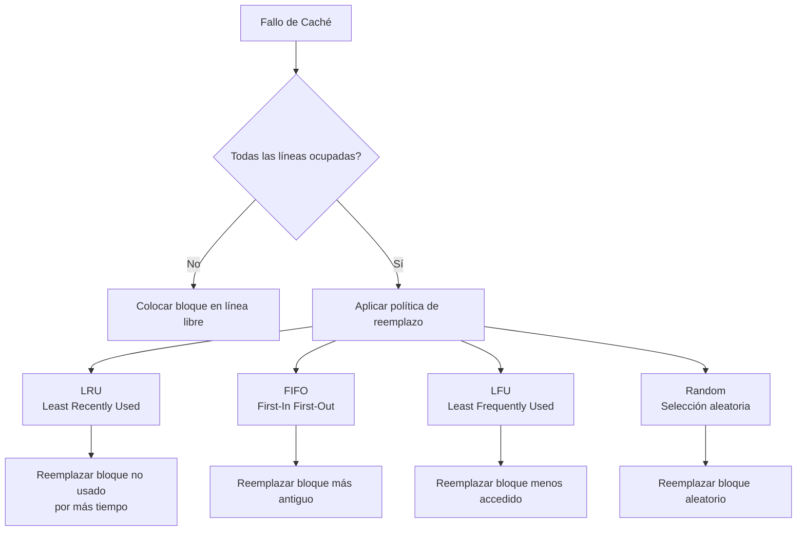
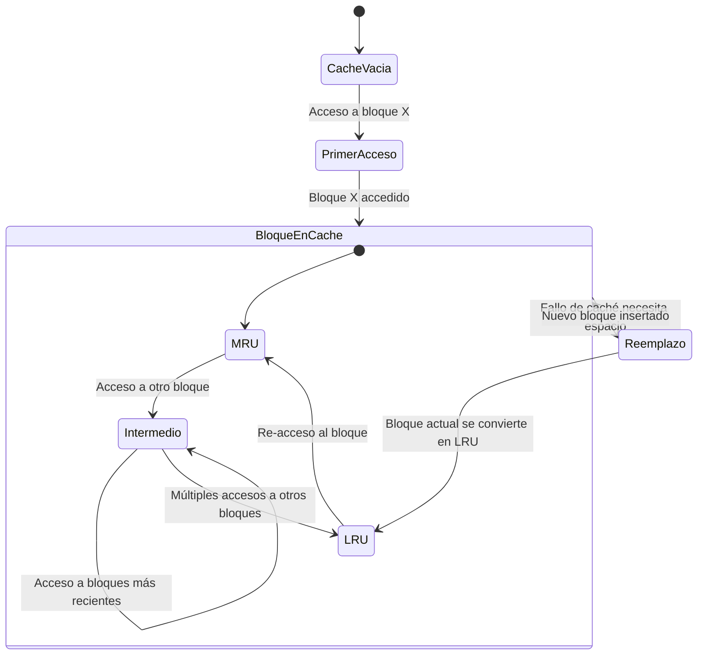

# Organización y Arquitectura de Computadoras - La jerarquía de memoria

## 9.3 Políticas de reemplazo de bloque en los caches

---

Las políticas de reemplazo determinan qué bloque debe ser eliminado de la caché cuando ocurre un fallo y todas las líneas están ocupadas. Esta decisión crítica afecta directamente la tasa de aciertos y el rendimiento general del sistema de memoria.

### Conceptos Fundamentales

#### Objetivo de las Políticas de Reemplazo

Maximizar la tasa de aciertos minimizando el número de reemplazos futuros necesarios.

#### Tasa de aciertos (Hit Rate)

$$
H = \frac{N_{\text{aciertos}}}{N_{\text{accesos}}} \times 100\%
$$

#### Tasa de fallos (Miss Rate)

$$
M = 1 - H = \frac{N_{\text{fallos}}}{N_{\text{accesos}}} \times 100\%
$$

### Políticas de Reemplazo Principales

#### 1. Least Recently Used (LRU)

Reemplaza el bloque que no ha sido accedido por más tiempo.

**Ventajas:**

- Alto rendimiento en la mayoría de casos
- Explota el principio de localidad temporal

**Desventajas:**

- Alta complejidad de implementación
- Costoso en hardware para altos grados de asociatividad

#### 2. First-In First-Out (FIFO)

Reemplaza el bloque que lleva más tiempo en la caché.

**Ventajas:**

- Simple de implementar
- Bajo costo hardware

**Desventajas:**

- Puede desalojar bloques frecuentemente usados
- Bajo rendimiento en patrones de acceso cíclicos

#### 3. Least Frequently Used (LFU)

Reemplaza el bloque con menor número de accesos.

**Ventajas:**

- Bueno para cargas de trabajo con accesos muy desbalanceados

**Desventajas:**

- Requiere contadores adicionales
- Puede mantener bloques "populares" obsoletos

#### 4. Random

Selecciona aleatoriamente un bloque para reemplazar.

**Ventajas:**

- Muy simple de implementar
- Sin overhead de mantenimiento de estado

**Desventajas:**

- Rendimiento impredecible
- Puede desalojar bloques importantes

### Diagrama de Políticas de Reemplazo



### Implementación de Políticas

#### Implementación de LRU con Contadores

```python
class LRUCache:
    def __init__(self, size):
        self.size = size
        self.cache = {}
        self.counter = 0
        self.access_time = {}

    def access(self, key):
        self.counter += 1

        if key in self.cache:
            # Actualizar tiempo de acceso
            self.access_time[key] = self.counter
            return True  # Hit
        else:
            # Miss: necesidad de reemplazo si caché llena
            if len(self.cache) >= self.size:
                # Encontrar la clave con el tiempo de acceso más antiguo
                lru_key = min(self.access_time, key=self.access_time.get)
                del self.cache[lru_key]
                del self.access_time[lru_key]

            # Insertar nuevo bloque
            self.cache[key] = True
            self.access_time[key] = self.counter
            return False  # Miss
```

#### Implementación de FIFO

```python
class FIFOCache:
    def __init__(self, size):
        self.size = size
        self.cache = set()
        self.queue = deque()

    def access(self, key):
        if key in self.cache:
            return True  # Hit
        else:
            if len(self.cache) >= self.size:
                # Eliminar el elemento más antiguo
                oldest = self.queue.popleft()
                self.cache.remove(oldest)

            # Insertar nuevo elemento
            self.cache.add(key)
            self.queue.append(key)
            return False  # Miss
```

### Ejemplos de Comportamiento

#### Ejemplo 1: Patrón de Acceso Secuencial

```
Accesos: A, B, C, D, A, B, C, D (Caché de 3 elementos)
```

**LRU:**

- A, B, C (Miss, Miss, Miss)
- D reemplaza a C (Miss)
- A reemplaza a D (Miss)
- B reemplaza a A (Miss)
- **Tasa de aciertos: 0%**

**FIFO:**

- A, B, C (Miss, Miss, Miss)
- D reemplaza a A (Miss)
- A reemplaza a B (Miss)
- B reemplaza a C (Miss)
- **Tasa de aciertos: 0%**

#### Ejemplo 2: Patrón con Localidad

```
Accesos: A, B, A, C, A, B, D (Caché de 2 elementos)
```

**LRU:**

- A, B (Miss, Miss)
- A (Hit)
- C reemplaza a B (Miss)
- A (Hit)
- B reemplaza a C (Miss)
- D reemplaza a B (Miss)
- **Tasa de aciertos: 28.6%**

**FIFO:**

- A, B (Miss, Miss)
- A (Hit)
- C reemplaza a A (Miss)
- A reemplaza a B (Miss)
- B reemplaza a A (Miss)
- D reemplaza a B (Miss)
- **Tasa de aciertos: 14.3%**

### Algoritmos Avanzados de Reemplazo

#### Algorithm 2Q

Combina LRU y FIFO usando dos colas:

- Una cola FIFO para elementos accedidos una vez
- Una cola LRU para elementos accedidos múltiples veces

#### ARC (Adaptive Replacement Cache)

Adapta dinámicamente entre recency y frequency:

- Mantiene dos listas: T1 (recencia) y T2 (frecuencia)
- Ajusta automáticamente el tamaño de las listas

### Ejercicios Propuestos

#### Ejercicio 1: Simulación de Políticas

Simule el siguiente patrón de acceso en una caché de 4 líneas usando LRU, FIFO y LFU:

```
A, B, C, D, A, E, B, A, D, F, C, G
```

Calcule:

1. Número de fallos para cada política
2. Tasa de aciertos para cada política
3. Identifique qué política funciona mejor para este patrón

#### Ejercicio 2: Análisis de Overhead

Para una caché 4-way set associative de 64KB con bloques de 64 bytes:

1. Calcule el número de bits adicionales necesarios para implementar LRU
2. Compare con el overhead de implementar FIFO
3. ¿Qué porcentaje del área total representa este overhead?

#### Ejercicio 3: Diseño de Política Híbrida

Diseñe una política que combine LRU y LFU:

1. Especifique cómo decidiría cuándo usar cada estrategia
2. Describa la implementación hardware necesaria
3. Evalúe ventajas y desventajas

#### Ejercicio 4: Análisis de Patrones

Para los siguientes patrones de acceso, determine qué política de reemplazo sería más efectiva:

1. Acceso secuencial a un array grande: A1, A2, A3, ..., An
2. Acceso aleatorio uniforme
3. Acceso a bucles anidados pequeños
4. Patrones con periodos de reuso largo

### Diagrama de Estados para Política LRU



### Métricas de Evaluación

#### Miss Rate por Tipo de Fallo

- **Compulsorio**: Primer acceso a un bloque
- **Capacidad**: Caché demasiado pequeña para el working set
- **Conflicto**: Mapeo subóptimo debido a la política de colocación

#### Penalización de Fallos

$$
\text{Penalización} = T_{\text{memoria}} - T_{\text{caché}}
$$

#### Tiempo de Acceso Efectivo

$$
T_{\text{efectivo}} = H \times T_{\text{caché}} + (1 - H) \times (T_{\text{caché}} + T_{\text{penalización}})
$$

### Optimizaciones Avanzadas

#### Write Policies

- **Write-through**: Escribir simultáneamente en caché y memoria
- **Write-back**: Escribir sólo en caché, actualizar memoria posteriormente

#### Prefetching

Anticipar y cargar bloques antes de que sean solicitados

#### Victim Caches

Pequeña caché totalmente asociativa que almacena bloques recientemente desalojados

### Referencias

#### Bibliografía Básica

1. Hennessy, John L. y David A. Patterson. _Computer Architecture: A Quantitative Approach_, 4a Ed. Morgan Kaufmann, 2006. (Capítulo 5: Memory Hierarchy Design)
2. Patterson, David A. y John L. Hennessy. _Computer Organization and Design: The Hardware/Software Interface_, 4a Ed. Morgan Kaufmann, 2008. (Capítulo 7: Large and Fast: Exploiting Memory Hierarchy)

#### Bibliografía Complementaria

1. Stallings, William. _Computer Organization and Architecture: Designing for Performance_, Prentice Hall - Pearson, 2009. (Capítulo 4: Cache Memory)
2. Tanenbaum, Andrew S. _Structured Computer Organization_, 5a Ed. Prentice Hall, 2005. (Capítulo 4: The Microarchitecture Level)

### Conclusión

La selección de la política de reemplazo óptima depende del patrón de acceso de la aplicación, el grado de asociatividad de la caché y las restricciones de hardware. Mientras LRU generalmente ofrece el mejor rendimiento para la mayoría de cargas de trabajo, su implementación puede ser costosa para cachés altamente asociativas. Políticas más simples como FIFO o Random pueden ser preferibles en contextos donde la simplicidad y el bajo costo son prioritarios. Las políticas adaptativas modernas como ARC intentan combinar lo mejor de múltiples enfoques para lograr un rendimiento robusto across diversas cargas de trabajo.
