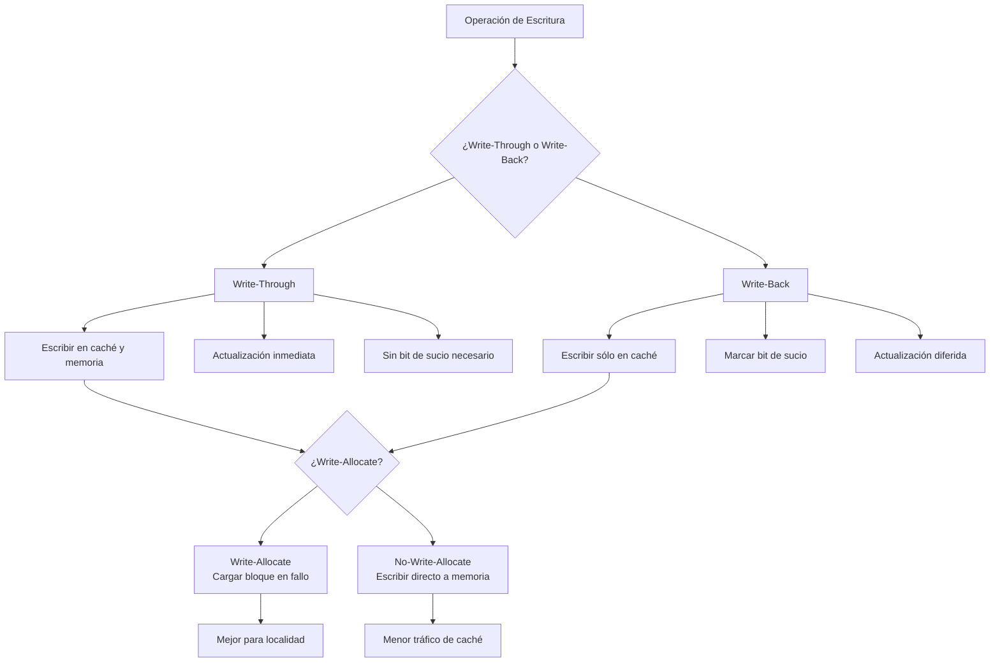
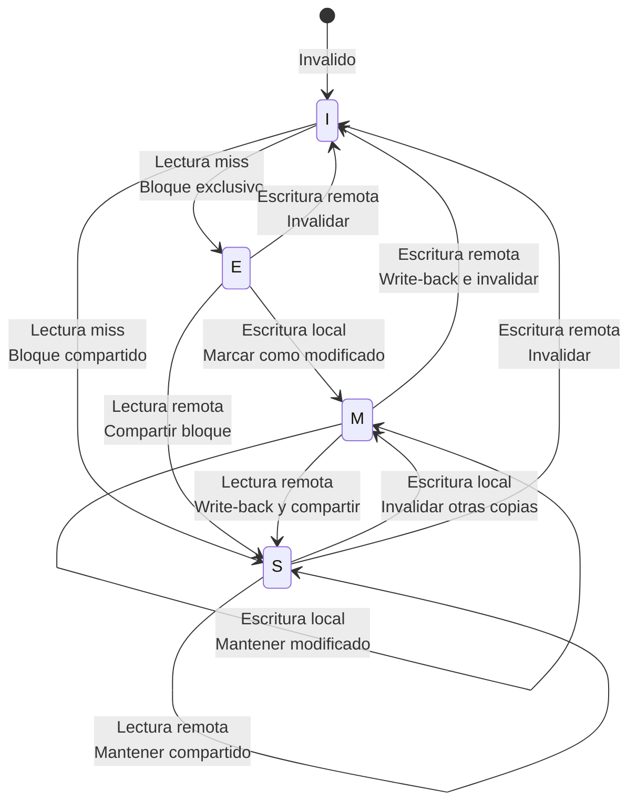

# Organización y Arquitectura de Computadoras - La jerarquía de memoria

## 9.4 Manejo de escrituras en el cache

---

El manejo de escrituras en la caché es un aspecto crítico del diseño de la jerarquía de memoria que determina cómo se gestionan las operaciones de escritura, asegurando la consistencia de datos entre la caché y la memoria principal mientras se maximiza el rendimiento.

### Conceptos Fundamentales

#### Políticas de Escritura Principales

##### Write-Through (Escritura Directa)

Cada escritura se realiza simultáneamente en la caché y en la memoria principal.

**Ventajas:**

- Simplicidad de implementación
- Consistencia garantizada
- Tolerancia a fallos

**Desventajas:**

- Alto ancho de banda requerido
- Mayor latencia de escritura

##### Write-Back (Escritura Diferida)

Las escrituras se realizan sólo en la caché inicialmente. La memoria principal se actualiza sólo cuando el bloque es reemplazado.

**Ventajas:**

- Menor ancho de banda requerido
- Mayor rendimiento
- Reducción de consumo energético

**Desventajas:**

- Mayor complejidad
- Riesgo de inconsistencia
- Necesidad de bits de "sucio" (dirty bits)

#### Bits de Estado en Caché

Cada línea de caché requiere bits adicionales:

- **Bit de validez (Valid bit)**: Indica si el dato en caché es válido
- **Bit de sucio (Dirty bit)**: Indica si el bloque ha sido modificado (sólo en write-back)

### Fórmulas y Métricas

#### Ancho de Banda Requerido para Write-Through

$$
BW_{wt} = N_{escrituras} \times T_{\text{tamaño}} \times (1 + R_{write-allocate})
$$

#### Ancho de Banda Requerido para Write-Back

$$
BW_{wb} = N_{reemplazos} \times T_{\text{tamaño}} \times R_{dirty}
$$

Donde $R_{dirty}$ es la tasa de bloques modificados.

#### Tiempo Promedio de Acceso con Escrituras

$$
T_{avg} = R \times T_{read} + W \times T_{write}
$$

Donde:

- $R$ = Fracción de lecturas
- $W$ = Fracción de escrituras $(W = 1 - R)$
- $T_{read}$ = Tiempo de lectura
- $T_{write}$ = Tiempo de escritura

### Políticas de Asignación en Escrituras

#### Write-Allocate (Asignación en Escritura)

Cuando ocurre un fallo de escritura:

1. Se carga el bloque desde memoria principal
2. Se realiza la escritura en la caché
3. Se actualiza el bit de sucio si es write-back

#### No-Write-Allocate (Sin Asignación en Escritura)

Cuando ocurre un fallo de escritura:

1. La escritura se realiza directamente en memoria principal
2. El bloque no se carga en caché

### Diagrama de Políticas de Escritura



### Implementación de Políticas

#### Implementación de Write-Back con Dirty Bits

```python
class WriteBackCache:
    def __init__(self, size, block_size):
        self.size = size
        self.block_size = block_size
        self.num_blocks = size // block_size
        self.cache = [None] * self.num_blocks
        self.tags = [-1] * self.num_blocks
        self.valid = [False] * self.num_blocks
        self.dirty = [False] * self.num_blocks
        self.access_count = 0

    def write(self, address, data):
        self.access_count += 1
        index = self.get_index(address)
        tag = self.get_tag(address)

        if self.valid[index] and self.tags[index] == tag:
            # Write hit
            self.cache[index] = data
            self.dirty[index] = True
            return True
        else:
            # Write miss - implement write-allocate
            self.handle_write_miss(address, index, tag, data)
            return False

    def handle_write_miss(self, address, index, tag, data):
        # Check if block needs to be evicted
        if self.valid[index] and self.dirty[index]:
            self.write_back(index)  # Write dirty block to memory

        # Load new block from memory (simulated)
        self.load_block_from_memory(address, index)
        self.cache[index] = data
        self.tags[index] = tag
        self.valid[index] = True
        self.dirty[index] = True

    def write_back(self, index):
        # Simulate writing back to memory
        print(f"Writing back block {index} to memory")
        self.dirty[index] = False

    def get_index(self, address):
        return (address // self.block_size) % self.num_blocks

    def get_tag(self, address):
        return address // (self.block_size * self.num_blocks)
```

#### Implementación de Write-Through

```python
class WriteThroughCache:
    def __init__(self, size, block_size):
        self.size = size
        self.block_size = block_size
        self.num_blocks = size // block_size
        self.cache = [None] * self.num_blocks
        self.tags = [-1] * self.num_blocks
        self.valid = [False] * self.num_blocks

    def write(self, address, data):
        index = self.get_index(address)
        tag = self.get_tag(address)

        if self.valid[index] and self.tags[index] == tag:
            # Write hit - update cache and memory
            self.cache[index] = data
            self.write_to_memory(address, data)  # Simultaneous write to memory
            return True
        else:
            # Write miss - no-write-allocate: write directly to memory
            self.write_to_memory(address, data)
            return False

    def write_to_memory(self, address, data):
        # Simulate writing to main memory
        print(f"Writing to memory at address {address}: {data}")

    def get_index(self, address):
        return (address // self.block_size) % self.num_blocks

    def get_tag(self, address):
        return address // (self.block_size * self.num_blocks)
```

### Ejemplos y Casos de Estudio

#### Ejemplo 1: Patrón de Acceso con Alta Localidad

```
Escrituras: A, B, A, C, A, B, D
```

**Write-Back con Write-Allocate:**

- 4 escrituras en caché, 1 write-back al final
- **Ventaja**: Sólo 1 transferencia a memoria

**Write-Through:**

- 7 escrituras directas a memoria
- **Desventaja**: 7 transferencias a memoria

#### Ejemplo 2: Buffer de Escritura (Write Buffer)

Para reducir la penalización de write-through:

```python
class WriteBuffer:
    def __init__(self, size):
        self.buffer = deque(maxlen=size)
        self.size = size

    def add_write(self, address, data):
        if len(self.buffer) >= self.size:
            self.flush()  # Buffer lleno, vaciar a memoria
        self.buffer.append((address, data))

    def flush(self):
        while self.buffer:
            address, data = self.buffer.popleft()
            self.write_to_memory(address, data)
```

### Ejercicios Propuestos

#### Ejercicio 1: Análisis de Rendimiento

Compare el rendimiento de write-through vs write-back para los siguientes patrones:

1. 80% lecturas, 20% escrituras, 10% tasa de fallos
2. 50% lecturas, 50% escrituras, 5% tasa de fallos
3. 20% lecturas, 80% escrituras, 15% tasa de fallos

Asuma:

- Tiempo de acceso a caché: 2 ns
- Tiempo de acceso a memoria: 60 ns
- Tiempo de write-back: 70 ns (incluye actualización)

#### Ejercicio 2: Diseño de Política Híbrida

Diseñe una política que use write-back para datos con alta localidad y write-through para datos críticos:

1. Especifique los criterios de decisión
2. Describa la implementación hardware necesaria
3. Calcule el overhead de estado adicional

#### Ejercicio 3: Análisis de Buffer de Escritura

Para un sistema con write-through y buffer de escritura de 4 entradas:

1. Simule el patrón: W(A), W(B), W(C), W(D), W(E), W(A)
2. Calcule el número de operaciones de memoria
3. Determine el tamaño óptimo del buffer

#### Ejercicio 4: Consistencia en Sistemas Multiprocesador

Analice los desafíos de coherencia de caché en un sistema quad-core:

1. Describa el protocolo MESI (Modified, Exclusive, Shared, Invalid)
2. Implemente una simulación básica de estados de coherencia
3. Calcule el overhead de comunicación entre núcleos

### Diagrama de Estados de Coherencia MESI



### Optimizaciones Avanzadas

#### Write Combining

Combinar múltiples escrituras consecutivas al mismo bloque antes de escribirlo a memoria.

#### Non-Temporal Writes

Escrituras que bypass la caché para datos que no serán reutilizados.

#### Critical Word First

Transferir primero la palabra crítica (la solicitada) y luego el resto del bloque.

### Métricas de Evaluación

#### Traffic Ratio

$$
\text{Traffic Ratio} = \frac{\text{Bytes transferidos con política}}{\text{Bytes transferidos con write-through}}
$$

#### Write Traffic

$$
\text{Write Traffic} = W \times (1 + R_{wa} \times M_{write})
$$

Donde:

- $W$ = Número de escrituras
- $R_{wa}$ = 1 si write-allocate, 0 si no
- $M_{write}$ = Tasa de fallos de escritura

### Referencias

#### Bibliografía Básica

1. Hennessy, John L. y David A. Patterson. _Computer Architecture: A Quantitative Approach_, 4a Ed. Morgan Kaufmann, 2006. (Capítulo 5: Memory Hierarchy Design)
2. Patterson, David A. y John L. Hennessy. _Computer Organization and Design: The Hardware/Software Interface_, 4a Ed. Morgan Kaufmann, 2008. (Capítulo 7: Large and Fast: Exploiting Memory Hierarchy)

#### Bibliografía Complementaria

1. Stallings, William. _Computer Organization and Architecture: Designing for Performance_, Prentice Hall - Pearson, 2009. (Capítulo 4: Cache Memory)
2. Tanenbaum, Andrew S. _Structured Computer Organization_, 5a Ed. Prentice Hall, 2005. (Capítulo 4: The Microarchitecture Level)

### Conclusión

El manejo de escrituras en la caché es un compromiso entre consistencia, rendimiento y complejidad. Write-through ofrece simplicidad y consistencia a costa de mayor tráfico de memoria, mientras que write-back proporciona mejor rendimiento pero requiere mecanismos adicionales para mantener la consistencia. La elección óptima depende del patrón de acceso de la aplicación, los requisitos de consistencia del sistema y las restricciones de hardware. Las optimizaciones modernas como write buffers, write combining y protocolos de coherencia sofisticados permiten maximizar el rendimiento mientras se mantiene la corrección del sistema.
