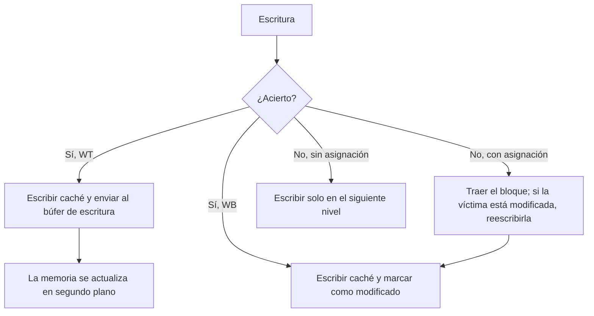

# Organización y Arquitectura de Computadoras - La jerarquía de memoria

## 9.4 Manejo de escrituras en el cache

---

Las lecturas son la mayoría de los accesos a memoria y se manejan con facilidad: se puede leer el dato de la caché a la vez que se compara la etiqueta, y si resulta ser un fallo, se descarta. Las escrituras son más delicadas: modifican el estado, no se pueden hacer especulativamente, y dejan la caché y la memoria con valores distintos. Este tema estudia las dos decisiones que hay que tomar (qué hacer en un acierto de escritura y qué hacer en un fallo), los **búferes de escritura** que ocultan la latencia de la memoria, y compara cuantitativamente las alternativas.

### Escritura en un acierto

**Escritura inmediata** (_write-through_, WT): cada escritura actualiza la caché **y** la memoria (o el siguiente nivel).

- La memoria siempre está actualizada: un bloque expulsado nunca hay que reescribirlo, y la coherencia con otros procesadores y con la E/S es más sencilla.
- Cada escritura genera tráfico hacia la memoria. Sin ayuda, el procesador tendría que esperar a la memoria en cada escritura.

**Escritura diferida** (_write-back_, WB): la escritura solo modifica la caché, y se marca el bloque con un **bit de modificado** (_dirty_). El bloque se escribe en memoria solo cuando se **expulsa** y está modificado.

- Las escrituras se hacen a la velocidad de la caché, y varias escrituras al mismo bloque se combinan en una sola reescritura: mucho menos tráfico.
- Los fallos pueden ser más costosos (hay que reescribir la víctima antes o en paralelo con la lectura del bloque nuevo), y la memoria puede tener datos obsoletos.

### Escritura en un fallo

- **Asignación en escritura** (_write allocate_): se trae el bloque a la caché y luego se escribe, como si fuera un acierto. Aprovecha la localidad si el bloque se vuelve a usar.
- **Sin asignación** (_no-write allocate_ o _write around_): se escribe directamente en el siguiente nivel sin traer el bloque. Evita llenar la caché con datos que solo se escriben, como al inicializar un arreglo grande.

La combinación habitual es **WB con asignación** (casi todas las cachés L1 de datos, L2 y L3 actuales) y **WT sin asignación** (algunas L1 sencillas, y cachés de procesadores empotrados).

### Búferes de escritura

En WT, un **búfer de escritura** guarda las escrituras pendientes: el procesador deposita la escritura en el búfer en un ciclo y sigue trabajando, mientras el búfer las envía a la memoria a su ritmo. Solo hay detención si el búfer está **lleno**, lo que pasa si la tasa de escrituras supera la capacidad de la memoria durante un tiempo. Los búferes con **fusión** (_write merging_) combinan escrituras a la misma línea en una entrada. En WB también se usa un búfer para guardar los bloques modificados expulsados y leer primero el bloque nuevo.

Atención: si una lectura busca una dirección que está en el búfer, debe tomar el dato del búfer (o esperar a que se vacíe), o leería un valor viejo de la memoria.



### Comparación cuantitativa

Con tiempo de caché $t_c,$ de memoria $t_m,$ reescritura de un bloque $t_{wb},$ tasa de fallos $m,$ fracciones de lecturas $f_l$ y escrituras $f_e,$ y fracción $d$ de víctimas modificadas:

$$ T_{\text{WT}} = f_l (t_c + m\, t_m) + f_e\, t_m \qquad \text{(sin búfer y sin asignación)} $$

$$ T_{\text{WB}} = t_c + m\,(t_m + d\, t_{wb}) \qquad \text{(con asignación)} $$

Sin búfer, la escritura inmediata paga la memoria en cada escritura, y es mucho peor cuando hay muchas escrituras. Un búfer suficiente hace que $f_e\, t_m$ casi desaparezca del tiempo del procesador, pero no del **tráfico** con la memoria, que es lo que limita a los multiprocesadores.

### Implementación en Python

El programa evalúa el modelo anterior para los tres casos del ejercicio 1, mide con el simulador de caché del tema 9.1 el tráfico con la memoria de las tres combinaciones en un bucle que actualiza varias veces un arreglo, y simula el búfer de escritura del ejercicio 3 con distintos tamaños.

```python
# Simulador de caché asociativa por conjuntos con políticas de reemplazo y de escritura
from collections import OrderedDict


class Cache:
    def __init__(self, tam, linea, vias, reemplazo="LRU", escritura="WB", asignar_en_escritura=True):
        self.linea, self.vias = linea, vias
        self.conjuntos = tam // (linea * vias)
        self.reemplazo, self.escritura, self.asignar = reemplazo, escritura, asignar_en_escritura
        self.sets = [OrderedDict() for _ in range(self.conjuntos)]   # etiqueta -> [sucio, usos]
        self.aciertos = self.fallos = self.escrituras_mem = self.lecturas_mem = 0

    def partir(self, dir_):
        bloque = dir_ // self.linea
        return bloque // self.conjuntos, bloque % self.conjuntos, dir_ % self.linea   # etiqueta, índice, desplazamiento

    def _victima(self, s):
        if self.reemplazo == "LFU":
            return min(s, key=lambda e: s[e][1])        # el menos usado (empate: el más antiguo)
        return next(iter(s))                            # LRU y FIFO: el primero del orden

    def acceso(self, dir_, escribir=False):
        etiqueta, i, _ = self.partir(dir_)
        s = self.sets[i]
        if etiqueta in s:
            self.aciertos += 1
            s[etiqueta][1] += 1
            if self.reemplazo == "LRU":
                s.move_to_end(etiqueta)
            if escribir:
                if self.escritura == "WT":
                    self.escrituras_mem += 1
                else:
                    s[etiqueta][0] = True
            return True
        self.fallos += 1
        if escribir and not self.asignar:               # sin asignación: se escribe directo en memoria
            self.escrituras_mem += 1
            return False
        if len(s) >= self.vias:
            v = self._victima(s)
            if s[v][0]:
                self.escrituras_mem += 1                # reescritura del bloque sucio
            del s[v]
        self.lecturas_mem += 1
        s[etiqueta] = [False, 1]
        if escribir:
            if self.escritura == "WT":
                self.escrituras_mem += 1
            else:
                s[etiqueta][0] = True
        return False

    def tasa(self):
        return self.aciertos / (self.aciertos + self.fallos)


# Ejercicio 1: modelo analítico con t_c = 2 ns, t_m = 60 ns y reescritura de un bloque sucio = 70 ns.
# Write-through sin asignación y sin búfer: cada escritura espera a la memoria.
# Write-back con asignación: un fallo trae el bloque y, si la víctima está sucia (probabilidad d), la reescribe.
tc, tm, twb = 2, 60, 70
casos = [(0.8, 0.2, 0.10), (0.5, 0.5, 0.05), (0.2, 0.8, 0.15)]
for lect, escr, m in casos:
    wt = lect * (tc + m * tm) + escr * tm
    d = escr                                  # supuesto: fracción de víctimas sucias = fracción de escrituras
    wb = tc + m * (tm + d * twb)
    print(f"ejercicio 1: {lect:.0%} lecturas, {escr:.0%} escrituras, {m:.0%} fallos:"
          f" WT = {wt:5.2f} ns, WB = {wb:5.2f} ns por acceso")

# Tráfico con memoria medido con el simulador: un bucle que actualiza un arreglo varias veces
def trafico(escritura, asignar):
    c = Cache(4096, 64, 4, escritura=escritura, asignar_en_escritura=asignar)
    for _ in range(10):                       # 10 pasadas sobre un arreglo de 2 KiB (cabe en la caché)
        for k in range(0, 2048, 4):
            c.acceso(k)                       # leer x[k]
            c.acceso(k, escribir=True)        # escribir x[k]
    for k in range(65536, 65536 + 8192, 64):  # al final se barre otra zona y se expulsa todo
        c.acceso(k)
    return c.lecturas_mem, c.escrituras_mem


for esc, asig, nombre in (("WT", False, "write-through sin asignación"), ("WT", True, "write-through con asignación"),
                          ("WB", True, "write-back con asignación")):
    l, e = trafico(esc, asig)
    print(f"{nombre:30s}: {l:5d} bloques leídos, {e:5d} escrituras a memoria")


# Ejercicio 3: búfer de escritura de 4 entradas con fusión; la memoria retira una entrada cada 3 ciclos
def bufer(escrituras, entradas=4, ciclos_memoria=3, fusionar=True):
    cola, t, detenciones, a_memoria, libre_en = [], 0, 0, 0, 0
    for w in escrituras:
        t += 1
        while cola and libre_en <= t:         # la memoria terminó una escritura
            cola.pop(0); a_memoria += 1
            libre_en = libre_en + ciclos_memoria if cola else t + ciclos_memoria
        if fusionar and w in cola:
            continue
        if len(cola) == entradas:             # búfer lleno: el procesador espera
            espera = libre_en - t
            detenciones += espera
            t = libre_en
            cola.pop(0); a_memoria += 1
            libre_en = t + ciclos_memoria
        if not cola:
            libre_en = t + ciclos_memoria
        cola.append(w)
    return detenciones, a_memoria + len(cola)


patron = ["A", "B", "C", "D", "E", "A"]
for tam in (1, 2, 4, 8):
    det, mem = bufer(patron, tam)
    print(f"ejercicio 3, búfer de {tam} entrada{'s' if tam > 1 else ''}: {det} ciclos de detención, {mem} escrituras a memoria")
det, mem = bufer(patron, 4, fusionar=False)
print(f"   4 entradas sin fusión de escrituras: {det} ciclos de detención, {mem} escrituras a memoria")
```

Salida:

```text
ejercicio 1: 80% lecturas, 20% escrituras, 10% fallos: WT = 18.40 ns, WB =  9.40 ns por acceso
ejercicio 1: 50% lecturas, 50% escrituras, 5% fallos: WT = 32.50 ns, WB =  6.75 ns por acceso
ejercicio 1: 20% lecturas, 80% escrituras, 15% fallos: WT = 50.20 ns, WB = 19.40 ns por acceso
write-through sin asignación  :   160 bloques leídos,  5120 escrituras a memoria
write-through con asignación  :   160 bloques leídos,  5120 escrituras a memoria
write-back con asignación     :   160 bloques leídos,    32 escrituras a memoria
ejercicio 3, búfer de 1 entrada: 10 ciclos de detención, 6 escrituras a memoria
ejercicio 3, búfer de 2 entradas: 7 ciclos de detención, 6 escrituras a memoria
ejercicio 3, búfer de 4 entradas: 1 ciclos de detención, 6 escrituras a memoria
ejercicio 3, búfer de 8 entradas: 0 ciclos de detención, 6 escrituras a memoria
   4 entradas sin fusión de escrituras: 1 ciclos de detención, 6 escrituras a memoria
```

En el bucle que actualiza 10 veces un arreglo que cabe en la caché, la escritura inmediata envía 5120 escrituras a la memoria; la diferida solo 32, una por línea modificada cuando finalmente se expulsa.

### Ejercicios Propuestos

1. **Comparación.** Compara WT y WB para: 80 % lecturas, 20 % escrituras y 10 % de fallos; 50 % y 50 % con 5 % de fallos; 20 % y 80 % con 15 % de fallos. Caché de 2 ns, memoria de 60 ns, reescritura de 70 ns.

2. **Política híbrida.** Diseña una política que use WB para los datos con mucha localidad y WT para los datos que deben estar siempre actualizados en memoria (por ejemplo, compartidos con un dispositivo de E/S).

3. **Búfer de escritura.** Con WT y un búfer de 4 entradas, simula `W(A), W(B), W(C), W(D), W(E), W(A)`. ¿Cuántas escrituras llegan a la memoria? ¿Qué tamaño de búfer elimina las detenciones?

4. **Coherencia.** ¿Por qué la escritura diferida complica la coherencia en un multiprocesador?

### Soluciones

**Ejercicio 1.** Con el modelo del tema y $d = f_e:$ 18.4 frente a 9.4 ns; 32.5 frente a 6.75 ns; 50.2 frente a 19.4 ns. WB gana en los tres casos, y la ventaja crece con la proporción de escrituras. Con un búfer de escritura grande, WT se acercaría a $t_c + m\, t_m$ en las lecturas, siempre que la memoria pueda absorber el flujo de escrituras.

**Ejercicio 2.** Un bit por página en la tabla de páginas (o en registros de rangos de memoria) indica el modo de escritura, como hacen los atributos de memoria de x86 (_write-back_, _write-through_, _uncached_) y ARM. En cada escritura, la caché consulta ese atributo, que llega con la traducción de la TLB: si es WT, además de escribir la línea envía la escritura al búfer. El costo es un bit por entrada de la TLB y la lógica de selección; la línea sigue necesitando su bit de modificado para las páginas WB.

**Ejercicio 3.** Con la memoria retirando una entrada cada 3 ciclos, el búfer de 4 entradas se llena en el sexto acceso y hay 1 ciclo de detención; llegan 6 escrituras a la memoria, porque cuando se repite `A` la primera ya salió del búfer y no se puede fusionar. Con 8 entradas no hay detenciones. El tamaño adecuado depende de la longitud de las ráfagas de escrituras y de la velocidad de la memoria: si la tasa media de escrituras supera la que la memoria absorbe, ningún búfer basta.

**Ejercicio 4.** Con WB, el valor más reciente de un dato puede estar solo en la caché de un procesador, modificado y sin copia en memoria. Otro procesador que lea la memoria obtendría un valor viejo. Hace falta un protocolo de coherencia que localice al dueño de la línea y obtenga el dato de su caché (tema 9.5).

### Referencias

1. Hennessy, J. L., and Patterson, D. A., _Computer Architecture: A Quantitative Approach_. Morgan Kaufmann, 2019. Apéndice B y capítulo 2.
2. Patterson, D. A., and Hennessy, J. L., _Computer Organization and Design: The Hardware/Software Interface_. Morgan Kaufmann, 2020. Sección 5.3.
3. Jouppi, N. P., Cache write policies and performance. _ISCA_, 1993.
4. Stallings, W., _Organización y arquitectura de computadores_. Pearson, 2006. Capítulo 4.
