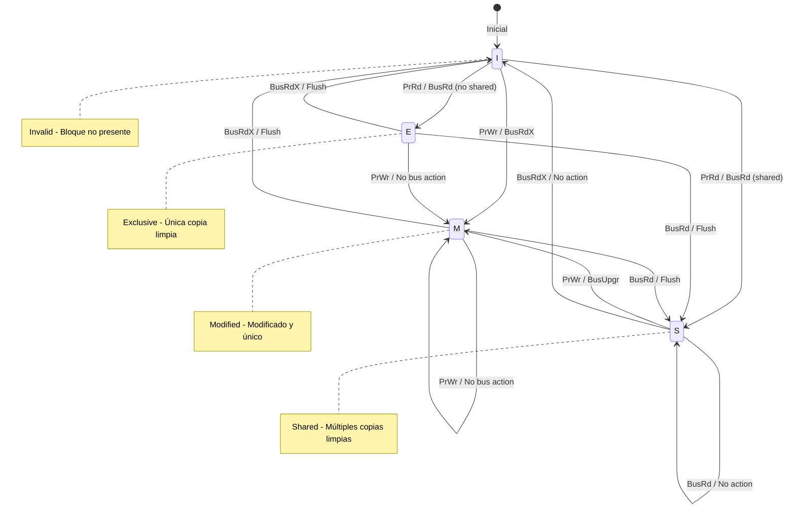
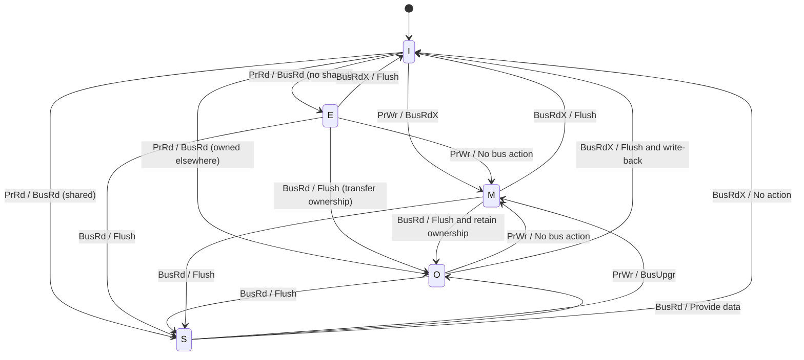

# Organización y Arquitectura de Computadoras - La jerarquía de memoria

## 9.5 Coherencia, conceptos y protocolos

---

La coherencia de memoria es un principio fundamental en sistemas multiprocesador que garantiza que todas las CPU tengan una vista consistente de los datos compartidos. Esta guía cubre los conceptos, protocolos y mecanismos que aseguran la coherencia en sistemas con múltiples cachés.

### Conceptos Fundamentales

#### Definición de Coherencia

Un sistema de memoria es coherente si para cualquier dirección de memoria, todos los procesadores observan la misma secuencia de operaciones de lectura y escritura.

#### Condiciones de Coherencia (Modelo de Coherencia)

1. **Preservación de orden de escritura**: Las escrituras de un procesador son vistas por otros en el mismo orden
2. **Propagación de escritura**: Las escrituras eventualmente se vuelven visibles para todos los procesadores
3. **Serialización de escrituras**: Las escrituras a una misma ubicación son serializadas

#### Problema de Coherencia

Surge cuando múltiples procesadores tienen copias de un mismo dato en sus cachés locales y alguno realiza una modificación.

### Fórmulas y Métricas

#### Tasa de Fallos de Coherencia

$$
\text{Coherence Miss Rate} = \frac{\text{Número de fallos por coherencia}}{\text{Número total de accesos}}
$$

#### Overhead de Tráfico de Coherencia

$$
\text{Coherence Traffic} = \sum_{i=1}^{n} (S_i + I_i + R_i)
$$

Donde:

- $S_i$ = Número de mensajes de sharing para el bloque $i$
- $I_i$ = Número de mensajes de invalidación para el bloque $i$
- $R_i$ = Número de mensajes de respuesta para el bloque $i$

#### Tiempo de Penalización por Coherencia

$$
T_{\text{coherence}} = T_{\text{invalidación}} + T_{\text{actualización}} + T_{\text{respuesta}}
$$

### Protocolos de Coherencia Principales

#### 1. Protocolos basados en Directorio

Centralizan la información de estado de los bloques en una estructura llamada directorio.

**Ventajas:**

- Escalables para muchos procesadores
- Reducen tráfico de broadcast

**Desventajas:**

- Mayor latencia para accesos remotos
- Punto central de potencial congestión

#### 2. Protocolos de Snooping (Vigilancia)

Cachés monitorean el bus de memoria para detectar operaciones que puedan afectar la coherencia.

**Ventajas:**

- Baja latencia para accesos locales
- Implementación más simple

**Desventajas:**

- No escalan bien para muchos procesadores
- Alto tráfico en el bus

### Protocolo MESI (Modified, Exclusive, Shared, Invalid)

#### Estados MESI

- **Modified (M)**: El bloque es modificado y sólo esta caché tiene una copia válida
- **Exclusive (E)**: El bloque es limpio y sólo esta caché tiene una copia
- **Shared (S)**: El bloque es limpio y múltiples cachés pueden tener copias
- **Invalid (I)**: El bloque no es válido o no está presente

#### Transiciones del Protocolo MESI



### Implementación del Protocolo MESI

```python
class MESICache:
    def __init__(self, cache_id, size, block_size):
        self.cache_id = cache_id
        self.size = size
        self.block_size = block_size
        self.num_blocks = size // block_size
        self.blocks = [{
            'tag': -1,
            'state': 'I',  # I, S, E, M
            'data': None,
            'dirty': False
        } for _ in range(self.num_blocks)]
        self.bus = None  # Bus compartido
        self.access_stats = {'hits': 0, 'misses': 0, 'invalidations': 0}

    def set_bus(self, bus):
        self.bus = bus

    def read(self, address):
        index, tag = self._decode_address(address)
        block = self.blocks[index]

        if block['tag'] == tag and block['state'] != 'I':
            # Read hit
            self.access_stats['hits'] += 1
            return block['data']
        else:
            # Read miss
            self.access_stats['misses'] += 1
            return self._handle_read_miss(address, index, tag)

    def write(self, address, data):
        index, tag = self._decode_address(address)
        block = self.blocks[index]

        if block['tag'] == tag and block['state'] in ['M', 'E']:
            # Write hit with exclusive access
            block['data'] = data
            block['state'] = 'M'
            block['dirty'] = True
            self.access_stats['hits'] += 1
            return True
        elif block['tag'] == tag and block['state'] == 'S':
            # Write hit but shared - need to invalidate others
            self.bus.broadcast_invalidate(address, self.cache_id)
            block['data'] = data
            block['state'] = 'M'
            block['dirty'] = True
            self.access_stats['hits'] += 1
            return True
        else:
            # Write miss
            self.access_stats['misses'] += 1
            return self._handle_write_miss(address, index, tag, data)

    def _handle_read_miss(self, address, index, tag):
        # Broadcast read request on bus
        shared, data = self.bus.broadcast_read(address, self.cache_id)

        self.blocks[index]['tag'] = tag
        self.blocks[index]['data'] = data
        self.blocks[index]['state'] = 'S' if shared else 'E'
        self.blocks[index]['dirty'] = False
        return data

    def _handle_write_miss(self, address, index, tag, data):
        # Broadcast write request on bus (request for exclusive access)
        self.bus.broadcast_invalidate(address, self.cache_id)

        self.blocks[index]['tag'] = tag
        self.blocks[index]['data'] = data
        self.blocks[index]['state'] = 'M'
        self.blocks[index]['dirty'] = True
        return True

    def snoop(self, address, operation, requesting_cache):
        index, tag = self._decode_address(address)
        block = self.blocks[index]

        if block['tag'] != tag or block['state'] == 'I':
            return None  # No action needed

        if operation == 'READ':
            if block['state'] == 'M':
                # Write back to memory and transition to Shared
                self._write_back(address)
                block['state'] = 'S'
                return block['data']  # Provide data
            elif block['state'] == 'E':
                block['state'] = 'S'
                return block['data']  # Provide data
            elif block['state'] == 'S':
                return block['data']  # Already shared

        elif operation == 'INVALIDATE':
            if block['state'] in ['M', 'E', 'S']:
                if block['state'] == 'M':
                    self._write_back(address)
                block['state'] = 'I'
                self.access_stats['invalidations'] += 1
                return True

        return None

    def _write_back(self, address):
        # Simulate writing back to memory
        index, tag = self._decode_address(address)
        block = self.blocks[index]
        if block['dirty']:
            print(f"Cache {self.cache_id}: Writing back address {address}")
            block['dirty'] = False

    def _decode_address(self, address):
        index = (address // self.block_size) % self.num_blocks
        tag = address // (self.block_size * self.num_blocks)
        return index, tag
```

### Protocolo MOESI (Modified, Owned, Exclusive, Shared, Invalid)

#### Extensión de MESI

- **Owned (O)**: Similar a Shared pero este caché es responsable de escribir back a memoria

#### Ventajas de MOESI

- Reduce el tráfico de write-back
- Mejora el rendimiento en sistemas con múltiples niveles de caché

#### Transiciones MOESI



### Ejemplos de Comportamiento

#### Ejemplo 1: Escenario de Falsa Compartición

```
CPU0: write to variable A (misma línea de caché que B)
CPU1: write to variable B (misma línea de caché que A)
```

**Problema**: Invalidaciones innecesarias aunque se acceda a variables diferentes.

**Solución**:

```c
// Estructura original con falsa compartición
struct {
    int variable_a;
    int variable_b;
} shared_data;

// Estructura con padding para evitar falsa compartición
struct {
    int variable_a;
    char padding[64 - sizeof(int)];  // Rellenar hasta tamaño de línea de caché
    int variable_b;
} optimized_data;
```

#### Ejemplo 2: Patrón de Productor-Consumidor

```
CPU0 (Productor): write data, set flag
CPU1 (Consumidor): read flag, read data
```

**Requerimientos**:需要 adecuada sincronización y barreras de memoria para garantizar visibilidad.

### Ejercicios Propuestos

#### Ejercicio 1: Simulación de Protocolo MESI

Simule el siguiente secuencia de operaciones en un sistema dual-core:

- CPU0: Read A
- CPU1: Read A
- CPU0: Write A
- CPU1: Read A

Trace los estados MESI en cada caché y el tráfico del bus para cada operación.

#### Ejercicio 2: Análisis de Overhead

Para un sistema con 4 cores y caché L1 de 32KB por core (bloques de 64 bytes):

1. Calcule el overhead de almacenamiento para bits de estado MESI (2 bits por línea)
2. Estime el tráfico adicional del bus para mantenimiento de coherencia
3. Compare con el protocolo MOESI (3 bits por línea)

#### Ejercicio 3: Falsa Compartición

Analice un escenario donde 4 variables diferentes (a, b, c, d de 4 bytes cada una) se almacenan en la misma línea de caché de 64 bytes:

1. Calcule el número de invalidaciones innecesarias si cada CPU escribe a una variable diferente
2. Proponga una solución de padding/aliniación
3. Implemente la solución en código C

#### Ejercicio 4: Protocolos en Sistemas Heterogéneos

Diseñe un protocolo de coherencia para un sistema con:

- 2 CPU cores con cachés coherentes
- 1 GPU con memoria propia
- 1 DMA controller

Considere los diferentes requisitos de latencia y ancho de banda.

### Optimizaciones Avanzadas

#### Directory-Based Coherence

```python
class Directory:
    def __init__(self, memory_size, block_size):
        self.entries = [{
            'state': 'UNCACHED',  # UNCACHED, SHARED, EXCLUSIVE
            'owners': set(),
            'sharers': set(),
            'dirty': False
        } for _ in range(memory_size // block_size)]

    def handle_request(self, cache_id, address, request_type):
        block_idx = address // block_size
        entry = self.entries[block_idx]

        if request_type == 'READ':
            if entry['state'] == 'EXCLUSIVE':
                # Need to downgrade owner to shared
                self._downgrade_to_shared(entry['owners'], address)
            entry['sharers'].add(cache_id)
            entry['state'] = 'SHARED'
            return 'SHARED'

        elif request_type == 'WRITE':
            # Invalidate all sharers if any
            if entry['sharers']:
                self._invalidate(entry['sharers'], address)
            entry['sharers'] = {cache_id}
            entry['owners'] = {cache_id}
            entry['state'] = 'EXCLUSIVE'
            entry['dirty'] = True
            return 'EXCLUSIVE'
```

#### Token Coherence

Protocolo que usa tokens para controlar acceso a bloques, evitando broadcast.

### Métricas de Evaluación

#### Coherence Miss Classification

- **True sharing misses**: Fallos debido a compartición legítima
- **False sharing misses**: Fallos debido a compartición artificial

#### Traffic Efficiency

$$
\text{Traffic Efficiency} = \frac{\text{Useful Data Transfers}}{\text{Total Bus Transactions}}
$$

#### Scalability Analysis

$$
\text{Scalability Factor} = \frac{\text{Performance with N cores}}{\text{N} \times \text{Performance with 1 core}}
$$

### Referencias

#### Bibliografía Básica

1. Hennessy, John L. y David A. Patterson. _Computer Architecture: A Quantitative Approach_, 4a Ed. Morgan Kaufmann, 2006. (Capítulo 5: Memory Hierarchy Design)
2. Patterson, David A. y John L. Hennessy. _Computer Organization and Design: The Hardware/Software Interface_, 4a Ed. Morgan Kaufmann, 2008. (Capítulo 7: Large and Fast: Exploiting Memory Hierarchy)

#### Bibliografía Complementaria

1. Stallings, William. _Computer Organization and Architecture: Designing for Performance_, Prentice Hall - Pearson, 2009. (Capítulo 17: Parallel Processing)
2. Tanenbaum, Andrew S. _Structured Computer Organization_, 5a Ed. Prentice Hall, 2005. (Capítulo 8: Parallel Computer Architectures)

### Conclusión

Los protocolos de coherencia son esenciales para mantener la consistencia en sistemas multiprocesador. MESI proporciona un balance entre complejidad y rendimiento, mientras que MOESI extiende esta funcionalidad para reducir el tráfico de memoria. La elección del protocolo adecuado depende de la arquitectura del sistema, el patrón de acceso a datos y los requisitos de escalabilidad. Las optimizaciones modernas como los protocolos basados en directorio y la coherencia de tokens permiten una mejor escalabilidad en sistemas con muchos núcleos, mientras que técnicas como el padding de datos ayudan a mitigar problemas como la falsa compartición.
