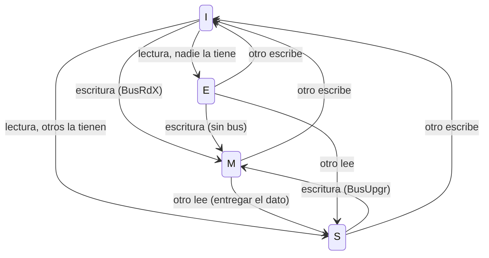

# Organización y Arquitectura de Computadoras - La jerarquía de memoria

## 9.5 Coherencia, conceptos y protocolos

---

En un multiprocesador con memoria compartida, cada núcleo tiene sus propias cachés, y un mismo dato puede estar copiado en varias. Si un núcleo lo modifica, los demás podrían seguir leyendo su copia vieja: es el **problema de la coherencia de cachés**. Este tema define formalmente qué es un sistema coherente, presenta los dos enfoques para mantenerlo (**fisgoneo** y **directorio**), estudia en detalle los protocolos de invalidación MSI, MESI y MOESI, y analiza un efecto de rendimiento muy común en programas paralelos: la **compartición falsa**.

### ¿Qué es un sistema coherente?

Un sistema de memoria es **coherente** si para cada posición de memoria:

1. **Orden del programa:** si un procesador escribe $X$ y luego lee $X,$ sin escrituras de otros en medio, lee lo que escribió.
2. **Propagación de las escrituras:** si un procesador escribe $X$ y otro lee $X$ suficientemente después, sin otras escrituras en medio, lee el valor escrito.
3. **Serialización de las escrituras:** dos escrituras a la misma posición son vistas en el mismo orden por todos los procesadores.

La coherencia se refiere a **una** dirección. El orden en que se ven las escrituras a direcciones **distintas** es otro problema, la **consistencia de memoria** (secuencial, TSO en x86, relajada en ARM y RISC-V), que el programador controla con barreras e instrucciones atómicas.

### Protocolos de invalidación

El enfoque dominante es la **invalidación**: antes de escribir, un núcleo obtiene la copia **exclusiva** de la línea, y todas las demás copias se invalidan. La alternativa, **actualización**, envía el nuevo valor a todas las copias, pero genera mucho más tráfico cuando un núcleo escribe varias veces seguidas.

**MSI.** Cada línea está en uno de tres estados: **M** (modificada: única copia válida, distinta de la memoria), **S** (compartida: copia limpia, puede haber otras) o **I** (inválida).

**MESI** añade **E** (exclusiva: única copia, limpia). Si un núcleo lee un dato que nadie más tiene, lo recibe en E, y si después lo escribe pasa a M **sin** usar el bus. Es el caso más común en programas secuenciales y en datos privados de cada hilo.

| Estado | ¿Válida? | ¿Igual a memoria? | ¿Otras copias? | Puede escribir sin avisar |
| --- | --- | --- | --- | --- |
| M | sí | no | no | sí |
| E | sí | sí | no | sí (pasa a M) |
| S | sí | sí | posibles | no |
| I | no | | | |

**Transiciones principales** (el núcleo local o el bus):

| Evento | Desde | A | Transacción en el bus |
| --- | --- | --- | --- |
| lectura local, fallo, nadie la tiene | I | E | `BusRd` |
| lectura local, fallo, otros la tienen | I | S | `BusRd` |
| escritura local en S | S | M | `BusUpgr` (invalidar a los demás) |
| escritura local en I | I | M | `BusRdX` (leer con intención de modificar) |
| escritura local en E | E | M | ninguna |
| se observa `BusRd` de otro | M | S | entregar el dato y actualizar la memoria |
| se observa `BusRd` de otro | E | S | |
| se observa `BusRdX` o `BusUpgr` de otro | M, E, S | I | (M entrega antes el dato) |

**MOESI** (AMD) añade **O** (_owned_): una línea modificada que se comparte sin escribirla en memoria; el dueño responde a las lecturas de los demás. Ahorra reescrituras a memoria. Intel usa una variante llamada **MESIF**, en la que el estado F indica qué copia compartida responde.



### Fisgoneo y directorios

- **Fisgoneo** (_snooping_): todas las cachés observan un medio compartido (un bus o un anillo) y reaccionan a las transacciones de las demás. Es sencillo y rápido con pocos núcleos, pero el medio compartido no escala: cada fallo se difunde a todos.
- **Directorio:** una estructura, distribuida junto a la memoria o a la L3, guarda para cada línea su estado y qué núcleos tienen copia. Las peticiones van al directorio, que envía mensajes **solo** a los núcleos implicados. Escala a decenas o cientos de núcleos y es lo que usan los procesadores de servidor actuales.

### Compartición falsa

La coherencia funciona por **líneas**, no por variables. Si dos núcleos escriben variables distintas que están en la **misma línea**, cada escritura invalida la copia del otro, y la línea "rebota" entre las cachés aunque los núcleos no compartan ningún dato. El remedio es separar las variables escritas por hilos distintos en líneas diferentes, con **relleno** (_padding_) o alineación a 64 bytes.

### Implementación en Python

El programa simula el protocolo MESI con fisgoneo y cuenta las transacciones del bus: traza el ejercicio 1, mide el efecto de la compartición falsa con cuatro núcleos que escriben cada uno su propio contador (juntos en una línea o separados) y calcula el costo de los bits de estado del ejercicio 2.

```python
# Protocolo MESI con fisgoneo (snooping) en un bus: una línea por dirección, sin expulsiones
class SistemaMESI:
    def __init__(self, n, linea=64):
        self.n, self.linea = n, linea
        self.estado = [dict() for _ in range(n)]          # bloque -> 'M', 'E', 'S' (ausente = 'I')
        self.bus = {"BusRd": 0, "BusRdX": 0, "BusUpgr": 0, "reescritura": 0}
        self.invalidaciones = 0

    def _otros(self, p, b):
        return [q for q in range(self.n) if q != p and b in self.estado[q]]

    def leer(self, p, dir_):
        b = dir_ // self.linea
        if b in self.estado[p]:
            return "acierto"
        self.bus["BusRd"] += 1
        otros = self._otros(p, b)
        for q in otros:
            if self.estado[q][b] == "M":
                self.bus["reescritura"] += 1          # el dueño entrega el dato y actualiza la memoria
            self.estado[q][b] = "S"
        self.estado[p][b] = "S" if otros else "E"
        return "BusRd"

    def escribir(self, p, dir_):
        b = dir_ // self.linea
        e = self.estado[p].get(b, "I")
        if e in ("M", "E"):
            self.estado[p][b] = "M"                    # E -> M sin tráfico en el bus
            return "acierto"
        otros = self._otros(p, b)
        if e == "S":
            self.bus["BusUpgr"] += 1
            tr = "BusUpgr"
        else:
            self.bus["BusRdX"] += 1
            tr = "BusRdX"
        for q in otros:
            if self.estado[q][b] == "M":
                self.bus["reescritura"] += 1
            del self.estado[q][b]
            self.invalidaciones += 1
        self.estado[p][b] = "M"
        return tr

    def estados(self, dir_):
        b = dir_ // self.linea
        return " ".join(f"CPU{p}:{self.estado[p].get(b, 'I')}" for p in range(self.n))


# Ejercicio 1
s = SistemaMESI(2)
A = 0x1000
for p, op in ((0, "lee"), (1, "lee"), (0, "escribe"), (1, "lee")):
    tr = s.leer(p, A) if op == "lee" else s.escribir(p, A)
    print(f"CPU{p} {op:7s} A: {tr:8s} -> {s.estados(A)}")
print("tráfico:", s.bus)

# Ejercicio 3: compartición falsa, 4 CPU escriben cada una su variable 1000 veces, intercaladas
for nombre, sep in (("variables contiguas (misma línea)", 4), ("con relleno de 64 bytes", 64)):
    s = SistemaMESI(4)
    for _ in range(1000):
        for p in range(4):
            s.escribir(p, 0x2000 + p * sep)
    print(f"{nombre:34s}: {s.invalidaciones} invalidaciones, transacciones {s.bus}")

# Ejercicio 2: costo de los bits de estado
lineas = 32 * 1024 // 64
for nombre, bits in (("MESI", 2), ("MOESI", 3)):
    total = 4 * lineas * bits
    print(f"ejercicio 2, {nombre}: {lineas} líneas por núcleo x {bits} bits x 4 núcleos = {total} bits"
          f" ({total // 8} bytes), {bits / (64 * 8):.2%} de los datos")
```

Salida:

```text
CPU0 lee     A: BusRd    -> CPU0:E CPU1:I
CPU1 lee     A: BusRd    -> CPU0:S CPU1:S
CPU0 escribe A: BusUpgr  -> CPU0:M CPU1:I
CPU1 lee     A: BusRd    -> CPU0:S CPU1:S
tráfico: {'BusRd': 3, 'BusRdX': 0, 'BusUpgr': 1, 'reescritura': 1}
variables contiguas (misma línea) : 3999 invalidaciones, transacciones {'BusRd': 0, 'BusRdX': 4000, 'BusUpgr': 0, 'reescritura': 3999}
con relleno de 64 bytes           : 0 invalidaciones, transacciones {'BusRd': 0, 'BusRdX': 4, 'BusUpgr': 0, 'reescritura': 0}
ejercicio 2, MESI: 512 líneas por núcleo x 2 bits x 4 núcleos = 4096 bits (512 bytes), 0.39% de los datos
ejercicio 2, MOESI: 512 líneas por núcleo x 3 bits x 4 núcleos = 6144 bits (768 bytes), 0.59% de los datos
```

Con los cuatro contadores en la misma línea, cada una de las 4000 escrituras necesita un `BusRdX` y casi todas invalidan la copia de otro núcleo y obligan a reescribir la línea; con relleno, cada núcleo obtiene su línea en estado M una sola vez y las 3996 escrituras restantes aciertan sin tráfico.

### Ejercicios Propuestos

1. **Traza MESI.** En un sistema de dos núcleos: CPU0 lee `A`, CPU1 lee `A`, CPU0 escribe `A`, CPU1 lee `A`. Indica los estados de `A` en cada caché y las transacciones del bus.

2. **Costo de estado.** Con 4 núcleos y L1 de 32 KiB con líneas de 64 bytes, calcula el almacenamiento de los bits de estado MESI (2 bits por línea) y compáralo con MOESI (3 bits).

3. **Compartición falsa.** Cuatro variables de 4 bytes están en la misma línea de 64 bytes y cada núcleo escribe una distinta. ¿Cuántas invalidaciones innecesarias hay? Propón una solución en C.

4. **Sistema heterogéneo.** ¿Qué problemas de coherencia aparecen con dos núcleos con cachés coherentes, una GPU con memoria propia y un controlador de DMA?

### Soluciones

**Ejercicio 1.** CPU0 lee: `BusRd`, nadie más la tiene, CPU0 en E. CPU1 lee: `BusRd`, CPU0 pasa a S y CPU1 queda en S. CPU0 escribe: tiene S, emite `BusUpgr`; CPU1 pasa a I y CPU0 a M. CPU1 lee: `BusRd`; CPU0, que la tiene en M, entrega el dato, actualiza la memoria y pasa a S; CPU1 queda en S. En total: 3 `BusRd`, 1 `BusUpgr` y 1 reescritura.

**Ejercicio 2.** Cada L1 tiene $32\,768 / 64 = 512$ líneas; con 2 bits, $4 \cdot 512 \cdot 2 = 4096$ bits (512 bytes) para los cuatro núcleos; con 3 bits, 6144 bits (768 bytes). Frente a los 512 bits de datos de cada línea, el estado es el 0.4 % o el 0.6 %. El costo importante del protocolo no es el almacenamiento, sino el tráfico y la latencia de las transacciones.

**Ejercicio 3.** Si los núcleos escriben de forma intercalada, prácticamente cada escritura invalida la línea en otro núcleo: en la simulación, 3999 invalidaciones en 4000 escrituras, todas innecesarias porque no hay datos compartidos. Solución: alinear cada variable a 64 bytes.

```c
#include <stdalign.h>
#include <stdio.h>

struct contadores_juntos {          /* los cuatro en la misma línea de 64 bytes */
    int a, b, c, d;
};

struct contador_alineado {          /* cada contador ocupa su propia línea */
    alignas(64) int valor;
};

int main(void) {
    struct contadores_juntos j;
    struct contador_alineado s[4];
    printf("juntos: sizeof = %zu, b está a %td bytes de a\n", sizeof j, (char *)&j.b - (char *)&j.a);
    printf("con relleno: sizeof de cada uno = %zu, s[1] está a %td bytes de s[0]\n",
           sizeof s[0], (char *)&s[1] - (char *)&s[0]);
    return 0;
}
```

```text
juntos: sizeof = 16, b está a 4 bytes de a
con relleno: sizeof de cada uno = 64, s[1] está a 64 bytes de s[0]
```

El costo es memoria: 64 bytes por contador en lugar de 4. En C++17 la constante `std::hardware_destructive_interference_size` da el tamaño de línea que conviene usar.

**Ejercicio 4.** La GPU con memoria propia no participa en el protocolo de las CPU: los datos deben copiarse explícitamente o usar memoria compartida con coherencia gestionada por software (vaciado e invalidación de cachés antes y después de cada transferencia) o por hardware en sistemas recientes (CXL, memoria unificada). El DMA escribe en memoria sin pasar por las cachés: o bien participa en el fisgoneo (DMA coherente), o el SO debe invalidar las líneas afectadas antes de leerlas y vaciar las modificadas antes de que el dispositivo las lea. Los requisitos de latencia de las CPU favorecen un protocolo de invalidación de grano fino; la GPU y el DMA, con grandes transferencias, prefieren coherencia de grano grueso por páginas o regiones.

### Referencias

1. Hennessy, J. L., and Patterson, D. A., _Computer Architecture: A Quantitative Approach_. Morgan Kaufmann, 2019. Capítulo 5.
2. Sorin, D. J., Hill, M. D., and Wood, D. A., _A Primer on Memory Consistency and Cache Coherence_. Morgan and Claypool, 2011. Capítulos 6 a 8.
3. Papamarcos, M. S., and Patel, J. H., A low-overhead coherence solution for multiprocessors with private cache memories. _ISCA_, 1984.
4. Patterson, D. A., and Hennessy, J. L., _Computer Organization and Design: The Hardware/Software Interface_. Morgan Kaufmann, 2020. Sección 5.10.
