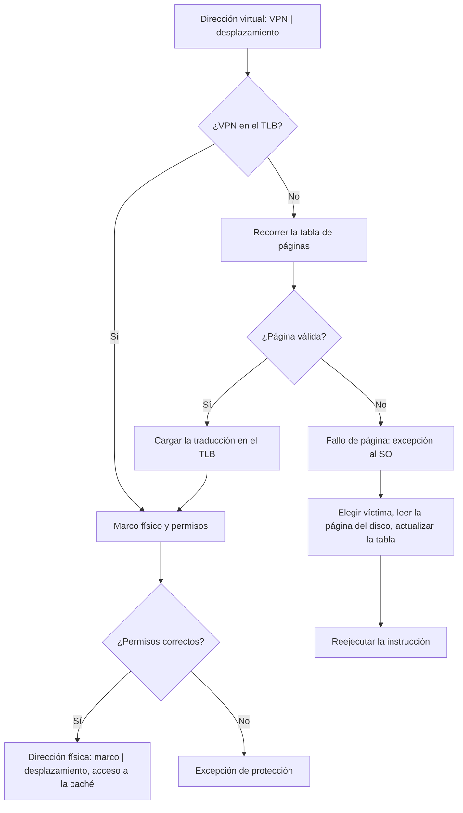

# Organización y Arquitectura de Computadoras - La jerarquía de memoria

## 9.6 Memoria virtual

---

La **memoria virtual** aplica la idea de la caché al nivel de la memoria principal y el disco, y además resuelve dos problemas que la caché no toca: permitir que cada proceso tenga su propio espacio de direcciones, **protegido** de los demás, y que un programa use más memoria de la que hay físicamente. Cada dirección que genera un programa es **virtual**; el hardware la traduce a una dirección **física** con tablas que mantiene el sistema operativo. Este tema describe la paginación, las tablas de páginas de uno y varios niveles, el búfer de traducción (TLB), los fallos de página y su costo, los algoritmos de reemplazo de páginas y el fenómeno de la hiperpaginación.

### Paginación

La memoria virtual y la física se dividen en bloques del mismo tamaño: **páginas** virtuales y **marcos** físicos, típicamente de 4 KiB (también hay páginas grandes de 2 MiB y 1 GiB). Una dirección virtual se divide en **número de página virtual** (VPN) y **desplazamiento**; la traducción sustituye el VPN por el **número de marco** (PFN) y conserva el desplazamiento.

**Tabla de páginas.** Para cada proceso, un arreglo indexado por el VPN. Cada entrada (PTE) contiene el número de marco y bits de control: **válido** (la página está en memoria), **permisos** (lectura, escritura, ejecución, usuario o núcleo), **referenciado** (para el reemplazo) y **modificado** (si hay que escribirla en disco al expulsarla). Un registro del procesador apunta a la tabla del proceso actual (`CR3` en x86, `satp` en RISC-V).

| Analogía | Caché | Memoria virtual |
| --- | --- | --- |
| unidad | línea (64 B) | página (4 KiB) |
| fallo | fallo de caché: decenas de ns | fallo de página: milisegundos con disco |
| colocación | directa o asociativa por conjuntos | totalmente asociativa |
| reemplazo | hardware (LRU aproximado) | sistema operativo (algoritmos más elaborados) |
| escritura | inmediata o diferida | siempre diferida |

Como un fallo de página cuesta millones de ciclos, conviene minimizarlos a cualquier precio: colocación totalmente asociativa, páginas grandes para aprovechar la localidad espacial, escritura diferida y reemplazo inteligente hecho por software.

### Tablas de páginas multinivel

Con 32 bits de dirección y páginas de 4 KiB, la tabla tiene $2^{20}$ entradas de 4 bytes: 4 MiB **por proceso**, casi todo vacío. Con 64 bits sería inmanejable. La solución es una **tabla jerárquica**: el VPN se divide en partes; la primera indexa un **directorio** cuyas entradas apuntan a tablas de segundo nivel, que solo existen si se usan. Con 32 bits se usan 10 + 10 + 12 bits, porque una tabla de 1024 entradas de 4 bytes ocupa exactamente una página. x86-64 usa 4 niveles de 9 bits (48 bits de dirección virtual), o 5 niveles con 57 bits.

### El búfer de traducción (TLB)

Con una tabla de dos niveles en memoria, cada acceso requeriría tres accesos a memoria: dos para la traducción y uno para el dato. El **TLB** (_Translation Lookaside Buffer_) es una caché pequeña (de 32 a unos pocos miles de entradas), asociativa, que guarda traducciones recientes. Si la traducción está en el TLB (más del 99 % de las veces gracias a la localidad), cuesta un ciclo; si no, el hardware (en x86 y ARM) o el sistema operativo (en MIPS) recorre la tabla. El TLB guarda también los permisos, que se comprueban en cada acceso.

$$ t_{\text{ef}} = h_{\text{TLB}} \cdot (t_{\text{TLB}} + t_m) + (1 - h_{\text{TLB}}) \cdot (t_{\text{TLB}} + k\, t_m + t_m) $$

con $k$ niveles de tabla. En los cambios de contexto el TLB debe vaciarse o sus entradas deben llevar un identificador de espacio de direcciones (ASID, PCID).



### Fallos de página y reemplazo

En un fallo de página, el sistema operativo busca un marco libre o elige una **víctima** (y la escribe en disco si está modificada), lee la página, actualiza la tabla y reejecuta la instrucción que falló. El tiempo efectivo de acceso con tasa de fallos $p$ es $(1 - p)\, t_m + p\, t_f$ (tema 8.2).

**Algoritmos de reemplazo:** **OPT** (expulsar la página que se usará más tarde; óptimo e irrealizable, tema 9.3), **FIFO**, **LRU** y sus aproximaciones prácticas con el bit de referencia, como el **reloj** (segunda oportunidad). FIFO puede sufrir la **anomalía de Belady**: más marcos pueden dar **más** fallos. LRU y OPT no la sufren, porque son **algoritmos de pila**: el contenido de la memoria con $m$ marcos está siempre incluido en el contenido con $m + 1.$

### Conjunto de trabajo e hiperpaginación

El **conjunto de trabajo** $W(t, \Delta)$ de un proceso es el conjunto de páginas referenciadas en las últimas $\Delta$ referencias (Denning, 1968). Si un proceso tiene menos marcos que su conjunto de trabajo, falla continuamente; si la suma de los conjuntos de trabajo de todos los procesos supera la memoria, el sistema pasa casi todo el tiempo moviendo páginas entre memoria y disco y casi no avanza: es la **hiperpaginación** (_thrashing_). Para evitarla, el sistema operativo mide la tasa de fallos de cada proceso y, si es alta, le asigna más marcos o **suspende** procesos hasta que los conjuntos de trabajo de los demás quepan.

### Implementación en Python

El programa cuenta los fallos de página del ejercicio 1 con FIFO, LRU y OPT (mostrando la anomalía de Belady), resuelve los ejercicios 2 y 3, simula la traducción con una tabla de dos niveles, calcula el efecto del TLB y, para el ejercicio 4, mide el conjunto de trabajo de una traza con fases de localidad y los fallos según el número de marcos.

```python
import random


def fallos_pagina(refs, marcos, politica):
    mem, fallos, orden = [], 0, []
    for t, p in enumerate(refs):
        if p in mem:
            if politica == "LRU":
                orden.remove(p); orden.append(p)
            continue
        fallos += 1
        if len(mem) == marcos:
            if politica == "OPT":
                fut = refs[t + 1:]
                v = max(mem, key=lambda q: fut.index(q) if q in fut else len(fut) + 1)
                orden.remove(v)
            else:
                v = orden.pop(0)
            mem.remove(v)
        mem.append(p); orden.append(p)
    return fallos


refs = [0, 1, 2, 3, 0, 1, 4, 0, 1, 2, 3, 4]
for m in (3, 4):
    print(f"ejercicio 1, {m} marcos:", {p: fallos_pagina(refs, m, p) for p in ("FIFO", "LRU", "OPT")})
print("   anomalía de Belady: FIFO hace más fallos con 4 marcos que con 3")

# Ejercicio 2
ma, servicio, p = 100e-9, 10e-3, 0.005
eat = (1 - p) * ma + p * servicio
print(f"ejercicio 2: EAT = {eat * 1e9:.1f} ns, {eat / ma:.0f} veces más lento que la memoria")

# Ejercicio 3: tabla de páginas de 32 bits, páginas de 4 KiB, entradas de 4 bytes
bits_dir, pagina, pte = 32, 4096, 4
entradas = 2 ** bits_dir // pagina
print(f"ejercicio 3: {entradas} entradas, tabla de {entradas * pte // 2**20} MiB por proceso;"
      f" una página contiene {pagina // pte} entradas -> 2 niveles de 10 bits")

# Traducción con tabla de dos niveles: 10 + 10 + 12 bits
tabla = {0x001: {0x234: 0x5A}, 0x3FF: {0x3FF: 0x07}}     # directorio -> tabla -> marco


def traducir(va):
    d, t, desp = va >> 22, (va >> 12) & 0x3FF, va & 0xFFF
    if d not in tabla or t not in tabla[d]:
        return f"0x{va:08X}: directorio {d}, tabla {t} -> fallo de página"
    return f"0x{va:08X}: directorio {d}, tabla {t}, desplazamiento 0x{desp:03X} -> física 0x{(tabla[d][t] << 12) | desp:08X}"


for va in (0x00634ABC, 0xFFFFF010, 0x12345678):
    print("  ", traducir(va))

# TLB: tiempo efectivo con tabla de dos niveles en memoria (100 ns por acceso) y TLB de 1 ns
for acierto in (0.90, 0.99, 0.999):
    t = acierto * (1 + 100) + (1 - acierto) * (1 + 2 * 100 + 100)
    print(f"TLB con {acierto:.1%} de aciertos: {t:.1f} ns por acceso ({t / 100 - 1:+.1%} sobre la memoria)")

# Ejercicio 4: conjunto de trabajo y fallos en función de los marcos (traza con fases de localidad)
rng = random.Random(5)
traza = []
for fase in range(6):
    base = 10 * fase
    traza += [base + rng.randrange(6) for _ in range(300)]       # cada fase usa 6 páginas
delta = 50
ws = [len(set(traza[t - delta:t])) for t in range(delta, len(traza), 300)]
print("ejercicio 4: tamaño del conjunto de trabajo (ventana de 50 referencias) medido dentro de cada fase:", ws)
for m in (3, 4, 5, 6, 8):
    print(f"   {m} marcos: {fallos_pagina(traza, m, 'LRU'):4d} fallos de {len(traza)} referencias")
```

Salida:

```text
ejercicio 1, 3 marcos: {'FIFO': 9, 'LRU': 10, 'OPT': 7}
ejercicio 1, 4 marcos: {'FIFO': 10, 'LRU': 8, 'OPT': 6}
   anomalía de Belady: FIFO hace más fallos con 4 marcos que con 3
ejercicio 2: EAT = 50099.5 ns, 501 veces más lento que la memoria
ejercicio 3: 1048576 entradas, tabla de 4 MiB por proceso; una página contiene 1024 entradas -> 2 niveles de 10 bits
   0x00634ABC: directorio 1, tabla 564, desplazamiento 0xABC -> física 0x0005AABC
   0xFFFFF010: directorio 1023, tabla 1023, desplazamiento 0x010 -> física 0x00007010
   0x12345678: directorio 72, tabla 837 -> fallo de página
TLB con 90.0% de aciertos: 121.0 ns por acceso (+21.0% sobre la memoria)
TLB con 99.0% de aciertos: 103.0 ns por acceso (+3.0% sobre la memoria)
TLB con 99.9% de aciertos: 101.2 ns por acceso (+1.2% sobre la memoria)
ejercicio 4: tamaño del conjunto de trabajo (ventana de 50 referencias) medido dentro de cada fase: [6, 6, 6, 6, 6, 6]
   3 marcos:  939 fallos de 1800 referencias
   4 marcos:  624 fallos de 1800 referencias
   5 marcos:  321 fallos de 1800 referencias
   6 marcos:   36 fallos de 1800 referencias
   8 marcos:   36 fallos de 1800 referencias
```

Los fallos caen bruscamente al llegar a 6 marcos, el tamaño del conjunto de trabajo de cada fase: con menos, el proceso hiperpagina; con más, los marcos adicionales no ayudan y solo quedan los 36 fallos obligatorios de las seis fases.

### Ejercicios Propuestos

1. **Reemplazo.** Para las referencias `0, 1, 2, 3, 0, 1, 4, 0, 1, 2, 3, 4` con 3 marcos, cuenta los fallos con FIFO, LRU y OPT. Repite con 4 marcos.

2. **Tiempo efectivo.** Con acceso a memoria de 100 ns, atención de fallo de 10 ms y tasa de fallos de 0.5 %, calcula el tiempo efectivo de acceso y la degradación.

3. **Tabla de páginas.** Con direcciones virtuales de 32 bits, páginas de 4 KiB y entradas de 4 bytes, ¿cuántas entradas tiene la tabla, cuánto ocupa y cuántos niveles harían falta para que cada tabla quepa en una página?

4. **Conjunto de trabajo.** Define el conjunto de trabajo, explica la hiperpaginación y propón estrategias para detectarla y evitarla.

### Soluciones

**Ejercicio 1.** Con 3 marcos: FIFO 9, LRU 10 y OPT 7 fallos. Con 4 marcos: FIFO 10, LRU 8 y OPT 6. FIFO empeora con más marcos: es la anomalía de Belady, y esta secuencia es el ejemplo clásico.

**Ejercicio 2.** $0.995 \cdot 100 + 0.005 \cdot 10^7 \approx 50\,100$ ns: unas 500 veces más lento que la memoria. Una tasa de fallos de medio por ciento es inaceptable; con discos hay que estar por debajo de uno por millón.

**Ejercicio 3.** $2^{32} / 2^{12} = 2^{20}$ entradas de 4 bytes: 4 MiB. Una página de 4 KiB contiene 1024 entradas, que se indexan con 10 bits: los 20 bits del VPN se dividen en dos niveles de 10. El directorio ocupa una página, y cada tabla de segundo nivel solo existe si se usa alguna de sus 1024 páginas (4 MiB de espacio virtual).

**Ejercicio 4.** Ver la sección del tema. Detección: tasa de fallos por proceso por encima de un umbral, o utilización del procesador que cae mientras la actividad del disco de paginación sube. Prevención: asignar a cada proceso al menos su conjunto de trabajo (modelo del conjunto de trabajo), ajustar los marcos según la frecuencia de fallos, reducir el grado de multiprogramación suspendiendo procesos y, en el programador, mejorar la localidad.

### Referencias

1. Patterson, D. A., and Hennessy, J. L., _Computer Organization and Design: The Hardware/Software Interface_. Morgan Kaufmann, 2020. Sección 5.7.
2. Hennessy, J. L., and Patterson, D. A., _Computer Architecture: A Quantitative Approach_. Morgan Kaufmann, 2019. Apéndice B y sección 2.4.
3. Silberschatz, A., Galvin, P. B., and Gagne, G., _Fundamentos de sistemas operativos_. McGraw-Hill, 2006. Capítulos 8 y 9.
4. Denning, P. J., The working set model for program behavior. _Communications of the ACM_ 11(5), 1968.
