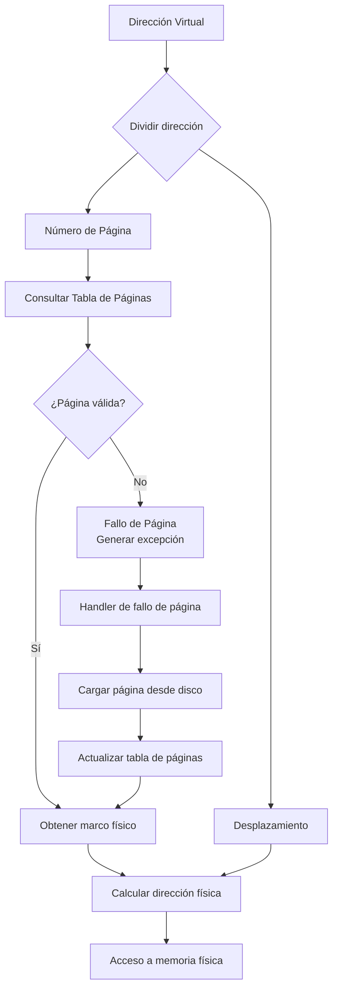
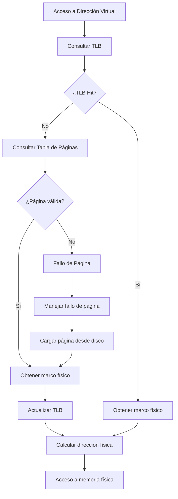

# Organización y Arquitectura de Computadoras - La jerarquía de memoria

## 9.6 Memoria virtual

---

La memoria virtual es una técnica fundamental que permite a los programas ejecutarse en un espacio de memoria mayor que la física disponible, proporcionando abstracción, protección y eficiencia en el uso de la memoria.

### Conceptos Fundamentales

#### Definición de Memoria Virtual

Sistema que permite a los procesos usar direcciones virtuales independientes de la memoria física real, creando la ilusión de un espacio de memoria contiguo y completo.

#### Espacios de Direcciones

- **Espacio virtual**: Direcciones utilizadas por el programa (0 a 2ⁿ-1)
- **Espacio físico**: Direcciones reales de la memoria RAM

#### Paginación

División de la memoria en bloques de tamaño fijo llamados páginas (típicamente 4KB).

#### Tabla de Páginas

Estructura de datos que mapea páginas virtuales a marcos físicos.

### Fórmulas y Métricas

#### Tamaño de la Tabla de Páginas

$$
\text{Tamaño} = \frac{\text{Espacio virtual}}{\text{Tamaño de página}} \times \text{Tamaño de entrada}
$$

#### Tiempo de Acceso Efectivo (TAE)

$$
\text{TAE} = (1 - p) \times T_{\text{memoria}} + p \times T_{\text{fallo}}
$$

Donde:

- $p$ = probabilidad de fallo de página
- $T_{\text{memoria}}$ = tiempo de acceso a memoria
- $T_{\text{fallo}}$ = tiempo de servicio de fallo de página

#### Tasa de Fallos de Página

$$
\text{Page Fault Rate} = \frac{\text{Número de fallos de página}}{\text{Número total de accesos}}
$$

### Componentes de la Memoria Virtual

#### Traducción de Direcciones

```python
def translate_address(virtual_address, page_table):
    # Extraer número de página y offset
    page_number = virtual_address // PAGE_SIZE
    offset = virtual_address % PAGE_SIZE

    if page_number in page_table and page_table[page_number]['valid']:
        # Página presente en memoria
        frame_number = page_table[page_number]['frame']
        physical_address = (frame_number * PAGE_SIZE) + offset
        return physical_address, True  # Hit
    else:
        # Fallo de página
        return None, False  # Miss
```

#### Estructura de Entrada de Tabla de Páginas

```python
class PageTableEntry:
    def __init__(self):
        self.frame_number = 0     # Marco físico
        self.valid = False        # Bit de presencia
        self.dirty = False        # Bit de modificación
        self.referenced = False   # Bit de referencia
        self.protection = 0       # Bits de protección (RWX)
        self.cached = False       # Bit de caché
```

### Diagrama de Traducción de Direcciones



### Algoritmos de Reemplazo de Páginas

#### FIFO (First-In, First-Out)

```python
class FIFOReplacement:
    def __init__(self, capacity):
        self.capacity = capacity
        self.queue = deque()
        self.page_table = {}

    def access_page(self, page_number):
        if page_number in self.page_table:
            # Hit - página ya en memoria
            return True
        else:
            # Miss - fallo de página
            if len(self.queue) >= self.capacity:
                # Eliminar la página más antigua
                oldest_page = self.queue.popleft()
                del self.page_table[oldest_page]

            # Agregar nueva página
            self.queue.append(page_number)
            self.page_table[page_number] = True
            return False
```

#### LRU (Least Recently Used)

```python
class LRUReplacement:
    def __init__(self, capacity):
        self.capacity = capacity
        self.cache = OrderedDict()

    def access_page(self, page_number):
        if page_number in self.cache:
            # Mover al final (más reciente)
            self.cache.move_to_end(page_number)
            return True  # Hit
        else:
            # Miss - fallo de página
            if len(self.cache) >= self.capacity:
                # Eliminar el menos recientemente usado
                self.cache.popitem(last=False)

            # Agregar nueva página
            self.cache[page_number] = True
            return False  # Miss
```

#### OPT (Óptimo)

```python
class OptimalReplacement:
    def __init__(self, capacity):
        self.capacity = capacity
        self.pages = set()
        self.reference_string = []

    def set_reference_string(self, references):
        self.reference_string = references

    def access_page(self, page_number, current_index):
        if page_number in self.pages:
            return True  # Hit

        # Miss - necesidad de reemplazo
        if len(self.pages) >= self.capacity:
            # Encontrar página que no se usará por más tiempo
            farthest = -1
            page_to_replace = None

            for page in self.pages:
                try:
                    next_use = self.reference_string.index(page, current_index + 1)
                except ValueError:
                    page_to_replace = page
                    break

                if next_use > farthest:
                    farthest = next_use
                    page_to_replace = page

            self.pages.remove(page_to_replace)

        self.pages.add(page_number)
        return False  # Miss
```

### Ejemplos de Comportamiento

#### Ejemplo 1: Secuencia de Accesos

```
Referencias: 1, 2, 3, 4, 1, 2, 5, 1, 2, 3, 4, 5
Capacidad: 3 marcos
```

**FIFO:**

- Fallos: 1,2,3,4,5,4,5 → 7 fallos
- Secuencia: [1], [1,2], [1,2,3], [2,3,4], [3,4,1], [4,1,2], [1,2,5], [2,5,1], [5,1,2], [1,2,3], [2,3,4], [3,4,5]

**LRU:**

- Fallos: 1,2,3,4,5,3,4 → 7 fallos
- Secuencia: [1], [2,1], [3,2,1], [4,3,2], [1,4,3], [2,1,4], [5,2,1], [1,5,2], [2,1,5], [3,2,1], [4,3,2], [5,4,3]

#### Ejemplo 2: Working Set y Localidad

```c
// Programa con buena localidad
int sum_array(int array[], int size) {
    int sum = 0;
    for (int i = 0; i < size; i++) {
        sum += array[i];  // Acceso secuencial con buena localidad espacial
    }
    return sum;
}

// Programa con mala localidad
int sum_matrix(int matrix[][1000], int size) {
    int sum = 0;
    for (int j = 0; j < 1000; j++) {
        for (int i = 0; i < size; i++) {
            sum += matrix[i][j];  // Acceso no secuencial con mala localidad
        }
    }
    return sum;
}
```

### Ejercicios Propuestos

#### Ejercicio 1: Análisis de Algoritmos de Reemplazo

Para la secuencia de referencia: 0, 1, 2, 3, 0, 1, 4, 0, 1, 2, 3, 4
y 3 marcos disponibles, calcule:

1. Número de fallos de página para FIFO
2. Número de fallos de página para LRU
3. Número de fallos de página para OPT

#### Ejercicio 2: Cálculo de Tiempo de Acceso Efectivo

Un sistema tiene:

- Tiempo de acceso a memoria: 100 ns
- Tiempo de servicio de fallo de página: 10 ms
- Tasa de fallos de página: 0.5%

Calcule:

1. Tiempo de acceso efectivo
2. Porcentaje de slowdown debido a la paginación

#### Ejercicio 3: Diseño de Tabla de Páginas

Para un sistema con:

- Espacio virtual de 32 bits
- Tamaño de página de 4 KB
- Entradas de tabla de páginas de 4 bytes

Calcule:

1. Número de entradas en la tabla de páginas
2. Tamaño total de la tabla de páginas
3. Número de niveles necesarios para una tabla multinivel

#### Ejercicio 4: Working Set y Thrashing

Analice un escenario donde múltiples procesos compiten por memoria:

1. Defina el concepto de "working set"
2. Explique el fenómeno de "thrashing"
3. Proponga estrategias para detectar y evitar thrashing

### Tablas de Páginas Multinivel

#### Estructura de Tabla de Dos Niveles

```python
class TwoLevelPageTable:
    def __init__(self):
        self.outer_table = [None] * 1024  # 10 bits para directorio
        self.page_size = 4096  # 4KB

    def translate(self, virtual_address):
        # Dividir dirección virtual
        dir_index = (virtual_address >> 22) & 0x3FF
        page_index = (virtual_address >> 12) & 0x3FF
        offset = virtual_address & 0xFFF

        # Verificar directorio
        if self.outer_table[dir_index] is None:
            raise PageFaultException("Directory entry not present")

        inner_table = self.outer_table[dir_index]

        # Verificar página
        if inner_table[page_index] is None or not inner_table[page_index]['valid']:
            raise PageFaultException("Page not present")

        page_entry = inner_table[page_index]
        physical_address = (page_entry['frame'] * self.page_size) + offset
        return physical_address
```

### TLB (Translation Lookaside Buffer)

#### Funcionamiento de la TLB

```python
class TLB:
    def __init__(self, entries):
        self.entries = entries
        self.cache = {}
        self.lru_queue = deque()

    def lookup(self, virtual_page):
        if virtual_page in self.cache:
            # TLB hit - actualizar LRU
            self.lru_queue.remove(virtual_page)
            self.lru_queue.append(virtual_page)
            return self.cache[virtual_page]
        return None  # TLB miss

    def update(self, virtual_page, physical_frame):
        if len(self.cache) >= self.entries:
            # Reemplazar entrada LRU
            lru_page = self.lru_queue.popleft()
            del self.cache[lru_page]

        self.cache[virtual_page] = physical_frame
        self.lru_queue.append(virtual_page)
```

#### Tiempo de Acceso con TLB

$$
\text{TAE} = (1 - p_{\text{tlb}}) \times T_{\text{memoria}} + p_{\text{tlb}} \times (T_{\text{tlb}} + T_{\text{memoria}})
$$

Donde $p_{\text{tlb}}$ es la tasa de fallos de TLB.

### Diagrama de Acceso con TLB



### Segmentación y Paginación Combinadas

#### Arquitectura x86 con Segmentación y Paginación

```c
// Estructura de descriptor de segmento
struct segment_descriptor {
    uint16_t limit_low;
    uint16_t base_low;
    uint8_t base_middle;
    uint8_t access;
    uint8_t granularity;
    uint8_t base_high;
};

// Traducción de dirección lineal a física
uint32_t linear_to_physical(uint32_t linear_address,
                           page_directory_t* page_dir) {
    uint32_t dir_index = (linear_address >> 22) & 0x3FF;
    uint32_t table_index = (linear_address >> 12) & 0x3FF;
    uint32_t offset = linear_address & 0xFFF;

    page_table_t* page_table = page_dir->tables[dir_index];
    if (!page_table || !page_table->pages[table_index].present) {
        return PAGE_FAULT;
    }

    uint32_t frame = page_table->pages[table_index].frame;
    return (frame << 12) | offset;
}
```

### Ejercicios de Implementación

#### Ejercicio 5: Simulador de Memoria Virtual

Implemente un simulador que:

1. Gestione tablas de páginas multinivel
2. Implemente algoritmos de reemplazo (FIFO, LRU, OPT)
3. Simule TLB con diferentes tamaños
4. Genere estadísticas de rendimiento

#### Ejercicio 6: Análisis de Patrones de Acceso

Desarrolle un analizador que:

1. Identifique patrones de acceso a memoria
2. Calcule working sets de procesos
3. Detecte potenciales problemas de thrashing

### Referencias

#### Bibliografía Básica

1. Hennessy, John L. y David A. Patterson. _Computer Architecture: A Quantitative Approach_, 4a Ed. Morgan Kaufmann, 2006. (Capítulo 5: Memory Hierarchy Design)
2. Patterson, David A. y John L. Hennessy. _Computer Organization and Design: The Hardware/Software Interface_, 4a Ed. Morgan Kaufmann, 2008. (Capítulo 7: Large and Fast: Exploiting Memory Hierarchy)

#### Bibliografía Complementaria

1. Stallings, William. _Computer Organization and Architecture: Designing for Performance_, Prentice Hall - Pearson, 2009. (Capítulo 8: Virtual Memory)
2. Tanenbaum, Andrew S. _Structured Computer Organization_, 5a Ed. Prentice Hall, 2005. (Capítulo 4: The Microarchitecture Level)
3. Silberschatz Abraham, Peter B. Galvin y Greg Gagne. _Operating System Concepts_, 8a Ed., Wiley, 2008. (Capítulo 9: Virtual Memory)

### Conclusión

La memoria virtual es un componente esencial de los sistemas computacionales modernos que proporciona numerosas ventajas: abstracción de memoria, protección entre procesos, y la capacidad de ejecutar programas más grandes que la memoria física disponible. Los algoritmos de reemplazo de páginas, las tablas multinivel, y los buffers de traducción (TLB) son mecanismos clave que optimizan el rendimiento de este sistema. El entendimiento profundo de estos conceptos es crucial para el diseño de sistemas operativos eficientes y arquitecturas de computadoras de alto rendimiento.
