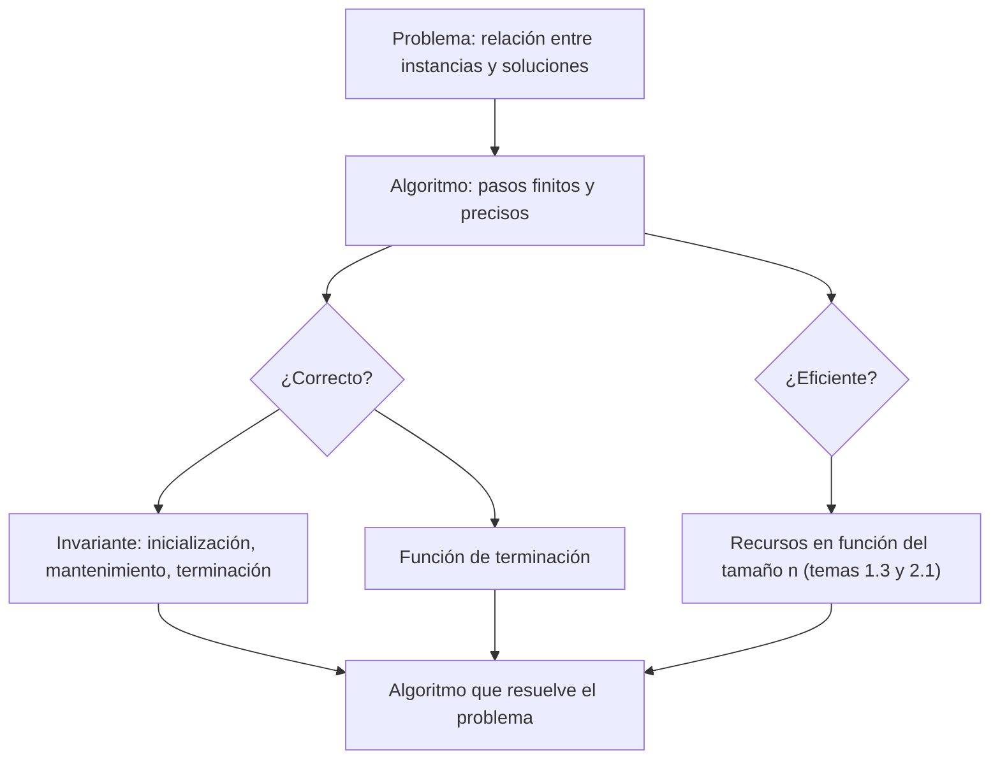

# Análisis de Algoritmos - Conceptos básicos

## 1.1 Problemas y algoritmos.

---

El análisis de algoritmos estudia dos preguntas sobre cada método de cálculo: ¿es **correcto**, es decir, produce siempre la respuesta pedida?, y ¿es **eficiente**, cuántos recursos (tiempo, memoria) consume en función del tamaño de la entrada? Para responderlas con rigor hace falta distinguir entre el **problema**, que dice qué se quiere calcular, y el **algoritmo**, que dice cómo calcularlo. Este tema define ambos conceptos, presenta las formas de describir un algoritmo y las técnicas para demostrar su corrección (invariantes de ciclo y funciones de terminación), y las aplica al algoritmo más antiguo que se sigue usando: el de Euclides.

### Problemas

Un **problema computacional** especifica, para cada entrada posible (una **instancia**), qué salidas son aceptables. Formalmente es una relación $P \subseteq I \times S$ entre el conjunto de instancias $I$ y el de soluciones $S:$ el par $(x, y)$ está en $P$ si $y$ es una respuesta correcta para $x.$

- **Ordenamiento.** Instancia: una secuencia $\langle a_1, \ldots, a_n \rangle$ de números. Solución: una permutación $\langle a'_1, \ldots, a'_n \rangle$ con $a'_1 \leq a'_2 \leq \cdots \leq a'_n.$
- **Máximo común divisor.** Instancia: dos enteros $a, b \geq 0,$ no ambos cero. Solución: el mayor entero que divide a ambos.
- **Búsqueda.** Instancia: un arreglo $A$ y un valor $x.$ Solución: un índice $i$ con $A[i] = x,$ o $-1$ si no hay ninguno.

Una instancia puede tener varias soluciones correctas (si $x$ aparece dos veces, cualquiera de los dos índices sirve): por eso un problema es una relación y no necesariamente una función. El **tamaño** de una instancia, $n,$ es la cantidad de datos necesarios para describirla: el número de elementos de un arreglo, el número de vértices y aristas de una gráfica o el número de bits de un entero.

### Algoritmos

Un **algoritmo** es un procedimiento finito y bien definido que transforma cada instancia de un problema en una solución. Sus propiedades (Knuth):

- **Finitud:** termina después de un número finito de pasos para toda entrada válida.
- **Definición precisa:** cada paso está especificado sin ambigüedad.
- **Entrada y salida:** recibe cero o más entradas y produce una o más salidas.
- **Efectividad:** cada paso es lo bastante elemental para hacerse exactamente y en tiempo finito.

Un algoritmo **resuelve** un problema si, para toda instancia, termina y su salida es una solución correcta. Un procedimiento que puede no terminar con algunas entradas no es un algoritmo, sino un **procedimiento de cálculo** (por ejemplo, un sistema operativo, o un programa que busca un contraejemplo a una conjetura).

**Formas de describirlos:** en lenguaje natural (ambiguo), en **pseudocódigo** (preciso e independiente del lenguaje, la forma habitual en los libros), con **diagramas de flujo**, o en un lenguaje de programación concreto. En este curso se usa pseudocódigo con índices desde 1 y Python para las implementaciones.

### Corrección: invariantes de ciclo

Para demostrar que un algoritmo iterativo es correcto se usa un **invariante de ciclo**: una propiedad que se cumple al inicio de cada iteración. Se demuestra en tres partes, como una inducción:

1. **Inicialización:** se cumple antes de la primera iteración.
2. **Mantenimiento:** si se cumple antes de una iteración, se cumple antes de la siguiente.
3. **Terminación:** cuando el ciclo termina, el invariante, junto con la condición de salida, implica que el resultado es correcto.

Hay que demostrar también que el ciclo **termina**, con una **función de terminación**: una cantidad entera no negativa que disminuye estrictamente en cada iteración.

**Ejemplo: búsqueda lineal.** Invariante: al inicio de la iteración $i,$ $x$ no está en $A[1..i-1].$ Inicialización: con $i = 1$ el subarreglo es vacío. Mantenimiento: si $A[i] = x,$ el algoritmo regresa $i,$ que es correcto; si no, $x$ tampoco está en $A[1..i].$ Terminación: si el ciclo llega a $i = n + 1,$ el invariante dice que $x$ no está en $A[1..n],$ y regresar $-1$ es correcto. La función de terminación es $n + 1 - i.$

### El algoritmo de Euclides

```
EUCLIDES(a, b)                 ▷ a, b ≥ 0, no ambos cero
1  mientras b ≠ 0
2      (a, b) ← (b, a mod b)
3  regresar a
```

**Lema.** Si $b > 0,$ entonces $\text{mcd}(a, b) = \text{mcd}(b, a \bmod b).$

**Demostración.** Sea $r = a \bmod b,$ de modo que $a = qb + r.$ Si $d$ divide a $a$ y a $b,$ divide a $r = a - qb;$ si $d$ divide a $b$ y a $r,$ divide a $a = qb + r.$ Así, los pares $(a, b)$ y $(b, r)$ tienen exactamente los mismos divisores comunes, y en particular el mismo máximo. $\blacksquare$

**Corrección.** Sean $a_0, b_0$ los valores iniciales. Invariante: $\text{mcd}(a, b) = \text{mcd}(a_0, b_0).$ Se cumple al inicio; el lema muestra que se mantiene; al terminar, $b = 0$ y $\text{mcd}(a, 0) = a,$ que es lo que se regresa.

**Terminación.** Después de la primera iteración, $0 \leq b$ y el nuevo $b$ es $a \bmod b \lt b:$ $b$ es un entero no negativo que disminuye estrictamente, así que llega a 0.

**Eficiencia: teorema de Lamé (1844).** Si el algoritmo hace $k \geq 1$ divisiones con $a > b,$ entonces $a \geq F_{k+2}$ y $b \geq F_{k+1},$ donde $F_j$ son los números de Fibonacci, con $F_1 = F_2 = 1.$ Como $F_j$ crece como $\varphi^j$ con $\varphi \approx 1.618,$ el número de divisiones es $O(\log b):$ a lo sumo unas cinco veces el número de cifras decimales de $b.$ El peor caso son dos números de Fibonacci consecutivos.



### Implementación en Python

El programa traza el algoritmo de Euclides con $\text{mcd}(1071, 462),$ lo compara con `math.gcd` en casos de prueba y en todos los pares menores que 200 (ejercicio 3), mide el número de divisiones con números de Fibonacci consecutivos (el peor caso de Lamé) y comprueba con aserciones, en cada iteración, las invariantes de la búsqueda lineal, del máximo y de la suma de un arreglo.

```python
from math import gcd


def euclides(a, b):
    """mcd(a, b) con a, b >= 0, no ambos cero; devuelve el mcd y el número de divisiones."""
    pasos = 0
    while b != 0:
        a, b = b, a % b              # invariante: mcd(a, b) no cambia
        pasos += 1
    return a, pasos


def euclides_traza(a, b):
    while b != 0:
        print(f"   mcd({a}, {b}): {a} = {a // b} x {b} + {a % b}")
        a, b = b, a % b
    print(f"   mcd({a}, 0) = {a}")


print("ejemplo, mcd(1071, 462):")
euclides_traza(1071, 462)

# Ejercicio 3: casos de prueba contra math.gcd
casos = [(48, 18), (17, 5), (0, 9), (9, 0), (1, 1), (2**61 - 1, 2**31 - 1), (123456789, 987654321)]
print("ejercicio 3:", all(euclides(a, b)[0] == gcd(a, b) for a, b in casos),
      [euclides(a, b)[0] for a, b in casos])
falla = [(a, b) for a in range(0, 200) for b in range(0, 200) if (a or b) and euclides(a, b)[0] != gcd(a, b)]
print("   comparación exhaustiva con 0 <= a, b < 200:", "sin diferencias" if not falla else falla[:3])

# Peor caso: números de Fibonacci consecutivos (teorema de Lamé)
fib = [1, 1]
while len(fib) < 32:
    fib.append(fib[-1] + fib[-2])
for k in (10, 20, 30):
    a, b = fib[k + 1], fib[k]
    print(f"F({k + 2}) = {a}, F({k + 1}) = {b}: {euclides(a, b)[1]} divisiones")
peor = max(((euclides(a, b)[1], a, b) for a in range(1, 1000) for b in range(1, a)))
print("máximo de divisiones con 1 <= b < a < 1000:", peor)


# Búsqueda lineal y máximo, con las invariantes comprobadas en cada iteración
def busqueda_lineal(A, x):
    for i in range(len(A)):
        assert x not in A[:i]              # invariante: x no está en A[0..i-1]
        if A[i] == x:
            return i
    return -1


def maximo(A):
    m = A[0]
    for i in range(1, len(A)):
        assert m == max(A[:i])             # invariante: m es el máximo de A[0..i-1]
        if A[i] > m:
            m = A[i]
    return m


def suma(A):
    s = 0
    for i in range(len(A)):
        assert s == sum(A[:i])             # invariante: s es la suma de A[0..i-1]
        s += A[i]
    return s


A = [31, -4, 15, 92, 65, -35, 89]
print("búsqueda de 92:", busqueda_lineal(A, 92), "| de 7:", busqueda_lineal(A, 7),
      "| máximo:", maximo(A), "| suma:", suma(A))
```

Salida:

```text
ejemplo, mcd(1071, 462):
   mcd(1071, 462): 1071 = 2 x 462 + 147
   mcd(462, 147): 462 = 3 x 147 + 21
   mcd(147, 21): 147 = 7 x 21 + 0
   mcd(21, 0) = 21
ejercicio 3: True [6, 1, 9, 9, 1, 1, 9]
   comparación exhaustiva con 0 <= a, b < 200: sin diferencias
F(12) = 144, F(11) = 89: 10 divisiones
F(22) = 17711, F(21) = 10946: 20 divisiones
F(32) = 2178309, F(31) = 1346269: 30 divisiones
máximo de divisiones con 1 <= b < a < 1000: (14, 987, 610)
búsqueda de 92: 3 | de 7: -1 | máximo: 92 | suma: 253
```

Entre todos los pares con $b \lt a \lt 1000,$ el que más divisiones necesita es $(987, 610) = (F_{16}, F_{15}),$ como predice el teorema de Lamé.

### Ejercicios Propuestos

1. **Búsqueda lineal.** Demuestra por inducción la corrección de la búsqueda lineal.

2. **Máximo.** Diseña un algoritmo que encuentre el máximo de un arreglo y demuestra su corrección.

3. **Euclides.** Implementa el algoritmo de Euclides y verifícalo con varios casos de prueba.

4. **Componentes.** Para el siguiente algoritmo, identifica las instancias, las soluciones y los pasos de cálculo:

   ```
   SUMA-ARREGLO(A)              ▷ A arreglo de n números
   1  suma ← 0
   2  para i ← 1 hasta n
   3      suma ← suma + A[i]
   4  regresar suma
   ```

5. **Invariante.** Formula un invariante para SUMA-ARREGLO y demuestra que es correcto.

### Soluciones

**Ejercicio 1.** Es el ejemplo del tema: por inducción sobre $i$ se demuestra que, si el algoritmo llega a la iteración $i,$ entonces $x \notin A[1..i-1].$ El caso base $i = 1$ es trivial y el paso inductivo usa que, si no se regresó en la iteración $i,$ es porque $A[i] \neq x.$

**Ejercicio 2.**

```
MÁXIMO(A)
1  m ← A[1]
2  para i ← 2 hasta n
3      si A[i] > m entonces m ← A[i]
4  regresar m
```

Invariante: al inicio de la iteración $i,$ $m = \max A[1..i-1].$ Inicialización: con $i = 2,$ $m = A[1].$ Mantenimiento: el nuevo $m$ es $\max(m, A[i]) = \max A[1..i].$ Terminación: con $i = n + 1,$ $m = \max A[1..n].$ Hace exactamente $n - 1$ comparaciones, y no se puede hacer con menos: cada elemento que no es el máximo debe "perder" al menos una comparación.

**Ejercicio 3.** Ver el programa: coincide con `math.gcd` en todos los casos, incluidos los extremos $\text{mcd}(0, 9) = 9$ y $\text{mcd}(2^{61} - 1, 2^{31} - 1) = 1.$

**Ejercicio 4.** Instancias: arreglos de $n$ números, para cualquier $n \geq 0,$ y el tamaño de la instancia es $n.$ Soluciones: un número, la suma. Pasos: una asignación inicial, $n$ iteraciones con una suma y una asignación cada una, y el regreso.

**Ejercicio 5.** Invariante: al inicio de la iteración $i,$ $\text{suma} = \sum_{j=1}^{i-1} A[j].$ Inicialización: suma vacía, 0. Mantenimiento: tras la línea 3, $\text{suma} = \sum_{j=1}^{i} A[j].$ Terminación: con $i = n + 1,$ $\text{suma} = \sum_{j=1}^{n} A[j];$ si $n = 0,$ regresa 0, que también es correcto.

### Referencias

1. Cormen, T. H., Leiserson, C. E., Rivest, R. L., and Stein, C., _Introduction to Algorithms_. MIT Press, 2022. Capítulos 1 y 2.
2. Knuth, D. E., _The Art of Computer Programming, Vol. 1: Fundamental Algorithms_. Addison-Wesley, 1997. Sección 1.1.
3. Kleinberg, J., and Tardos, É., _Algorithm Design_. Pearson, 2006. Capítulo 1.
4. Gries, D., _The Science of Programming_. Springer, 1981. Capítulos 11 y 16.
