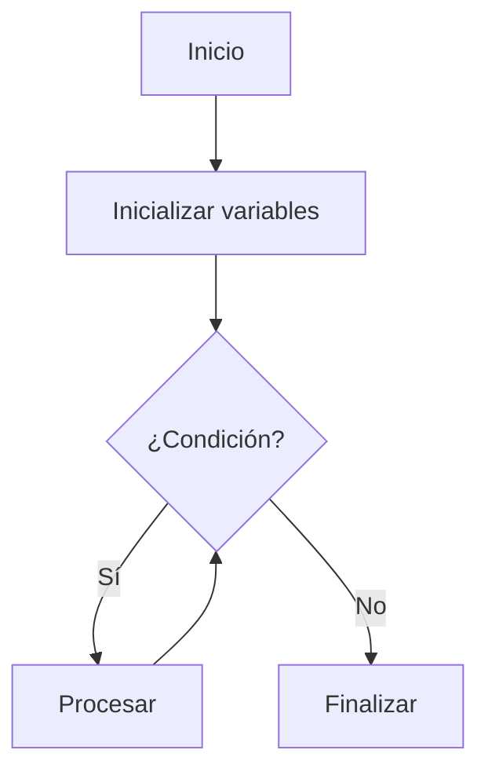

# Análisis de Algoritmos - Conceptos básicos
## 1.1 Problemas y algoritmos.

---

### Definición de Problema

Un **problema computacional** es una relación entre un conjunto de **instancias** (entradas) y un conjunto de **soluciones** (salidas). Formalmente, un problema puede definirse como una relación binaria $P \subseteq I \times S$, donde $I$ es el conjunto de instancias y $S$ es el conjunto de soluciones.

**Ejemplo**: El problema de ordenamiento:
- **Instancia**: Una secuencia de n números $\langle a_1, a_2, ..., a_n \rangle$
- **Solución**: Una permutación $\langle a'_1, a'_2, ..., a'_n \rangle$ tal que $a'_1 \leq a'_2 \leq ... \leq a'_n$

### Definición de Algoritmo

Un **algoritmo** es un procedimiento computacional bien definido que toma algún valor o conjunto de valores como **entrada** y produce algún valor o conjunto de valores como **salida**. Es una secuencia de pasos computacionales que transforma la entrada en la salida (Cormen et al., 2009).

**Características esenciales**:
1. **Precisión**: Cada paso está definido exactamente
2. **Determinismo**: Misma entrada → misma salida
3. **Finitud**: Termina después de un número finito de pasos
4. **Efectividad**: Cada paso es suficientemente básico
5. **Generalidad**: Aplica a múltiples instancias del problema

### Componentes de un Algoritmo

```python
# Ejemplo: Algoritmo de búsqueda lineal
def busqueda_lineal(arr, objetivo):
    """
    Entrada: arr - lista de elementos
             objetivo - elemento a buscar
    Salida: índice del elemento o -1 si no se encuentra
    """
    for i in range(len(arr)):  # Paso 1: Iteración
        if arr[i] == objetivo:  # Paso 2: Comparación
            return i  # Paso 3: Retorno del resultado
    return -1  # Paso 4: Retorno si no se encuentra
```

### Representación de Algoritmos

Los algoritmos pueden representarse mediante:

1. **Pseudocódigo**: Descripción de alto nivel
2. **Diagramas de flujo**: Representación visual
3. **Lenguajes de programación**: Implementación ejecutable



### Correctitud de Algoritmos

Un algoritmo es **correcto** si para cada instancia de entrada, se detiene con la salida correcta. La correctitud se demuestra mediante:

1. **Invariante de bucle**: Propiedad que se mantiene verdadera antes y después de cada iteración
2. **Inducción matemática**: Demostración formal de correctitud

**Ejemplo**: Correctitud del algoritmo de búsqueda lineal:
- **Invariante**: En la i-ésima iteración, los primeros i-1 elementos han sido verificados y no coinciden con el objetivo
- **Caso base**: i=0, ningún elemento verificado (verdadero)
- **Paso inductivo**: Si el invariante se mantiene para i, se mantiene para i+1

### Ejemplo: Algoritmo de Euclides

El algoritmo de Euclides calcula el máximo común divisor (MCD) de dos números enteros:

```python
def euclides_mcd(a, b):
    """
    Calcula el MCD de a y b usando el algoritmo de Euclides
    """
    while b != 0:
        a, b = b, a % b
    return a
```

**Correctitud**: Se basa en la propiedad matemática:

$$mcd(a, b) = mcd(b, a \mod b)$$

### Ejercicios Propuestos

1. **Análisis de correctitud**: Demuestre la correctitud del algoritmo de búsqueda lineal usando inducción matemática.

2. **Diseño de algoritmo**: Diseñe un algoritmo para encontrar el máximo de un arreglo de números. Demuestre su correctitud.

3. **Implementación**: Implemente el algoritmo de Euclides en su lenguaje de programación preferido y verifique su funcionamiento con varios casos de prueba.

4. **Identificación de componentes**: Para el siguiente pseudocódigo, identifique:
   - Las instancias de entrada
   - Las soluciones de salida
   - Los pasos computacionales

```
ALGORITMO SumaArreglo
ENTRADA: Arreglo A de n números
SALIDA: Suma de todos los elementos de A
1. suma ← 0
2. PARA i ← 1 HASTA n HACER
3.     suma ← suma + A[i]
4. RETORNAR suma
```

5. **Análisis de invariante**: Para el algoritmo de suma de arreglos, formule un invariante de bucle y demuestre su validez.

### Problemas Comunes y Sus Algoritmos

| Problema | Descripción | Ejemplo de Algoritmo |
|----------|-------------|----------------------|
| **Ordenamiento** | Organizar elementos en orden específico | Quicksort, Mergesort |
| **Búsqueda** | Encontrar elemento en estructura de datos | Búsqueda binaria |
| **Grafos** | Problemas de recorrido y caminos | BFS, DFS, Dijkstra |
| **Optimización** | Encontrar solución óptima | Programación dinámica |

### Referencias

1. Cormen, T. H., Leiserson, C. E., Rivest, R. L., & Stein, C. (2009). *Introduction to Algorithms* (3rd ed.). MIT Press. (Capítulo 1: The Role of Algorithms in Computing)

2. Kleinberg, J., & Tardos, É. (2005). *Algorithm Design*. Addison Wesley. (Capítulo 1: Introduction: Some Representative Problems)

3. Skiena, S. S. (2008). *The Algorithm Design Manual* (2nd ed.). Springer. (Capítulo 1: Introduction to Algorithm Design)

4. Dasgupta, S., Papadimitriou, C., & Vazirani, U. (2006). *Algorithms*. McGraw-Hill. (Capítulo 0: Prologue)

### Recursos Adicionales

- **Visualizaciones interactivas**: [VisualGo](https://visualgo.net/)
- **Plataformas de práctica**: [LeetCode](https://leetcode.com/), [HackerRank](https://www.hackerrank.com/)
- **Herramientas de diagramación**: [Mermaid Live Editor](https://mermaid.live/)
