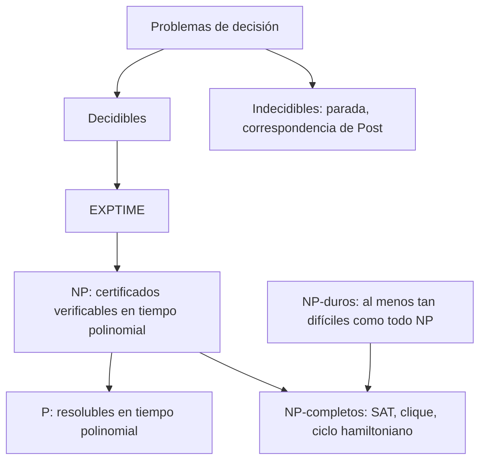

# Análisis de Algoritmos - Conceptos básicos

## 1.2 Tipos de problemas.

---

Los problemas computacionales se clasifican de dos maneras complementarias. Por la **forma de la respuesta**: problemas de decisión (sí o no), de búsqueda (encontrar una solución), de optimización (encontrar la mejor) y de conteo. Y por su **dificultad**: los que se resuelven en tiempo polinomial (clase P), aquellos cuyas soluciones se verifican en tiempo polinomial (clase NP), los más difíciles de NP (NP-completos) y los que ningún algoritmo puede resolver (indecidibles). Este tema define estas clases, la herramienta que las relaciona, la **reducción polinomial**, y muestra cómo pasar de un tipo de problema a otro.

### Por la forma de la respuesta

| Tipo | Pregunta | Ejemplo |
| --- | --- | --- |
| decisión | ¿existe una solución? (sí o no) | ¿tiene $G$ un ciclo hamiltoniano? |
| búsqueda | encontrar una solución | dar un camino de $s$ a $t$ |
| optimización | encontrar la mejor solución | el camino más corto de $s$ a $t$ |
| conteo | ¿cuántas soluciones hay? | número de árboles generadores de $G$ |

**Optimización y decisión.** A cada problema de optimización corresponde uno de decisión que agrega un umbral $k$ y pregunta si hay una solución de valor al menos $k,$ o a lo sumo $k$ si se minimiza. La versión de decisión **no es más difícil**: si se resuelve la optimización, basta comparar el óptimo con $k.$ Y casi siempre **tampoco es más fácil**: si los valores son enteros entre 0 y $V,$ una búsqueda binaria sobre $k$ encuentra el óptimo con $\lceil \log_2 (V + 1) \rceil$ llamadas a la versión de decisión. Por eso la teoría de la complejidad se formula con problemas de decisión: son más simples de definir y no pierden nada esencial.

Un problema de decisión se identifica con un **lenguaje**: el conjunto $L$ de las cadenas que codifican instancias cuya respuesta es "sí". Resolverlo es decidir, para una cadena $x,$ si $x \in L.$

### Las clases P y NP

- **P** es la clase de problemas de decisión que un algoritmo determinista resuelve en tiempo $O(n^c)$ para alguna constante $c,$ donde $n$ es el tamaño de la entrada. Ejemplos: ¿es $G$ bipartita?, ¿hay un camino de $s$ a $t$ de longitud a lo sumo $k?,$ ¿es $n$ primo? (algoritmo AKS, 2002).
- **NP** es la clase de problemas de decisión para los que existe un **verificador** polinomial: un algoritmo $V(x, c)$ tal que $x$ tiene respuesta "sí" si y solo si existe un **certificado** $c,$ de longitud polinomial en $|x|,$ con $V(x, c) =$ "acepta". Equivalentemente, los que una máquina **no determinista** resuelve en tiempo polinomial (tema 5.1). Ejemplos: ciclo hamiltoniano (el certificado es el ciclo), satisfacibilidad de fórmulas booleanas (el certificado es una asignación), mochila (el subconjunto de objetos).

**Proposición.** $\text{P} \subseteq \text{NP}.$

**Demostración.** Si $A$ se resuelve en tiempo polinomial con un algoritmo $M,$ el verificador $V(x, c)$ ignora $c$ y ejecuta $M(x).$ El certificado vacío sirve para toda instancia "sí". $\blacksquare$

Si $\text{P} = \text{NP}$ es el problema abierto más importante de la computación (uno de los Problemas del Milenio del Instituto Clay). La creencia general es que no: encontrar una solución parece mucho más difícil que comprobarla.

### Reducciones y NP-completitud

Un problema $A$ se **reduce en tiempo polinomial** a $B,$ escrito $A \leq_p B,$ si existe una función $f$ calculable en tiempo polinomial tal que, para toda instancia $x,$ la respuesta a $x$ en $A$ es "sí" si y solo si la respuesta a $f(x)$ en $B$ es "sí". Intuitivamente, $B$ es al menos tan difícil como $A.$

**Ejemplo.** Un conjunto independiente de $G$ (vértices sin aristas entre ellos) es exactamente un clique (vértices todos adyacentes entre sí) en el complemento $\bar{G}.$ Por tanto $f(G, k) = (\bar{G}, k)$ es una reducción de CONJUNTO-INDEPENDIENTE a CLIQUE, y se calcula en $O(n^2).$

- $B$ es **NP-duro** si $A \leq_p B$ para todo $A \in \text{NP}.$
- $B$ es **NP-completo** si es NP-duro y además $B \in \text{NP}.$

**Teorema de Cook y Levin** (1971). SAT, la satisfacibilidad de fórmulas booleanas, es NP-completo. A partir de él, Karp (1972) mostró por reducciones en cadena que 21 problemas clásicos lo son: clique, cubierta de vértices, ciclo hamiltoniano, mochila, coloración con 3 colores, entre otros. Para probar que un problema nuevo $B$ es NP-completo basta mostrar que $B \in \text{NP}$ y que $A \leq_p B$ para algún $A$ ya conocido como NP-completo, por la transitividad de $\leq_p.$

Un problema NP-duro no tiene por qué estar en NP: la versión de optimización del agente viajero no es un problema de decisión, y el problema de la parada es NP-duro e indecidible.

### Problemas indecidibles

Un problema es **indecidible** si ningún algoritmo lo resuelve correctamente para todas las instancias. El ejemplo fundamental es el **problema de la parada** (Turing, 1936): dado un programa $P$ y una entrada $x,$ ¿termina $P$ con la entrada $x?$ Otros: la correspondencia de Post, decidir si dos gramáticas libres de contexto generan el mismo lenguaje, el décimo problema de Hilbert (si una ecuación diofántica tiene solución entera) y, por el teorema de Rice, cualquier propiedad no trivial del comportamiento de los programas.

### Otras clasificaciones

- **Numéricos y no numéricos.** Los numéricos operan sobre números reales y les preocupan la precisión y la estabilidad (sistemas de ecuaciones, integración); los no numéricos son combinatorios (ordenamiento, gráficas, cadenas).
- **En línea y fuera de línea.** Un algoritmo en línea recibe la entrada por partes y debe responder sin conocer el resto (paginación, asignación de memoria); se mide con la razón competitiva frente al óptimo fuera de línea.
- **Pseudopolinomiales.** La mochila se resuelve en $O(nW)$ con programación dinámica: polinomial en el **valor** $W,$ pero exponencial en su número de bits, $\log W.$ Por eso no contradice que sea NP-completo.



### Implementación en Python

El programa resuelve los problemas en P del ejercicio 1 (bipartición y ruta más corta con BFS), comprueba en 300 gráficas aleatorias la reducción de conjunto independiente a clique, implementa el verificador polinomial de certificados de ciclo hamiltoniano (ejercicio 3), construye el programa diagonal del problema de la parada (ejercicio 4) y obtiene el óptimo de una mochila haciendo búsqueda binaria con su versión de decisión (ejercicio 5).

```python
from collections import deque
from itertools import combinations, permutations

# --- Ejercicio 1: dos problemas en P ---
def bipartita(n, aristas):
    """Decisión: ¿la gráfica es bipartita? BFS con 2 colores, O(n + m)."""
    ady = [[] for _ in range(n)]
    for u, v in aristas:
        ady[u].append(v); ady[v].append(u)
    color = [None] * n
    for s in range(n):
        if color[s] is not None:
            continue
        color[s] = 0
        cola = deque([s])
        while cola:
            u = cola.popleft()
            for v in ady[u]:
                if color[v] is None:
                    color[v] = 1 - color[u]; cola.append(v)
                elif color[v] == color[u]:
                    return False, None
    return True, color

def ruta_corta(n, aristas, s, t):
    """Búsqueda: un camino con el menor número de aristas (BFS)."""
    ady = [[] for _ in range(n)]
    for u, v in aristas:
        ady[u].append(v); ady[v].append(u)
    padre = {s: None}
    cola = deque([s])
    while cola:
        u = cola.popleft()
        for v in ady[u]:
            if v not in padre:
                padre[v] = u; cola.append(v)
    if t not in padre:
        return None
    camino = [t]
    while padre[camino[-1]] is not None:
        camino.append(padre[camino[-1]])
    return camino[::-1]

ciclo6 = [(i, (i + 1) % 6) for i in range(6)]
ciclo5 = [(i, (i + 1) % 5) for i in range(5)]
print("ejercicio 1:")
print("   C6 bipartita:", bipartita(6, ciclo6))
print("   C5 bipartita:", bipartita(5, ciclo5)[0])
print("   ruta más corta 0 -> 3 en C6:", ruta_corta(6, ciclo6, 0, 3))
def compuesto_certificado(n, d):
    return 1 < d < n and n % d == 0
print("   91 compuesto, certificado d = 7:", compuesto_certificado(91, 7))

# --- Ejercicio 2: una reducción polinomial concreta ---
# CONJUNTO-INDEPENDIENTE(G, k) <=p CLIQUE(complemento de G, k)
def clique_fuerza_bruta(n, E, k):
    return any(all(frozenset(p) in E for p in combinations(S, 2))
               for S in combinations(range(n), k))

def indep_fuerza_bruta(n, E, k):
    return any(all(frozenset(p) not in E for p in combinations(S, 2))
               for S in combinations(range(n), k))

def reduccion(n, E, k):
    """Transforma la instancia en O(n^2): complemento de la gráfica."""
    Ec = {frozenset(p) for p in combinations(range(n), 2)} - E
    return n, Ec, k

import random
random.seed(5)
coinciden = 0
for _ in range(300):
    n = random.randint(1, 7)
    E = {frozenset(p) for p in combinations(range(n), 2) if random.random() < 0.5}
    k = random.randint(1, n)
    assert indep_fuerza_bruta(n, E, k) == clique_fuerza_bruta(*reduccion(n, E, k))
    coinciden += 1
print("ejercicio 2: independiente(G, k) = clique(complemento, k) en", coinciden, "gráficas aleatorias")

# --- Ejercicio 3: verificador de certificados para ciclo hamiltoniano ---
def verifica_hamiltoniano(n, aristas, cert):
    """O(n + m): el certificado es una permutación de los vértices."""
    E = {frozenset(e) for e in aristas}
    if sorted(cert) != list(range(n)):
        return False
    return all(frozenset((cert[i], cert[(i + 1) % n])) in E for i in range(n))

def busca_hamiltoniano(n, aristas):
    """Fuerza bruta: hasta (n-1)! certificados."""
    for p in permutations(range(1, n)):
        c = (0,) + p
        if verifica_hamiltoniano(n, aristas, c):
            return c
    return None

cubo = [(0,1),(1,3),(3,2),(2,0),(4,5),(5,7),(7,6),(6,4),(0,4),(1,5),(2,6),(3,7)]
c = busca_hamiltoniano(8, cubo)
print("ejercicio 3: cubo, certificado", c, "válido:", verifica_hamiltoniano(8, cubo, c))
print("   certificado falso (0..7 en orden):", verifica_hamiltoniano(8, cubo, list(range(8))))
estrella = [(0, i) for i in range(1, 5)]
print("   estrella K1,4 tiene ciclo hamiltoniano:", busca_hamiltoniano(5, estrella) is not None)

# --- Ejercicio 4: el argumento diagonal del problema de la parada ---
def diagonal(para):
    """Dado un supuesto decisor para(prog, entrada), construye D."""
    def D(prog):
        if para(prog, prog):
            while True:
                pass
        return "terminó"
    return D

def para_ingenuo(prog, entrada):
    return True          # cualquier candidato a decisor

D = diagonal(para_ingenuo)
print("ejercicio 4: el decisor dice que D(D) termina:", para_ingenuo(D, D),
      "-> pero entonces D(D) entra en un ciclo infinito: contradicción")

# --- Ejercicio 5: mochila, optimización a partir de decisión ---
pesos = [12, 7, 11, 8, 9]
valores = [24, 13, 23, 15, 16]
W = 26
llamadas = 0

def mochila_decision(k):
    """¿Hay un subconjunto con peso <= W y valor >= k? (fuerza bruta)."""
    global llamadas
    llamadas += 1
    n = len(pesos)
    return any(sum(pesos[i] for i in S) <= W and sum(valores[i] for i in S) >= k
               for r in range(n + 1) for S in combinations(range(n), r))

def mochila_optimo():
    lo, hi = 0, sum(valores)   # búsqueda binaria sobre k
    while lo < hi:
        mid = (lo + hi + 1) // 2
        if mochila_decision(mid):
            lo = mid
        else:
            hi = mid - 1
    return lo

def mochila_pd():
    T = [0] * (W + 1)
    for p, v in zip(pesos, valores):
        for c in range(W, p - 1, -1):
            T[c] = max(T[c], T[c - p] + v)
    return T[W]

opt = mochila_optimo()
print("ejercicio 5: óptimo por búsqueda binaria =", opt, "con", llamadas,
      "llamadas a la versión de decisión; programación dinámica =", mochila_pd())
```

Salida:

```text
ejercicio 1:
   C6 bipartita: (True, [0, 1, 0, 1, 0, 1])
   C5 bipartita: False
   ruta más corta 0 -> 3 en C6: [0, 1, 2, 3]
   91 compuesto, certificado d = 7: True
ejercicio 2: independiente(G, k) = clique(complemento, k) en 300 gráficas aleatorias
ejercicio 3: cubo, certificado (0, 1, 3, 2, 6, 7, 5, 4) válido: True
   certificado falso (0..7 en orden): False
   estrella K1,4 tiene ciclo hamiltoniano: False
ejercicio 4: el decisor dice que D(D) termina: True -> pero entonces D(D) entra en un ciclo infinito: contradicción
ejercicio 5: óptimo por búsqueda binaria = 51 con 6 llamadas a la versión de decisión; programación dinámica = 51
```

El verificador del ciclo hamiltoniano es lineal, pero encontrar el certificado requirió probar permutaciones: es la asimetría entre verificar y buscar que separa, presumiblemente, a NP de P.

### Ejercicios Propuestos

1. **Clasificación.** Para cada problema, indica si es de decisión, búsqueda u optimización, y su clase de complejidad:
   - encontrar el camino más corto entre dos vértices;
   - determinar si una gráfica es bipartita;
   - encontrar la asignación óptima de recursos;
   - verificar si un número es compuesto.

2. **Reducciones.** Demuestra que si $A \leq_p B$ y $B \in \text{P},$ entonces $A \in \text{P}.$

3. **Certificados.** Para el problema del ciclo hamiltoniano, describe un certificado verificable en tiempo polinomial.

4. **Indecidibilidad.** Explica por qué el problema de la parada es indecidible.

5. **De optimización a decisión.** ¿Cómo se transforma un problema de optimización en su versión de decisión? Ejemplifica con la mochila y muestra cómo recuperar el óptimo.

### Soluciones

**Ejercicio 1.**

- **Camino más corto:** de optimización (o de búsqueda, si se pide el camino). Está en P: BFS en $O(n + m)$ sin pesos, Dijkstra con pesos no negativos (tema 4.3). Su versión de decisión, que pregunta si hay un camino de longitud a lo sumo $k,$ está en P.
- **Bipartita:** de decisión, en P: se colorea con BFS alternando dos colores y se responde "no" si una arista une dos vértices del mismo color, en $O(n + m).$ Equivale a no tener ciclos impares, por eso $C_6$ es bipartita y $C_5$ no.
- **Asignación óptima de recursos:** de optimización. Depende del modelo: la asignación de $n$ tareas a $n$ agentes con costos (problema de asignación) está en P con el método húngaro, $O(n^3);$ con capacidades y valores enteros, como la mochila, su versión de decisión es NP-completa.
- **Compuesto:** de decisión. Está en NP, porque un divisor $d$ con $1 \lt d \lt n$ es un certificado, como $d = 7$ para $91;$ y, por el algoritmo AKS, también está en P.

**Ejercicio 2.** Sea $f$ la reducción, calculable en tiempo $O(n^a),$ y $M_B$ un algoritmo para $B$ en tiempo $O(n^b).$ Para decidir $x \in A,$ se calcula $f(x)$ y se ejecuta $M_B(f(x)).$ La respuesta es correcta por la definición de reducción. En cuanto al tiempo, $|f(x)| = O(|x|^a),$ porque un algoritmo no puede escribir más símbolos que pasos ejecuta; así, $M_B$ tarda $O((|x|^a)^b) = O(|x|^{ab}),$ y el total es $O(|x|^a + |x|^{ab}),$ polinomial. $\blacksquare$ El contrapositivo es la forma útil: si $A \leq_p B$ y $A$ no está en P, $B$ tampoco.

**Ejercicio 3.** El certificado es una secuencia $v_1, \ldots, v_n$ de los vértices. El verificador comprueba que es una permutación (cada vértice aparece exactamente una vez, $O(n)$ con un arreglo de marcas) y que $\{v_i, v_{i+1}\}$ es arista para $i = 1, \ldots, n - 1,$ así como $\{v_n, v_1\},$ en $O(n)$ con una tabla de aristas. El certificado tiene longitud $O(n \log n)$ bits. Por tanto, ciclo hamiltoniano está en NP.

**Ejercicio 4.** Supón que existe un algoritmo $\text{PARA}(P, x)$ que siempre termina y responde si $P$ termina con la entrada $x.$ Construye el programa $D(P):$ si $\text{PARA}(P, P)$ responde "sí", $D$ entra en un ciclo infinito; si responde "no", $D$ termina. Ahora considera $D(D).$ Si $D(D)$ termina, entonces $\text{PARA}(D, D)$ respondió "sí" y $D$ entró en un ciclo infinito: contradicción. Si $D(D)$ no termina, $\text{PARA}(D, D)$ respondió "no" y $D$ terminó: contradicción. Luego $\text{PARA}$ no existe. $\blacksquare$ Es el argumento diagonal de Cantor: $D$ difiere de cada programa en su comportamiento con su propio código como entrada.

**Ejercicio 5.** Mochila de optimización: dados pesos $w_i,$ valores $v_i$ y capacidad $W,$ maximizar $\sum_{i \in S} v_i$ sujeto a $\sum_{i \in S} w_i \leq W.$ Versión de decisión: dado además $k,$ ¿existe $S$ con $\sum_{i \in S} w_i \leq W$ y $\sum_{i \in S} v_i \geq k?$ Para recuperar el óptimo se hace búsqueda binaria de $k$ en $[0, \sum v_i]:$ el mayor $k$ con respuesta "sí" es el valor óptimo. En el programa, con $\sum v_i = 91,$ bastan 6 llamadas y el resultado, 51, coincide con la programación dinámica. Para obtener el conjunto, se prueba quitar cada objeto: si el óptimo sin él sigue siendo 51, se descarta, y si no, pertenece a la solución.

### Referencias

1. Cormen, T. H., Leiserson, C. E., Rivest, R. L., and Stein, C., _Introduction to Algorithms_. MIT Press, 2022. Capítulo 34.
2. Garey, M. R., and Johnson, D. S., _Computers and Intractability: A Guide to the Theory of NP-Completeness_. W. H. Freeman, 1979.
3. Sipser, M., _Introduction to the Theory of Computation_. Cengage, 2012. Capítulos 4 y 7.
4. Karp, R. M., Reducibility among combinatorial problems. En _Complexity of Computer Computations_, Plenum, 1972.
