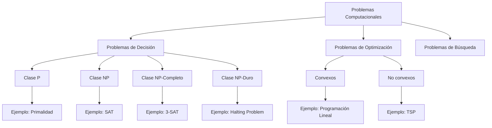
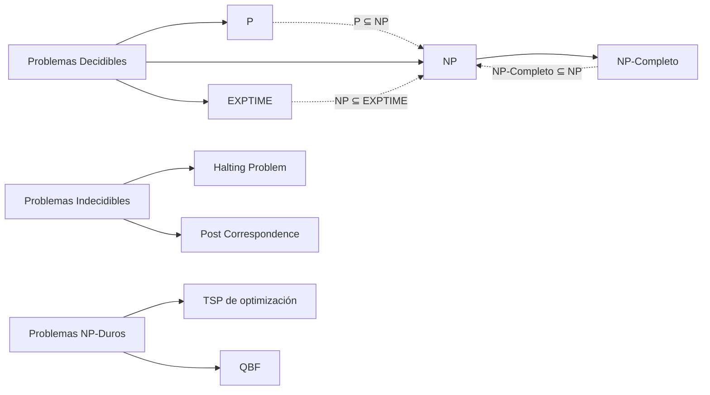

# Análisis de Algoritmos - Conceptos básicos

## 1.2 Tipos de problemas.

---

### Clasificación de Problemas Computacionales

En el análisis de algoritmos, los problemas se clasifican según su complejidad computacional y naturaleza. Esta clasificación es fundamental para seleccionar el enfoque algorítmico apropiado.

### Problemas de Decisión vs. Problemas de Optimización

#### Problemas de Decisión

Son problemas cuya respuesta es **SÍ** o **NO**. Formalmente, un problema de decisión es un subconjunto $L \subseteq \Sigma^*$ donde $\Sigma$ es un alfabeto finito.

**Ejemplo**: El problema de la primalidad:

- **Entrada**: Un número entero $n > 1$
- **Pregunta**: ¿Es $n$ un número primo?

#### Problemas de Optimización

Buscan encontrar la **mejor solución** según algún criterio entre todas las soluciones factibles. Constan de:

- Función objetivo: $f: S \rightarrow \mathbb{R}$ a maximizar/minimizar
- Restricciones que definen las soluciones factibles

**Ejemplo**: Problema del viajante (TSP):

- **Entrada**: Grafo completo con pesos en las aristas
- **Objetivo**: Encontrar el ciclo Hamiltoniano de mínimo costo

### Clases de Complejidad Computacional

#### Problemas P (Polinomiales)

Problemas de decisión que pueden resolverse en tiempo polinomial por una máquina de Turing determinística.

$$P = \{L: \exists \text{ algoritmo determinístico que decide } L \text{ en tiempo } O(n^k) \text{ para algún } k\}$$

**Ejemplo**: Ordenamiento, búsqueda en grafos (BFS/DFS)

#### Problemas NP (No Determinístico Polinomial)

Problemas de decisión donde una solución propuesta puede **verificarse** en tiempo polinomial.

$$NP = \{L: \exists \text{ algoritmo que verifica certificados en tiempo polinomial}\}$$

**Ejemplo**: Problema de la mochila, problema de satisfabilidad booleana (SAT)



### Problemas NP-Completos y NP-Duros

#### Problemas NP-Completos

Son los problemas más difíciles en NP. Un problema $L$ es NP-completo si:

1. $L \in NP$
2. Todo problema en NP se reduce a $L$ en tiempo polinomial

**Ejemplo**: 3-SAT, problema de la clique, problema del vertex cover

#### Problemas NP-Duros

Problemas al menos tan difíciles como los problemas NP-completos, pero que no necesariamente están en NP.

**Ejemplo**: Problema de la parada (halting problem), problema de optimización del TSP

### Problemas Indecidibles

Problemas para los cuales **no existe algoritmo** que los resuelva para todas las instancias.

$$L \text{ es indecidible} \iff \nexists \text{ algoritmo que decide } L \text{ para todas las entradas}$$

**Ejemplo**: Problema de la parada, problema de la correspondencia de Post.

### Problemas de Búsqueda vs. Decisión

#### Problemas de Búsqueda

Encontrar una solución específica que satisfaga ciertas propiedades.

**Ejemplo**: Encontrar un ciclo Hamiltoniano en un grafo.

#### Problemas de Decisión

Determinar si existe una solución con ciertas propiedades.

**Ejemplo**: ¿Existe un ciclo Hamiltoniano en el grafo?

### Problemas Numéricos vs. No Numéricos

#### Problemas Numéricos

Involucran operaciones matemáticas con números.

$$f(x) = x^2 + 2x + 1$$

**Ejemplo**: Resolución de ecuaciones, integración numérica.

#### Problemas No Numéricos

Manejan estructuras discretas como grafos, cadenas, etc.

**Ejemplo**: Ordenamiento, búsqueda en grafos, procesamiento de texto.

### Ejemplos de Diferentes Tipos de Problemas

```python
# Ejemplo: Problema de decisión (Primalidad)
def es_primo(n):
    """Decide si n es primo"""
    if n < 2:
        return False
    for i in range(2, int(n**0.5) + 1):
        if n % i == 0:
            return False
    return True

# Ejemplo: Problema de optimización (Máximo subarreglo)
def max_subarray_sum(arr):
    """Encuentra la suma máxima de un subarreglo contiguo"""
    max_actual = max_global = arr[0]
    for i in range(1, len(arr)):
        max_actual = max(arr[i], max_actual + arr[i])
        max_global = max(max_global, max_actual)
    return max_global
```

### Relaciones Entre Clases de Complejidad

$$P \subseteq NP$$
$$NP\text{-completo} \subseteq NP$$
$$NP\text{-duro} \cap NP = NP\text{-completo}$$
$$Indecidibles \cap P = \emptyset$$

**Problema abierto**: ¿Es $P = NP$?

### Ejercicios Propuestos

1. **Clasificación de problemas**: Para cada problema, indique si es de decisión, optimización o búsqueda, y su clase de complejidad probable:
   - Encontrar el camino más corto entre dos nodos
   - Determinar si un grafo es bipartito
   - Encontrar la asignación óptima de recursos
   - Verificar si un número es compuesto

2. **Reducciones polinomiales**: Demuestre que si el problema A se reduce al problema B en tiempo polinomial y B ∈ P, entonces A ∈ P.

3. **Verificación de certificados**: Para el problema del ciclo Hamiltoniano, describa qué constituiría un certificado verificable en tiempo polinomial.

4. **Problemas indecidibles**: Investigue y explique por qué el problema de la parada es indecidible.

5. **Transformación entre tipos**: ¿Cómo transformaría un problema de optimización en su versión de decisión? Ejemplifique con el problema de la mochila.

### Diagrama de Relaciones de Complejidad



### Aplicaciones Prácticas

- **Problemas P**: Aplicaciones en tiempo real, procesamiento de grandes volúmenes de datos
- **Problemas NP-completos**: Requieren heurísticas o aproximaciones para instancias grandes
- **Problemas indecidibles**: Limitaciones fundamentales de la computación

### Referencias

1. Cormen, T. H., et al. (2009). _Introduction to Algorithms_ (Capítulo 34: NP-Completeness)
2. Kleinberg, J., & Tardos, É. (2005). _Algorithm Design_ (Capítulo 8: NP and Computational Intractability)
3. Dasgupta, S., et al. (2006). _Algorithms_ (Capítulo 8: NP-complete Problems)
4. Garey, M. R., & Johnson, D. S. (1979). _Computers and Intractability: A Guide to the Theory of NP-Completeness_

Esta clasificación de problemas es fundamental para comprender los límites y posibilidades de la computación algorítmica, así como para seleccionar las estrategias adecuadas según el tipo de problema a resolver.
