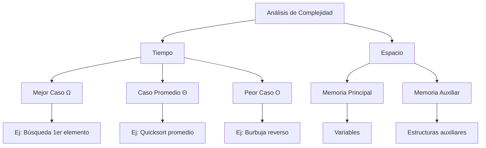

# Análisis de Algoritmos - Conceptos básicos

## 1.3 Complejidad.

---

### Introducción a la Complejidad Computacional

La **complejidad computacional** estudia los recursos requeridos por un algoritmo para resolver un problema, principalmente el **tiempo** y **espacio** necesarios. El análisis de complejidad nos permite comparar algoritmos y predecir su comportamiento con entradas grandes.

### Notación Asintótica

La notación asintótica describe el comportamiento de funciones cuando el argumento tiende hacia infinito.

#### Notación O Grande (Cota Superior Asintótica)

$$f(n) = O(g(n)) \iff \exists c > 0, n_0 > 0 \text{ tal que } 0 \leq f(n) \leq c \cdot g(n) \text{ para todo } n \geq n_0$$

**Ejemplo**: $2n^2 + 3n + 1 = O(n^2)$

#### Notación Ω (Cota Inferior Asintótica)

$$f(n) = \Omega(g(n)) \iff \exists c > 0, n_0 > 0 \text{ tal que } 0 \leq c \cdot g(n) \leq f(n) \text{ para todo } n \geq n_0$$

**Ejemplo**: $2n^2 + 3n + 1 = \Omega(n^2)$

#### Notación Θ (Cota Ajustada Asintótica)

$$f(n) = \Theta(g(n)) \iff f(n) = O(g(n)) \text{ y } f(n) = \Omega(g(n))$$

**Ejemplo**: $2n^2 + 3n + 1 = \Theta(n^2)$

### Complejidad de Tiempo

Mide la cantidad de **operaciones elementales** que realiza un algoritmo en función del tamaño de entrada.

#### Clases de Complejidad Comunes

```python
# Ejemplo: Complejidad constante O(1)
def acceso_directo(arreglo, indice):
    return arreglo[indice]  # Una operación

# Ejemplo: Complejidad lineal O(n)
def suma_arreglo(arreglo):
    total = 0
    for elemento in arreglo:  # n iteraciones
        total += elemento
    return total

# Ejemplo: Complejidad cuadrática O(n²)
def pares_arreglo(arreglo):
    pares = []
    for i in range(len(arreglo)):  # n iteraciones
        for j in range(len(arreglo)):  # n iteraciones
            pares.append((arreglo[i], arreglo[j]))
    return pares
```

### Complejidad de Espacio

Mide la cantidad de **memoria** requerida por un algoritmo en función del tamaño de entrada.

```python
# Ejemplo: Complejidad de espacio O(n)
def duplicar_arreglo(arreglo):
    resultado = []  # Espacio adicional O(n)
    for elemento in arreglo:
        resultado.append(elemento * 2)
    return resultado
```

### Análisis de Casos

#### Mejor Caso

El mínimo tiempo/espacio requerido para cualquier entrada de tamaño n.

#### Caso Promedio

El tiempo/espacio esperado para una entrada aleatoria.

#### Peor Caso

El máximo tiempo/espacio requerido para cualquier entrada de tamaño n.



### Reglas para el Análisis de Complejidad

1. **Regla de la suma**: $O(f(n)) + O(g(n)) = O(\max(f(n), g(n)))$
2. **Regla del producto**: $O(f(n)) \cdot O(g(n)) = O(f(n) \cdot g(n))$
3. **Ignorar constantes**: $O(2n) = O(n)$, $O(3n²) = O(n²)$
4. **Dominancia asintótica**: $O(1) < O(\log n) < O(n) < O(n \log n) < O(n²) < O(2^n)$

### Ejemplos de Análisis

```python
def algoritmo_complejo(n):
    # O(1) - constante
    resultado = 0

    # O(n) - lineal
    for i in range(n):
        resultado += i

    # O(n²) - cuadrático
    for i in range(n):
        for j in range(n):
            resultado += i * j

    # O(log n) - logarítmico
    k = n
    while k > 1:
        k = k // 2
        resultado += k

    return resultado  # Complejidad total: O(n²)
```

### Jerarquía de Complejidades

$$O(1) < O(\log n) < O(n) < O(n \log n) < O(n^2) < O(n^3) < O(2^n) < O(n!)$$

### Complejidades Comunes y Ejemplos

| Complejidad    | Ejemplo               | Descripción  |
| -------------- | --------------------- | ------------ |
| **O(1)**       | Acceso a array        | Constante    |
| **O(log n)**   | Búsqueda binaria      | Logarítmica  |
| **O(n)**       | Búsqueda lineal       | Lineal       |
| **O(n log n)** | Mergesort, Heapsort   | Linealítmica |
| **O(n²)**      | Bubblesort, selección | Cuadrática   |
| **O(2ⁿ)**      | Fibonacci recursivo   | Exponencial  |
| **O(n!)**      | Problema del viajante | Factorial    |

### Análisis de Algoritmos Recursivos

Para algoritmos recursivos, usamos **ecuaciones de recurrencia**:

**Ejemplo**: Mergesort

$$T(n) = 2T\left(\frac{n}{2}\right) + O(n)$$

Solución: $T(n) = O(n \log n)$

**Ejemplo**: Fibonacci recursivo

$$T(n) = T(n-1) + T(n-2) + O(1)$$

Solución: $T(n) = O(2^n)$

### Ejercicios Propuestos

1. **Análisis de complejidad**: Determine la complejidad temporal y espacial del siguiente algoritmo:

```python
def algoritmo_misterioso(n):
    matriz = [[0] * n for _ in range(n)]  # O(n²) espacio
    for i in range(n):  # O(n)
        for j in range(i, n):  # O(n/2) en promedio
            matriz[i][j] = i * j
    return matriz
```

2. **Notación asintótica**: Demuestre formalmente que:
   - $3n^3 + 2n^2 + 5 = O(n^3)$
   - $2^n + n^3 = \Omega(2^n)$
   - $4n \log n + 2n = \Theta(n \log n)$

3. **Comparación de algoritmos**: Dados dos algoritmos:
   - Algoritmo A: $T(n) = 100n^2$
   - Algoritmo B: $T(n) = 2^n$

   ¿Para qué valores de n es mejor cada algoritmo?

4. **Análisis recursivo**: Resuelva la recurrencia:

   $$T(n) = 3T\left(\frac{n}{2}\right) + O(n)$$

5. **Optimización de espacio**: Reescriba el siguiente algoritmo para reducir su complejidad espacial:

```python
def duplicados(arreglo):
    visto = set()  # O(n) espacio
    duplicados = []  # O(n) espacio
    for elemento in arreglo:
        if elemento in visto:
            duplicados.append(elemento)
        else:
            visto.add(elemento)
    return duplicados
```

### Técnicas de Análisis

1. **Análisis iterativo**: Expandir la recurrencia iterativamente
2. **Árbol de recurrencia**: Visualizar las llamadas recursivas
3. **Teorema maestro**: Para recurrencias de la forma:

   $$T(n) = aT\left(\frac{n}{b}\right) + f(n)$$

### Casos del Teorema Maestro

1. Si $f(n) = O(n^{\log_b a - \epsilon})$ para $\epsilon > 0$, entonces $T(n) = \Theta(n^{\log_b a})$
2. Si $f(n) = \Theta(n^{\log_b a})$, entonces $T(n) = \Theta(n^{\log_b a} \log n)$
3. Si $f(n) = \Omega(n^{\log_b a + \epsilon})$ y $af(n/b) \leq cf(n)$ para $c < 1$, entonces $T(n) = \Theta(f(n))$

### Referencias

1. Cormen, T. H., et al. (2009). _Introduction to Algorithms_ (Capítulos 2-4: Growth of Functions, Recurrences)
2. Kleinberg, J., & Tardos, É. (2005). _Algorithm Design_ (Capítulo 2: Basics of Algorithm Analysis)
3. Dasgupta, S., et al. (2006). _Algorithms_ (Capítulo 0: Prologue)
4. Knuth, D. E. (1997). _The Art of Computer Programming_ (Vol. 1: Fundamental Algorithms)
