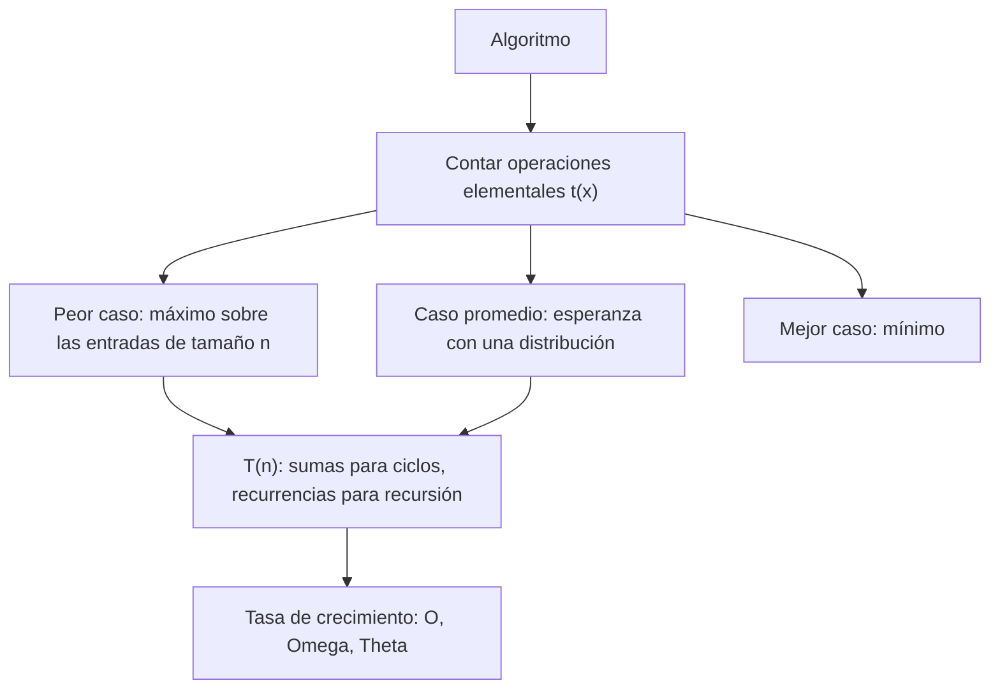

# Análisis de Algoritmos - Conceptos básicos

## 1.3 Complejidad.

---

La **complejidad** de un algoritmo es la cantidad de recursos que consume en función del tamaño de su entrada. Los recursos habituales son el **tiempo**, medido como número de operaciones elementales, y el **espacio**, medido como memoria adicional a la entrada. Medir en segundos no sirve para comparar algoritmos, porque depende de la máquina, del compilador y de la carga del sistema; contar operaciones en un modelo de cómputo (tema 1.4) da una medida independiente de todo eso, y la notación asintótica (tema 2.1) permite ignorar los factores constantes y quedarse con la **tasa de crecimiento**. Este tema introduce estas medidas, los análisis de mejor caso, peor caso y caso promedio, y las técnicas básicas para calcularlos.

### Función de complejidad

Sea $A$ un algoritmo y $I_n$ el conjunto de instancias de tamaño $n.$ Si $t(x)$ es el número de operaciones elementales que $A$ ejecuta con la entrada $x,$ se definen:

- **Peor caso:** $T(n) = \max_{x \in I_n} t(x).$ Es una garantía: el algoritmo nunca tarda más.
- **Mejor caso:** $T_{\min}(n) = \min_{x \in I_n} t(x).$ Rara vez es útil por sí solo.
- **Caso promedio:** $T_{\text{prom}}(n) = \sum_{x \in I_n} \Pr[x] \, t(x),$ para una distribución de probabilidad sobre las entradas que hay que suponer explícitamente.

**Ejemplo: búsqueda lineal** de $x$ en $A[1..n].$ Si $x = A[1]$ se hace 1 comparación (mejor caso); si $x$ no está, $n$ (peor caso). Si $x$ está y es igualmente probable que esté en cualquier posición, el promedio es

$$\frac{1}{n} \sum_{i=1}^{n} i = \frac{n + 1}{2}.$$

Los tres son lineales en este caso, pero no siempre coinciden: quicksort hace $\Theta(n \log n)$ comparaciones en promedio y $\Theta(n^2)$ en el peor caso.

### Notación asintótica

Para comparar funciones de complejidad se usan tres notaciones, que el tema 2.1 estudia a fondo:

- $f(n) = O(g(n))$ si existen $c > 0$ y $n_0$ con $f(n) \leq c \, g(n)$ para todo $n \geq n_0:$ cota superior.
- $f(n) = \Omega(g(n))$ si existen $c > 0$ y $n_0$ con $f(n) \geq c \, g(n)$ para todo $n \geq n_0:$ cota inferior.
- $f(n) = \Theta(g(n))$ si se cumplen ambas: cota ajustada.

Para demostrar una de ellas basta exhibir las constantes $c$ y $n_0.$ Las clases más frecuentes, de menor a mayor crecimiento:

| Clase | Nombre | Ejemplo |
| --- | --- | --- |
| $O(1)$ | constante | acceso a un arreglo por índice |
| $O(\log n)$ | logarítmica | búsqueda binaria |
| $O(n)$ | lineal | búsqueda lineal, máximo |
| $O(n \log n)$ | casi lineal | mergesort, heapsort |
| $O(n^2)$ | cuadrática | ordenamiento por inserción |
| $O(n^3)$ | cúbica | multiplicación de matrices clásica |
| $O(2^n)$ | exponencial | probar todos los subconjuntos |
| $O(n!)$ | factorial | probar todas las permutaciones |

La diferencia es dramática: con $10^9$ operaciones por segundo, un algoritmo $O(n \log n)$ procesa $n = 10^9$ en unos 30 segundos, mientras que uno $O(2^n)$ con $n = 60$ tardaría más de 36 años.

### Reglas para calcular la complejidad

1. **Operaciones elementales** (asignación, aritmética, comparación, acceso por índice): $O(1).$
2. **Secuencia:** la suma, que asintóticamente es el máximo: $O(f) + O(g) = O(\max(f, g)).$
3. **Condicional:** el costo de la condición más el de la rama más cara (en el peor caso).
4. **Ciclo:** la suma de los costos de cada iteración. Si todas cuestan lo mismo, el número de iteraciones por el costo de una; si no, hay que sumar una serie.
5. **Llamada recursiva:** se plantea una **recurrencia** y se resuelve (tema 2.3).

**Ejemplo.** En dos ciclos anidados donde el interno va de $i$ a $n,$ el número de iteraciones internas es

$$\sum_{i=0}^{n-1} (n - i) = n + (n - 1) + \cdots + 1 = \frac{n(n + 1)}{2} = \Theta(n^2).$$

### Complejidad espacial

Se cuenta la memoria **adicional** a la entrada: variables, estructuras auxiliares y la pila de recursión. Un algoritmo que usa $O(1)$ espacio adicional se llama **en el lugar** (_in place_). Tiempo y espacio suelen intercambiarse: una tabla de dispersión acelera las búsquedas a costa de memoria, y la programación dinámica guarda resultados para no recalcularlos.



### Implementación en Python

El programa mide los tres casos de la búsqueda lineal, cuenta las asignaciones de `algoritmo_misterioso` (ejercicio 1), comprueba numéricamente las constantes de las demostraciones del ejercicio 2, encuentra el punto de cruce del ejercicio 3, evalúa la recurrencia del ejercicio 4 contra su forma cerrada y compara tres versiones de `duplicados` (ejercicio 5), midiendo la memoria con `tracemalloc`.

```python
import math, random, tracemalloc

# --- Casos de la búsqueda lineal: comparaciones ---
def comparaciones_busqueda(A, x):
    for i, a in enumerate(A, 1):
        if a == x:
            return i
    return len(A)

n = 1000
A = list(range(n))
mejor = comparaciones_busqueda(A, 0)
peor = comparaciones_busqueda(A, -1)
promedio = sum(comparaciones_busqueda(A, x) for x in A) / n
print(f"búsqueda lineal, n = {n}: mejor {mejor}, peor {peor}, promedio {promedio} = (n + 1)/2")

# --- Ejercicio 1: algoritmo_misterioso ---
def algoritmo_misterioso(n):
    asignaciones = 0
    matriz = [[0] * n for _ in range(n)]
    for i in range(n):
        for j in range(i, n):
            matriz[i][j] = i * j
            asignaciones += 1
    return matriz, asignaciones

print("ejercicio 1:")
for n in (10, 100, 1000):
    _, a = algoritmo_misterioso(n)
    print(f"   n = {n:4}: {a:6} asignaciones, n(n+1)/2 = {n*(n+1)//2:6}, celdas = {n*n}")

# --- Ejercicio 2: comprobar las constantes de las demostraciones ---
N = range(1, 10**5)
assert all(3*n**3 + 2*n**2 + 5 <= 10 * n**3 for n in N)
assert all(2**n + n**3 >= 2**n for n in range(1, 2000))
assert all(4*n*math.log2(n) <= 4*n*math.log2(n) + 2*n <= 6*n*math.log2(n) for n in range(2, 10**5))
print("ejercicio 2: c = 10, n0 = 1 | c = 1, n0 = 1 | c1 = 4, c2 = 6, n0 = 2: comprobadas")

# --- Ejercicio 3: 100 n^2 frente a 2^n ---
mejor_B = [n for n in range(1, 40) if 2**n < 100 * n**2]
print("ejercicio 3: 2^n < 100 n^2 para n =", mejor_B[0], "...", mejor_B[-1],
      f"| n = 14: {100*14**2} vs {2**14} | n = 15: {100*15**2} vs {2**15}")

# --- Ejercicio 4: T(n) = 3T(n/2) + n, T(1) = 1 ---
def T(n):
    return 1 if n == 1 else 3 * T(n // 2) + n

print("ejercicio 4:")
for k in (4, 8, 12, 16, 20):
    n = 2**k
    cerrada = 3 * 3**k - 2 * n       # 3 n^{lg 3} - 2n, con n^{lg 3} = 3^k
    print(f"   n = 2^{k:<2}: T(n) = {T(n):11}, 3n^lg3 - 2n = {cerrada:11},"
          f" T(n)/n^lg3 = {T(n) / 3**k:.4f}")

# --- Ejercicio 5: duplicados con menos memoria ---
def duplicados(arreglo):
    visto, dup = set(), []
    for e in arreglo:
        if e in visto:
            dup.append(e)
        else:
            visto.add(e)
    return dup

def duplicados_in_situ(arreglo):
    """Ordena en el lugar y reporta cada valor repetido una vez."""
    arreglo.sort()
    res = []
    for i in range(1, len(arreglo)):
        if arreglo[i] == arreglo[i - 1] and (i == 1 or arreglo[i - 1] != arreglo[i - 2]):
            res.append(arreglo[i])
    return res

def duplicados_marcas(arreglo):
    """Valores en 1..n: se marca el índice v-1 cambiando el signo. O(n), O(1) extra."""
    res = []
    for e in arreglo:
        v = abs(e)
        if arreglo[v - 1] < 0:
            res.append(v)
        else:
            arreglo[v - 1] = -arreglo[v - 1]
    return res

random.seed(3)
datos = [random.randint(1, 50) for _ in range(50)]
esperado = sorted(set(duplicados(datos)))
print("ejercicio 5:", esperado == duplicados_in_situ(datos[:]),
      "| valores repetidos:", len(esperado))
d = [4, 3, 2, 7, 8, 2, 3, 1]
print("   marcas de signo con", d, "->", sorted(set(duplicados_marcas(d[:]))))

def memoria(f, x):
    tracemalloc.start()
    f(x)
    pico = tracemalloc.get_traced_memory()[1]
    tracemalloc.stop()
    return pico

grande = list(range(200000)) + [5, 7]
random.shuffle(grande)
print(f"   memoria extra con n = {len(grande)}: conjunto {memoria(duplicados, grande[:]) // 1024} KiB,"
      f" ordenando {memoria(duplicados_in_situ, grande[:]) // 1024} KiB")
```

Salida:

```text
búsqueda lineal, n = 1000: mejor 1, peor 1000, promedio 500.5 = (n + 1)/2
ejercicio 1:
   n =   10:     55 asignaciones, n(n+1)/2 =     55, celdas = 100
   n =  100:   5050 asignaciones, n(n+1)/2 =   5050, celdas = 10000
   n = 1000: 500500 asignaciones, n(n+1)/2 = 500500, celdas = 1000000
ejercicio 2: c = 10, n0 = 1 | c = 1, n0 = 1 | c1 = 4, c2 = 6, n0 = 2: comprobadas
ejercicio 3: 2^n < 100 n^2 para n = 1 ... 14 | n = 14: 19600 vs 16384 | n = 15: 22500 vs 32768
ejercicio 4:
   n = 2^4 : T(n) =         211, 3n^lg3 - 2n =         211, T(n)/n^lg3 = 2.6049
   n = 2^8 : T(n) =       19171, 3n^lg3 - 2n =       19171, T(n)/n^lg3 = 2.9220
   n = 2^12: T(n) =     1586131, 3n^lg3 - 2n =     1586131, T(n)/n^lg3 = 2.9846
   n = 2^16: T(n) =   129009091, 3n^lg3 - 2n =   129009091, T(n)/n^lg3 = 2.9970
   n = 2^20: T(n) = 10458256051, 3n^lg3 - 2n = 10458256051, T(n)/n^lg3 = 2.9994
ejercicio 5: True | valores repetidos: 14
   marcas de signo con [4, 3, 2, 7, 8, 2, 3, 1] -> [2, 3]
   memoria extra con n = 200002: conjunto 12288 KiB, ordenando 781 KiB
```

### Ejercicios Propuestos

1. **Análisis.** Determina la complejidad temporal y espacial de:

   ```python
   def algoritmo_misterioso(n):
       matriz = [[0] * n for _ in range(n)]
       for i in range(n):
           for j in range(i, n):
               matriz[i][j] = i * j
       return matriz
   ```

2. **Notación asintótica.** Demuestra formalmente que:
   - $3n^3 + 2n^2 + 5 = O(n^3);$
   - $2^n + n^3 = \Omega(2^n);$
   - $4n \log n + 2n = \Theta(n \log n).$

3. **Comparación.** Un algoritmo A tarda $T_A(n) = 100n^2$ y uno B tarda $T_B(n) = 2^n.$ ¿Para qué valores de $n$ conviene cada uno?

4. **Recurrencia.** Resuelve $T(n) = 3T(n/2) + O(n).$

5. **Espacio.** Reescribe el siguiente algoritmo para reducir su complejidad espacial:

   ```python
   def duplicados(arreglo):
       visto = set()
       duplicados = []
       for elemento in arreglo:
           if elemento in visto:
               duplicados.append(elemento)
           else:
               visto.add(elemento)
       return duplicados
   ```

### Soluciones

**Ejercicio 1.** Crear la matriz cuesta $n^2$ asignaciones. Los ciclos hacen $\sum_{i=0}^{n-1} (n - i) = n(n + 1)/2$ asignaciones, como confirma el programa. Tiempo total: $n^2 + n(n + 1)/2 = \Theta(n^2).$ Espacio: $\Theta(n^2)$ por la matriz, aunque solo se usa el triángulo superior; guardándolo como un arreglo de $n(n + 1)/2$ posiciones se ahorra la mitad, pero sigue siendo $\Theta(n^2).$

**Ejercicio 2.**

- Para $n \geq 1,$ $2n^2 \leq 2n^3$ y $5 \leq 5n^3,$ así que $3n^3 + 2n^2 + 5 \leq 10n^3:$ $c = 10,$ $n_0 = 1.$
- Para $n \geq 1,$ $n^3 \geq 0,$ así que $2^n + n^3 \geq 2^n:$ $c = 1,$ $n_0 = 1.$
- Cota inferior: $4n \log n + 2n \geq 4n \log n$ para todo $n \geq 1.$ Cota superior: para $n \geq 2,$ $\log_2 n \geq 1,$ así que $2n \leq 2n \log_2 n$ y $4n \log n + 2n \leq 6n \log n.$ Con $c_1 = 4,$ $c_2 = 6,$ $n_0 = 2.$

**Ejercicio 3.** $2^n \lt 100n^2$ para $1 \leq n \leq 14;$ en $n = 14,$ $16384 \lt 19600.$ En cambio, $2^n > 100n^2$ desde $n = 15,$ donde $32768 > 22500,$ en adelante, porque la razón $2^n / n^2$ es creciente para $n \geq 3.$ El algoritmo B conviene solo hasta $n = 14;$ a partir de $n = 15,$ A es mejor y la diferencia crece sin límite: con $n = 50,$ A hace $2.5 \times 10^5$ operaciones y B más de $10^{15}.$

**Ejercicio 4.** Con $T(1) = 1$ y $n = 2^k,$ al desarrollar:

$$T(n) = n + \tfrac{3}{2} n + \left(\tfrac{3}{2}\right)^2 n + \cdots + \left(\tfrac{3}{2}\right)^{k-1} n + 3^k = 2n\left(\left(\tfrac{3}{2}\right)^k - 1\right) + 3^k = 3 \cdot 3^k - 2n.$$

Como $3^k = 3^{\log_2 n} = n^{\log_2 3},$ queda $T(n) = 3n^{\log_2 3} - 2n = \Theta(n^{\log_2 3}) \approx \Theta(n^{1.585}).$ El programa confirma la forma cerrada y que $T(n)/n^{\log_2 3}$ tiende a 3. Es el caso 1 del teorema maestro (tema 2.3): $f(n) = n = O(n^{\log_2 3 - \epsilon}),$ y es la recurrencia del algoritmo de Karatsuba para multiplicar enteros.

**Ejercicio 5.** El original usa $O(n)$ espacio adicional para `visto`, además de la salida. Dos alternativas:

- **Ordenar en el lugar** y recorrer comparando vecinos: los duplicados quedan contiguos. Tiempo $O(n \log n);$ espacio adicional $O(1)$ con heapsort. El `sort` de Python (Timsort) usa un búfer temporal de hasta $n/2$ referencias, que es lo que mide el programa; aun así, ocupa mucho menos que el conjunto.
- Si los valores están entre 1 y $n,$ **marcar con el signo**: al ver $v,$ se niega $A[v - 1];$ si ya era negativo, $v$ es un duplicado. Tiempo $O(n)$ y espacio $O(1),$ a cambio de modificar la entrada (se puede restaurar al final).

### Referencias

1. Cormen, T. H., Leiserson, C. E., Rivest, R. L., and Stein, C., _Introduction to Algorithms_. MIT Press, 2022. Capítulos 2 y 3.
2. Kleinberg, J., and Tardos, É., _Algorithm Design_. Pearson, 2006. Capítulo 2.
3. Dasgupta, S., Papadimitriou, C., and Vazirani, U., _Algorithms_. McGraw-Hill, 2006. Capítulo 0.
4. Knuth, D. E., _The Art of Computer Programming, Vol. 1: Fundamental Algorithms_. Addison-Wesley, 1997. Sección 1.2.
