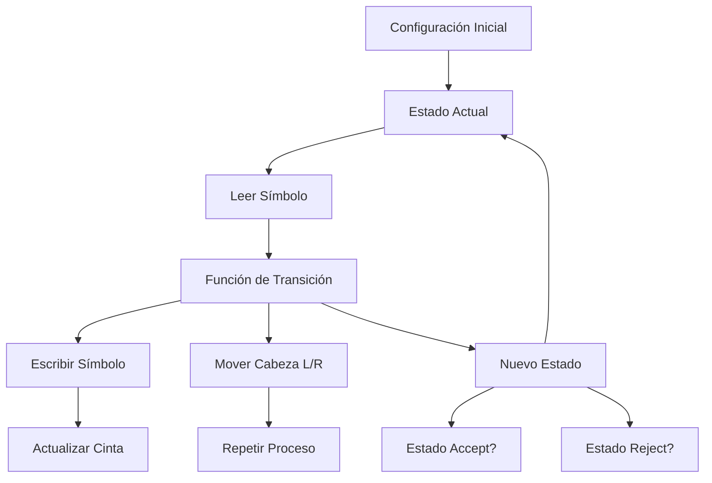
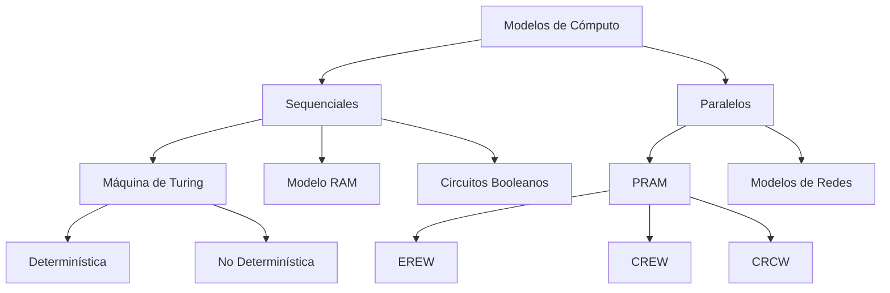

# Análisis de Algoritmos - Conceptos básicos

## 1.4 Modelos de cómputo.

---

### Introducción a los Modelos de Cómputo

Un **modelo de cómputo** es una abstracción matemática que define las operaciones permitidas y sus costos. Estos modelos nos permiten analizar algoritmos de manera formal independientemente del hardware específico.

### Máquina de Turing (MT)

La **Máquina de Turing** es el modelo de cómputo más fundamental, propuesto por Alan Turing en 1936. Constituye la base teórica de la computación moderna.

#### Definición Formal

Una Máquina de Turing es una 7-tupla:

$$M = (Q, \Sigma, \Gamma, \delta, q_0, q_{\text{accept}}, q_{\text{reject}})$$

Donde:

- $Q$: Conjunto finito de estados
- $\Sigma$: Alfabeto de entrada
- $\Gamma$: Alfabeto de la cinta $(\Sigma \subseteq \Gamma)$
- $\delta$: Función de transición $(Q \times \Gamma \rightarrow Q \times \Gamma \times \{L, R\})$
- $q_0$: Estado inicial
- $q_{\text{accept}}$: Estado de aceptación
- $q_{\text{reject}}$: Estado de rechazo



#### Ejemplo: Máquina de Turing para palíndromos

```python
# Pseudocódigo para MT que detecta palíndromos
def mt_palindromo(cinta):
    """
    Máquina de Turing que decide si una cadena es palíndromo
    """
    estado = 'q0'
    cabeza = 0
    while estado not in ['accept', 'reject']:
        simbolo = cinta[cabeza]

        if estado == 'q0':
            if simbolo == '0':
                cinta[cabeza] = 'X'
                cabeza += 1
                estado = 'q1'
            elif simbolo == '1':
                cinta[cabeza] = 'X'
                cabeza += 1
                estado = 'q2'
            elif simbolo == 'X' or simbolo == ' ':
                estado = 'accept'

        # Estados intermedios q1, q2, q3, q4...
        # Transiciones para verificar palíndromo

    return estado == 'accept'
```

### Modelo RAM (Random Access Machine)

El **modelo RAM** es un modelo de computación que simula una computadora real con memoria de acceso aleatorio. Es más práctico para el análisis de algoritmos.

#### Características del Modelo RAM

- Memoria infinita organizada en celdas
- Operaciones básicas con costo unitario:
  - Operaciones aritméticas: $+, -, \times, /$
  - Comparaciones: $<, >, =$
  - Acceso a memoria: lectura/escritura
  - Control: saltos condicionales

#### Ejemplo: Análisis en modelo RAM

```python
def busqueda_binaria(arr, target):
    """
    Búsqueda binaria en modelo RAM
    Costo: O(log n) operaciones
    """
    left, right = 0, len(arr) - 1  # 2 operaciones
    operaciones = 0

    while left <= right:  # log n iteraciones
        mid = (left + right) // 2  # 3 operaciones por iteración
        operaciones += 3

        if arr[mid] == target:  # 2 operaciones
            return mid, operaciones
        elif arr[mid] < target:  # 2 operaciones
            left = mid + 1  # 2 operaciones
        else:
            right = mid - 1  # 2 operaciones

    return -1, operaciones
```

### Modelo de Circuitos Booleanos

Los **circuitos booleanos** son modelos de cómputo que utilizan compuertas lógicas para procesar información.

#### Complejidad de Circuitos

- **Tamaño del circuito**: Número de compuertas
- **Profundidad del circuito**: Longitud del camino más largo

$$C(x_1, x_2, ..., x_n) = \text{circuito que computa } f: \{0,1\}^n \rightarrow \{0,1\}$$

### Modelo PRAM (Parallel Random Access Machine)

Extensión paralela del modelo RAM que permite el estudio de algoritmos paralelos.

#### Tipos de PRAM

1. **EREW**: Exclusive Read, Exclusive Write
2. **CREW**: Concurrent Read, Exclusive Write
3. **CRCW**: Concurrent Read, Concurrent Write



### Máquina de Turing No Determinística

Extensión de la MT que permite múltiples transiciones desde un estado.

$$NTM = (Q, \Sigma, \Gamma, \Delta, q_0, q_{\text{accept}}, q_{\text{reject}})$$

Donde $\Delta \subseteq Q \times \Gamma \times Q \times \Gamma \times \{L, R\}$

### Jerarquía de Modelos de Cómputo

#### Tesis de Church-Turing

"Todo algoritmo puede ser implementado en una Máquina de Turing"

#### Relaciones entre Modelos

- MT ≡ Modelo RAM (polinomialmente equivalentes)
- MT Determinística ≡ MT No Determinística (¿P = NP?)
- Circuitos booleanos polinomiales ≡ MT

### Análisis de Complejidad en Diferentes Modelos

#### Teorema de Invariancia

Los modelos de cómputo razonables son polinomialmente equivalentes:

$$T_{\text{RAM}}(n) = O(T_{\text{MT}}(n)^k) \quad \text{para algún } k$$

#### Ejemplo: Multiplicación de matrices

```python
def multiplicar_matrices(A, B):
    """
    Multiplicación de matrices en modelo RAM
    Complejidad: O(n³) operaciones
    """
    n = len(A)
    C = [[0] * n for _ in range(n)]
    operaciones = 0

    for i in range(n):  # n iteraciones
        for j in range(n):  # n iteraciones
            for k in range(n):  # n iteraciones
                C[i][j] += A[i][k] * B[k][j]  # 2 operaciones
                operaciones += 2

    return C, operaciones  # Total: 2n³ operaciones
```

### Modelos de Cómputo Cuántico

Extensión de los modelos clásicos que utiliza qubits y superposición cuántica.

#### Circuito Cuántico

$$|\psi\rangle = \alpha|0\rangle + \beta|1\rangle \quad \text{donde } |\alpha|^2 + |\beta|^2 = 1$$

### Ejercicios Propuestos

1. **Diseño de MT**: Diseñe una Máquina de Turing que compute la función:

   $$f(n) = n + 1 \quad \text{(sucesor)}$$

   para números binarios.

2. **Análisis de complejidad**: Para el algoritmo de búsqueda binaria en modelo RAM:
   - Calcule el número exacto de operaciones en el peor caso
   - Compare con la implementación en MT

3. **Conversión de modelos**: Demuestre cómo simular una operación RAM de acceso aleatorio en una MT en tiempo polinomial.

4. **Circuitos booleanos**: Diseñe un circuito booleano para sumar dos números de 2 bits.

5. **Análisis PRAM**: Analice la complejidad del algoritmo de suma paralela en modelo PRAM CRCW.

6. **Equivalencia de modelos**: Demuestre que una MT de k cintas puede simularse por una MT de 1 cinta con complejidad:

   $$T'(n) = O(T(n)^2)$$

### Referencias

1. Cormen, T. H., et al. (2009). _Introduction to Algorithms_ (Capítulo 1: The Role of Algorithms in Computing)
2. Sipser, M. (2012). _Introduction to the Theory of Computation_ (Capítulos 3-5: Models of Computation)
3. Papadimitriou, C. H. (1994). _Computational Complexity_ (Capítulo 2: Models of Computation)
4. Arora, S., & Barak, B. (2009). _Computational Complexity: A Modern Approach_ (Capítulo 1: The computational model - and why it doesn't matter)

### Aplicaciones Prácticas

- **MT**: Fundamentos teóricos, límites de la computación
- **RAM**: Análisis práctico de algoritmos
- **PRAM**: Diseño de algoritmos paralelos
- **Circuitos**: Diseño de hardware, chips VLSI
