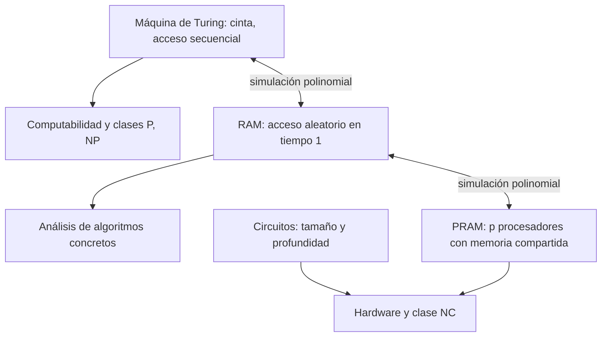

# Análisis de Algoritmos - Conceptos básicos

## 1.4 Modelos de cómputo.

---

Para decir que un algoritmo hace $T(n)$ "operaciones" hay que fijar qué operaciones están permitidas y cuánto cuesta cada una: eso es un **modelo de cómputo**. La **máquina de Turing** es el modelo de la teoría de la computabilidad y de las clases de complejidad; la **máquina de acceso aleatorio** (RAM) es el modelo en el que se analizan los algoritmos concretos, porque se parece a una computadora real; los **circuitos booleanos** y la **PRAM** modelan el cómputo en hardware y en paralelo. Este tema define cada modelo, compara sus costos y explica por qué, pese a sus diferencias, todos los modelos razonables coinciden en qué es computable y, hasta un factor polinomial, en qué es eficiente.

### Máquina de Turing

Una **máquina de Turing** (MT) determinista es una tupla $M = (Q, \Sigma, \Gamma, \delta, q_0, q_f)$ donde:

- $Q$ es un conjunto finito de estados, con un estado inicial $q_0$ y uno final $q_f;$
- $\Sigma$ es el alfabeto de entrada y $\Gamma \supseteq \Sigma \cup \{\sqcup\}$ el de la cinta, con el símbolo blanco $\sqcup;$
- $\delta : Q \times \Gamma \to Q \times \Gamma \times \{L, R, S\}$ es la función de transición.

La máquina tiene una cinta infinita dividida en casillas y una cabeza que lee una casilla. En cada paso, según el estado actual y el símbolo leído, $\delta$ indica el nuevo estado, el símbolo que se escribe y si la cabeza se mueve a la izquierda, a la derecha o se queda. La entrada se escribe al principio de la cinta y la máquina se detiene al llegar a $q_f.$ Su **tiempo** es el número de pasos y su **espacio** el número de casillas visitadas.

**Tesis de Church y Turing.** Toda función calculable por un procedimiento efectivo es calculable por una máquina de Turing. No es un teorema (procedimiento efectivo no tiene definición formal), pero todos los modelos propuestos (cálculo lambda, funciones recursivas, máquinas RAM, lenguajes de programación) han resultado equivalentes a ella.

**Variantes.** Una MT de $k$ cintas, cada una con su cabeza, se simula con una de una cinta en tiempo $O(T(n)^2)$ (ejercicio 6). Una MT **no determinista** tiene una relación de transición en lugar de una función y acepta si **alguna** rama de cómputo acepta; se simula con una determinista en tiempo $2^{O(T(n))}.$ Esa brecha exponencial es la pregunta P frente a NP (tema 1.2).

### Máquina de acceso aleatorio

La **RAM** tiene una memoria de celdas $M[0], M[1], \ldots$ direccionables, un conjunto finito de registros y un programa de instrucciones: cargar y almacenar (con direccionamiento indirecto), aritmética, que incluye suma, resta, multiplicación y división entera,, comparaciones y saltos.

- **Costo uniforme:** cada instrucción cuesta 1. Es el modelo de los libros de algoritmos. Para que sea realista, se supone que las palabras tienen $O(\log n)$ bits (**word-RAM**); si no, multiplicar repetidamente produciría números de tamaño exponencial en tiempo lineal.
- **Costo logarítmico:** cada instrucción cuesta el número de bits de sus operandos. Es más preciso cuando los números crecen, como en la aritmética de enteros grandes.

La diferencia esencial con la MT es el **acceso aleatorio**: leer $M[i]$ cuesta 1, sin importar $i,$ mientras que la cabeza de una MT tiene que recorrer la cinta hasta la casilla $i.$

### Circuitos booleanos

Un **circuito** es una gráfica dirigida acíclica cuyos nodos son entradas, compuertas AND, OR y NOT, y salidas. Su **tamaño** es el número de compuertas (el trabajo total) y su **profundidad** la longitud del camino más largo de una entrada a una salida (el tiempo en paralelo). Un circuito tiene un número fijo de entradas, así que un problema se resuelve con una **familia** $C_1, C_2, \ldots,$ un circuito por tamaño. La clase **NC** contiene los problemas con circuitos de tamaño polinomial y profundidad $O(\log^k n):$ los que se paralelizan muy bien.

### PRAM

La **PRAM** (_Parallel RAM_) tiene $p$ procesadores RAM sincronizados que comparten una memoria. En cada paso todos leen, calculan y escriben. Las variantes difieren en los accesos simultáneos a una misma celda:

| Variante | Lectura concurrente | Escritura concurrente |
| --- | --- | --- |
| EREW | no | no |
| CREW | sí | no |
| CRCW | sí | sí, con una regla: común (todos escriben lo mismo), arbitraria, prioritaria o combinante (se escribe la suma, el máximo, etc.) |

Se miden el **tiempo** $T_p(n)$ y el **trabajo** $p \cdot T_p(n).$ Un algoritmo paralelo es **óptimo en trabajo** si su trabajo es del mismo orden que el tiempo del mejor algoritmo secuencial.

### Invariancia de los modelos

**Tesis extendida de Church y Turing.** Los modelos deterministas razonables se simulan entre sí con una pérdida a lo sumo **polinomial**: una RAM con costo logarítmico que tarda $T(n)$ se simula en una MT en tiempo $O(T(n)^3)$ (ejercicio 3), y una MT se simula en una RAM en tiempo $O(T(n)).$ Por eso las clases P y NP son las mismas en cualquier modelo, y la distinción entre "polinomial" y "exponencial" no depende de la máquina. Los factores polinomiales sí cambian: la búsqueda binaria es $O(\log n)$ en RAM y $\Omega(n)$ en MT (ejercicio 2). Las computadoras cuánticas son la única excepción plausible conocida a la versión extendida: factorizan enteros en tiempo polinomial con el algoritmo de Shor.



### Implementación en Python

El programa implementa un simulador de máquinas de Turing y la máquina del sucesor binario (ejercicio 1), compara las iteraciones de la búsqueda binaria en RAM con las casillas que tendría que recorrer la cabeza de una MT (ejercicio 2), verifica en las 16 entradas el circuito sumador de 2 bits (ejercicio 4) y simula la suma en árbol en una PRAM EREW y el OR en un paso en una CRCW común (ejercicio 5).

```python
import math

# --- Ejercicio 1: máquina de Turing para el sucesor binario ---
def ejecuta_mt(delta, cinta, q0="q0", aceptacion=("qf",), blanco="_", max_pasos=10**6):
    cinta = dict(enumerate(cinta))
    q, cabeza, pasos = q0, 0, 0
    while q not in aceptacion:
        s = cinta.get(cabeza, blanco)
        q, escribe, mov = delta[(q, s)]
        cinta[cabeza] = escribe
        cabeza += {"R": 1, "L": -1, "S": 0}[mov]
        pasos += 1
        assert pasos < max_pasos
    izq, der = min(cinta), max(cinta)
    salida = "".join(cinta.get(i, blanco) for i in range(izq, der + 1)).strip(blanco)
    return salida, pasos

sucesor = {
    ("q0", "0"): ("q0", "0", "R"),   # ir al final del número
    ("q0", "1"): ("q0", "1", "R"),
    ("q0", "_"): ("q1", "_", "L"),
    ("q1", "1"): ("q1", "0", "L"),   # acarreo: 1 -> 0 y seguir
    ("q1", "0"): ("qf", "1", "S"),   # 0 -> 1 y terminar
    ("q1", "_"): ("qf", "1", "S"),   # desbordamiento: nuevo dígito
}

print("ejercicio 1:")
for x in ["0", "1", "1011", "111", "10011", "1111111"]:
    y, pasos = ejecuta_mt(sucesor, x)
    assert int(y, 2) == int(x, 2) + 1
    print(f"   {x:>8} -> {y:>8}  ({pasos} pasos)")
ok = all(int(ejecuta_mt(sucesor, bin(n)[2:])[0], 2) == n + 1 for n in range(2000))
print("   correcto para 0 <= n < 2000:", ok)

# --- Ejercicio 2: búsqueda binaria, RAM frente a MT ---
def busqueda_binaria(A, x):
    lo, hi, comps, posiciones = 0, len(A) - 1, 0, []
    while lo <= hi:
        mid = (lo + hi) // 2
        posiciones.append(mid)
        comps += 1
        if A[mid] == x:
            return mid, comps, posiciones
        if A[mid] < x:
            lo = mid + 1
        else:
            hi = mid - 1
    return -1, comps, posiciones

print("ejercicio 2:")
for n in (15, 1000, 10**5):
    A = list(range(0, 2 * n, 2))
    peor_comp = peor_mov = 0
    for x in range(-1, 2 * n + 1):
        _, c, pos = busqueda_binaria(A, x)
        mov = pos[0] + sum(abs(a - b) for a, b in zip(pos, pos[1:]))
        peor_comp, peor_mov = max(peor_comp, c), max(peor_mov, mov)
    print(f"   n = {n:6}: iteraciones RAM {peor_comp} = floor(lg n) + 1 = {math.floor(math.log2(n)) + 1},"
          f" casillas recorridas por la cabeza de una MT >= {peor_mov}")

# --- Ejercicio 4: circuito sumador de 2 bits ---
XOR = lambda a, b: a ^ b
AND = lambda a, b: a & b
OR  = lambda a, b: a | b

def sumador_2bits(a1, a0, b1, b0):
    s0 = XOR(a0, b0)              # medio sumador
    c0 = AND(a0, b0)
    t  = XOR(a1, b1)              # sumador completo
    s1 = XOR(t, c0)
    c1 = OR(AND(a1, b1), AND(t, c0))
    return c1, s1, s0             # 7 compuertas, profundidad 3

ok = all(4 * c + 2 * s1 + s0 == (2 * a1 + a0) + (2 * b1 + b0)
         for a1 in (0, 1) for a0 in (0, 1) for b1 in (0, 1) for b0 in (0, 1)
         for c, s1, s0 in [sumador_2bits(a1, a0, b1, b0)])
print("ejercicio 4: sumador de 2 bits correcto en las 16 entradas:", ok,
      "| 3 + 2 =", sumador_2bits(1, 1, 1, 0))

# --- Ejercicio 5: suma en PRAM ---
def suma_pram_arbol(A):
    """EREW: en el paso k, el procesador i suma B[i] + B[i + 2^k]."""
    B, n, pasos, procesadores = A[:], len(A), 0, 0
    salto = 1
    while salto < n:
        activos = list(range(0, n - salto, 2 * salto))
        procesadores = max(procesadores, len(activos))
        lecturas = [(i, B[i] + B[i + salto]) for i in activos]   # todos leen
        for i, v in lecturas:                                     # luego escriben
            B[i] = v
        salto *= 2
        pasos += 1
    return B[0], pasos, procesadores

def or_crcw_comun(bits):
    """CRCW común: todo procesador con bit 1 escribe 1 en la misma celda. 1 paso."""
    celda = 0
    escrituras = [1 for b in bits if b]
    if escrituras:
        assert len(set(escrituras)) == 1   # todos escriben el mismo valor
        celda = 1
    return celda, 1

print("ejercicio 5:")
for n in (8, 1000, 2**20):
    A = list(range(1, n + 1))
    s, pasos, p = suma_pram_arbol(A)
    assert s == n * (n + 1) // 2
    print(f"   n = {n:7}: suma {s:12} en {pasos:2} pasos = ceil(lg n), hasta {p} procesadores,"
          f" trabajo total {n - 1}")
print("   OR de 1000 bits en CRCW común:", or_crcw_comun([0] * 999 + [1]))
```

Salida:

```text
ejercicio 1:
          0 ->        1  (3 pasos)
          1 ->       10  (4 pasos)
       1011 ->     1100  (8 pasos)
        111 ->     1000  (8 pasos)
      10011 ->    10100  (9 pasos)
    1111111 -> 10000000  (16 pasos)
   correcto para 0 <= n < 2000: True
ejercicio 2:
   n =     15: iteraciones RAM 4 = floor(lg n) + 1 = 4, casillas recorridas por la cabeza de una MT >= 14
   n =   1000: iteraciones RAM 10 = floor(lg n) + 1 = 10, casillas recorridas por la cabeza de una MT >= 1000
   n = 100000: iteraciones RAM 17 = floor(lg n) + 1 = 17, casillas recorridas por la cabeza de una MT >= 100002
ejercicio 4: sumador de 2 bits correcto en las 16 entradas: True | 3 + 2 = (1, 0, 1)
ejercicio 5:
   n =       8: suma           36 en  3 pasos = ceil(lg n), hasta 4 procesadores, trabajo total 7
   n =    1000: suma       500500 en 10 pasos = ceil(lg n), hasta 500 procesadores, trabajo total 999
   n = 1048576: suma 549756338176 en 20 pasos = ceil(lg n), hasta 524288 procesadores, trabajo total 1048575
   OR de 1000 bits en CRCW común: (1, 1)
```

### Ejercicios Propuestos

1. **Diseño de una MT.** Diseña una máquina de Turing que calcule el sucesor $f(n) = n + 1$ de un número escrito en binario.

2. **Búsqueda binaria.** Calcula el número exacto de iteraciones de la búsqueda binaria en el peor caso en el modelo RAM y compáralo con una implementación en una MT.

3. **Simulación.** Muestra cómo simular el acceso aleatorio de una RAM en una MT en tiempo polinomial.

4. **Circuitos.** Diseña un circuito booleano que sume dos números de 2 bits.

5. **PRAM.** Analiza la complejidad de la suma de $n$ números en una PRAM, en particular en el modelo CRCW.

6. **Equivalencia.** Demuestra que una MT de $k$ cintas que tarda $T(n)$ se simula con una MT de una cinta en tiempo $O(T(n)^2).$

### Soluciones

**Ejercicio 1.** Con la cabeza en el primer dígito, el estado $q_0$ avanza a la derecha hasta el primer blanco y pasa a $q_1$ moviéndose a la izquierda. El estado $q_1$ propaga el acarreo: cambia cada 1 por 0 y sigue a la izquierda; al encontrar un 0 o un blanco, escribe 1 y termina.

| Estado | Lee | Escribe | Mueve | Nuevo estado |
| --- | --- | --- | --- | --- |
| $q_0$ | 0 | 0 | R | $q_0$ |
| $q_0$ | 1 | 1 | R | $q_0$ |
| $q_0$ | $\sqcup$ | $\sqcup$ | L | $q_1$ |
| $q_1$ | 1 | 0 | L | $q_1$ |
| $q_1$ | 0 | 1 | S | $q_f$ |
| $q_1$ | $\sqcup$ | 1 | S | $q_f$ |

Con $k$ dígitos y $t$ unos finales, tarda $(k + 1) + t + 1$ pasos: a lo sumo $2k + 2 = O(k),$ con el máximo en $1^k,$ como muestra el programa con $1111111.$

**Ejercicio 2.** En la RAM, cada iteración reduce el intervalo de tamaño $m$ a uno de tamaño a lo sumo $\lfloor m/2 \rfloor,$ así que el peor caso hace exactamente $\lfloor \log_2 n \rfloor + 1$ iteraciones, cada una con un número constante de instrucciones (comparación del ciclo, cálculo de la mitad, carga, una o dos comparaciones y una asignación): $\Theta(\log n)$ en total. En una MT de una cinta con el arreglo escrito en ella, la cabeza debe ir a la posición central, luego a la de un cuarto, y así sucesivamente: recorre al menos $n/2 + n/4 + \cdots \approx n$ casillas, como confirma el programa, y además cada clave ocupa $\Theta(\log n)$ casillas. La búsqueda binaria en MT es $\Omega(n),$ no mejor que la lineal: el acceso aleatorio es lo que la hace rápida.

**Ejercicio 3.** La MT guarda la memoria de la RAM en una cinta como una lista de pares $\#\text{dirección}\#\text{valor}$ y los registros en otra. Para ejecutar una carga $M[i],$ recorre la lista comparando cada dirección con $i;$ un almacenamiento modifica el par o agrega uno al final. Si la RAM tarda $T$ pasos con costo logarítmico, ha tocado a lo sumo $T$ celdas y cada número tiene $O(T)$ bits, así que la lista mide $O(T^2)$ casillas y cada instrucción se simula en $O(T^2)$ pasos: $O(T^3)$ en total con varias cintas, y $O(T^6)$ con una, por el ejercicio 6. Polinomial en ambos casos.

**Ejercicio 4.** Con $A = a_1 a_0$ y $B = b_1 b_0,$ el bit menos significativo usa un medio sumador y el otro un sumador completo:

$$s_0 = a_0 \oplus b_0, \quad c_0 = a_0 \land b_0, \quad s_1 = a_1 \oplus b_1 \oplus c_0, \quad c_1 = (a_1 \land b_1) \lor ((a_1 \oplus b_1) \land c_0).$$

El resultado es $c_1 s_1 s_0.$ Son 7 compuertas (3 XOR, 3 AND, 1 OR), reutilizando $a_1 \oplus b_1,$ con profundidad 3. El programa lo verifica en las 16 combinaciones; por ejemplo, $3 + 2 = 101_2.$

**Ejercicio 5.** En EREW, la **suma en árbol**: en el paso $k,$ el procesador $i$ suma $B[i] + B[i + 2^k],$ para los $i$ múltiplos de $2^{k+1};$ en cada paso se lee cada celda una sola vez. Tarda $\lceil \log_2 n \rceil$ pasos con $n/2$ procesadores. El trabajo, contado como $p \cdot T_p,$ es $\Theta(n \log n);$ usando $n / \log n$ procesadores, cada uno suma primero $\log n$ elementos secuencialmente y luego se aplica el árbol, para tiempo $O(\log n)$ y trabajo $O(n),$ óptimo. En **CRCW**, la lectura y escritura concurrentes no ayudan a la suma con las reglas común, arbitraria o prioritaria: sigue necesitando $\Theta(\log n / \log \log n)$ pasos con un número polinomial de procesadores (Beame y Håstad). Sí ayudan a otros problemas: el OR de $n$ bits se calcula en 1 paso, como en el programa, y el máximo en $O(1)$ con $n^2$ procesadores. Solo la CRCW **combinante**, cuya escritura simultánea guarda la suma de los valores, obtiene la suma en $O(1),$ y es un modelo poco realista.

**Ejercicio 6.** La cinta única se divide en $2k$ **pistas**: la pista $2j - 1$ guarda el contenido de la cinta $j,$ y la pista $2j$ tiene una marca en la posición de su cabeza, lo que equivale a usar como alfabeto las tuplas de $2k$ símbolos. Para simular un paso, la máquina recorre la parte usada de la cinta de izquierda a derecha, guardando en su estado los $k$ símbolos que hay bajo las marcas; con ellos y la transición original sabe qué escribir y cómo mover cada cabeza, y en un segundo recorrido actualiza los símbolos y desplaza las marcas. En $T(n)$ pasos ninguna cabeza se aleja más de $T(n)$ casillas, así que cada recorrido cuesta $O(T(n))$ y la simulación completa, $O(T(n)^2).$ $\blacksquare$ La cota es justa: reconocer los palíndromos toma $O(n)$ con dos cintas y $\Omega(n^2)$ con una.

### Referencias

1. Sipser, M., _Introduction to the Theory of Computation_. Cengage, 2012. Capítulos 3 y 7.
2. Aho, A. V., Hopcroft, J. E., and Ullman, J. D., _The Design and Analysis of Computer Algorithms_. Addison-Wesley, 1974. Capítulo 1.
3. Arora, S., and Barak, B., _Computational Complexity: A Modern Approach_. Cambridge University Press, 2009. Capítulos 1 y 6.
4. JáJá, J., _An Introduction to Parallel Algorithms_. Addison-Wesley, 1992. Capítulos 1 y 2.
