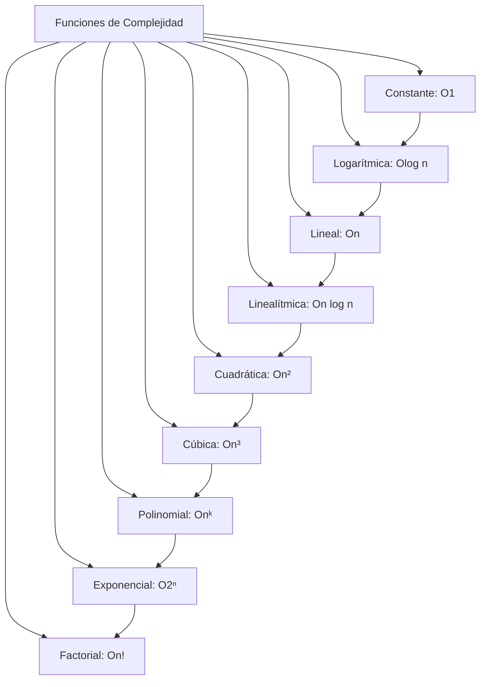

# Análisis de Algoritmos - Justificación y diseño de algoritmos

## 2.1 Notación asintótica.

---

La notación asintótica es una herramienta fundamental en el análisis de algoritmos que nos permite describir el comportamiento de las funciones que representan el tiempo de ejecución o el uso de recursos de un algoritmo cuando el tamaño de la entrada crece hacia el infinito. Esta notación nos permite comparar algoritmos de manera abstracta, ignorando constantes y términos de menor orden.

### Motivación

Al analizar algoritmos, nos interesa principalmente entender cómo se comporta el tiempo de ejecución cuando el tamaño de la entrada $n$ se hace muy grande. Para $n$ suficientemente grande, los términos de menor orden y los factores constantes se vuelven insignificantes comparados con el término de mayor orden.

### Notaciones Asintóticas Principales

#### Notación O Grande (O)

La notación O grande proporciona una cota superior asintótica para una función.

**Definición formal:**
$O(g(n)) = \{f(n): \text{existen constantes positivas } c \text{ y } n_0 \text{ tales que } 0 \leq f(n) \leq c \cdot g(n) \text{ para todo } n \geq n_0\}$

**Ejemplo:**
$2n^2 + 3n + 1 = O(n^2)$ porque para $n \geq 2$, $2n^2 + 3n + 1 \leq 3n^2$

#### Notación Ω (Omega)

La notación Ω proporciona una cota inferior asintótica para una función.

**Definición formal:**
$\Omega(g(n)) = \{f(n): \text{existen constantes positivas } c \text{ y } n_0 \text{ tales que } 0 \leq c \cdot g(n) \leq f(n) \text{ para todo } n \geq n_0\}$

**Ejemplo:**
$2n^2 + 3n + 1 = \Omega(n^2)$ porque para $n \geq 1$, $2n^2 + 3n + 1 \geq n^2$

#### Notación Θ (Theta)

La notación Θ proporciona una cota ajustada asintótica para una función.

**Definición formal:**
$\Theta(g(n)) = \{f(n): \text{existen constantes positivas } c_1, c_2, \text{ y } n_0 \text{ tales que } 0 \leq c_1 \cdot g(n) \leq f(n) \leq c_2 \cdot g(n) \text{ para todo } n \geq n_0\}$

**Ejemplo:**
$2n^2 + 3n + 1 = \Theta(n^2)$ porque es tanto $O(n^2)$ como $\Omega(n^2)$

### Notaciones Adicionales

#### Notación o (o pequeña)

La notación o pequeña proporciona una cota superior que no es ajustada.

**Definición formal:**
$o(g(n)) = \{f(n): \text{para cualquier constante } c > 0, \text{ existe una constante } n_0 > 0 \text{ tal que } 0 \leq f(n) < c \cdot g(n) \text{ para todo } n \geq n_0\}$

**Ejemplo:**
$2n = o(n^2)$ pero $2n^2 \neq o(n^2)$

#### Notación ω (omega pequeña)

La notación ω pequeña proporciona una cota inferior que no es ajustada.

**Definición formal:**
$\omega(g(n)) = \{f(n): \text{para cualquier constante } c > 0, \text{ existe una constante } n_0 > 0 \text{ tal que } 0 \leq c \cdot g(n) < f(n) \text{ para todo } n \geq n_0\}$

**Ejemplo:**
$2n^2 = \omega(n)$ pero $2n^2 \neq \omega(n^2)$

### Propiedades de las Notaciones Asintóticas

#### Transitividad

- Si $f(n) = O(g(n))$ y $g(n) = O(h(n))$, entonces $f(n) = O(h(n))$
- Si $f(n) = \Omega(g(n))$ y $g(n) = \Omega(h(n))$, entonces $f(n) = \Omega(h(n))$
- Si $f(n) = \Theta(g(n))$ y $g(n) = \Theta(h(n))$, entonces $f(n) = \Theta(h(n))$

#### Reflexividad

- $f(n) = O(f(n))$
- $f(n) = \Omega(f(n))$
- $f(n) = \Theta(f(n))$

#### Simetría

- $f(n) = \Theta(g(n))$ si y solo si $g(n) = \Theta(f(n))$

#### Simetría Transpuesta

- $f(n) = O(g(n))$ si y solo si $g(n) = \Omega(f(n))$
- $f(n) = o(g(n))$ si y solo si $g(n) = \omega(f(n))$

### Comparación de Funciones Comunes



### Ejemplos de Análisis con Notación Asintótica

#### Ejemplo 1: Función Cuadrática

Para $f(n) = 3n^2 + 2n + 5$:

- $f(n) = O(n^2)$ porque $3n^2 + 2n + 5 \leq 4n^2$ para $n \geq 3$
- $f(n) = \Omega(n^2)$ porque $3n^2 + 2n + 5 \geq 3n^2$ para $n \geq 0$
- $f(n) = \Theta(n^2)$ porque es tanto $O(n^2)$ como $\Omega(n^2)$

#### Ejemplo 2: Comparación de Funciones

```python
# Comparación de tasas de crecimiento
def compare_growth(n):
    constant = 1
    logarithmic = math.log(n)
    linear = n
    linearithmic = n * math.log(n)
    quadratic = n**2
    cubic = n**3
    exponential = 2**n

    return {
        'constant': constant,
        'logarithmic': logarithmic,
        'linear': linear,
        'linearithmic': linearithmic,
        'quadratic': quadratic,
        'cubic': cubic,
        'exponential': exponential
    }
```

### Reglas Prácticas para el Análisis Asintótico

#### Regla del Máximo

Si $f(n) = O(g(n))$ y $h(n) = O(k(n))$, entonces:

- $f(n) + h(n) = O(\max(g(n), k(n)))$
- $f(n) \cdot h(n) = O(g(n) \cdot k(n))$

#### Reglas para Polinomios

Para un polinomio $p(n) = \sum_{i=0}^{d} a_i n^i$ donde $a_d > 0$:

- $p(n) = \Theta(n^d)$

#### Reglas para Logaritmos

- $\log_b(n) = \Theta(\log_c(n))$ para cualquier $b, c > 1$
- Para cualquier $k > 0$: $\log^k(n) = o(n^\epsilon)$ para cualquier $\epsilon > 0$

### Ejercicios Propuestos

#### Ejercicio 1

Demuestra formalmente que $5n^3 + 2n^2 + 8n + 10 = \Theta(n^3)$

#### Ejercicio 2

Para cada par de funciones, indica si $f(n) = O(g(n))$, $f(n) = \Omega(g(n))$, o ambas:

1. $f(n) = n^2 + 3n + 4$, $g(n) = 6n + 8$
2. $f(n) = n\log n$, $g(n) = n\sqrt{n}$
3. $f(n) = 2^n$, $g(n) = 3^n$
4. $f(n) = \log_2 n$, $g(n) = \log_3 n$

#### Ejercicio 3

Ordena las siguientes funciones por tasa de crecimiento:

- $n^3$, $2^n$, $n\log n$, $n!$, $\log n$, $n^2$, $1$, $n$

#### Ejercicio 4

Demuestra o refuta:

1. $n^2 + n = O(n^2)$
2. $n^2 = O(n\log n)$
3. $2^{n+1} = O(2^n)$
4. $2^{2n} = O(2^n)$

#### Ejercicio 5

Encuentra la complejidad asintótica del siguiente algoritmo:

```python
def ejemplo_algoritmo(n):
    suma = 0
    for i in range(n):
        for j in range(i, n):
            suma += i * j
    return suma
```

### Soluciones a Ejercicios Selectos

#### Solución Ejercicio 1

Para demostrar que $5n^3 + 2n^2 + 8n + 10 = \Theta(n^3)$, debemos encontrar constantes $c_1$, 

$c_2$ y $n_0$ tales que:

$c_1 n^3 \leq 5n^3 + 2n^2 + 8n + 10 \leq c_2 n^3$ para todo $n \geq n_0$

Para la cota superior:

$5n^3 + 2n^2 + 8n + 10 \leq 5n^3 + 2n^3 + 8n^3 + 10n^3 = 25n^3$ para $n \geq 1$

Por lo tanto, $c_2 = 25$

Para la cota inferior:

$5n^3 + 2n^2 + 8n + 10 \geq 5n^3$ para $n \geq 0$

Por lo tanto, $c_1 = 5$

Así, con $c_1 = 5$, $c_2 = 25$ y $n_0 = 1$, queda demostrado.

#### Solución Ejercicio 3

Orden de menor a mayor tasa de crecimiento:

$1$, $\log n$, $n$, $n\log n$, $n^2$, $n^3$, $2^n$, $n!$

### Aplicaciones en el Diseño de Algoritmos

La notación asintótica es crucial para:

1. **Comparar algoritmos**: Determinar qué algoritmo es más eficiente para entradas grandes
2. **Diseñar algoritmos**: Guiar las decisiones de diseño hacia soluciones más eficientes
3. **Predecir escalabilidad**: Entender cómo se comportará un algoritmo con entradas más grandes
4. **Establecer límites teóricos**: Determinar la complejidad inherente de los problemas

### Referencias

#### Bibliografía Básica

1. Cormen, T. H., Leiserson, C. E., Rivest, R. L., & Stein, C. (2009). Introduction to Algorithms (3rd ed.). MIT Press. (Capítulo 3)
2. Kleinberg, J., & Tardos, É. (2005). Algorithm Design. Addison Wesley. (Capítulo 2)

#### Bibliografía Complementaria

1. Skiena, S. S. (2008). The Algorithm Design Manual (2nd ed.). Springer. (Capítulo 2)
2. Dasgupta, S., Papadimitriou, C., & Vazirani, U. (2006). Algorithms. McGraw-Hill. (Capítulo 0)
3. Graham, R. L., Knuth, D. E., & Patashnik, O. (1994). Concrete Mathematics: A Foundation for Computer Science (2nd ed.). Addison-Wesley Professional. (Capítulo 9)

### Consejos para el Estudio

1. **Practica con ejercicios**: La notación asintótica se domina con la práctica constante
2. **Entiende las definiciones formales**: No memorices, comprende el significado detrás de cada notación
3. **Aplica a algoritmos reales**: Analiza la complejidad de algoritmos que conozcas
4. **Compara funciones**: Desarrolla intuición sobre las tasas de crecimiento relativas
