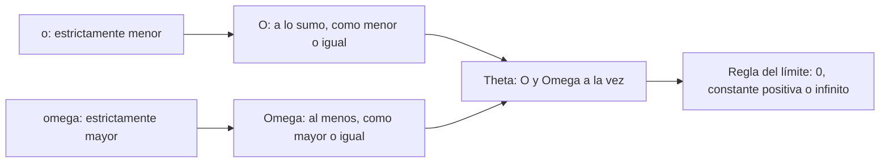

# Análisis de Algoritmos - Justificación y diseño de algoritmos

## 2.1 Notación asintótica.

---

Contar exactamente las operaciones de un algoritmo da expresiones como $T(n) = 3n^2 + 7n + 12,$ cuyos coeficientes dependen de detalles sin importancia: qué se cuenta como una operación, la máquina, el compilador. Lo que distingue a un algoritmo de otro cuando $n$ crece es la **tasa de crecimiento**, el término dominante sin su constante. La **notación asintótica** formaliza esta idea con cinco símbolos: $O,$ $\Omega,$ $\Theta,$ $o$ y $\omega.$ Este tema los define, demuestra sus propiedades, da la regla del límite para compararlos y establece la jerarquía de las funciones más comunes.

### Definiciones

Sean $f, g : \mathbb{N} \to \mathbb{R}_{\geq 0}.$

- **Cota superior.** $f(n) = O(g(n))$ si existen constantes $c > 0$ y $n_0$ tales que $f(n) \leq c \, g(n)$ para todo $n \geq n_0.$
- **Cota inferior.** $f(n) = \Omega(g(n))$ si existen $c > 0$ y $n_0$ tales que $f(n) \geq c \, g(n)$ para todo $n \geq n_0.$
- **Cota ajustada.** $f(n) = \Theta(g(n))$ si existen $c_1, c_2 > 0$ y $n_0$ tales que $c_1 g(n) \leq f(n) \leq c_2 g(n)$ para todo $n \geq n_0.$
- **Cota superior estricta.** $f(n) = o(g(n))$ si para **toda** $c > 0$ existe $n_0$ con $f(n) \lt c \, g(n)$ para todo $n \geq n_0.$
- **Cota inferior estricta.** $f(n) = \omega(g(n))$ si para toda $c > 0$ existe $n_0$ con $f(n) > c \, g(n)$ para todo $n \geq n_0.$

El signo $=$ es un abuso de notación: $O(g(n))$ es un **conjunto** de funciones y $f(n) = O(g(n))$ significa $f \in O(g).$ Por eso la igualdad no es simétrica: $n = O(n^2)$ pero $n^2 \neq O(n).$

La analogía con los números ayuda a recordarlas: $O$ es como $\leq,$ $\Omega$ como $\geq,$ $\Theta$ como $=,$ $o$ como $\lt$ y $\omega$ como $>.$ La analogía falla en un punto: no todo par de funciones es comparable. Con $f(n) = n$ y $g(n) = n^{1 + \sin n},$ ninguna es $O$ de la otra.

### Propiedades

**Teorema.** $f(n) = \Theta(g(n))$ si y solo si $f(n) = O(g(n))$ y $f(n) = \Omega(g(n)).$

**Demostración.** Si $c_1 g \leq f \leq c_2 g$ para $n \geq n_0,$ las dos desigualdades dan $O$ y $\Omega$ con las mismas $n_0.$ Recíprocamente, si $f \leq c_2 g$ para $n \geq n_1$ y $f \geq c_1 g$ para $n \geq n_2,$ ambas valen para $n \geq \max(n_1, n_2).$ $\blacksquare$

- **Transitividad:** si $f = O(g)$ y $g = O(h),$ entonces $f = O(h)$ (multiplicando las constantes). Igual para $\Omega,$ $\Theta,$ $o$ y $\omega.$
- **Reflexividad:** $f = O(f),$ $f = \Omega(f),$ $f = \Theta(f).$
- **Simetría:** $f = \Theta(g)$ si y solo si $g = \Theta(f).$
- **Simetría transpuesta:** $f = O(g)$ si y solo si $g = \Omega(f);$ $f = o(g)$ si y solo si $g = \omega(f).$
- **Suma:** $O(f) + O(g) = O(\max(f, g)),$ porque $f + g \leq 2 \max(f, g).$
- **Producto:** $O(f) \cdot O(g) = O(f \cdot g).$
- **Constantes:** $O(c f) = O(f)$ para $c > 0.$
- **Polinomios:** si $p(n) = a_d n^d + \cdots + a_0$ con $a_d > 0,$ entonces $p(n) = \Theta(n^d).$

**Regla del límite.** Si $L = \lim_{n \to \infty} f(n)/g(n)$ existe, entonces:

- $L = 0$ implica $f = o(g),$ y por tanto $f = O(g);$
- $0 \lt L \lt \infty$ implica $f = \Theta(g);$
- $L = \infty$ implica $f = \omega(g),$ y por tanto $f = \Omega(g).$

Para calcular el límite suele usarse la regla de L'Hôpital. Por ejemplo, $\lim \frac{\ln n}{n^\epsilon} = \lim \frac{1/n}{\epsilon n^{\epsilon - 1}} = \lim \frac{1}{\epsilon n^\epsilon} = 0:$ todo logaritmo crece más despacio que toda potencia positiva de $n.$

### Jerarquía de funciones

Para constantes $0 \lt \epsilon \lt 1 \lt c$ y $k \geq 1:$

$$1 \prec \log^* n \prec \log \log n \prec \log n \prec \log^k n \prec n^\epsilon \prec n \prec n \log n \prec n^c \prec n^{\log n} \prec c^n \prec n! \prec n^n$$

donde $f \prec g$ significa $f = o(g).$

- **Bases de logaritmos:** $\log_a n = \log_b n / \log_b a,$ así que todos los logaritmos difieren en una constante y se escribe $O(\log n)$ sin base.
- **Exponenciales:** las bases sí importan: $2^n = o(3^n),$ porque $(2/3)^n \to 0.$
- **Factorial:** por la fórmula de Stirling, $n! = \sqrt{2 \pi n} \, (n/e)^n (1 + \Theta(1/n)),$ de donde $\log n! = \Theta(n \log n)$ (tema 3.5).
- **Logaritmo iterado:** $\log^* n$ es el número de veces que hay que aplicar $\log_2$ para bajar a 1 o menos. Vale 5 para todo $n \leq 2^{65536}:$ en la práctica, es constante.



### Implementación en Python

El programa comprueba numéricamente las constantes del ejercicio 1, calcula los cocientes $f(n)/g(n)$ de los ejercicios 2 y 4 para valores crecientes de $n,$ ordena las funciones del ejercicio 3 comparando sus logaritmos, para no desbordar con $n!,$ cuenta las iteraciones del ejercicio 5 y evalúa el logaritmo iterado.

```python
import math

# --- Ejercicio 1: constantes de la demostración ---
f = lambda n: 5*n**3 + 2*n**2 + 8*n + 10
assert all(5*n**3 <= f(n) <= 25*n**3 for n in range(1, 10**5))
print("ejercicio 1: 5 n^3 <= f(n) <= 25 n^3 para 1 <= n < 10^5;",
      "f(n)/n^3 en n = 10, 10^3, 10^6:",
      [round(f(n) / n**3, 4) for n in (10, 10**3, 10**6)])

# --- Ejercicio 2: el cociente f/g para n grande ---
pares = {
    "n^2+3n+4 / 6n+8":  (lambda n: n*n + 3*n + 4, lambda n: 6*n + 8),
    "n lg n / n sqrt n": (lambda n: n*math.log2(n), lambda n: n*math.sqrt(n)),
    "2^n / 3^n":        (lambda n: 2**n, lambda n: 3**n),
    "log2 n / log3 n":  (lambda n: math.log2(n), lambda n: math.log(n, 3)),
}
print("ejercicio 2: f(n)/g(n)")
for nombre, (f, g) in pares.items():
    print(f"   {nombre:18}", "  ".join(f"{f(n)/g(n):.4g}" for n in (10, 100, 1000)))

# --- Ejercicio 3: ordenar comparando logaritmos en n = 2^20 ---
n = 2**20
lg = {                      # log2 de cada función
    "1": 0.0, "log n": math.log2(math.log2(n)), "n": math.log2(n),
    "n log n": math.log2(n) + math.log2(math.log2(n)), "n^2": 2*math.log2(n),
    "n^3": 3*math.log2(n), "2^n": float(n), "n!": math.lgamma(n + 1) / math.log(2),
}
print("ejercicio 3:", " < ".join(sorted(lg, key=lg.get)))

# --- Ejercicio 4: cocientes ---
print("ejercicio 4:")
for nombre, r in [("(n^2+n)/n^2", lambda n: (n*n + n) / (n*n)),
                  ("n^2/(n lg n)", lambda n: n*n / (n*math.log2(n))),
                  ("2^(n+1)/2^n", lambda n: 2**(n + 1) / 2**n),
                  ("2^(2n)/2^n", lambda n: 2**(2*n) // 2**n)]:
    print(f"   {nombre:13}", [round(r(n), 3) for n in (10, 20, 40)])

# --- Ejercicio 5 ---
def ejemplo_algoritmo(n):
    suma, ops = 0, 0
    for i in range(n):
        for j in range(i, n):
            suma += i * j
            ops += 1
    return suma, ops

print("ejercicio 5:", [(n, ejemplo_algoritmo(n)[1], n*(n + 1)//2) for n in (10, 100, 1000)])

# --- Logaritmos en distintas bases e iterado ---
def log_estrella(x):
    k = 0
    while x > 1:
        x, k = math.log2(x), k + 1
    return k
print("lg* de 2, 16, 65536, 2^65536:", [log_estrella(2), log_estrella(16),
      log_estrella(65536), 1 + log_estrella(65536)])
```

Salida:

```text
ejercicio 1: 5 n^3 <= f(n) <= 25 n^3 para 1 <= n < 10^5; f(n)/n^3 en n = 10, 10^3, 10^6: [5.29, 5.002, 5.0]
ejercicio 2: f(n)/g(n)
   n^2+3n+4 / 6n+8    1.971  16.95  166.9
   n lg n / n sqrt n  1.05  0.6644  0.3151
   2^n / 3^n          0.01734  2.46e-18  8.105e-177
   log2 n / log3 n    1.585  1.585  1.585
ejercicio 3: 1 < log n < n < n log n < n^2 < n^3 < 2^n < n!
ejercicio 4:
   (n^2+n)/n^2   [1.1, 1.05, 1.025]
   n^2/(n lg n)  [3.01, 4.628, 7.516]
   2^(n+1)/2^n   [2.0, 2.0, 2.0]
   2^(2n)/2^n    [1024, 1048576, 1099511627776]
ejercicio 5: [(10, 55, 55), (100, 5050, 5050), (1000, 500500, 500500)]
lg* de 2, 16, 65536, 2^65536: [1, 3, 4, 5]
```

Un cociente que se estabiliza en una constante positiva indica $\Theta;$ uno que tiende a 0, $o;$ uno que crece sin límite, $\omega.$ Los números sugieren, pero la demostración requiere las constantes o el límite.

### Ejercicios Propuestos

1. Demuestra formalmente que $5n^3 + 2n^2 + 8n + 10 = \Theta(n^3).$

2. Para cada par, indica si $f(n) = O(g(n)),$ si $f(n) = \Omega(g(n))$ o ambas:
   1. $f(n) = n^2 + 3n + 4,$ $g(n) = 6n + 8;$
   2. $f(n) = n \log n,$ $g(n) = n \sqrt{n};$
   3. $f(n) = 2^n,$ $g(n) = 3^n;$
   4. $f(n) = \log_2 n,$ $g(n) = \log_3 n.$

3. Ordena por tasa de crecimiento: $n^3,$ $2^n,$ $n \log n,$ $n!,$ $\log n,$ $n^2,$ $1,$ $n.$

4. Demuestra o refuta:
   1. $n^2 + n = O(n^2);$
   2. $n^2 = O(n \log n);$
   3. $2^{n+1} = O(2^n);$
   4. $2^{2n} = O(2^n).$

5. Encuentra la complejidad asintótica de:

   ```python
   def ejemplo_algoritmo(n):
       suma = 0
       for i in range(n):
           for j in range(i, n):
               suma += i * j
       return suma
   ```

### Soluciones

**Ejercicio 1.** Cota superior: para $n \geq 1,$ $2n^2 \leq 2n^3,$ $8n \leq 8n^3$ y $10 \leq 10n^3,$ así que $f(n) \leq 25n^3.$ Cota inferior: los términos son no negativos, así que $f(n) \geq 5n^3.$ Con $c_1 = 5,$ $c_2 = 25,$ $n_0 = 1$ queda demostrado. También por la regla del límite: $f(n)/n^3 = 5 + 2/n + 8/n^2 + 10/n^3 \to 5.$

**Ejercicio 2.**

1. $f/g \to \infty,$ porque el cociente es aproximadamente $n/6:$ $f = \Omega(g)$ pero no $O(g).$
2. $f/g = \log n / \sqrt{n} \to 0:$ $f = O(g),$ de hecho $o(g),$ pero no $\Omega(g).$
3. $f/g = (2/3)^n \to 0:$ $f = O(g)$ pero no $\Omega(g).$
4. $f/g = \log_2 n / \log_3 n = \log_2 3 \approx 1.585,$ constante: ambas, $f = \Theta(g).$

**Ejercicio 3.** $1 \prec \log n \prec n \prec n \log n \prec n^2 \prec n^3 \prec 2^n \prec n!.$ Cada paso se justifica con la regla del límite; el último porque $n!/2^n = \prod_{i=1}^n (i/2) \geq (n/2) \cdot \frac{1}{2} \to \infty.$

**Ejercicio 4.**

1. **Verdadero:** $n^2 + n \leq 2n^2$ para $n \geq 1.$
2. **Falso:** si $n^2 \leq c \, n \log n,$ entonces $n / \log n \leq c,$ pero $n / \log n \to \infty.$
3. **Verdadero:** $2^{n+1} = 2 \cdot 2^n,$ con $c = 2.$
4. **Falso:** $2^{2n} = 4^n$ y $4^n / 2^n = 2^n$ no está acotado. La constante en el exponente sí cambia la clase.

**Ejercicio 5.** El ciclo interno se ejecuta $n - i$ veces, y $\sum_{i=0}^{n-1} (n - i) = n(n + 1)/2 = \Theta(n^2),$ como confirma el programa.

### Referencias

1. Cormen, T. H., Leiserson, C. E., Rivest, R. L., and Stein, C., _Introduction to Algorithms_. MIT Press, 2022. Capítulo 3.
2. Graham, R. L., Knuth, D. E., and Patashnik, O., _Concrete Mathematics_. Addison-Wesley, 1994. Capítulo 9.
3. Knuth, D. E., Big Omicron and big Omega and big Theta. _SIGACT News_ 8(2), 1976.
4. Sedgewick, R., and Flajolet, P., _An Introduction to the Analysis of Algorithms_. Addison-Wesley, 2013. Capítulo 4.
