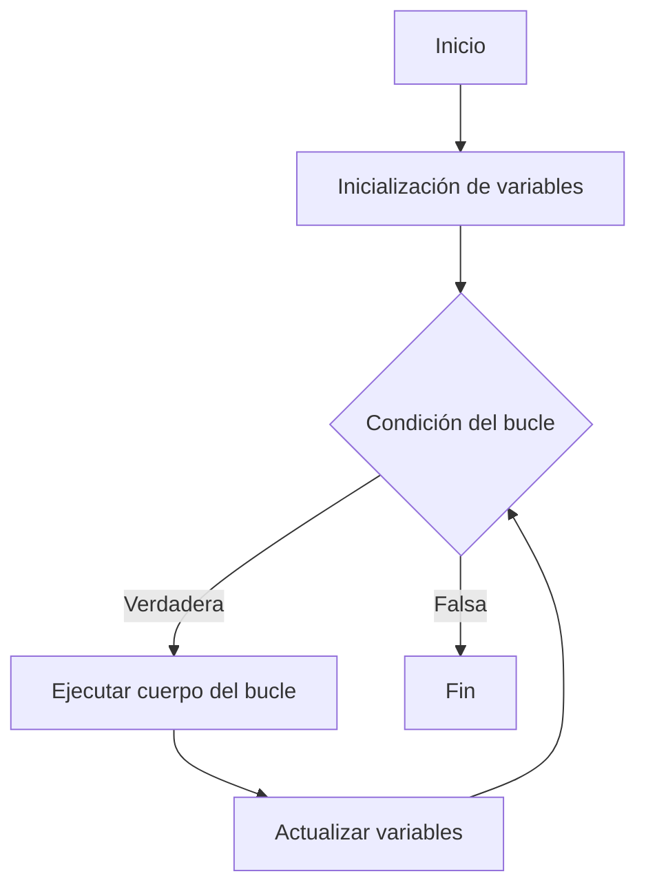

# Análisis de Algoritmos - Justificación y diseño de algoritmos

## 2.2 Algoritmos iterativos.

---

Los algoritmos iterativos son aquellos que resuelven problemas mediante la repetición de un conjunto de instrucciones en un bucle o ciclo. Constituyen uno de los paradigmas fundamentales en el diseño de algoritmos y son ampliamente utilizados por su simplicidad conceptual y eficiencia en muchos casos.

**Definición formal:** Un algoritmo iterativo es un procedimiento computacional que emplea estructuras de control repetitivas (bucles) para resolver un problema mediante la aplicación sucesiva de operaciones hasta alcanzar una condición de terminación.

### Características Fundamentales

#### Elementos de un Algoritmo Iterativo

1. **Inicialización**: Establecimiento de condiciones iniciales
2. **Condición de continuación**: Expresión booleana que determina si el bucle continúa
3. **Cuerpo del bucle**: Conjunto de instrucciones que se ejecutan repetidamente
4. **Actualización**: Modificación de variables que eventualmente causará la terminación

#### Ventajas y Desventajas

| Ventajas                                     | Desventajas                                              |
| -------------------------------------------- | -------------------------------------------------------- |
| Fácil implementación y comprensión           | Puede ser menos eficiente que recursión en algunos casos |
| Generalmente más eficiente en uso de memoria | Puede resultar en código más verbose                     |
| Fácil de optimizar por compiladores          |                                                          |

### Análisis de Complejidad de Algoritmos Iterativos

#### Notación Asintótica para Algoritmos Iterativos

La complejidad de algoritmos iterativos se determina analizando los bucles anidados:

- **Bucle simple**: $O(n)$
- **Bucles anidados**: $O(n^k)$ donde $k$ es el nivel de anidamiento
- **Bucles con progresión geométrica**: $O(\log n)$

#### Fórmulas de Análisis

Para un bucle con $k$ iteraciones y cuerpo de complejidad $C$:

$$T(n) = \sum_{i=1}^{k} C_i$$

Para bucles anidados:

$$T(n) = \sum_{i=1}^{k} \sum_{j=1}^{m} C_{ij}$$

### Patrones Comunes de Algoritmos Iterativos

#### Búsqueda Lineal

```python
def busqueda_lineal(arr, objetivo):
    """
    Búsqueda lineal iterativa
    Complejidad: O(n)
    """
    for i in range(len(arr)):
        if arr[i] == objetivo:
            return i
    return -1
```

#### Ordenamiento por Inserción

```python
def ordenamiento_insercion(arr):
    """
    Ordenamiento por inserción iterativo
    Complejidad: O(n²) en el peor caso
    """
    for i in range(1, len(arr)):
        clave = arr[i]
        j = i - 1
        while j >= 0 and arr[j] > clave:
            arr[j + 1] = arr[j]
            j -= 1
        arr[j + 1] = clave
    return arr
```

#### Búsqueda Binaria Iterativa

```python
def busqueda_binaria_iterativa(arr, objetivo):
    """
    Búsqueda binaria implementada iterativamente
    Complejidad: O(log n)
    """
    izquierda, derecha = 0, len(arr) - 1

    while izquierda <= derecha:
        medio = (izquierda + derecha) // 2
        if arr[medio] == objetivo:
            return medio
        elif arr[medio] < objetivo:
            izquierda = medio + 1
        else:
            derecha = medio - 1

    return -1
```

### Técnicas de Diseño de Algoritmos Iterativos

#### Método de Fuerza Bruta

```python
def subarreglo_suma_maxima_fuerza_bruta(arr):
    """
    Encuentra el subarreglo contiguo con la suma máxima
    Complejidad: O(n²)
    """
    max_suma = float('-inf')
    n = len(arr)

    for i in range(n):
        suma_actual = 0
        for j in range(i, n):
            suma_actual += arr[j]
            if suma_actual > max_suma:
                max_suma = suma_actual

    return max_suma
```

#### Algoritmos Voraces Iterativos

```python
def cambio_monedas_iterativo(monedas, cantidad):
    """
    Problema de cambio de monedas usando enfoque voraz iterativo
    Complejidad: O(n log n) por el ordenamiento + O(n) para el algoritmo
    """
    monedas.sort(reverse=True)  # Ordenar de mayor a menor
    resultado = []

    for moneda in monedas:
        while cantidad >= moneda:
            cantidad -= moneda
            resultado.append(moneda)

    return resultado
```

#### Divide y Vencerás Iterativo

```python
def busqueda_profundidad_iterativa(grafo, inicio, objetivo):
    """
    Búsqueda en profundidad iterativa (IDDFS)
    Complejidad: O(b^d) donde b es el factor de ramificación y d la profundidad
    """
    profundidad = 0
    while True:
        encontrado = dls(grafo, inicio, objetivo, profundidad)
        if encontrado is not None:
            return encontrado
        profundidad += 1

def dls(grafo, nodo, objetivo, profundidad):
    """
    Búsqueda en profundidad limitada (helper function)
    """
    if profundidad == 0 and nodo == objetivo:
        return [nodo]
    elif profundidad > 0:
        for vecino in grafo[nodo]:
            resultado = dls(grafo, vecino, objetivo, profundidad - 1)
            if resultado is not None:
                return [nodo] + resultado
    return None
```

### Análisis de Correctitud

#### Invariantes de Bucle

Un invariante de bucle es una condición que permanece verdadera antes y después de cada iteración del bucle. Es fundamental para demostrar la correctitud de algoritmos iterativos.

**Ejemplo para ordenamiento por inserción:**

```python
def ordenamiento_insercion_con_invariante(arr):
    # Invariante: Los elementos arr[0..i-1] están ordenados
    for i in range(1, len(arr)):
        # El invariante se mantiene aquí
        clave = arr[i]
        j = i - 1
        while j >= 0 and arr[j] > clave:
            arr[j + 1] = arr[j]
            j -= 1
        arr[j + 1] = clave
        # El invariante se mantiene aquí: arr[0..i] están ordenados
    return arr
```

### Optimización de Algoritmos Iterativos

#### Técnica de los Dos Punteros

```python
def par_suma(arr, suma_objetivo):
    """
    Encuentra un par de elementos que sumen el objetivo
    usando la técnica de dos punteros
    Complejidad: O(n log n) por el ordenamiento
    """
    arr.sort()  # Requiere arreglo ordenado
    izquierda, derecha = 0, len(arr) - 1

    while izquierda < derecha:
        suma_actual = arr[izquierda] + arr[derecha]
        if suma_actual == suma_objetivo:
            return (arr[izquierda], arr[derecha])
        elif suma_actual < suma_objetivo:
            izquierda += 1
        else:
            derecha -= 1

    return None
```

#### Algoritmo de Kadane (Máximo Subarreglo)

```python
def kadane(arr):
    """
    Algoritmo de Kadane para encontrar el subarreglo contiguo con suma máxima
    Complejidad: O(n)
    """
    max_global = max_actual = arr[0]

    for i in range(1, len(arr)):
        max_actual = max(arr[i], max_actual + arr[i])
        if max_actual > max_global:
            max_global = max_actual

    return max_global
```

### Diagrama de Flujo de un Algoritmo Iterativo



### Ejercicios Propuestos

#### Ejercicio 1: Implementación y Análisis

Implementa un algoritmo iterativo para calcular el factorial de un número y analiza su complejidad temporal y espacial.

#### Ejercicio 2: Invariante de Bucle

Para el algoritmo de ordenamiento por inserción, define formalmente el invariante de bucle y demuestra su correctitud.

#### Ejercicio 3: Optimización

Dado el siguiente algoritmo ineficiente, optimízalo:

```python
def suma_pares(arr):
    resultado = 0
    for i in range(len(arr)):
        for j in range(len(arr)):
            if (arr[i] + arr[j]) % 2 == 0:
                resultado += 1
    return resultado
```

#### Ejercicio 4: Diseño de Algoritmo

Diseña un algoritmo iterativo para encontrar el elemento mayoritario en un arreglo (que aparece más de n/2 veces).

#### Ejercicio 5: Análisis de Complejidad

Analiza la complejidad temporal del siguiente algoritmo:

```python
def algoritmo_misterioso(n):
    i = 1
    while i <= n:
        j = i
        while j <= n:
            print(i, j)
            j *= 2
        i += 1
```

### Soluciones a Ejercicios Selectos

#### Solución Ejercicio 1

```python
def factorial_iterativo(n):
    """
    Calcula el factorial de n iterativamente
    Complejidad: O(n) temporal, O(1) espacial
    """
    if n < 0:
        raise ValueError("El factorial no está definido para números negativos")

    resultado = 1
    for i in range(1, n + 1):
        resultado *= i
    return resultado
```

#### Solución Ejercicio 5

El algoritmo exterior ejecuta n iteraciones. El bucle interior ejecuta O(log n) iteraciones en cada paso del bucle exterior. Por lo tanto, la complejidad total es O(n log n).

### Referencias Bibliográficas

#### Bibliografía Básica

1. Cormen, T. H., Leiserson, C. E., Rivest, R. L., & Stein, C. (2009). Introduction to Algorithms (3rd ed.). MIT Press. (Capítulos 2 y 17)
2. Kleinberg, J., & Tardos, É. (2005). Algorithm Design. Addison Wesley. (Capítulo 2)

#### Bibliografía Complementaria

1. Skiena, S. S. (2008). The Algorithm Design Manual (2nd ed.). Springer. (Capítulo 1)
2. Dasgupta, S., Papadimitriou, C., & Vazirani, U. (2006). Algorithms. McGraw-Hill. (Capítulo 0)

### Consejos para el Estudio

1. **Practica la implementación**: Escribe múltiples versiones iterativas de algoritmos comunes
2. **Analiza la complejidad**: Para cada algoritmo, determina su complejidad temporal y espacial
3. **Identifica invariantes**: Practica la identificación y formulación de invariantes de bucle
4. **Compara con recursión**: Implementa versiones recursivas e iterativas y compara sus ventajas
5. **Optimiza progresivamente**: Comienza con soluciones de fuerza bruta y luego optimiza

Los algoritmos iterativos forman la base de muchos métodos eficientes en computación. Dominar su diseño, implementación y análisis es fundamental para cualquier especialista en ciencias de la computación.
