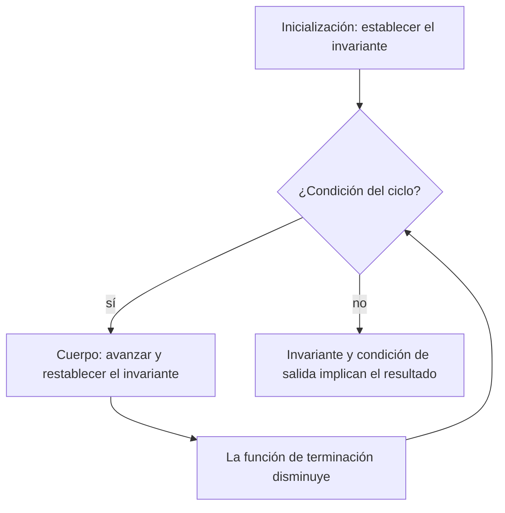

# Análisis de Algoritmos - Justificación y diseño de algoritmos

## 2.2 Algoritmos iterativos.

---

Un **algoritmo iterativo** resuelve un problema repitiendo un bloque de instrucciones con ciclos (`para`, `mientras`) que actualizan un estado, en lugar de llamarse a sí mismo. Analizarlo exige responder dos preguntas: cuántas veces se ejecuta cada instrucción, lo que lleva a **sumatorias**, y por qué el resultado es correcto, lo que lleva a **invariantes de ciclo**. Este tema presenta las sumatorias más frecuentes, cómo acotar ciclos cuyos índices no avanzan de uno en uno, el método del invariante aplicado al ordenamiento por inserción y algunas técnicas de diseño iterativo: acumuladores, dos apuntadores, ventana deslizante y conteo.

### Análisis: de ciclos a sumatorias

Si el cuerpo de un ciclo cuesta $c_i$ en la iteración $i,$ el ciclo cuesta $\sum_i c_i.$ Las sumas que más aparecen:

| Suma | Valor | Orden |
| --- | --- | --- |
| $\sum_{i=1}^{n} 1$ | $n$ | $\Theta(n)$ |
| $\sum_{i=1}^{n} i$ | $n(n + 1)/2$ | $\Theta(n^2)$ |
| $\sum_{i=1}^{n} i^2$ | $n(n + 1)(2n + 1)/6$ | $\Theta(n^3)$ |
| $\sum_{i=0}^{k} 2^i$ | $2^{k+1} - 1$ | $\Theta(2^k)$ |
| $\sum_{i=1}^{n} 1/i$ | $H_n = \ln n + O(1)$ | $\Theta(\log n)$ |
| $\sum_{i=1}^{n} \log i$ | $\log n!$ | $\Theta(n \log n)$ |

**Ciclos con avance geométrico.** Un ciclo `i ← 1; mientras i ≤ n: i ← 2i` hace $\lfloor \log_2 n \rfloor + 1$ iteraciones. Uno que divide entre dos, igual. En general, si el índice se multiplica por una constante $c > 1,$ son $\Theta(\log n)$ iteraciones.

**Cota rápida.** Si no se necesita la constante exacta, basta acotar: el número de iteraciones del ciclo externo por la máxima del interno da una cota superior, y quedarse con la mitad de los términos más grandes da una inferior. Por ejemplo, $\sum_{i=1}^{n} \log i \leq n \log n,$ y $\sum_{i=n/2}^{n} \log i \geq (n/2) \log(n/2),$ así que la suma es $\Theta(n \log n).$

### Corrección: invariante de ciclo

Como en el tema 1.1, se demuestra que una propiedad $I$ vale al inicio de cada iteración (inicialización y mantenimiento), y que $I$ junto con la condición de salida implica el resultado (terminación). Además, una función de terminación garantiza que el ciclo acaba.

**Ordenamiento por inserción.**

```
INSERCIÓN(A[1..n])
1  para i ← 2 hasta n
2      clave ← A[i];  j ← i − 1
3      mientras j ≥ 1 y A[j] > clave
4          A[j + 1] ← A[j];  j ← j − 1
5      A[j + 1] ← clave
```

**Invariante:** al inicio de la iteración $i,$ el subarreglo $A[1..i-1]$ contiene los elementos que originalmente estaban en $A[1..i-1],$ ordenados.

- **Inicialización:** con $i = 2,$ $A[1..1]$ tiene un solo elemento y está ordenado.
- **Mantenimiento:** el ciclo interno desplaza una posición a la derecha los elementos de $A[1..i-1]$ mayores que la clave y deja un hueco en la posición $j + 1,$ donde $A[j] \leq \text{clave}$ o bien $j = 0.$ Al colocar la clave allí, $A[1..i]$ contiene los elementos originales de $A[1..i],$ ordenados. Un análisis riguroso usaría un segundo invariante para el ciclo interno.
- **Terminación:** el ciclo acaba con $i = n + 1;$ el invariante dice que $A[1..n]$ está ordenado y es una permutación del original.

**Costo:** el ciclo interno hace a lo sumo $i - 1$ desplazamientos. Peor caso, con el arreglo en orden inverso: $\sum_{i=2}^{n} (i - 1) = n(n - 1)/2 = \Theta(n^2).$ Mejor caso, ya ordenado: $\Theta(n).$ En general hace exactamente tantos desplazamientos como **inversiones** tiene el arreglo, pares $i \lt j$ con $A[i] > A[j],$ por lo que es muy eficiente con datos casi ordenados.

### Técnicas de diseño iterativo

- **Acumulador:** una variable resume el prefijo procesado (suma, máximo, conteo). El invariante dice qué resume.
- **Dos apuntadores:** dos índices recorren el arreglo, por ejemplo desde los extremos hacia el centro, para buscar un par con suma dada en un arreglo ordenado en $O(n)$ en lugar de $O(n^2).$
- **Ventana deslizante:** se mantiene la información de un subarreglo contiguo que avanza, agregando el elemento que entra y quitando el que sale.
- **Conteo y precálculo:** contar o precalcular sumas de prefijos evita recorrer el arreglo una y otra vez (ejercicio 3).
- **Eliminación por parejas:** el algoritmo del voto mayoritario de Boyer y Moore (ejercicio 4).



### Implementación en Python

El programa implementa los cinco ejercicios: el factorial iterativo con su número de multiplicaciones, la inserción con su invariante comprobado por aserciones en 200 arreglos aleatorios, las dos versiones de `suma_pares`, el voto mayoritario comparado con `Counter` y el conteo exacto de las iteraciones de `algoritmo_misterioso`.

```python
import math, random
from collections import Counter

# --- Ejercicio 1: factorial iterativo ---
def factorial(n):
    r, mult = 1, 0
    for i in range(2, n + 1):
        r *= i
        mult += 1
    return r, mult

print("ejercicio 1:")
for n in (0, 1, 5, 20, 1000):
    r, m = factorial(n)
    assert r == math.factorial(n)
    print(f"   {n:4}! tiene {len(str(r)):4} cifras ({r.bit_length():5} bits), {m} multiplicaciones")

# --- Ejercicio 2: inserción con su invariante comprobado ---
def insercion(A):
    A = A[:]
    original = sorted(A)
    for i in range(1, len(A)):
        # invariante: A[0..i-1] tiene los elementos originales de esas posiciones, ordenados
        assert A[:i] == sorted(A[:i])
        clave, j = A[i], i - 1
        while j >= 0 and A[j] > clave:
            A[j + 1] = A[j]
            j -= 1
        A[j + 1] = clave
    assert A == original
    return A

random.seed(1)
for _ in range(200):
    insercion([random.randint(0, 20) for _ in range(random.randint(0, 30))])
print("ejercicio 2:", insercion([5, 2, 4, 6, 1, 3]), "| invariante comprobado en 200 arreglos")

# --- Ejercicio 3: suma_pares en O(n) ---
def suma_pares(arr):
    resultado = 0
    for i in range(len(arr)):
        for j in range(len(arr)):
            if (arr[i] + arr[j]) % 2 == 0:
                resultado += 1
    return resultado

def suma_pares_rapida(arr):
    pares = sum(1 for x in arr if x % 2 == 0)
    impares = len(arr) - pares
    return pares * pares + impares * impares

ok = all(suma_pares(a) == suma_pares_rapida(a)
         for a in ([random.randint(-50, 50) for _ in range(random.randint(0, 40))] for _ in range(300)))
print("ejercicio 3: coincide en 300 arreglos:", ok, "| [1, 2, 3, 4, 5] ->", suma_pares_rapida([1, 2, 3, 4, 5]))

# --- Ejercicio 4: elemento mayoritario (Boyer y Moore) ---
def mayoritario(A):
    candidato, cuenta = None, 0
    for x in A:                       # fase 1: emparejar votos distintos
        if cuenta == 0:
            candidato, cuenta = x, 1
        elif x == candidato:
            cuenta += 1
        else:
            cuenta -= 1
    if A.count(candidato) > len(A) // 2:   # fase 2: verificar
        return candidato
    return None

def mayoritario_ref(A):
    if not A:
        return None
    x, c = Counter(A).most_common(1)[0]
    return x if c > len(A) // 2 else None

ok = True
for _ in range(2000):
    A = [random.randint(0, 3) for _ in range(random.randint(0, 15))]
    ok &= mayoritario(A) == mayoritario_ref(A)
print("ejercicio 4: coincide con Counter en 2000 arreglos:", ok,
      "|", mayoritario([3, 3, 4, 2, 4, 4, 2, 4, 4]), mayoritario([1, 2, 3, 1, 2]))

# --- Ejercicio 5: el ciclo interno se duplica ---
def misterioso(n):
    ops, i = 0, 1
    while i <= n:
        j = i
        while j <= n:
            ops += 1
            j *= 2
        i += 1
    return ops

print("ejercicio 5:")
for n in (10, 100, 10**4, 10**6):
    o = misterioso(n)
    unos = bin(n).count("1")
    print(f"   n = {n:7}: {o:8} iteraciones internas = 2n - {unos} (unos de n en binario)")
    assert o == 2 * n - unos
assert all(misterioso(n) == 2 * n - bin(n).count("1") for n in range(1, 3000))
print("   fórmula 2n - s(n) comprobada para 1 <= n < 3000")
```

Salida:

```text
ejercicio 1:
      0! tiene    1 cifras (    1 bits), 0 multiplicaciones
      1! tiene    1 cifras (    1 bits), 0 multiplicaciones
      5! tiene    3 cifras (    7 bits), 4 multiplicaciones
     20! tiene   19 cifras (   62 bits), 19 multiplicaciones
   1000! tiene 2568 cifras ( 8530 bits), 999 multiplicaciones
ejercicio 2: [1, 2, 3, 4, 5, 6] | invariante comprobado en 200 arreglos
ejercicio 3: coincide en 300 arreglos: True | [1, 2, 3, 4, 5] -> 13
ejercicio 4: coincide con Counter en 2000 arreglos: True | 4 None
ejercicio 5:
   n =      10:       18 iteraciones internas = 2n - 2 (unos de n en binario)
   n =     100:      197 iteraciones internas = 2n - 3 (unos de n en binario)
   n =   10000:    19995 iteraciones internas = 2n - 5 (unos de n en binario)
   n = 1000000:  1999993 iteraciones internas = 2n - 7 (unos de n en binario)
   fórmula 2n - s(n) comprobada para 1 <= n < 3000
```

### Ejercicios Propuestos

1. **Factorial.** Implementa un algoritmo iterativo para el factorial y analiza su complejidad temporal y espacial.

2. **Invariante.** Para el ordenamiento por inserción, define formalmente el invariante de ciclo y demuestra su corrección.

3. **Optimización.** Optimiza:

   ```python
   def suma_pares(arr):
       resultado = 0
       for i in range(len(arr)):
           for j in range(len(arr)):
               if (arr[i] + arr[j]) % 2 == 0:
                   resultado += 1
       return resultado
   ```

4. **Mayoritario.** Diseña un algoritmo iterativo que encuentre el elemento mayoritario de un arreglo, el que aparece más de $n/2$ veces, si existe.

5. **Análisis.** Calcula la complejidad temporal de:

   ```python
   def algoritmo_misterioso(n):
       i = 1
       while i <= n:
           j = i
           while j <= n:
               print(i, j)
               j *= 2
           i += 1
   ```

### Soluciones

**Ejercicio 1.**

```
FACTORIAL(n)
1  r ← 1
2  para i ← 2 hasta n
3      r ← r · i
4  regresar r
```

Invariante: al inicio de la iteración $i,$ $r = (i - 1)!.$ Hace $\max(n - 1, 0)$ multiplicaciones: $\Theta(n)$ en el modelo de costo uniforme, con espacio $O(1).$ Pero $n!$ tiene $\Theta(n \log n)$ bits, y $1000!$ ya tiene 8530, así que con costo logarítmico cada multiplicación de $r$ por $i$ cuesta $O(n \log n \cdot \log n)$ y el total es $O(n^2 \log^2 n),$ con espacio $\Theta(n \log n)$ para el resultado. Es un caso en que el modelo uniforme engaña.

**Ejercicio 2.** Es el análisis de la sección de corrección; el programa comprueba el invariante en cada iteración de 200 arreglos aleatorios.

**Ejercicio 3.** $a_i + a_j$ es par si y solo si $a_i$ y $a_j$ tienen la misma paridad. Si hay $p$ pares e $q$ impares, el número de pares ordenados $(i, j),$ incluidos los de $i = j,$ es $p^2 + q^2.$ Un solo recorrido para contar: $O(n)$ en lugar de $O(n^2),$ con espacio $O(1).$ Con $[1, 2, 3, 4, 5]$ hay 2 pares y 3 impares: $4 + 9 = 13.$

**Ejercicio 4.** El **algoritmo del voto de Boyer y Moore**: se mantiene un candidato y un contador. Si el contador es 0, el elemento actual se vuelve candidato; si es igual al candidato, el contador aumenta; si no, disminuye. Un segundo recorrido verifica que el candidato aparezca más de $n/2$ veces.

**Corrección:** cada decremento empareja una aparición del candidato con un elemento distinto, y ambos se descartan. Al final, los elementos no descartados son exactamente las copias del candidato que cuenta el contador. Si $m$ aparece $c > n/2$ veces, cada pareja descartada contiene al menos un elemento distinto de $m,$ así que hay a lo sumo $n - c \lt c$ parejas, y alguna copia de $m$ sobrevive: $m$ termina como candidato. Si no hay mayoritario, la verificación lo detecta. Tiempo $O(n)$ y espacio $O(1).$

**Ejercicio 5.** Para cada $i,$ el ciclo interno recorre $j = i, 2i, 4i, \ldots$ mientras $j \leq n:$ son $\lfloor \log_2 (n/i) \rfloor + 1$ iteraciones. La cota ingenua es $O(n \log n),$ pero se puede contar mejor: la cantidad de $i$ con al menos $k + 1$ iteraciones, es decir con $2^k i \leq n,$ es $\lfloor n/2^k \rfloor.$ Sumando por $k:$

$$\sum_{k \geq 0} \left\lfloor \frac{n}{2^k} \right\rfloor = 2n - s(n),$$

donde $s(n)$ es el número de unos en la representación binaria de $n.$ El programa confirma la fórmula. La complejidad es $\Theta(n),$ no $\Theta(n \log n):$ la mayoría de los $i$ hacen muy pocas iteraciones.

### Referencias

1. Cormen, T. H., Leiserson, C. E., Rivest, R. L., and Stein, C., _Introduction to Algorithms_. MIT Press, 2022. Capítulo 2 y apéndice A.
2. Boyer, R. S., and Moore, J. S., MJRTY: a fast majority vote algorithm. En _Automated Reasoning_, Kluwer, 1991.
3. Bentley, J., _Programming Pearls_. Addison-Wesley, 2000. Columnas 4 y 8.
4. Graham, R. L., Knuth, D. E., and Patashnik, O., _Concrete Mathematics_. Addison-Wesley, 1994. Capítulo 2.
