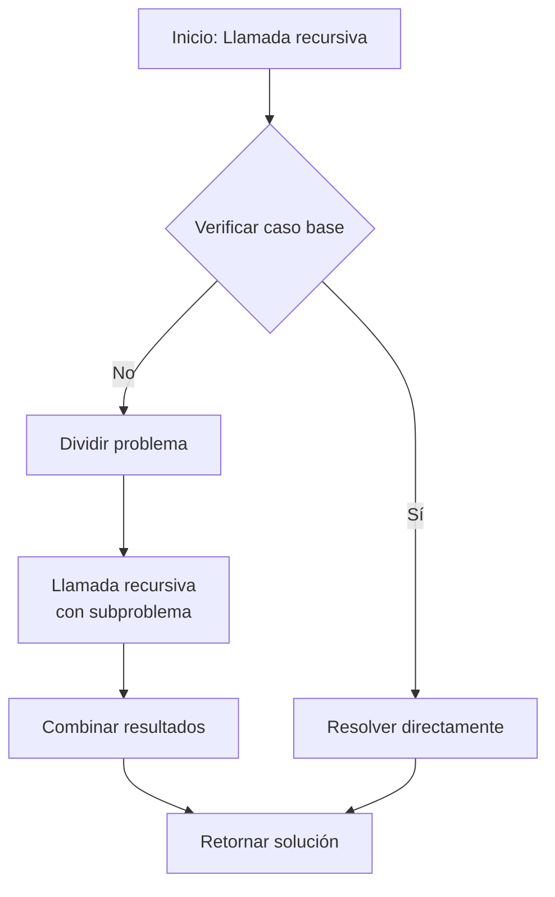

# Análisis de Algoritmos - Justificación y diseño de algoritmos

## 2.3 Algoritmos recursivos.

---

Los algoritmos recursivos son aquellos que se definen en términos de sí mismos, resolviendo problemas complejos dividiéndolos en subproblemas más simples del mismo tipo. La recursión es una poderosa técnica de diseño que permite escribir soluciones elegantes para problemas que tienen una estructura recursiva natural.

**Definición formal:** Un algoritmo recursivo es un procedimiento computacional que se llama a sí mismo directa o indirectamente, con argumentos que convergen hacia un caso base que termina la recursión.

### Fundamentos de la Recursión

#### Elementos de un Algoritmo Recursivo

1. **Caso(s) base**: Condición(es) de terminación que evitan la recursión infinita
2. **Paso recursivo**: Llamada al mismo algoritmo con parámetros modificados
3. **Convergencia**: Los parámetros deben acercarse al caso base

#### Estructura General

```python
def funcion_recursiva(parametros):
    # Verificar caso base
    if condicion_caso_base:
        return solucion_simple

    # Simplificar el problema
    subproblema = simplificar(parametros)

    # Llamada recursiva
    resultado_parcial = funcion_recursiva(subproblema)

    # Combinar resultados
    return combinar(resultado_parcial, parametros)
```

### Análisis de Algoritmos Recursivos

#### Ecuaciones de Recurrencia

El análisis de algoritmos recursivos se realiza mediante ecuaciones de recurrencia que expresan el tiempo de ejecución en función del tamaño del problema.

Para un algoritmo que divide el problema en $a$ subproblemas de tamaño $n/b$:

$$T(n) = aT(n/b) + f(n)$$

Donde:

- $a$: número de subproblemas
- $n/b$: tamaño de cada subproblema
- $f(n)$: costo de dividir y combinar

#### Teorema Maestro

El teorema maestro proporciona soluciones para recurrencias de la forma:

$$T(n) = aT(n/b) + f(n)$$

Donde $a \geq 1$, $b > 1$, y $f(n)$ es asintóticamente positiva.

**Caso 1:** Si $f(n) = O(n^{\log_b a - \epsilon})$ para $\epsilon > 0$, entonces $T(n) = \Theta(n^{\log_b a})$

**Caso 2:** Si $f(n) = \Theta(n^{\log_b a})$, entonces $T(n) = \Theta(n^{\log_b a} \log n)$

**Caso 3:** Si $f(n) = \Omega(n^{\log_b a + \epsilon})$ para $\epsilon > 0$ y $af(n/b) \leq cf(n)$ para $c < 1$, entonces $T(n) = \Theta(f(n))$

### Tipos de Recursión

#### Recursión Simple

```python
def factorial(n):
    """
    Calcula el factorial de n recursivamente
    Complejidad: O(n)
    Ecuación de recurrencia: T(n) = T(n-1) + O(1)
    """
    if n == 0 or n == 1:  # Caso base
        return 1
    return n * factorial(n - 1)  # Paso recursivo
```

#### Recursión Múltiple

```python
def fibonacci(n):
    """
    Calcula el n-ésimo número de Fibonacci
    Complejidad: O(2^n) (ineficiente)
    Ecuación de recurrencia: T(n) = T(n-1) + T(n-2) + O(1)
    """
    if n <= 1:  # Casos base
        return n
    return fibonacci(n - 1) + fibonacci(n - 2)  # Dos llamadas recursivas
```

#### Recursión de Cola (Tail Recursion)

```python
def factorial_cola(n, acumulador=1):
    """
    Factorial implementado con recursión de cola
    Complejidad: O(n)
    """
    if n == 0 or n == 1:
        return acumulador
    return factorial_cola(n - 1, n * acumulador)
```

#### Recursión Mutua

```python
def es_par(n):
    """
    Función que usa recursión mutua para determinar paridad
    """
    if n == 0:
        return True
    return es_impar(n - 1)

def es_impar(n):
    """
    Función complementaria para recursión mutua
    """
    if n == 0:
        return False
    return es_par(n - 1)
```

### Diseño de Algoritmos Recursivos

#### Método Divide y Vencerás

```python
def busqueda_binaria_recursiva(arr, objetivo, izquierda, derecha):
    """
    Búsqueda binaria implementada recursivamente
    Complejidad: O(log n)
    Ecuación de recurrencia: T(n) = T(n/2) + O(1)
    """
    if izquierda > derecha:  # Caso base 1: no encontrado
        return -1

    medio = (izquierda + derecha) // 2

    if arr[medio] == objetivo:  # Caso base 2: encontrado
        return medio
    elif arr[medio] > objetivo:
        return busqueda_binaria_recursiva(arr, objetivo, izquierda, medio - 1)
    else:
        return busqueda_binaria_recursiva(arr, objetivo, medio + 1, derecha)
```

#### Backtracking Recursivo

```python
def permutaciones(nums):
    """
    Genera todas las permutaciones de una lista usando backtracking recursivo
    Complejidad: O(n!)
    """
    def backtrack(inicio):
        if inicio == len(nums) - 1:  # Caso base: permutación completa
            resultado.append(nums[:])
            return

        for i in range(inicio, len(nums)):
            nums[inicio], nums[i] = nums[i], nums[inicio]  # Hacer elección
            backtrack(inicio + 1)  # Llamada recursiva
            nums[inicio], nums[i] = nums[i], nums[inicio]  # Deshacer elección

    resultado = []
    backtrack(0)
    return resultado
```

### Análisis de Correctitud

#### Inducción Matemática

La correctitud de algoritmos recursivos se demuestra típicamente usando inducción matemática:

1. **Caso base**: Demostrar que el algoritmo es correcto para el caso más simple
2. **Paso inductivo**: Asumir que el algoritmo es correcto para entradas más pequeñas y demostrar que esto implica correctitud para la entrada actual

**Ejemplo para factorial:**

- **Caso base**: factorial(0) = 1 (correcto por definición)
- **Hipótesis inductiva**: Suponer factorial(k) es correcto para k < n
- **Paso inductivo**: factorial(n) = n × factorial(n-1) = n × (n-1)! = n! (correcto)

### Optimización de Algoritmos Recursivos

#### Memoización

```python
def fibonacci_memo(n, memo={}):
    """
    Fibonacci optimizado con memoización
    Complejidad: O(n)
    """
    if n in memo:
        return memo[n]

    if n <= 1:
        return n

    memo[n] = fibonacci_memo(n - 1, memo) + fibonacci_memo(n - 2, memo)
    return memo[n]
```

#### Recursión con Iteración

```python
def fibonacci_iterativo(n):
    """
    Versión iterativa de Fibonacci (optimización de recursión)
    Complejidad: O(n)
    """
    if n <= 1:
        return n

    a, b = 0, 1
    for _ in range(2, n + 1):
        a, b = b, a + b

    return b
```

### Diagrama de Flujo de un Algoritmo Recursivo



### Ejercicios Propuestos

#### Ejercicio 1: Implementación y Análisis

Implementa un algoritmo recursivo para calcular el máximo común divisor (MCD) usando el algoritmo de Euclides y analiza su complejidad.

#### Ejercicio 2: Ecuación de Recurrencia

Para el algoritmo de búsqueda binaria recursiva, deriva y resuelve la ecuación de recurrencia.

#### Ejercicio 3: Torres de Hanói

Implementa una solución recursiva para el problema de las Torres de Hanói y determina su complejidad.

#### Ejercicio 4: Memoización

Dada la siguiente función recursiva ineficiente, optimízala usando memoización:

```python
def count_ways(n):
    """Cuenta formas de subir escalones (1, 2, o 3 pasos a la vez)"""
    if n < 0:
        return 0
    if n == 0:
        return 1
    return count_ways(n-1) + count_ways(n-2) + count_ways(n-3)
```

#### Ejercicio 5: Correctitud por Inducción

Demuestra por inducción matemática la correctitud del algoritmo recursivo del factorial.

### Soluciones a Ejercicios Selectos

#### Solución Ejercicio 1

```python
def mcd_euclides(a, b):
    """
    Algoritmo de Euclides para MCD (recursivo)
    Complejidad: O(log min(a, b))
    Ecuación de recurrencia: T(a, b) = T(b, a mod b) + O(1)
    """
    if b == 0:  # Caso base
        return a
    return mcd_euclides(b, a % b)  # Paso recursivo
```

#### Solución Ejercicio 3

```python
def torres_hanoi(n, origen, destino, auxiliar):
    """
    Resuelve el problema de las Torres de Hanói
    Complejidad: O(2^n)
    """
    if n == 1:  # Caso base
        print(f"Mover disco 1 de {origen} a {destino}")
        return

    torres_hanoi(n-1, origen, auxiliar, destino)
    print(f"Mover disco {n} de {origen} a {destino}")
    torres_hanoi(n-1, auxiliar, destino, origen)

# Análisis de complejidad:
# T(n) = 2T(n-1) + O(1)
# Resolviendo: T(n) = O(2^n)
```

### Ventajas y Desventajas de la Recursión

| Ventajas                                             | Desventajas                                         |
| ---------------------------------------------------- | --------------------------------------------------- |
| Soluciones elegantes y concisas                      | Mayor uso de memoria (pila de llamadas)             |
| Facilita resolver problemas con estructura recursiva | Posible sobrecarga por llamadas a función           |
| Más fácil de entender y mantener en muchos casos     | Puede ser menos eficiente que soluciones iterativas |

### Referencias Bibliográficas

#### Bibliografía Básica

1. Cormen, T. H., Leiserson, C. E., Rivest, R. L., & Stein, C. (2009). Introduction to Algorithms (3rd ed.). MIT Press. (Capítulos 4 y 15)
2. Kleinberg, J., & Tardos, É. (2005). Algorithm Design. Addison Wesley. (Capítulo 5)

#### Bibliografía Complementaria

1. Skiena, S. S. (2008). The Algorithm Design Manual (2nd ed.). Springer. (Capítulo 3)
2. Dasgupta, S., Papadimitriou, C., & Vazirani, U. (2006). Algorithms. McGraw-Hill. (Capítulo 2)
3. Graham, R. L., Knuth, D. E., & Patashnik, O. (1994). Concrete Mathematics. Addison-Wesley. (Capítulo 1)

### Consejos para el Estudio

1. **Identifica la estructura recursiva**: Antes de implementar, reconoce cómo el problema se divide en subproblemas similares
2. **Define casos base claros**: Asegúrate de que todos los caminos recursivos converjan a un caso base
3. **Practica el análisis de recurrencias**: Domina el uso del teorema maestro y otros métodos de solución
4. **Considera optimizaciones**: Evalúa cuando usar memoización o convertir a iterativo
5. **Verifica la correctitud**: Usa inducción matemática para demostrar que tu algoritmo funciona correctamente

Los algoritmos recursivos son una herramienta fundamental en el diseño de algoritmos, particularmente para problemas que exhiben una estructura recursiva natural. El dominio de esta técnica permite resolver problemas complejos de manera elegante y eficiente.
