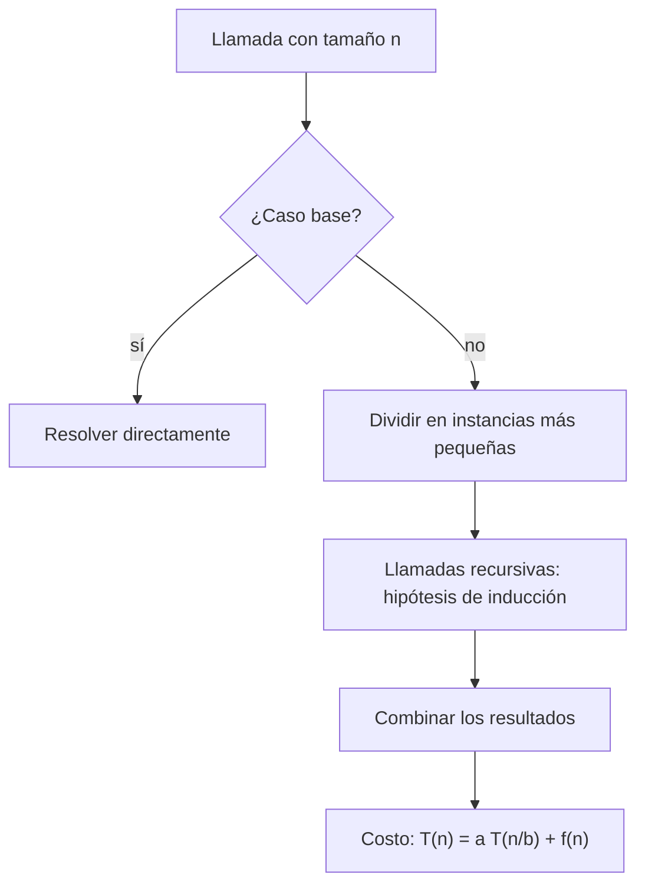

# Análisis de Algoritmos - Justificación y diseño de algoritmos

## 2.3 Algoritmos recursivos.

---

Un **algoritmo recursivo** resuelve una instancia reduciéndola a instancias más pequeñas del mismo problema, hasta llegar a **casos base** que se resuelven directamente. La recursión es la forma natural de expresar divide y vencerás, el recorrido de árboles y la búsqueda exhaustiva, y su estructura coincide con la de la **inducción matemática**: por eso la corrección se demuestra por inducción y el costo se expresa con una **ecuación de recurrencia**. Este tema presenta los tipos de recursión, la demostración de corrección, los tres métodos para resolver recurrencias (sustitución, árbol de recursión y teorema maestro), el costo de la pila y la memoización.

### Estructura

Todo algoritmo recursivo tiene:

1. **Casos base** que no hacen llamadas recursivas.
2. **Casos recursivos** que llaman al algoritmo con instancias **estrictamente más pequeñas** según alguna medida que no puede decrecer indefinidamente: esto garantiza la terminación.
3. Una forma de **combinar** los resultados de las llamadas.

**Tipos.** Recursión **lineal** (una llamada por nivel: factorial, búsqueda binaria), **de cola** (la llamada es la última operación y se puede convertir en un ciclo: Euclides), **múltiple** o en árbol (varias llamadas: Fibonacci, mergesort, Hanói), **mutua** (dos funciones se llaman entre sí: un analizador sintáctico descendente) y **anidada** (el argumento de la llamada es otra llamada: la función de Ackermann).

### Corrección por inducción

Se demuestra que el algoritmo es correcto para toda instancia de tamaño $n$ por **inducción fuerte** sobre $n:$ los casos base son correctos por inspección; para el paso inductivo se supone que las llamadas con instancias más pequeñas regresan resultados correctos (hipótesis de inducción) y se muestra que la combinación da el resultado correcto. Hay que usar exactamente la misma especificación en la hipótesis que en la conclusión: si el algoritmo usa un parámetro adicional, como un acumulador, la especificación debe decir qué significa.

### Recurrencias

El tiempo de un algoritmo recursivo cumple una recurrencia: el costo con tamaño $n$ es el de las llamadas más el trabajo propio. Por ejemplo, mergesort divide en dos mitades y mezcla en tiempo lineal: $T(n) = 2T(n/2) + \Theta(n).$

**Método de sustitución.** Se adivina la forma de la solución y se demuestra por inducción. Para $T(n) = 2T(\lfloor n/2 \rfloor) + n,$ se propone $T(n) \leq c \, n \log_2 n.$ Suponiéndolo para $\lfloor n/2 \rfloor:$

$$T(n) \leq 2c \left\lfloor \tfrac{n}{2} \right\rfloor \log_2 \tfrac{n}{2} + n \leq c \, n (\log_2 n - 1) + n = c \, n \log_2 n - (c - 1) n \leq c \, n \log_2 n$$

para $c \geq 1,$ con los casos base ajustando $c.$

**Árbol de recursión.** Se dibujan las llamadas como un árbol, se suma el trabajo de cada nivel y luego los niveles. En $T(n) = 2T(n/2) + n,$ el nivel $k$ tiene $2^k$ nodos de tamaño $n/2^k,$ con trabajo total $n;$ hay $\log_2 n + 1$ niveles, así que $T(n) = \Theta(n \log n).$

**Teorema maestro.** Sean $a \geq 1,$ $b > 1$ y $T(n) = aT(n/b) + f(n).$ Con $c^* = \log_b a:$

1. Si $f(n) = O(n^{c^* - \epsilon})$ para algún $\epsilon > 0,$ entonces $T(n) = \Theta(n^{c^*}).$ Dominan las hojas.
2. Si $f(n) = \Theta(n^{c^*} \log^k n)$ con $k \geq 0,$ entonces $T(n) = \Theta(n^{c^*} \log^{k+1} n).$ Todos los niveles pesan lo mismo.
3. Si $f(n) = \Omega(n^{c^* + \epsilon})$ y además $a f(n/b) \leq \delta f(n)$ para alguna $\delta \lt 1$ y $n$ grande, entonces $T(n) = \Theta(f(n)).$ Domina la raíz.

**Idea de la demostración.** El árbol tiene $\log_b n$ niveles; el nivel $j$ tiene $a^j$ nodos con trabajo $f(n/b^j)$ cada uno, y las hojas son $a^{\log_b n} = n^{c^*}.$ Así $T(n) = \Theta(n^{c^*}) + \sum_{j=0}^{\log_b n - 1} a^j f(n/b^j).$ En el caso 1 la suma es una serie geométrica creciente dominada por las hojas; en el 2 cada término vale $\Theta(n^{c^*} \log^k (n/b^j))$ y se suman $\log_b n$ de ellos; en el 3 es una serie geométrica decreciente dominada por el primer término.

| Recurrencia | Caso | Solución | Algoritmo |
| --- | --- | --- | --- |
| $T(n/2) + 1$ | 2 | $\Theta(\log n)$ | búsqueda binaria |
| $2T(n/2) + n$ | 2 | $\Theta(n \log n)$ | mergesort |
| $3T(n/2) + n$ | 1 | $\Theta(n^{\log_2 3})$ | Karatsuba |
| $7T(n/2) + n^2$ | 1 | $\Theta(n^{\log_2 7})$ | Strassen |
| $2T(n/2) + n^2$ | 3 | $\Theta(n^2)$ | |

El teorema no cubre todo: $T(n) = 2T(n/2) + n / \log n$ cae entre los casos 1 y 2, y las recurrencias con restas como $T(n) = 2T(n - 1) + 1$ se resuelven desarrollándolas.

### Costo de la pila y memoización

Cada llamada activa ocupa un **marco de pila**, así que el espacio de un algoritmo recursivo incluye la **profundidad máxima** de la recursión: $\Theta(n)$ para el factorial recursivo, $\Theta(\log n)$ para la búsqueda binaria. Python limita la profundidad a 1000 por omisión, y no elimina la recursión de cola.

Cuando la recursión múltiple resuelve muchas veces los mismos subproblemas, la **memoización** guarda cada resultado la primera vez y lo reutiliza: el tiempo pasa a ser el número de subproblemas distintos por el costo de cada uno. Es la versión descendente de la **programación dinámica** (tema 2.4).



### Implementación en Python

El programa implementa los cinco ejercicios: Euclides recursivo con su número de llamadas, la búsqueda binaria recursiva con su peor caso medido, las torres de Hanói con un verificador de las reglas, las tres versiones de `count_ways` (sin memoria, memoizada e iterativa) y el factorial recursivo con el límite de la pila. Al final evalúa cuatro recurrencias y las divide entre la cota del teorema maestro.

```python
import math, sys
from functools import lru_cache

# --- Ejercicio 1: MCD recursivo ---
def mcd(a, b, prof=0):
    if b == 0:
        return a, prof
    return mcd(b, a % b, prof + 1)

print("ejercicio 1:", [mcd(a, b) for a, b in [(1071, 462), (987, 610), (10**18, 6)]],
      "(mcd, llamadas recursivas)")

# --- Ejercicio 2: búsqueda binaria recursiva ---
def bb(A, x, lo, hi, llamadas=1):
    if lo > hi:
        return -1, llamadas
    mid = (lo + hi) // 2
    if A[mid] == x:
        return mid, llamadas
    if A[mid] < x:
        return bb(A, x, mid + 1, hi, llamadas + 1)
    return bb(A, x, lo, mid - 1, llamadas + 1)

print("ejercicio 2:")
for n in (1, 7, 8, 1000, 10**6):
    A = list(range(n))
    peor = max(bb(A, x, 0, n - 1)[1] for x in [-1, n] + list(range(0, n, max(1, n // 2000))))
    print(f"   n = {n:7}: peor caso {peor} llamadas, floor(lg n) + 2 = {math.floor(math.log2(n)) + 2}")

# --- Ejercicio 3: torres de Hanói ---
def hanoi(n, origen, destino, auxiliar, movs):
    if n == 0:
        return
    hanoi(n - 1, origen, auxiliar, destino, movs)
    movs.append((n, origen, destino))
    hanoi(n - 1, auxiliar, destino, origen, movs)

def verifica_hanoi(n, movs):
    postes = {"A": list(range(n, 0, -1)), "B": [], "C": []}
    for disco, o, d in movs:
        assert postes[o] and postes[o][-1] == disco
        assert not postes[d] or postes[d][-1] > disco   # nunca uno grande sobre uno chico
        postes[d].append(postes[o].pop())
    return postes["C"] == list(range(n, 0, -1))

m = []
hanoi(3, "A", "C", "B", m)
print("ejercicio 3: n = 3:", " ".join(f"{d}:{o}{t}" for d, o, t in m))
for n in (1, 5, 10, 20):
    m = []
    hanoi(n, "A", "C", "B", m)
    print(f"   n = {n:2}: {len(m):7} movimientos = 2^n - 1 = {2**n - 1}, válido: {verifica_hanoi(n, m)}")

# --- Ejercicio 4: memoización ---
llamadas = 0
def count_ways(n):
    global llamadas
    llamadas += 1
    if n < 0:
        return 0
    if n == 0:
        return 1
    return count_ways(n - 1) + count_ways(n - 2) + count_ways(n - 3)

@lru_cache(maxsize=None)
def count_ways_memo(n):
    if n < 0:
        return 0
    if n == 0:
        return 1
    return count_ways_memo(n - 1) + count_ways_memo(n - 2) + count_ways_memo(n - 3)

def count_ways_iter(n):
    a, b, c = 0, 0, 1          # f(-2), f(-1), f(0)
    for _ in range(n):
        a, b, c = b, c, a + b + c
    return c

print("ejercicio 4:")
for n in (5, 10, 20, 25):
    llamadas = 0
    v = count_ways(n)
    count_ways_memo.cache_clear()
    assert v == count_ways_memo(n) == count_ways_iter(n)
    print(f"   n = {n:2}: {v:8} formas; sin memoria {llamadas:9} llamadas,"
          f" con memoria {count_ways_memo.cache_info().misses} subproblemas")
print("   n = 1000 iterativo:", str(count_ways_iter(1000))[:20] + "...",
      f"({len(str(count_ways_iter(1000)))} cifras)")

# --- Ejercicio 5: factorial recursivo y profundidad de la pila ---
def fact(n):
    return 1 if n == 0 else n * fact(n - 1)

assert all(fact(n) == math.factorial(n) for n in range(300))
print("ejercicio 5: fact(n) = n! para 0 <= n < 300; límite de recursión de Python:",
      sys.getrecursionlimit())
try:
    fact(10**5)
except RecursionError:
    print("   fact(10^5): RecursionError, la pila crece linealmente con n")

# --- Teorema maestro: comprobación numérica ---
def T(n, a, b, f):
    return 1 if n <= 1 else a * T(n // b, a, b, f) + f(n)

print("teorema maestro, T(n)/cota con n = 2^10, 2^15, 2^20:")
for nombre, a, b, f, cota in [
        ("2T(n/2) + n       ~ n lg n", 2, 2, lambda n: n, lambda n: n * math.log2(n)),
        ("4T(n/2) + n       ~ n^2   ", 4, 2, lambda n: n, lambda n: n**2),
        ("2T(n/2) + n^2     ~ n^2   ", 2, 2, lambda n: n**2, lambda n: n**2),
        ("T(n/2) + 1        ~ lg n  ", 1, 2, lambda n: 1, lambda n: math.log2(n))]:
    print("  ", nombre, [round(T(2**k, a, b, f) / cota(2**k), 3) for k in (10, 15, 20)])
```

Salida:

```text
ejercicio 1: [(21, 3), (1, 14), (2, 3)] (mcd, llamadas recursivas)
ejercicio 2:
   n =       1: peor caso 2 llamadas, floor(lg n) + 2 = 2
   n =       7: peor caso 4 llamadas, floor(lg n) + 2 = 4
   n =       8: peor caso 5 llamadas, floor(lg n) + 2 = 5
   n =    1000: peor caso 11 llamadas, floor(lg n) + 2 = 11
   n = 1000000: peor caso 21 llamadas, floor(lg n) + 2 = 21
ejercicio 3: n = 3: 1:AC 2:AB 1:CB 3:AC 1:BA 2:BC 1:AC
   n =  1:       1 movimientos = 2^n - 1 = 1, válido: True
   n =  5:      31 movimientos = 2^n - 1 = 31, válido: True
   n = 10:    1023 movimientos = 2^n - 1 = 1023, válido: True
   n = 20: 1048575 movimientos = 2^n - 1 = 1048575, válido: True
ejercicio 4:
   n =  5:       13 formas; sin memoria        46 llamadas, con memoria 8 subproblemas
   n = 10:      274 formas; sin memoria       979 llamadas, con memoria 13 subproblemas
   n = 20:   121415 formas; sin memoria    433993 llamadas, con memoria 23 subproblemas
   n = 25:  2555757 formas; sin memoria   9135460 llamadas, con memoria 28 subproblemas
   n = 1000 iterativo: 27588428077664862526... (265 cifras)
ejercicio 5: fact(n) = n! para 0 <= n < 300; límite de recursión de Python: 1000
   fact(10^5): RecursionError, la pila crece linealmente con n
teorema maestro, T(n)/cota con n = 2^10, 2^15, 2^20:
   2T(n/2) + n       ~ n lg n [1.1, 1.067, 1.05]
   4T(n/2) + n       ~ n^2    [1.999, 2.0, 2.0]
   2T(n/2) + n^2     ~ n^2    [1.999, 2.0, 2.0]
   T(n/2) + 1        ~ lg n   [1.1, 1.067, 1.05]
```

Los cocientes se estabilizan en una constante, como predice el teorema; en los casos 2 la convergencia es lenta, porque los términos de orden inferior, como $n$ junto a $n \log n,$ solo se diluyen a razón de $1/\log n.$

### Ejercicios Propuestos

1. **MCD.** Implementa el algoritmo de Euclides en forma recursiva y analiza su complejidad.

2. **Búsqueda binaria.** Deriva y resuelve la recurrencia de la búsqueda binaria recursiva.

3. **Torres de Hanói.** Implementa la solución recursiva y determina su complejidad.

4. **Memoización.** Optimiza la siguiente función, que cuenta las formas de subir $n$ escalones dando pasos de 1, 2 o 3:

   ```python
   def count_ways(n):
       if n < 0:
           return 0
       if n == 0:
           return 1
       return count_ways(n-1) + count_ways(n-2) + count_ways(n-3)
   ```

5. **Inducción.** Demuestra por inducción la corrección del factorial recursivo.

### Soluciones

**Ejercicio 1.**

```
MCD(a, b)
1  si b = 0 entonces regresar a
2  regresar MCD(b, a mod b)
```

Corrección por inducción sobre $b,$ usando el lema del tema 1.1. Es recursión de cola: un compilador que la elimina usa espacio $O(1);$ Python usa una pila de profundidad igual al número de llamadas. Por el teorema de Lamé, hace $O(\log \min(a, b))$ llamadas; el peor caso son números de Fibonacci consecutivos, como $(987, 610)$ con 14 llamadas.

**Ejercicio 2.** Cada llamada hace trabajo constante y una sola llamada con a lo sumo la mitad de los elementos: $T(n) = T(\lfloor n/2 \rfloor) + \Theta(1),$ con $T(0) = \Theta(1).$ Desarrollando, $T(n) = T(n/2^k) + k \, \Theta(1),$ y el tamaño llega a 0 tras $\lfloor \log_2 n \rfloor + 1$ divisiones: $T(n) = \Theta(\log n).$ Es el caso 2 del teorema maestro con $a = 1,$ $b = 2,$ $c^* = 0.$ Contando también la llamada final con el intervalo vacío, el peor caso hace exactamente $\lfloor \log_2 n \rfloor + 2$ llamadas, como mide el programa. Espacio de pila: $\Theta(\log n).$

**Ejercicio 3.** Para mover $n$ discos de A a C: mover $n - 1$ de A a B usando C, mover el disco $n$ de A a C, y mover $n - 1$ de B a C usando A. Por inducción, las llamadas recursivas son válidas porque el disco $n,$ el más grande, está en el fondo y no estorba. El número de movimientos cumple $M(0) = 0$ y $M(n) = 2M(n - 1) + 1,$ cuya solución es $M(n) = 2^n - 1:$ si vale para $n - 1,$ $M(n) = 2(2^{n-1} - 1) + 1 = 2^n - 1.$ Es **óptimo**: cualquier solución debe mover el disco más grande al menos una vez, y antes de ese movimiento los otros $n - 1$ discos deben estar todos en el poste restante, lo que requiere al menos $M(n - 1)$ movimientos antes y otros tantos después. Tiempo $\Theta(2^n),$ espacio de pila $\Theta(n).$

**Ejercicio 4.** Sin memoria, el número de llamadas $L(n) = 1 + L(n - 1) + L(n - 2) + L(n - 3)$ crece como la sucesión de tribonacci, $\Theta(1.839^n):$ casi 9 millones de llamadas para $n = 25.$ Con memoización hay solo $n + 3$ subproblemas distintos, los valores de $-2$ a $n,$ cada uno con costo constante: $\Theta(n)$ tiempo y espacio. La versión iterativa conserva solo los tres últimos valores: $\Theta(n)$ tiempo y $O(1)$ espacio, contando sumas como operaciones de costo constante.

**Ejercicio 5.**

```
FACT(n)
1  si n = 0 entonces regresar 1
2  regresar n · FACT(n − 1)
```

**Afirmación:** para todo $n \geq 0,$ $\text{FACT}(n) = n!.$ **Base:** $\text{FACT}(0) = 1 = 0!.$ **Paso:** si $\text{FACT}(n - 1) = (n - 1)!,$ entonces $\text{FACT}(n) = n \cdot (n - 1)! = n!.$ **Terminación:** el argumento disminuye en 1 y llega a 0. $\blacksquare$ Hace $n$ multiplicaciones y usa $\Theta(n)$ espacio de pila, a diferencia de la versión iterativa; por eso `fact(10**5)` excede el límite de recursión de Python.

### Referencias

1. Cormen, T. H., Leiserson, C. E., Rivest, R. L., and Stein, C., _Introduction to Algorithms_. MIT Press, 2022. Capítulo 4.
2. Kleinberg, J., and Tardos, É., _Algorithm Design_. Pearson, 2006. Capítulo 5.
3. Graham, R. L., Knuth, D. E., and Patashnik, O., _Concrete Mathematics_. Addison-Wesley, 1994. Capítulo 1.
4. Bentley, J. L., Haken, D., and Saxe, J. B., A general method for solving divide-and-conquer recurrences. _SIGACT News_ 12(3), 1980.
