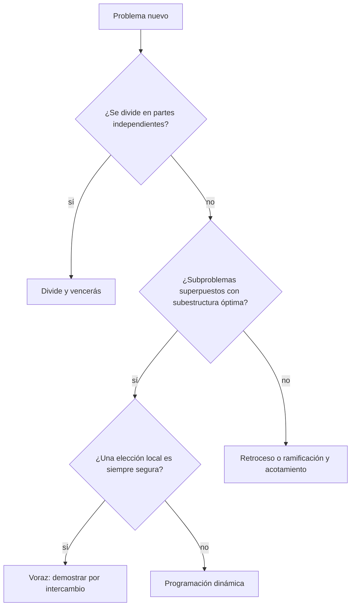

# Análisis de Algoritmos - Justificación y diseño de algoritmos

## 2.4 Diseño de algoritmos.

---

Diseñar un algoritmo para un problema nuevo rara vez parte de cero: casi siempre se adapta uno de unos pocos **paradigmas** que han demostrado funcionar para familias enteras de problemas. Este tema presenta los cinco principales: **fuerza bruta**, **divide y vencerás**, **programación dinámica**, **algoritmos voraces** y **búsqueda con retroceso** (_backtracking_), junto con la condición que debe cumplir un problema para que cada uno funcione y la forma de demostrar su corrección. Los ejercicios aplican cada paradigma a un problema clásico.

### Fuerza bruta

Enumera todas las soluciones candidatas y se queda con la que sirve o con la mejor. Es correcta por construcción y sirve como referencia para probar algoritmos más rápidos, como hacen los programas de este curso, pero su costo suele ser exponencial: $2^n$ subconjuntos, $n!$ permutaciones.

### Divide y vencerás

1. **Dividir** la instancia en $a$ subinstancias del mismo problema, de tamaño $n/b.$
2. **Resolver** cada una recursivamente.
3. **Combinar** las soluciones en una solución de la instancia original.

Funciona cuando las subinstancias son **independientes** y la combinación es barata. El costo es $T(n) = aT(n/b) + f(n),$ que se resuelve con el teorema maestro (tema 2.3). Ejemplos: mergesort, quicksort, búsqueda binaria, Karatsuba, Strassen, la transformada rápida de Fourier y el par de puntos más cercano (ejercicio 1).

### Programación dinámica

Se aplica a problemas de optimización con dos propiedades:

- **Subestructura óptima:** una solución óptima contiene soluciones óptimas de subproblemas.
- **Subproblemas superpuestos:** la recursión natural resuelve muchas veces los mismos subproblemas.

El método: definir los subproblemas, escribir la **recurrencia** que relaciona el valor óptimo de un subproblema con los de subproblemas más pequeños, resolverlos en un orden en que cada uno se calcula después de los que necesita (de abajo hacia arriba, con una tabla) o con memoización (de arriba hacia abajo), y **reconstruir** la solución siguiendo las decisiones. El tiempo es el número de subproblemas por el costo de cada uno. Ejemplos: mochila, subsecuencia común más larga (ejercicio 2), distancia de edición, multiplicación encadenada de matrices, Floyd y Warshall (tema 4.3).

### Algoritmos voraces

Construyen la solución por pasos, eligiendo en cada uno la opción que parece mejor en ese momento y sin reconsiderarla. Funcionan cuando el problema tiene:

- **Propiedad de elección voraz:** existe una solución óptima que contiene la primera elección voraz.
- **Subestructura óptima:** tras la elección, lo que queda es una instancia más pequeña del mismo problema.

La corrección se demuestra casi siempre con un **argumento de intercambio**: se toma una solución óptima cualquiera y se muestra que se puede transformar, sin empeorarla, en la que construye el algoritmo. Ejemplos: planificación de intervalos (ejercicio 3), códigos de Huffman, Kruskal y Prim (tema 4.2), Dijkstra (tema 4.3). Un voraz con un criterio equivocado da respuestas subóptimas, y probarlo contra fuerza bruta es la forma más rápida de descubrirlo.

### Búsqueda con retroceso

Explora el **árbol de decisiones** en profundidad, construyendo una solución parcial paso a paso; en cuanto una solución parcial no puede extenderse a una completa válida, **poda** esa rama y retrocede. El peor caso sigue siendo exponencial, pero una buena poda reduce enormemente el árbol explorado. **Ramificación y acotamiento** (_branch and bound_) es la variante para optimización: poda las ramas cuya cota optimista no supera la mejor solución encontrada. Ejemplos: las $n$ reinas, sudoku, suma de subconjuntos (ejercicio 4), satisfacibilidad.

| Paradigma | Cuándo funciona | Cómo se demuestra | Costo típico |
| --- | --- | --- | --- |
| fuerza bruta | siempre | por construcción | exponencial |
| divide y vencerás | subproblemas independientes | inducción | $T(n) = aT(n/b) + f(n)$ |
| programación dinámica | subestructura óptima y superposición | inducción sobre la recurrencia | subproblemas por costo de cada uno |
| voraz | elección voraz y subestructura óptima | argumento de intercambio | dominado por ordenar |
| retroceso | restricciones que permiten podar | por construcción | exponencial, con poda |



### Implementación en Python

El programa implementa los cuatro algoritmos de los ejercicios y compara cada uno con una búsqueda por fuerza bruta en cientos de instancias aleatorias. Además busca contraejemplos para dos criterios voraces equivocados de la planificación de intervalos y mide cuántos nodos explora el retroceso en instancias imposibles que la poda no detecta.

```python
import math, random
from itertools import combinations

random.seed(24)

# --- Ejercicio 1: par de puntos más cercano, divide y vencerás ---
def dist(p, q):
    return math.hypot(p[0] - q[0], p[1] - q[1])

def cercano_fuerza_bruta(P):
    return min(dist(p, q) for p, q in combinations(P, 2))

def cercano(P):
    Px = sorted(P)
    Py = sorted(P, key=lambda p: p[1])
    return _cercano(Px, Py)

def _cercano(Px, Py):
    n = len(Px)
    if n <= 3:
        return cercano_fuerza_bruta(Px)
    m = n // 2
    xm = Px[m][0]
    izq = set(Px[:m])
    Py_izq = [p for p in Py if p in izq]
    Py_der = [p for p in Py if p not in izq]
    d = min(_cercano(Px[:m], Py_izq), _cercano(Px[m:], Py_der))
    franja = [p for p in Py if abs(p[0] - xm) < d]       # ordenada por y
    for i in range(len(franja)):
        for j in range(i + 1, min(i + 8, len(franja))):  # a lo sumo 7 vecinos
            d = min(d, dist(franja[i], franja[j]))
    return d

ok = True
for _ in range(200):
    P = list({(random.randint(0, 1000), random.randint(0, 1000)) for _ in range(random.randint(2, 60))})
    if len(P) >= 2:
        ok &= math.isclose(cercano(P), cercano_fuerza_bruta(P))
print("ejercicio 1: coincide con fuerza bruta en 200 conjuntos:", ok)
P = list({(random.random(), random.random()) for _ in range(20000)})
print(f"   20000 puntos: distancia mínima {cercano(P):.3e}")

# --- Ejercicio 2: subsecuencia común más larga ---
def lcs(X, Y):
    m, n = len(X), len(Y)
    L = [[0] * (n + 1) for _ in range(m + 1)]
    for i in range(1, m + 1):
        for j in range(1, n + 1):
            if X[i - 1] == Y[j - 1]:
                L[i][j] = L[i - 1][j - 1] + 1
            else:
                L[i][j] = max(L[i - 1][j], L[i][j - 1])
    s, i, j = [], m, n                      # reconstrucción
    while i and j:
        if X[i - 1] == Y[j - 1]:
            s.append(X[i - 1]); i -= 1; j -= 1
        elif L[i - 1][j] >= L[i][j - 1]:
            i -= 1
        else:
            j -= 1
    return L[m][n], "".join(reversed(s))

def es_subsecuencia(s, X):
    it = iter(X)
    return all(c in it for c in s)

def lcs_fuerza_bruta(X, Y):
    for k in range(len(X), -1, -1):
        for idx in combinations(range(len(X)), k):
            if es_subsecuencia("".join(X[i] for i in idx), Y):
                return k

print("ejercicio 2:", lcs("ABCBDAB", "BDCABA"), lcs("AGGTAB", "GXTXAYB"))
ok = all(lcs(X, Y)[0] == lcs_fuerza_bruta(X, Y) and es_subsecuencia(lcs(X, Y)[1], X)
         and es_subsecuencia(lcs(X, Y)[1], Y)
         for X, Y in ((("".join(random.choice("ABC") for _ in range(random.randint(0, 9)))),
                       "".join(random.choice("ABC") for _ in range(random.randint(0, 9))))
                      for _ in range(300)))
print("   coincide con fuerza bruta en 300 pares:", ok)

# --- Ejercicio 3: planificación de intervalos (voraz) ---
def intervalos(I):
    elegidos, fin = [], -math.inf
    for s, f in sorted(I, key=lambda x: x[1]):      # menor tiempo de fin primero
        if s >= fin:
            elegidos.append((s, f)); fin = f
    return elegidos

def intervalos_fuerza_bruta(I):
    for k in range(len(I), 0, -1):
        for S in combinations(sorted(I), k):
            if all(S[i][1] <= S[i + 1][0] for i in range(k - 1)):
                return k
    return 0

I = [(1, 4), (3, 5), (0, 6), (5, 7), (3, 9), (5, 9), (6, 10), (8, 11), (8, 12), (2, 14), (12, 16)]
print("ejercicio 3:", intervalos(I))
ok = True
for _ in range(300):
    J = []
    for _ in range(random.randint(0, 10)):
        s = random.randint(0, 20); J.append((s, s + random.randint(1, 8)))
    ok &= len(intervalos(J)) == intervalos_fuerza_bruta(J)
print("   óptimo en 300 instancias:", ok)
for nombre, clave in [("inicio más temprano", lambda x: x[0]), ("duración más corta", lambda x: x[1] - x[0])]:
    contra = None
    for _ in range(5000):
        J = [(s, s + random.randint(1, 8)) for s in (random.randint(0, 15) for _ in range(5))]
        # voraz genérico: aceptar si no se traslapa con los ya elegidos
        sel = []
        for s, f in sorted(J, key=clave):
            if all(f <= s2 or f2 <= s for s2, f2 in sel):
                sel.append((s, f))
        if len(sel) < intervalos_fuerza_bruta(J):
            contra = (sorted(J), len(sel), intervalos_fuerza_bruta(J)); break
    print(f"   voraz por {nombre}: contraejemplo {contra[0]} elige {contra[1]}, óptimo {contra[2]}")

# --- Ejercicio 4: suma de subconjuntos con backtracking ---
nodos = 0
def suma_subconjuntos(A, objetivo):
    global nodos
    A = sorted(A, reverse=True)
    resto = [sum(A[i:]) for i in range(len(A) + 1)]
    sol = []
    def bt(i, falta):
        global nodos
        nodos += 1
        if falta == 0:
            return True
        if i == len(A) or falta < 0 or resto[i] < falta:   # poda
            return False
        sol.append(A[i])
        if bt(i + 1, falta - A[i]):
            return True
        sol.pop()
        return bt(i + 1, falta)
    return (list(sol) if bt(0, objetivo) else None)

A = [3, 34, 4, 12, 5, 2]
for t in (9, 30, 53):
    nodos = 0
    print(f"ejercicio 4: objetivo {t}: {suma_subconjuntos(A, t)} ({nodos} nodos)")
ok = True
for _ in range(300):
    B = [random.randint(1, 30) for _ in range(random.randint(0, 10))]
    t = random.randint(0, 100)
    r = suma_subconjuntos(B, t)
    existe = any(sum(S) == t for k in range(len(B) + 1) for S in combinations(B, k))
    ok &= (r is not None) == existe and (r is None or sum(r) == t)
print("   correcto en 300 instancias:", ok)
for n in (10, 15, 20):
    nodos = 0
    B = [2 * i for i in range(1, n + 1)]
    t = (n * (n + 1) // 2) | 1          # impar: imposible, pero la poda no lo ve
    suma_subconjuntos(B, t)
    print(f"   n = {n}, pares con objetivo impar {t}: {nodos} nodos (árbol completo: {2**(n + 1) - 1})")
```

Salida:

```text
ejercicio 1: coincide con fuerza bruta en 200 conjuntos: True
   20000 puntos: distancia mínima 1.245e-05
ejercicio 2: (4, 'BCBA') (4, 'GTAB')
   coincide con fuerza bruta en 300 pares: True
ejercicio 3: [(1, 4), (5, 7), (8, 11), (12, 16)]
   óptimo en 300 instancias: True
   voraz por inicio más temprano: contraejemplo [(1, 8), (2, 3), (3, 10), (7, 8), (11, 16)] elige 2, óptimo 3
   voraz por duración más corta: contraejemplo [(0, 5), (6, 12), (11, 16), (11, 18), (13, 21)] elige 2, óptimo 3
ejercicio 4: objetivo 9: [5, 4] (7 nodos)
ejercicio 4: objetivo 30: None (3 nodos)
ejercicio 4: objetivo 53: [34, 12, 5, 2] (9 nodos)
   correcto en 300 instancias: True
   n = 10, pares con objetivo impar 55: 307 nodos (árbol completo: 2047)
   n = 15, pares con objetivo impar 121: 5639 nodos (árbol completo: 65535)
   n = 20, pares con objetivo impar 211: 120841 nodos (árbol completo: 2097151)
```

### Ejercicios Propuestos

1. **Divide y vencerás.** Diseña un algoritmo para encontrar el par de puntos más cercano en el plano y analiza su complejidad.

2. **Programación dinámica.** Resuelve el problema de la subsecuencia común más larga.

3. **Voraz.** Diseña un algoritmo voraz para la planificación de intervalos: elegir el máximo número de intervalos sin traslapes.

4. **Retroceso.** Implementa un algoritmo de retroceso para la suma de subconjuntos: decidir si algún subconjunto de $A$ suma exactamente $t.$

5. **Complejidad.** Analiza la complejidad de los algoritmos de los ejercicios anteriores.

### Soluciones

**Ejercicio 1.** Se ordenan los puntos por $x$ y por $y$ una sola vez. **Dividir:** una recta vertical $x = x_m$ separa los puntos en dos mitades. **Resolver:** se calcula recursivamente la distancia mínima $\delta_I$ en la izquierda y $\delta_D$ en la derecha; sea $\delta = \min(\delta_I, \delta_D).$ **Combinar:** un par más cercano que $\delta$ debe cruzar la recta, con ambos puntos en la **franja** $|x - x_m| \lt \delta.$ Se recorren los puntos de la franja ordenados por $y$ y cada uno se compara solo con los 7 siguientes.

**Por qué bastan 7:** si $p$ y $q$ están en la franja con $0 \leq y_q - y_p \lt \delta,$ ambos están en un rectángulo de $2\delta \times \delta.$ Dividido en 8 cuadrados de lado $\delta/2,$ cada cuadrado contiene a lo sumo un punto, porque dos puntos del mismo cuadrado estarían del mismo lado de la recta y a distancia menor que $\delta.$ Así, entre $p$ y $q$ hay a lo sumo 6 puntos en el orden por $y.$

**Costo:** dividir manteniendo las listas ordenadas y combinar cuestan $O(n),$ así que $T(n) = 2T(n/2) + O(n) = O(n \log n),$ más el ordenamiento inicial, también $O(n \log n).$ La fuerza bruta compara los $\binom{n}{2}$ pares: $\Theta(n^2).$

**Ejercicio 2.** Para $X = x_1 \cdots x_m$ y $Y = y_1 \cdots y_n,$ sea $L[i, j]$ la longitud de una subsecuencia común más larga de $x_1 \cdots x_i$ y $y_1 \cdots y_j.$ Recurrencia:

$$L[i, j] = \begin{cases} 0 & \text{si } i = 0 \text{ o } j = 0, \\ L[i-1, j-1] + 1 & \text{si } x_i = y_j, \\ \max(L[i-1, j], \, L[i, j-1]) & \text{si } x_i \neq y_j. \end{cases}$$

**Subestructura óptima:** si $x_i = y_j,$ alguna subsecuencia común más larga termina en ese símbolo, y lo anterior es una subsecuencia común más larga de los prefijos; si $x_i \neq y_j,$ una subsecuencia común más larga no usa $x_i$ o no usa $y_j.$ Se llena la tabla por filas y se reconstruye desde $L[m, n]$ siguiendo las decisiones. Con $X = \text{ABCBDAB}$ y $Y = \text{BDCABA},$ la longitud es 4 y una solución es BCBA.

**Ejercicio 3.** **Voraz por fin más temprano:** se ordenan los intervalos por su tiempo de fin y se toma cada uno que no se traslape con el último elegido.

**Demostración por intercambio.** Sean $g_1, \ldots, g_k$ los intervalos del voraz y $o_1, \ldots, o_m$ los de una solución óptima, ambos en orden. Por inducción, $f(g_r) \leq f(o_r)$ para todo $r \leq k:$ para $r = 1,$ $g_1$ es el que termina primero; si $f(g_{r-1}) \leq f(o_{r-1}) \leq s(o_r),$ entonces $o_r$ era compatible cuando el voraz eligió $g_r,$ y como el voraz eligió el compatible que termina primero, $f(g_r) \leq f(o_r).$ Si fuera $m > k,$ el intervalo $o_{k+1}$ empezaría después de $f(o_k) \geq f(g_k)$ y el voraz lo habría tomado: contradicción. Luego $k = m.$ $\blacksquare$

Otros criterios naturales fallan, y el programa encuentra contraejemplos: empezar por el que inicia primero falla si ese intervalo es muy largo; empezar por el más corto falla si este se traslapa con dos que serían compatibles entre sí.

**Ejercicio 4.** Se ordenan los elementos de mayor a menor y se decide, para cada uno, si se incluye o no. Se poda cuando lo que falta es negativo o cuando la suma de todos los elementos restantes no alcanza lo que falta. El programa lo verifica contra fuerza bruta. Con $A = \{3, 34, 4, 12, 5, 2\}$ y $t = 9,$ encuentra $\{5, 4\}$ explorando 7 nodos. En el peor caso explora $O(2^n)$ nodos: con números pares y un objetivo impar, la poda no detecta la imposibilidad y el árbol explorado crece exponencialmente, aunque mucho menos que el completo.

**Ejercicio 5.**

| Algoritmo | Tiempo | Espacio |
| --- | --- | --- |
| par más cercano | $O(n \log n)$ | $O(n)$ |
| subsecuencia común más larga | $\Theta(mn)$ | $\Theta(mn),$ o $O(\min(m, n))$ si solo se quiere la longitud |
| intervalos, voraz | $O(n \log n)$ por el ordenamiento | $O(n)$ |
| suma de subconjuntos, retroceso | $O(2^n)$ en el peor caso | $O(n)$ de pila |

La suma de subconjuntos también tiene una solución de programación dinámica en $O(nt),$ pseudopolinomial (tema 1.2): conviene cuando $t$ es pequeño.

### Referencias

1. Kleinberg, J., and Tardos, É., _Algorithm Design_. Pearson, 2006. Capítulos 4, 5 y 6.
2. Cormen, T. H., Leiserson, C. E., Rivest, R. L., and Stein, C., _Introduction to Algorithms_. MIT Press, 2022. Capítulos 4, 14, 15 y 33.
3. Shamos, M. I., and Hoey, D., Closest-point problems. _16th Annual Symposium on Foundations of Computer Science_, 1975.
4. Skiena, S. S., _The Algorithm Design Manual_. Springer, 2020. Capítulos 5, 9 y 10.
