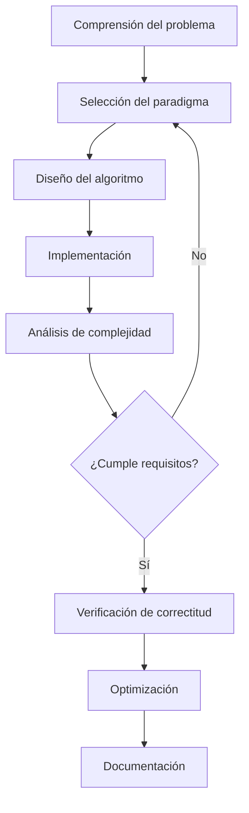

# Análisis de Algoritmos - Justificación y diseño de algoritmos

## 2.4 Diseño de algoritmos.

---

El diseño de algoritmos es el proceso sistemático de desarrollar soluciones computacionales eficientes para problemas específicos. Involucra la selección de técnicas apropiadas, el análisis de complejidad y la verificación de correctitud.

**Definición formal:** Un algoritmo es una secuencia finita de instrucciones bien definidas que resuelve un problema computacional en tiempo finito, dados ciertos inputs, produciendo outputs correctos.

### Paradigmas Fundamentales de Diseño

#### 1. Divide y Vencerás (Divide and Conquer)

Estrategia que divide un problema en subproblemas más pequeños, los resuelve recursivamente y combina sus soluciones.

**Estructura general:**
$$T(n) = aT(n/b) + f(n)$$

```python
def divide_y_venceras(problema):
    if es_caso_base(problema):
        return resolver_directamente(problema)

    subproblemas = dividir(problema)
    soluciones_parciales = []

    for subproblema in subproblemas:
        soluciones_parciales.append(divide_y_venceras(subproblema))

    return combinar(soluciones_parciales)
```

**Ejemplo: Merge Sort**

```python
def merge_sort(arr):
    if len(arr) <= 1:
        return arr

    medio = len(arr) // 2
    izquierda = merge_sort(arr[:medio])
    derecha = merge_sort(arr[medio:])

    return merge(izquierda, derecha)

def merge(izquierda, derecha):
    resultado = []
    i = j = 0

    while i < len(izquierda) and j < len(derecha):
        if izquierda[i] < derecha[j]:
            resultado.append(izquierda[i])
            i += 1
        else:
            resultado.append(derecha[j])
            j += 1

    resultado.extend(izquierda[i:])
    resultado.extend(derecha[j:])
    return resultado
```

#### 2. Programación Dinámica

Resuelve problemas complejos dividiéndolos en subproblemas más simples, almacenando soluciones para evitar recomputación.

**Principio de optimalidad de Bellman:**
Una política óptima tiene la propiedad de que, cualesquiera que sean el estado inicial y la decisión inicial, las decisiones restantes deben constituir una política óptima con respecto al estado resultante de la primera decisión.

```python
def programacion_dinamica(problema):
    # Inicializar tabla de memoización
    dp = [0] * (n + 1)

    # Casos base
    dp[0] = valor_base

    # Llenar tabla de manera bottom-up
    for i in range(1, n + 1):
        dp[i] = mejor_opcion(dp[subproblemas_relevantes])

    return dp[n]
```

**Ejemplo: Fibonacci con DP**

```python
def fibonacci_dp(n):
    if n <= 1:
        return n

    dp = [0] * (n + 1)
    dp[1] = 1

    for i in range(2, n + 1):
        dp[i] = dp[i - 1] + dp[i - 2]

    return dp[n]
```

#### 3. Algoritmos Voraces (Greedy)

Toman decisiones localmente óptimas en cada paso, esperando alcanzar una solución globalmente óptima.

**Propiedad de elección voraz:** Una solución global óptima puede alcanzarse eligiendo localmente la mejor opción en cada paso.

```python
def algoritmo_voraz(problema):
    solucion = []
    while not es_solucion_completa(solucion):
        mejor_opcion = seleccionar_mejor_opcion(problema)
        if es_factible(mejor_opcion, solucion):
            solucion.append(mejor_opcion)
            problema = actualizar_problema(problema, mejor_opcion)
    return solucion
```

**Ejemplo: Problema de la mochila fraccional**

```python
def mochila_fraccional(pesos, valores, capacidad):
    n = len(pesos)
    ratio = [(valores[i] / pesos[i], pesos[i], valores[i]) for i in range(n)]
    ratio.sort(reverse=True)

    valor_total = 0
    for r, peso, valor in ratio:
        if capacidad >= peso:
            capacidad -= peso
            valor_total += valor
        else:
            valor_total += r * capacidad
            break

    return valor_total
```

#### 4. Backtracking

Explora sistemáticamente el espacio de soluciones, retrocediendo cuando una solución parcial no puede extenderse a una solución completa.

```python
def backtrack(solucion_parcial, opciones):
    if es_solucion_completa(solucion_parcial):
        procesar_solucion(solucion_parcial)
        return

    for opcion in opciones:
        if es_factible(solucion_parcial, opcion):
            hacer_eleccion(solucion_parcial, opcion)
            backtrack(solucion_parcial, opciones_actualizadas)
            deshacer_eleccion(solucion_parcial, opcion)
```

**Ejemplo: Problema de las N-Reinas**

```python
def n_reinas(n):
    def es_seguro(tablero, fila, col):
        # Verificar misma columna
        for i in range(fila):
            if tablero[i] == col:
                return False

        # Verificar diagonales
        for i in range(fila):
            if abs(tablero[i] - col) == abs(i - fila):
                return False

        return True

    def backtrack(fila, tablero, resultados):
        if fila == n:
            resultados.append(tablero[:])
            return

        for col in range(n):
            if es_seguro(tablero, fila, col):
                tablero[fila] = col
                backtrack(fila + 1, tablero, resultados)
                tablero[fila] = -1

    resultados = []
    backtrack(0, [-1] * n, resultados)
    return resultados
```

### Técnicas de Análisis de Algoritmos

#### Análisis Asintótico

**Notación O grande:** $O(g(n)) = \{f(n): \exists c > 0, n_0 > 0 \text{ tal que } 0 \leq f(n) \leq c \cdot g(n) \ \forall n \geq n_0\}$

**Notación Ω:** $\Omega(g(n)) = \{f(n): \exists c > 0, n_0 > 0 \text{ tal que } 0 \leq c \cdot g(n) \leq f(n) \ \forall n \geq n_0\}$

**Notación Θ:** $\Theta(g(n)) = \{f(n): \exists c_1, c_2 > 0, n_0 > 0 \text{ tal que } 0 \leq c_1 \cdot g(n) \leq f(n) \leq c_2 \cdot g(n) \ \forall n \geq n_0\}$

#### Análisis de Recurrencias

**Teorema Maestro:** Para $T(n) = aT(n/b) + f(n)$:

- Si $f(n) = O(n^{\log_b a - \epsilon})$: $T(n) = \Theta(n^{\log_b a})$
- Si $f(n) = \Theta(n^{\log_b a})$: $T(n) = \Theta(n^{\log_b a} \log n)$
- Si $f(n) = \Omega(n^{\log_b a + \epsilon})$ y $af(n/b) \leq cf(n)$: $T(n) = \Theta(f(n))$

### Proceso de Diseño de Algoritmos



### Ejercicios Propuestos

#### Ejercicio 1: Diseño con Divide y Vencerás

Diseña un algoritmo para encontrar el par de puntos más cercano en un plano 2D usando divide y vencerás. Analiza su complejidad.

#### Ejercicio 2: Programación Dinámica

Resuelve el problema de la subsecuencia común más larga (LCS) usando programación dinámica.

#### Ejercicio 3: Algoritmo Voraz

Diseña un algoritmo voraz para el problema de planificación de intervalos (interval scheduling).

#### Ejercicio 4: Backtracking

Implementa un algoritmo de backtracking para resolver el problema de la suma de subconjuntos.

#### Ejercicio 5: Análisis de Complejidad

Analiza la complejidad de los algoritmos que diseñaste en los ejercicios anteriores.

### Soluciones a Ejercicios Selectos

#### Solución Ejercicio 2: LCS con PD

```python
def lcs(X, Y):
    m, n = len(X), len(Y)
    dp = [[0] * (n + 1) for _ in range(m + 1)]

    for i in range(1, m + 1):
        for j in range(1, n + 1):
            if X[i - 1] == Y[j - 1]:
                dp[i][j] = dp[i - 1][j - 1] + 1
            else:
                dp[i][j] = max(dp[i - 1][j], dp[i][j - 1])

    # Reconstruir la secuencia
    lcs_seq = []
    i, j = m, n
    while i > 0 and j > 0:
        if X[i - 1] == Y[j - 1]:
            lcs_seq.append(X[i - 1])
            i -= 1
            j -= 1
        elif dp[i - 1][j] > dp[i][j - 1]:
            i -= 1
        else:
            j -= 1

    return ''.join(reversed(lcs_seq))

# Complejidad: O(m*n) temporal y espacial
```

#### Solución Ejercicio 3: Interval Scheduling Voraz

```python
def interval_scheduling(intervalos):
    # Ordenar por tiempo de finalización
    intervalos.sort(key=lambda x: x[1])

    seleccionados = []
    ultimo_fin = -float('inf')

    for inicio, fin in intervalos:
        if inicio >= ultimo_fin:
            seleccionados.append((inicio, fin))
            ultimo_fin = fin

    return seleccionados

# Complejidad: O(n log n) por el ordenamiento
```

### Técnicas de Verificación de Correctitud

#### Invariantes de Bucle

Una condición que permanece verdadera antes y después de cada iteración de un bucle.

#### Inducción Matemática

Demostrar que un algoritmo es correcto para todos los casos base y que si es correcto para entradas más pequeñas, también lo es para entradas más grandes.

#### Pruebas de Optimalidad

Para algoritmos voraces, demostrar que la elección localmente óptima conduce a una solución global óptima.

### Optimización de Algoritmos

#### Técnicas Comunes:

1. **Memoización**: Almacenar resultados de subproblemas
2. **Podas**: Eliminar ramas del espacio de búsqueda que no llevan a soluciones óptimas
3. **Heurísticas**: Usar reglas prácticas para guiar la búsqueda
4. **Aproximaciones**: Aceptar soluciones subóptimas pero computablemente más eficientes

### Referencias Bibliográficas

#### Bibliografía Básica

1. Cormen, T. H., Leiserson, C. E., Rivest, R. L., & Stein, C. (2009). Introduction to Algorithms (3rd ed.). MIT Press. (Capítulos 1-16)
2. Kleinberg, J., & Tardos, É. (2005). Algorithm Design. Addison Wesley. (Capítulos 1-6)

#### Bibliografía Complementaria

1. Skiena, S. S. (2008). The Algorithm Design Manual (2nd ed.). Springer. (Capítulos 1-8)
2. Dasgupta, S., Papadimitriou, C., & Vazirani, U. (2006). Algorithms. McGraw-Hill. (Capítulos 0-6)
3. Kleinberg, J., & Tardos, É. (2005). Algorithm Design. Addison Wesley. (Capítulos 1-6)

### Consejos para el Diseño de Algoritmos

1. **Comprende el problema completamente** antes de diseñar la solución
2. **Identifica el paradigma apropiado** según la naturaleza del problema
3. **Considera múltiples enfoques** y compara sus complejidades
4. **Prueba con casos pequeños** antes de generalizar
5. **Analiza los casos límite** y condiciones de borde
6. **Documenta tu diseño** y suposiciones
7. **Itera y mejora** tu diseño basado en el análisis

El diseño de algoritmos es tanto un arte como una ciencia, que combina creatividad con rigor matemático para desarrollar soluciones eficientes a problemas computacionales complejos.
