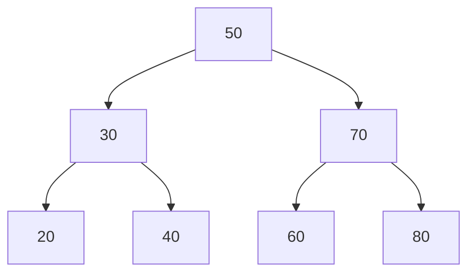

# Análisis de Algoritmos - Algoritmos que involucran secuencias y conjuntos

## 3.1 Diccionarios.

---

Un diccionario (o tabla de símbolos) es una estructura de datos abstracta que almacena pares clave-valor y soporta operaciones básicas como inserción, búsqueda y eliminación. Según Cormen et al. (2009), es "una estructura de datos para mantener un conjunto dinámico de elementos, cada uno con una clave asociada".

#### Operaciones Fundamentales

Las operaciones básicas de un diccionario son:

- `INSERT(D, k, v)`: Inserta la clave `k` con valor `v` en el diccionario `D`
- `SEARCH(D, k)`: Retorna el valor asociado a la clave `k`
- `DELETE(D, k)`: Elimina la clave `k` y su valor asociado

### Implementaciones de Diccionarios

#### Listas Enlazadas No Ordenadas

```python
class ListNode:
    def __init__(self, key, value):
        self.key = key
        self.value = value
        self.next = None

class LinkedListDict:
    def __init__(self):
        self.head = None

    def search(self, key):
        current = self.head
        while current:
            if current.key == key:
                return current.value
            current = current.next
        return None
```

**Complejidad temporal**:

- Búsqueda: $O(n)$ en caso promedio y peor caso
- Inserción: $O(1)$ al inicio
- Eliminación: $O(n)$ (debido a la búsqueda)

#### Tablas Hash

Las tablas hash implementan diccionarios mediante una función hash que mapea claves a índices en un arreglo.

##### Función Hash Ideal

Una función hash ideal $h: U \rightarrow \{0, 1, \ldots, m-1\}$ debería satisfacer la propiedad de hashing uniforme simple:

$$P(h(k) = j) = \frac{1}{m} \quad \text{para todo } j \in \{0, 1, \ldots, m-1\}$$

##### Direccionamiento Abierto

```python
class HashTable:
    def __init__(self, size):
        self.size = size
        self.table = [None] * size

    def hash_function(self, key, i):
        # Hash por doble hashing
        h1 = hash(key) % self.size
        h2 = 1 + (hash(key) % (self.size - 1))
        return (h1 + i * h2) % self.size

    def insert(self, key, value):
        i = 0
        while i < self.size:
            j = self.hash_function(key, i)
            if self.table[j] is None or self.table[j] == "DELETED":
                self.table[j] = (key, value)
                return j
            i += 1
        raise Exception("Tabla hash llena")
```

**Complejidad temporal esperada**: $O(1)$ para todas las operaciones bajo suposiciones adecuadas

#### Árboles de Búsqueda Binaria



```python
class TreeNode:
    def __init__(self, key, value):
        self.key = key
        self.value = value
        self.left = None
        self.right = None

class BSTDict:
    def search(self, root, key):
        if root is None or root.key == key:
            return root.value if root else None
        if key < root.key:
            return self.search(root.left, key)
        return self.search(root.right, key)
```

**Complejidad temporal**:

- Caso promedio: $O(\log n)$
- Peor caso: $O(n)$ (árbol degenerado)

#### Árboles AVL (Balanceados)

Los árboles AVL mantienen balance mediante rotaciones para garantizar $O(\log n)$ en el peor caso.

**Altura máxima**: $h \leq 1.44 \log_2(n + 2) - 1.328$

#### Árboles Rojo-Negro

Según Cormen et al., los árboles rojo-negro garantizan que la altura sea como máximo $2\log_2(n + 1)$.

### Aplicaciones de Diccionarios

#### Conteo de Frecuencias

```python
def count_frequency(elements):
    freq_dict = {}
    for element in elements:
        freq_dict[element] = freq_dict.get(element, 0) + 1
    return freq_dict
```

#### Eliminación de Duplicados

```python
def remove_duplicates(sequence):
    return list(dict.fromkeys(sequence))
```

#### Memoización (Programación Dinámica)

```python
def fibonacci(n, memo={}):
    if n in memo:
        return memo[n]
    if n <= 2:
        return 1
    memo[n] = fibonacci(n-1, memo) + fibonacci(n-2, memo)
    return memo[n]
```

### Análisis de Complejidad

#### Tabla Comparativa

| Estructura        | Búsqueda (promedio) | Búsqueda (peor) | Inserción (promedio) | Inserción (peor) |
| ----------------- | ------------------- | --------------- | -------------------- | ---------------- |
| Lista no ordenada | $O(n)$              | $O(n)$          | $O(1)$               | $O(1)$           |
| Lista ordenada    | $O(\log n)$         | $O(\log n)$     | $O(n)$               | $O(n)$           |
| Tabla hash        | $O(1)$              | $O(n)$          | $O(1)$               | $O(n)$           |
| BST               | $O(\log n)$         | $O(n)$          | $O(\log n)$          | $O(n)$           |
| AVL/RB            | $O(\log n)$         | $O(\log n)$     | $O(\log n)$          | $O(\log n)$      |

#### Análisis Amortizado de Tablas Hash

El redimensionamiento de tablas hash tiene costo amortizado $O(1)$. Si la tabla crece por un factor de $\alpha$, el costo amortizado por inserción es:

$$T_{amortizado} = O(1) + \frac{O(n)}{n} = O(1)$$

### Ejercicios Propuestos

#### Ejercicio 1: Implementación de Diccionario

Implemente un diccionario usando hashing cerrado (encadenamiento) y analice su complejidad en diferentes escenarios.

#### Ejercicio 2: Análisis de Colisiones

Para una tabla hash de tamaño $m = 11$ con función hash $h(k) = k \mod m$, inserte las claves: ${12, 44, 13, 88, 23, 94, 11, 39, 20, 16, 5}$.

a) Muestre la tabla resultante
b) Calcule el número de colisiones
c) ¿Cuál es el factor de carga?

#### Ejercicio 3: Árbol AVL

Inserte las claves ${15, 20, 24, 10, 13, 7, 30, 36, 25}$ en un árbol AVL y muestre las rotaciones realizadas.

#### Ejercicio 4: Diseño de Cache

Diseñe una estructura de datos que funcione como cache LRU (Least Recently Used) usando un diccionario y una lista doblemente enlazada.

#### Ejercicio 5: Análisis Teórico

Demuestre que el costo amortizado de las operaciones en una tabla hash que se redimensiona es $O(1)$.

### Soluciones Sugeridas

#### Ejercicio 2

Factor de carga: $\alpha = \frac{n}{m} = \frac{11}{11} = 1$

#### Ejercicio 4

```python
class LRUCache:
    def __init__(self, capacity):
        self.capacity = capacity
        self.cache = {}
        self.head = DLinkedNode()
        self.tail = DLinkedNode()
        self.head.next = self.tail
        self.tail.prev = self.head

    def get(self, key):
        if key in self.cache:
            node = self.cache[key]
            self._move_to_head(node)
            return node.value
        return -1
```

### Referencias

1. Cormen, T. H., Leiserson, C. E., Rivest, R. L., & Stein, C. (2009). Introduction to Algorithms (3rd ed.). MIT Press. (Capítulos 11, 12, 13)
2. Kleinberg, J., & Tardos, É. (2005). Algorithm Design. Addison Wesley. (Capítulo 13)
3. Knuth, D. E. (1998). The Art of Computer Programming, Volume 3: Sorting and Searching. Addison-Wesley.

### Recursos Adicionales

- Visualizaciones interactivas de estructuras de datos: https://visualgo.net/
- Implementaciones de referencia en diferentes lenguajes de programación
- Plataformas para práctica: LeetCode, HackerRank, CodeSignal
