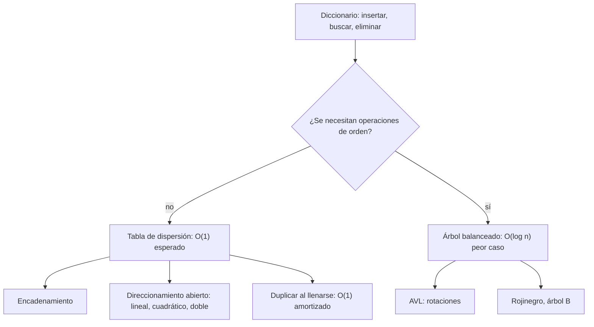

# Análisis de Algoritmos - Algoritmos que involucran secuencias y conjuntos

## 3.1 Diccionarios.

---

Un **diccionario** es un tipo abstracto de datos que almacena pares (clave, valor) y ofrece tres operaciones: **insertar** un par, **buscar** el valor asociado a una clave y **eliminar** una clave. Es probablemente la estructura más usada en programación: tablas de símbolos de un compilador, índices de bases de datos, cachés, conjuntos. Este tema compara sus implementaciones, estudia a fondo las **tablas de dispersión** (_hash tables_), con su análisis de caso promedio y el costo amortizado del redimensionamiento, y presenta los **árboles balanceados**, que garantizan $O(\log n)$ en el peor caso y además mantienen las claves ordenadas.

### Implementaciones

| Implementación | Buscar | Insertar | Eliminar | Orden |
| --- | --- | --- | --- | --- |
| arreglo no ordenado | $O(n)$ | $O(1)$ | $O(n)$ | no |
| arreglo ordenado | $O(\log n)$ | $O(n)$ | $O(n)$ | sí |
| árbol binario de búsqueda | $O(h)$ | $O(h)$ | $O(h)$ | sí |
| árbol balanceado (AVL, rojinegro) | $O(\log n)$ | $O(\log n)$ | $O(\log n)$ | sí |
| tabla de dispersión | $O(1)$ esperado | $O(1)$ amortizado esperado | $O(1)$ esperado | no |

Si además se necesitan operaciones de orden (mínimo, sucesor, rango de claves), conviene un árbol balanceado; si solo se necesitan las tres operaciones básicas, una tabla de dispersión.

### Tablas de dispersión

Una **función de dispersión** $h : U \to \{0, \ldots, m - 1\}$ asigna a cada clave del universo $U$ una posición de una tabla de tamaño $m.$ Como $|U| \gg m,$ dos claves distintas pueden tener la misma posición: una **colisión**. Hay dos formas de resolverlas:

- **Encadenamiento:** cada posición guarda una lista con las claves que caen en ella.
- **Direccionamiento abierto:** todas las claves están en la tabla; si la posición está ocupada se prueba una secuencia de posiciones alternativas: sondeo lineal $h(k) + i,$ cuadrático $h(k) + c_1 i + c_2 i^2$ o doble dispersión $h_1(k) + i \, h_2(k),$ todo módulo $m.$ Al eliminar se deja una marca, porque un hueco cortaría la secuencia de búsqueda de otras claves.

**Funciones de dispersión.** El método de la **división**, $h(k) = k \bmod m,$ funciona bien con $m$ primo y lejano a potencias de 2. El de la **multiplicación**, $h(k) = \lfloor m (kA \bmod 1) \rfloor$ con $0 \lt A \lt 1,$ no depende tanto de $m.$ La **dispersión universal** elige $h$ al azar de una familia $\mathcal{H}$ tal que, para claves distintas $k \neq l,$ $\Pr_{h \in \mathcal{H}}[h(k) = h(l)] \leq 1/m;$ por ejemplo $h_{a,b}(k) = ((ak + b) \bmod p) \bmod m$ con $p$ primo mayor que todas las claves. Así ningún adversario puede elegir claves que colisionen siempre.

**Análisis del encadenamiento.** Sea $\alpha = n/m$ el **factor de carga**.

**Teorema.** Con dispersión universal, el número esperado de claves en la lista de una clave $k$ dada, sin contar a $k,$ es a lo sumo $\alpha.$ Por tanto, una búsqueda cuesta $O(1 + \alpha)$ en promedio.

**Demostración.** Para cada clave $l \neq k$ almacenada, sea $X_l = 1$ si $h(l) = h(k)$ y 0 si no. Por la universalidad, $E[X_l] \leq 1/m.$ Por linealidad de la esperanza, el número esperado de claves que comparten la lista es $\sum_{l} E[X_l] \leq n/m = \alpha.$ $\blacksquare$

Si $m$ crece proporcionalmente a $n,$ $\alpha = O(1)$ y las tres operaciones cuestan $O(1)$ esperado. Con direccionamiento abierto, bajo la hipótesis de dispersión uniforme, una búsqueda fallida hace en promedio a lo sumo $1/(1 - \alpha)$ sondeos: con $\alpha = 0.9,$ diez.

### Redimensionamiento y costo amortizado

Para mantener $\alpha$ acotado, cuando la tabla se llena se crea otra del **doble** de tamaño y se reinsertan todas las claves. Esa inserción cuesta $\Theta(n),$ pero ocurre rara vez. El **análisis amortizado** acota el costo total de una secuencia de operaciones y lo reparte entre ellas (ejercicio 5): $n$ inserciones cuestan $O(n)$ en total, es decir, $O(1)$ amortizado cada una. Duplicar es esencial: si la tabla creciera en una cantidad fija, el costo total sería $\Theta(n^2).$

### Árboles balanceados

Un **árbol binario de búsqueda** (tema 3.2) cuesta $O(h),$ donde $h$ es su altura, que puede llegar a $n - 1.$ Un **árbol AVL** (Adelson-Velski y Landis, 1962) mantiene en cada nodo la condición de que las alturas de sus dos subárboles difieran a lo sumo en 1. Tras una inserción, el primer ancestro desbalanceado se repara con una **rotación** simple (casos izquierda-izquierda y derecha-derecha) o doble (izquierda-derecha y derecha-izquierda), en $O(1).$ La altura de un AVL con $n$ nodos es menor que $1.44 \log_2 (n + 2),$ como se demuestra en el tema 3.2. Los **árboles rojinegros** relajan la condición, con altura a lo sumo $2 \log_2 (n + 1),$ a cambio de menos rotaciones, y son los que usan `std::map` de C++ y `TreeMap` de Java. Los **árboles B** generalizan la idea a nodos con muchas claves, para disco.



### Implementación en Python

El programa implementa una tabla de dispersión con encadenamiento y redimensionamiento, la compara con `dict` en 20 000 operaciones aleatorias y cuenta las copias que hacen los redimensionamientos (ejercicios 1 y 5); construye la tabla del ejercicio 2 con encadenamiento y con sondeo lineal; inserta las claves del ejercicio 3 en un AVL registrando las rotaciones, y simula una caché LRU (ejercicio 4).

```python
import random

# --- Ejercicio 1: diccionario con encadenamiento y redimensionamiento ---
class TablaHash:
    def __init__(self, m=8):
        self.m, self.n = m, 0
        self.cubetas = [[] for _ in range(m)]
        self.copias = 0                      # elementos reinsertados al crecer

    def _h(self, k):
        return hash(k) % self.m

    def insertar(self, k, v):
        c = self.cubetas[self._h(k)]
        for par in c:
            if par[0] == k:
                par[1] = v
                return
        c.append([k, v])
        self.n += 1
        if self.n > self.m:                  # factor de carga > 1: duplicar
            viejas = self.cubetas
            self.m *= 2
            self.cubetas = [[] for _ in range(self.m)]
            for cub in viejas:
                for kk, vv in cub:
                    self.cubetas[self._h(kk)].append([kk, vv])
                    self.copias += 1

    def buscar(self, k):
        for kk, v in self.cubetas[self._h(k)]:
            if kk == k:
                return v
        return None

    def eliminar(self, k):
        c = self.cubetas[self._h(k)]
        for i, par in enumerate(c):
            if par[0] == k:
                c.pop(i); self.n -= 1
                return True
        return False

random.seed(31)
T, ref = TablaHash(), {}
for _ in range(20000):
    k = random.randint(0, 5000)
    op = random.random()
    if op < 0.5:
        T.insertar(k, k * k); ref[k] = k * k
    elif op < 0.8:
        assert T.buscar(k) == ref.get(k)
    else:
        assert T.eliminar(k) == (ref.pop(k, None) is not None)
print(f"ejercicio 1: 20000 operaciones iguales a dict; n = {T.n}, m = {T.m},"
      f" cubeta más larga = {max(map(len, T.cubetas))}")

# --- Ejercicio 5: costo amortizado de las inserciones ---
print("ejercicio 5:")
for n in (10**3, 10**4, 10**5):
    T = TablaHash(1)
    for k in range(n):
        T.insertar(k, None)
    print(f"   {n:6} inserciones: {T.copias:6} copias al crecer, costo por inserción {(n + T.copias) / n:.3f}")

# --- Ejercicio 2: m = 11, h(k) = k mod 11, encadenamiento ---
claves = [12, 44, 13, 88, 23, 94, 11, 39, 20, 16, 5]
tabla = [[] for _ in range(11)]
colisiones = 0
for k in claves:
    if tabla[k % 11]:
        colisiones += 1
    tabla[k % 11].append(k)
print("ejercicio 2:")
for i, c in enumerate(tabla):
    print(f"   {i:2}: {c}")
print(f"   colisiones: {colisiones}, factor de carga: {len(claves)}/11 = {len(claves) / 11:.2f}")

# direccionamiento abierto con sondeo lineal, para comparar
abierta, sondeos = [None] * 11, 0
for k in claves:
    i = k % 11
    while abierta[i] is not None:
        i = (i + 1) % 11; sondeos += 1
    abierta[i] = k
print("   sondeo lineal:", abierta, "sondeos extra:", sondeos)

# --- Ejercicio 3: árbol AVL con registro de rotaciones ---
class Nodo:
    def __init__(self, k):
        self.k, self.izq, self.der, self.h = k, None, None, 1

def h(t): return t.h if t else 0
def act(t): t.h = 1 + max(h(t.izq), h(t.der))
def rot_der(y):
    x = y.izq; y.izq = x.der; x.der = y; act(y); act(x); return x
def rot_izq(x):
    y = x.der; x.der = y.izq; y.izq = x; act(x); act(y); return y

def insertar_avl(t, k, log):
    if t is None:
        return Nodo(k)
    if k < t.k:
        t.izq = insertar_avl(t.izq, k, log)
    else:
        t.der = insertar_avl(t.der, k, log)
    act(t)
    b = h(t.izq) - h(t.der)
    if b > 1 and k < t.izq.k:
        log.append(f"II en {t.k}"); return rot_der(t)
    if b < -1 and k >= t.der.k:
        log.append(f"DD en {t.k}"); return rot_izq(t)
    if b > 1:
        log.append(f"ID en {t.k}"); t.izq = rot_izq(t.izq); return rot_der(t)
    if b < -1:
        log.append(f"DI en {t.k}"); t.der = rot_der(t.der); return rot_izq(t)
    return t

def preorden(t):
    return [] if t is None else [t.k] + preorden(t.izq) + preorden(t.der)

t = None
print("ejercicio 3:")
for k in [15, 20, 24, 10, 13, 7, 30, 36, 25]:
    log = []
    t = insertar_avl(t, k, log)
    print(f"   inserta {k:2}: {', '.join(log) or 'sin rotación':14} preorden {preorden(t)}")
print("   altura final:", h(t))

# --- Ejercicio 4: caché LRU con diccionario y lista doblemente enlazada ---
class NodoL:
    __slots__ = ("k", "v", "ant", "sig")
    def __init__(self, k=None, v=None):
        self.k, self.v, self.ant, self.sig = k, v, None, None

class LRU:
    def __init__(self, capacidad):
        self.cap, self.mapa = capacidad, {}
        self.cabeza, self.cola = NodoL(), NodoL()       # centinelas
        self.cabeza.sig, self.cola.ant = self.cola, self.cabeza

    def _quitar(self, x):
        x.ant.sig, x.sig.ant = x.sig, x.ant

    def _al_frente(self, x):
        x.sig, x.ant = self.cabeza.sig, self.cabeza
        self.cabeza.sig.ant = x
        self.cabeza.sig = x

    def get(self, k):
        if k not in self.mapa:
            return None
        x = self.mapa[k]
        self._quitar(x); self._al_frente(x)
        return x.v

    def put(self, k, v):
        if k in self.mapa:
            self._quitar(self.mapa[k])
        x = NodoL(k, v)
        self.mapa[k] = x
        self._al_frente(x)
        if len(self.mapa) > self.cap:
            viejo = self.cola.ant
            self._quitar(viejo)
            del self.mapa[viejo.k]

    def orden(self):
        x, r = self.cabeza.sig, []
        while x is not self.cola:
            r.append(x.k); x = x.sig
        return r

c = LRU(3)
print("ejercicio 4: capacidad 3")
for op in ["put 1", "put 2", "put 3", "get 1", "put 4", "get 2", "get 3", "put 5"]:
    accion, k = op.split(); k = int(k)
    r = c.put(k, k * 10) if accion == "put" else c.get(k)
    print(f"   {op}: {'' if accion == 'put' else str(r) + ' '}reciente a antiguo {c.orden()}")
```

Salida:

```text
ejercicio 1: 20000 operaciones iguales a dict; n = 3385, m = 4096, cubeta más larga = 2
ejercicio 5:
     1000 inserciones:   1033 copias al crecer, costo por inserción 2.033
    10000 inserciones:  16397 copias al crecer, costo por inserción 2.640
   100000 inserciones: 131088 copias al crecer, costo por inserción 2.311
ejercicio 2:
    0: [44, 88, 11]
    1: [12, 23]
    2: [13]
    3: []
    4: []
    5: [16, 5]
    6: [94, 39]
    7: []
    8: []
    9: [20]
   10: []
   colisiones: 5, factor de carga: 11/11 = 1.00
   sondeo lineal: [44, 12, 13, 88, 23, 11, 94, 39, 16, 20, 5] sondeos extra: 20
ejercicio 3:
   inserta 15: sin rotación   preorden [15]
   inserta 20: sin rotación   preorden [15, 20]
   inserta 24: DD en 15       preorden [20, 15, 24]
   inserta 10: sin rotación   preorden [20, 15, 10, 24]
   inserta 13: ID en 15       preorden [20, 13, 10, 15, 24]
   inserta  7: II en 20       preorden [13, 10, 7, 20, 15, 24]
   inserta 30: sin rotación   preorden [13, 10, 7, 20, 15, 24, 30]
   inserta 36: DD en 24       preorden [13, 10, 7, 20, 15, 30, 24, 36]
   inserta 25: DI en 20       preorden [13, 10, 7, 24, 20, 15, 30, 25, 36]
   altura final: 4
ejercicio 4: capacidad 3
   put 1: reciente a antiguo [1]
   put 2: reciente a antiguo [2, 1]
   put 3: reciente a antiguo [3, 2, 1]
   get 1: 10 reciente a antiguo [1, 3, 2]
   put 4: reciente a antiguo [4, 1, 3]
   get 2: None reciente a antiguo [4, 1, 3]
   get 3: 30 reciente a antiguo [3, 4, 1]
   put 5: reciente a antiguo [5, 3, 4]
```

### Ejercicios Propuestos

1. **Encadenamiento.** Implementa un diccionario con dispersión y encadenamiento, y analiza su complejidad en el mejor, el peor y el caso promedio.

2. **Colisiones.** En una tabla de tamaño $m = 11$ con $h(k) = k \bmod 11,$ inserta las claves 12, 44, 13, 88, 23, 94, 11, 39, 20, 16, 5. Muestra la tabla, cuenta las colisiones y calcula el factor de carga.

3. **AVL.** Inserta las claves 15, 20, 24, 10, 13, 7, 30, 36, 25 en un árbol AVL vacío y muestra las rotaciones.

4. **Caché LRU.** Diseña una caché LRU (_least recently used_) con un diccionario y una lista doblemente enlazada, con `get` y `put` en $O(1).$

5. **Costo amortizado.** Demuestra que el costo amortizado de las inserciones en una tabla que duplica su tamaño al llenarse es $O(1).$

### Soluciones

**Ejercicio 1.** Mejor caso: la lista de la posición tiene a lo sumo un elemento, $O(1).$ Peor caso: todas las claves caen en la misma posición y la lista mide $n:$ $O(n).$ Caso promedio, con dispersión universal y $\alpha = O(1):$ $O(1 + \alpha) = O(1)$ por el teorema. En el programa, con duplicación al pasar de $\alpha = 1,$ la lista más larga tras 20 000 operaciones tiene 2 elementos.

**Ejercicio 2.** Los residuos son $12 \to 1,$ $44 \to 0,$ $13 \to 2,$ $88 \to 0,$ $23 \to 1,$ $94 \to 6,$ $11 \to 0,$ $39 \to 6,$ $20 \to 9,$ $16 \to 5,$ $5 \to 5.$ La tabla con encadenamiento es la que imprime el programa. Hay 5 colisiones (88, 23, 11, 39 y 5 llegan a posiciones ocupadas) y $\alpha = 11/11 = 1.$ Con sondeo lineal la tabla queda llena y se necesitan 20 sondeos adicionales: el sondeo lineal forma **cúmulos**, como el bloque de las posiciones 0 a 8, que alargan las búsquedas.

**Ejercicio 3.** Es la traza del programa:

- 24 desbalancea a 15 hacia la derecha: rotación simple a la izquierda, la raíz pasa a ser 20.
- 13 queda a la derecha de 10, que está a la izquierda de 15: rotación doble izquierda-derecha en 15, y 13 sube.
- 7 desbalancea a la raíz 20 por la izquierda: rotación simple a la derecha, la raíz pasa a ser 13.
- 36 desbalancea a 24 por la derecha: rotación simple a la izquierda, 30 sube.
- 25 queda a la izquierda del hijo derecho de 20: rotación doble derecha-izquierda en 20, y 24 sube.

El árbol final tiene raíz 13, altura 4 y preorden 13, 10, 7, 24, 20, 15, 30, 25, 36.

**Ejercicio 4.** El diccionario lleva cada clave a su nodo en una lista doblemente enlazada ordenada del uso más reciente al más antiguo. `get` busca el nodo en el diccionario, lo desconecta y lo pone al frente: $O(1),$ porque desconectar un nodo de una lista doblemente enlazada no requiere recorrerla. `put` inserta al frente y, si se excede la capacidad, elimina el último nodo de la lista y su clave del diccionario: $O(1).$ Los nodos centinela al principio y al final evitan los casos especiales. En la traza, `put 4` expulsa a 2, que era el menos usado recientemente, y por eso `get 2` falla.

**Ejercicio 5.** Se empieza con $m = 1$ y se duplica cuando $n$ supera a $m.$ Al insertar la clave número $2^j + 1$ se copian $2^j$ claves. En $n$ inserciones, las copias suman $\sum_{j : 2^j \lt n} 2^j \lt 2n.$ El costo total es $n$ inserciones más menos de $2n$ copias: menos de $3n,$ y el costo amortizado es menor que 3, constante. El programa mide entre 2 y 2.7 operaciones por inserción.

**Con el método del potencial:** sea $\Phi = 2n - m.$ Una inserción sin crecimiento cuesta 1 y aumenta $\Phi$ en 2: costo amortizado 3. Una con crecimiento, con $n = m + 1$ tras insertar, cuesta $1 + m,$ y $\Phi$ pasa de $2m - m = m$ a $2(m + 1) - 2m = 2:$ costo amortizado $1 + m + 2 - m = 3.$ Como $\Phi \geq 0$ tras el primer crecimiento, el costo real total es a lo sumo el amortizado total, $3n.$

### Referencias

1. Cormen, T. H., Leiserson, C. E., Rivest, R. L., and Stein, C., _Introduction to Algorithms_. MIT Press, 2022. Capítulos 11, 13 y 16.
2. Knuth, D. E., _The Art of Computer Programming, Vol. 3: Sorting and Searching_. Addison-Wesley, 1998. Secciones 6.2.3 y 6.4.
3. Carter, J. L., and Wegman, M. N., Universal classes of hash functions. _Journal of Computer and System Sciences_ 18(2), 1979.
4. Sedgewick, R., and Wayne, K., _Algorithms_. Addison-Wesley, 2011. Capítulo 3.
