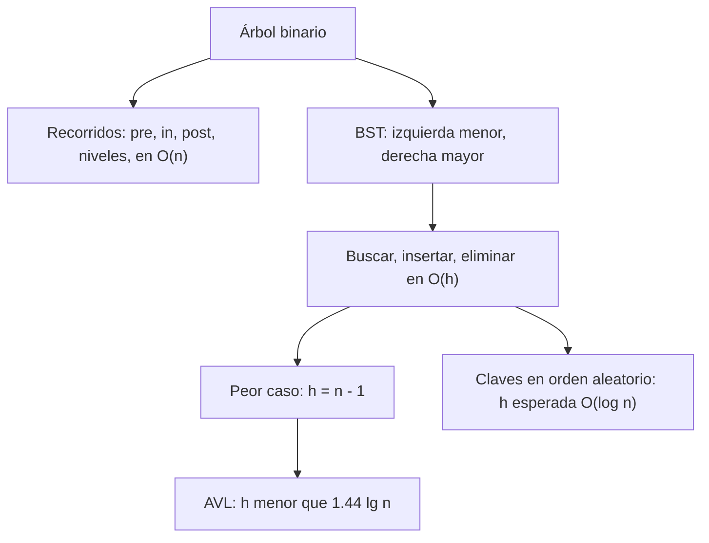

# Análisis de Algoritmos - Algoritmos que involucran secuencias y conjuntos

## 3.2 Árboles binarios.

---

Un **árbol binario** es una estructura en la que cada nodo tiene a lo sumo dos hijos, izquierdo y derecho. Con la regla de que las claves del subárbol izquierdo son menores que la del nodo y las del derecho mayores, se obtiene un **árbol binario de búsqueda** (BST), que implementa un diccionario ordenado (tema 3.1) con operaciones en tiempo proporcional a la altura. Este tema define los árboles binarios y sus recorridos, presenta las operaciones del BST con su análisis, demuestra la cota de altura de los árboles AVL y cuenta cuántos BST distintos hay con $n$ claves.

### Definiciones

Un árbol binario es vacío, o es un nodo raíz con un subárbol izquierdo y uno derecho, ambos árboles binarios. La **profundidad** de un nodo es el número de aristas desde la raíz; la **altura** del árbol, la máxima profundidad (aquí, $-1$ para el árbol vacío). Un árbol de altura $h$ tiene a lo sumo $2^{h+1} - 1$ nodos, porque el nivel $d$ tiene a lo sumo $2^d.$ Por tanto, un árbol con $n$ nodos tiene altura al menos $\lceil \log_2 (n + 1) \rceil - 1.$

- **Lleno:** todo nodo tiene 0 o 2 hijos. Si tiene $i$ nodos internos, tiene $i + 1$ hojas.
- **Completo:** todos los niveles están llenos salvo quizá el último, que se llena de izquierda a derecha. Se almacena en un arreglo sin apuntadores: los hijos de la posición $i$ están en $2i$ y $2i + 1$ (montículos, tema 3.4).
- **Perfecto:** todas las hojas a la misma profundidad; tiene $2^{h+1} - 1$ nodos.

### Recorridos

| Recorrido | Orden | Uso |
| --- | --- | --- |
| preorden | raíz, izquierdo, derecho | copiar un árbol, notación prefija |
| inorden | izquierdo, raíz, derecho | en un BST, claves ordenadas |
| postorden | izquierdo, derecho, raíz | liberar memoria, evaluar expresiones |
| por niveles | nivel a nivel, con una cola | distancias desde la raíz |

Todos visitan cada nodo una vez: $\Theta(n).$ Los tres primeros usan una pila (la de la recursión) de tamaño $O(h).$

**Teorema.** El preorden y el inorden de un árbol con claves distintas lo determinan de forma única.

**Demostración** por inducción sobre $n.$ El primer elemento del preorden es la raíz $r.$ En el inorden, los elementos a la izquierda de $r$ son exactamente los del subárbol izquierdo, y los de la derecha, los del derecho; sus cantidades fijan también cómo se parte el resto del preorden. Por hipótesis de inducción, cada par de subsecuencias determina su subárbol. $\blacksquare$ Preorden y postorden **no** bastan: un nodo con un solo hijo, a la izquierda o a la derecha, da los mismos dos recorridos.

### Árbol binario de búsqueda

**Propiedad BST:** para todo nodo $x,$ las claves de su subárbol izquierdo son menores que $x.k$ y las del derecho, mayores. En consecuencia, el inorden da las claves en orden creciente.

- **Buscar** $k:$ desde la raíz, ir a la izquierda si $k \lt x.k$ y a la derecha si $k > x.k.$ $O(h).$
- **Mínimo y máximo:** bajar siempre a la izquierda o a la derecha. $O(h).$
- **Insertar:** buscar $k$ y colgar el nuevo nodo donde termina la búsqueda. $O(h).$
- **Eliminar** $x:$ si es hoja, quitarlo; si tiene un hijo, sustituirlo por ese hijo; si tiene dos, copiar en $x$ la clave de su **sucesor** (el mínimo del subárbol derecho, que no tiene hijo izquierdo) y eliminar el sucesor. $O(h).$
- **Selección y rango:** guardando en cada nodo el tamaño de su subárbol, se obtiene el k-ésimo menor en $O(h)$ (ejercicio 3).

**Altura.** En el peor caso, si las claves llegan ordenadas, el árbol degenera en una lista y $h = n - 1.$ Si las $n!$ órdenes de llegada son igualmente probables, la profundidad media de un nodo es $2 \ln n + O(1) \approx 1.39 \log_2 n,$ la misma cuenta que las comparaciones de quicksort, y la altura esperada es $\Theta(\log n),$ alrededor de $4.31 \ln n$ para $n$ grande (Devroye, 1986). Para garantizar $O(\log n)$ en el peor caso se usan árboles balanceados.

### Árboles AVL

Un árbol **AVL** cumple que, en cada nodo, las alturas de los dos subárboles difieren a lo sumo en 1. La inserción y la eliminación lo mantienen con rotaciones (tema 3.1).

**Teorema.** Un AVL con $n$ nodos tiene altura $h$ con $h + 1 \lt 1.4405 \log_2 (n + 2) - 0.3277.$

**Demostración.** Sea $N(h)$ el mínimo de nodos de un AVL de altura $h.$ Un AVL mínimo de altura $h$ tiene un subárbol de altura $h - 1$ y, para minimizar, el otro de altura $h - 2,$ ambos mínimos:

$$N(h) = N(h - 1) + N(h - 2) + 1, \qquad N(0) = 1, \quad N(1) = 2.$$

Con $M(h) = N(h) + 1$ queda $M(h) = M(h - 1) + M(h - 2),$ con $M(0) = 2 = F_3$ y $M(1) = 3 = F_4,$ así que $N(h) = F_{h+3} - 1.$ Como $F_k > \varphi^k / \sqrt{5} - 1,$ se tiene $n + 2 \geq N(h) + 2 = F_{h+3} + 1 > \varphi^{h+3}/\sqrt{5},$ y tomando logaritmos, $h + 3 \lt \log_\varphi (\sqrt{5} (n + 2)) = \log_2 (n + 2) / \log_2 \varphi + \log_\varphi \sqrt{5}.$ Con $1/\log_2 \varphi \approx 1.4405$ y $\log_\varphi \sqrt{5} \approx 1.6723$ se obtiene la cota. $\blacksquare$

Los árboles de altura mínima con $N(h)$ nodos se llaman **árboles de Fibonacci** y alcanzan la cota.



### Implementación en Python

El programa implementa un BST con tamaños de subárbol, sus cuatro recorridos y la eliminación con sucesor, y lo compara con un conjunto de Python en 5000 operaciones aleatorias (ejercicio 1); valida BST (ejercicio 2), selecciona el k-ésimo menor (ejercicio 3), reconstruye árboles desde preorden e inorden (ejercicio 4), comprueba la fórmula $N(h) = F_{h+3} - 1$ (ejercicio 6), enumera los BST con $n$ claves (ejercicio 7) y mide la altura de BST construidos con claves en orden aleatorio.

```python
import math, random
from functools import lru_cache

# --- Ejercicio 1: árbol binario de búsqueda ---
class Nodo:
    def __init__(self, k):
        self.k, self.izq, self.der, self.tam = k, None, None, 1

def tam(t):
    return t.tam if t else 0

def insertar(t, k):
    if t is None:
        return Nodo(k)
    if k < t.k:
        t.izq = insertar(t.izq, k)
    elif k > t.k:
        t.der = insertar(t.der, k)
    t.tam = 1 + tam(t.izq) + tam(t.der)
    return t

def buscar(t, k):
    while t and t.k != k:
        t = t.izq if k < t.k else t.der
    return t is not None

def eliminar(t, k):
    if t is None:
        return None
    if k < t.k:
        t.izq = eliminar(t.izq, k)
    elif k > t.k:
        t.der = eliminar(t.der, k)
    else:
        if t.izq is None:
            return t.der
        if t.der is None:
            return t.izq
        s = t.der                       # sucesor: mínimo del subárbol derecho
        while s.izq:
            s = s.izq
        t.k = s.k
        t.der = eliminar(t.der, s.k)
    t.tam = 1 + tam(t.izq) + tam(t.der)
    return t

def preorden(t):  return [] if t is None else [t.k] + preorden(t.izq) + preorden(t.der)
def inorden(t):   return [] if t is None else inorden(t.izq) + [t.k] + inorden(t.der)
def postorden(t): return [] if t is None else postorden(t.izq) + postorden(t.der) + [t.k]
def por_niveles(t):
    cola, r = [t] if t else [], []
    while cola:
        x = cola.pop(0); r.append(x.k)
        cola += [y for y in (x.izq, x.der) if y]
    return r

def altura(t):
    return -1 if t is None else 1 + max(altura(t.izq), altura(t.der))

t = None
for k in [50, 30, 70, 20, 40, 60, 80, 35, 45, 65]:
    t = insertar(t, k)
print("ejercicio 1:")
print("   preorden  ", preorden(t))
print("   inorden   ", inorden(t))
print("   postorden ", postorden(t))
print("   niveles   ", por_niveles(t))
for k in (20, 30, 50):
    t = eliminar(t, k)
print("   tras eliminar 20, 30 y 50: inorden", inorden(t), "| preorden", preorden(t))

random.seed(32)
t, ref = None, set()
for _ in range(5000):
    k = random.randint(0, 300)
    if random.random() < 0.6:
        t = insertar(t, k); ref.add(k)
    else:
        t = eliminar(t, k); ref.discard(k)
    assert buscar(t, k) == (k in ref)
assert inorden(t) == sorted(ref) and tam(t) == len(ref)
print("   5000 operaciones aleatorias iguales a un conjunto de Python")

# --- Ejercicio 2: validar un BST ---
def es_bst(t, lo=-math.inf, hi=math.inf):
    if t is None:
        return True
    return lo < t.k < hi and es_bst(t.izq, lo, t.k) and es_bst(t.der, t.k, hi)

malo = Nodo(10); malo.izq = Nodo(5); malo.der = Nodo(15); malo.der.izq = Nodo(6)
print("ejercicio 2: árbol aleatorio", es_bst(t), "| 10(5, 15(6, -))", es_bst(malo),
      "(cada hijo respeta a su padre, pero 6 < 10 está a la derecha de 10)")

# --- Ejercicio 3: k-ésimo menor con tamaños de subárbol ---
def kesimo(t, k):
    while t:
        izq = tam(t.izq)
        if k == izq + 1:
            return t.k
        if k <= izq:
            t = t.izq
        else:
            k -= izq + 1
            t = t.der
    return None

ordenado = sorted(ref)
assert all(kesimo(t, i + 1) == ordenado[i] for i in range(len(ordenado)))
print("ejercicio 3: k-ésimo correcto para k = 1 ...", len(ordenado))

# --- Ejercicio 4: reconstrucción desde preorden e inorden ---
def reconstruye(pre, ino):
    pos = {k: i for i, k in enumerate(ino)}
    it = iter(pre)
    def rec(lo, hi):
        if lo > hi:
            return None
        r = Nodo(next(it))
        m = pos[r.k]
        r.izq = rec(lo, m - 1)
        r.der = rec(m + 1, hi)
        return r
    return rec(0, len(ino) - 1)

pre, ino = ["A", "B", "D", "E", "C", "F"], ["D", "B", "E", "A", "C", "F"]
r = reconstruye(pre, ino)
print("ejercicio 4: postorden reconstruido", postorden(r), "| niveles", por_niveles(r))
for _ in range(200):
    u = None
    for k in random.sample(range(1000), random.randint(0, 40)):
        u = insertar(u, k)
    v = reconstruye(preorden(u), inorden(u))
    assert preorden(v) == preorden(u) and postorden(v) == postorden(u)
print("   200 árboles reconstruidos correctamente")

# --- Ejercicio 6: altura de AVL (el ejercicio 5 se resuelve en el tema 3.1) ---
def avl_min(h):
    """Mínimo de nodos de un AVL de altura h (contando aristas; vacío = -1)."""
    a, b = 1, 2                    # N(0), N(1)
    if h == 0:
        return 1
    for _ in range(h - 1):
        a, b = b, a + b + 1
    return b

def fib(n):
    a, b = 0, 1
    for _ in range(n):
        a, b = b, a + b
    return a

print("ejercicio 6: N(h) = F(h+3) - 1:", all(avl_min(h) == fib(h + 3) - 1 for h in range(40)))
for h in (5, 10, 20, 30):
    n = avl_min(h)
    print(f"   h = {h:2}, {h + 1:2} niveles: N(h) = {n:8}, cota 1.44 lg(n + 2) = {1.44 * math.log2(n + 2):6.2f}")

# --- Ejercicio 7: número de BST con n claves ---
@lru_cache(maxsize=None)
def cuenta_bst(n):
    return 1 if n <= 1 else sum(cuenta_bst(i) * cuenta_bst(n - 1 - i) for i in range(n))

def todos_bst(claves):
    if not claves:
        return [None]
    r = []
    for i, k in enumerate(claves):
        for a in todos_bst(claves[:i]):
            for b in todos_bst(claves[i + 1:]):
                r.append((k, a, b))
    return r

catalan = [math.comb(2 * n, n) // (n + 1) for n in range(11)]
print("ejercicio 7: enumerados", [len(todos_bst(list(range(n)))) for n in range(9)])
print("   recurrencia ", [cuenta_bst(n) for n in range(11)])
print("   C_n         ", catalan)

# --- altura de un BST aleatorio ---
for n in (100, 1000, 10000):
    alturas = []
    for _ in range(20):
        u = None
        for k in random.sample(range(10 * n), n):
            u = insertar(u, k)
        alturas.append(altura(u))
    print(f"   BST con {n:5} claves en orden aleatorio: altura media {sum(alturas) / 20:5.1f},"
          f" lg n = {math.log2(n):5.2f}")
```

Salida:

```text
ejercicio 1:
   preorden   [50, 30, 20, 40, 35, 45, 70, 60, 65, 80]
   inorden    [20, 30, 35, 40, 45, 50, 60, 65, 70, 80]
   postorden  [20, 35, 45, 40, 30, 65, 60, 80, 70, 50]
   niveles    [50, 30, 70, 20, 40, 60, 80, 35, 45, 65]
   tras eliminar 20, 30 y 50: inorden [35, 40, 45, 60, 65, 70, 80] | preorden [60, 40, 35, 45, 70, 65, 80]
   5000 operaciones aleatorias iguales a un conjunto de Python
ejercicio 2: árbol aleatorio True | 10(5, 15(6, -)) False (cada hijo respeta a su padre, pero 6 < 10 está a la derecha de 10)
ejercicio 3: k-ésimo correcto para k = 1 ... 183
ejercicio 4: postorden reconstruido ['D', 'E', 'B', 'F', 'C', 'A'] | niveles ['A', 'B', 'C', 'D', 'E', 'F']
   200 árboles reconstruidos correctamente
ejercicio 6: N(h) = F(h+3) - 1: True
   h =  5,  6 niveles: N(h) =       20, cota 1.44 lg(n + 2) =   6.42
   h = 10, 11 niveles: N(h) =      232, cota 1.44 lg(n + 2) =  11.33
   h = 20, 21 niveles: N(h) =    28656, cota 1.44 lg(n + 2) =  21.32
   h = 30, 31 niveles: N(h) =  3524577, cota 1.44 lg(n + 2) =  31.32
ejercicio 7: enumerados [1, 1, 2, 5, 14, 42, 132, 429, 1430]
   recurrencia  [1, 1, 2, 5, 14, 42, 132, 429, 1430, 4862, 16796]
   C_n          [1, 1, 2, 5, 14, 42, 132, 429, 1430, 4862, 16796]
   BST con   100 claves en orden aleatorio: altura media  11.9, lg n =  6.64
   BST con  1000 claves en orden aleatorio: altura media  20.9, lg n =  9.97
   BST con 10000 claves en orden aleatorio: altura media  30.4, lg n = 13.29
```

La altura de un BST aleatorio crece como $\log n,$ pero en estos tamaños es de 1.8 a 2.3 veces $\log_2 n,$ y la constante sigue creciendo lentamente hacia $4.31 \ln n \approx 2.99 \log_2 n;$ la de un AVL nunca supera $1.44 \log_2 n.$

### Ejercicios Propuestos

1. **BST.** Implementa un BST con inserción, búsqueda, eliminación y los cuatro recorridos.

2. **Validación.** Escribe un algoritmo que decida si un árbol binario es un BST válido.

3. **Selección.** Encuentra el k-ésimo menor elemento de un BST.

4. **Reconstrucción.** Dados el preorden y el inorden de un árbol, reconstrúyelo.

5. **AVL.** Inserta las claves 15, 20, 24, 10, 13, 7, 30, 36, 25 en un AVL vacío y muestra las rotaciones.

6. **Altura de un AVL.** Demuestra que la altura de un AVL con $n$ nodos está acotada por $1.44 \log_2 (n + 2).$

7. **Número de BST.** ¿Cuántos BST distintos hay con $n$ claves?

### Soluciones

**Ejercicio 1.** Es la clase del programa. Con las claves 50, 30, 70, 20, 40, 60, 80, 35, 45, 65, el inorden sale ordenado. Al eliminar 50, que tiene dos hijos, su sucesor 60 ocupa su lugar y la raíz pasa a ser 60. Todas las operaciones cuestan $O(h).$

**Ejercicio 2.** No basta comparar cada nodo con sus hijos: en el árbol 10 con hijos 5 y 15, y 6 como hijo izquierdo de 15, cada padre respeta a sus hijos, pero 6 está en el subárbol derecho de 10. Hay que pasar a cada llamada el **intervalo** $(lo, hi)$ en que deben estar sus claves: el hijo izquierdo hereda $(lo, x.k)$ y el derecho $(x.k, hi).$ $O(n).$ Alternativa equivalente: verificar que el inorden sea estrictamente creciente.

**Ejercicio 3.** Si cada nodo guarda el tamaño $s$ de su subárbol: sea $i = s(\text{izq}) + 1$ el rango de la raíz. Si $k = i,$ es la raíz; si $k \lt i,$ se busca el k-ésimo en el izquierdo; si $k > i,$ el elemento de rango $k - i$ en el derecho. $O(h).$ Sin tamaños, un recorrido inorden que se detiene en el k-ésimo nodo cuesta $O(h + k).$

**Ejercicio 4.** Es la demostración del teorema convertida en algoritmo: se toma la raíz del preorden, se localiza en el inorden con un diccionario de posiciones y se construyen recursivamente los dos subárboles, consumiendo el preorden en orden. $O(n).$ Con preorden A, B, D, E, C, F e inorden D, B, E, A, C, F, la raíz es A, con subárbol izquierdo B, de hijos D y E, y derecho C, con hijo derecho F.

**Ejercicio 5.** Resuelto en el tema 3.1: hay 5 rotaciones (simple derecha-derecha en 15, doble izquierda-derecha en 15, simple izquierda-izquierda en 20, simple derecha-derecha en 24 y doble derecha-izquierda en 20) y el árbol final tiene raíz 13 y altura 4.

**Ejercicio 6.** Es el teorema de la sección de árboles AVL; el programa comprueba $N(h) = F_{h+3} - 1$ hasta $h = 39$ y que los árboles de Fibonacci quedan justo bajo la cota.

**Ejercicio 7.** Sea $b_n$ el número de BST con las claves $1, \ldots, n.$ Si la raíz es $i,$ el subárbol izquierdo es un BST con $i - 1$ claves y el derecho con $n - i,$ de forma independiente:

$$b_0 = 1, \qquad b_n = \sum_{i=1}^{n} b_{i-1} \, b_{n-i}.$$

Es la recurrencia de los **números de Catalan**, $b_n = C_n = \frac{1}{n + 1} \binom{2n}{n}:$ 1, 1, 2, 5, 14, 42, 132, ... La forma cerrada se obtiene con la función generadora $B(x) = \sum b_n x^n,$ que cumple $B(x) = 1 + x B(x)^2,$ de donde $B(x) = (1 - \sqrt{1 - 4x})/(2x).$ El programa la verifica enumerando todos los árboles hasta $n = 8.$ Asintóticamente, $C_n \sim 4^n / (n^{3/2} \sqrt{\pi}).$

### Referencias

1. Cormen, T. H., Leiserson, C. E., Rivest, R. L., and Stein, C., _Introduction to Algorithms_. MIT Press, 2022. Capítulos 12 y 13.
2. Knuth, D. E., _The Art of Computer Programming, Vol. 3: Sorting and Searching_. Addison-Wesley, 1998. Secciones 6.2.2 y 6.2.3.
3. Adelson-Velsky, G. M., and Landis, E. M., An algorithm for the organization of information. _Soviet Mathematics Doklady_ 3, 1962.
4. Devroye, L., A note on the height of binary search trees. _Journal of the ACM_ 33(3), 1986.
