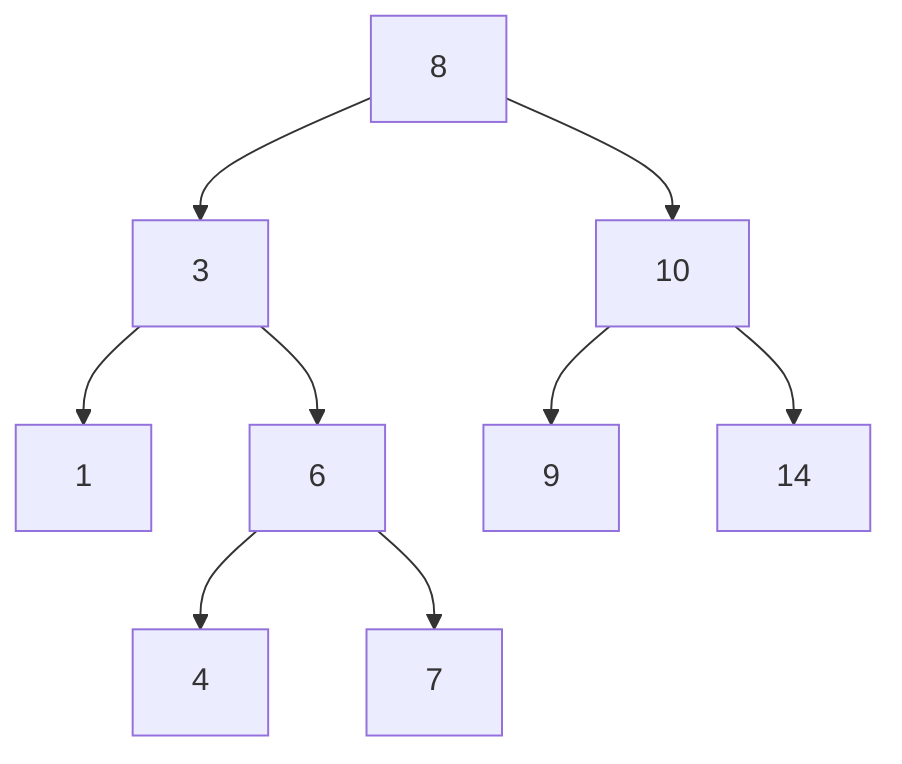
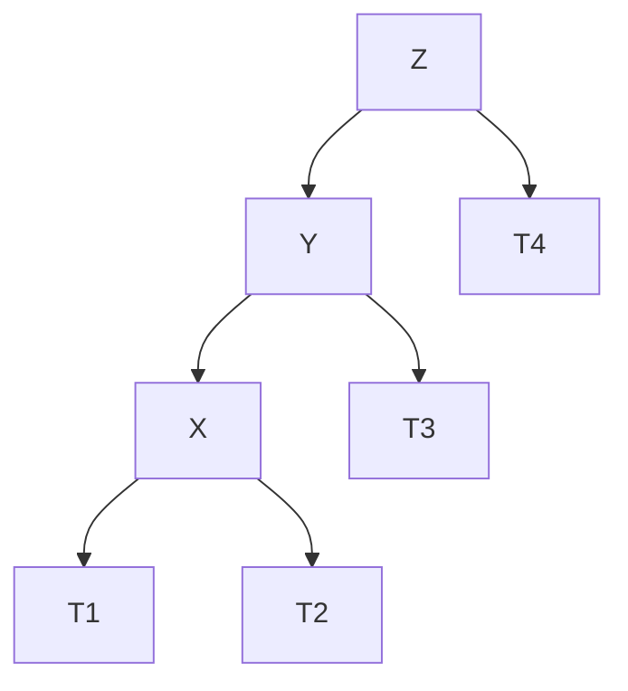

# Análisis de Algoritmos - Algoritmos que involucran secuencias y conjuntos

## 3.2 Árboles binarios.

---

Un árbol binario es una estructura de datos jerárquica donde cada nodo tiene como máximo dos hijos, denominados hijo izquierdo e hijo derecho. Según Cormen et al. (2009), es "una estructura de datos formada por nodos que contiene una clave, un valor y punteros a sus hijos izquierdo y derecho".

#### Definición Formal

Un árbol binario $T$ es:

- Un conjunto finito de nodos que está vacío, o
- Consiste en una raíz y dos árboles binarios disjuntos $T_{left}$ y $T_{right}$ llamados subárbol izquierdo y derecho

#### Propiedades Fundamentales

Para un árbol binario con $n$ nodos:

- Número máximo de nodos en el nivel $i$: $2^i$
- Altura máxima de un árbol con $n$ nodos: $n$ (árbol degenerado)
- Altura mínima: $\lfloor \log_2 n \rfloor$ (árbol completo)

### Tipos de Árboles Binarios

#### Árbol Binario Completo

Un árbol binario completo de altura $h$ tiene todos sus nodos en los niveles $0$ a $h-1$, y los nodos del nivel $h$ están llenos de izquierda a derecha.

**Número de nodos**: Entre $2^h$ y $2^{h+1} - 1$

#### Árbol Binario Perfecto

Todos los niveles están completamente llenos.

**Número de nodos**: $2^{h+1} - 1$ donde $h$ es la altura

#### Árbol Binario de Búsqueda (BST)

Para todo nodo $x$:

- Todos los nodos en el subárbol izquierdo tienen claves $\leq x.clave$
- Todos los nodos en el subárbol derecho tienen claves $\geq x.clave$



### Implementación de Árboles Binarios

#### Estructura Básica

```python
class TreeNode:
    def __init__(self, key, value=None):
        self.key = key
        self.value = value
        self.left = None
        self.right = None
        self.parent = None  # Opcional

class BinaryTree:
    def __init__(self):
        self.root = None
        self.size = 0
```

### Recorridos de Árboles Binarios

#### Recorrido Inorden (Inorder)

Visita: subárbol izquierdo, raíz, subárbol derecho

```python
def inorder_traversal(node, result=None):
    if result is None:
        result = []
    if node:
        inorder_traversal(node.left, result)
        result.append(node.key)
        inorder_traversal(node.right, result)
    return result
```

**Complejidad**: $O(n)$

#### Recorrido Preorden (Preorder)

Visita: raíz, subárbol izquierdo, subárbol derecho

#### Recorrido Postorden (Postorder)

Visita: subárbol izquierdo, subárbol derecho, raíz

#### Recorrido por Niveles (BFS)

```python
from collections import deque

def level_order_traversal(root):
    if not root:
        return []

    result = []
    queue = deque([root])

    while queue:
        node = queue.popleft()
        result.append(node.key)
        if node.left:
            queue.append(node.left)
        if node.right:
            queue.append(node.right)

    return result
```

### Operaciones en BST

#### Búsqueda

```python
def search(node, key):
    if node is None or node.key == key:
        return node
    if key < node.key:
        return search(node.left, key)
    else:
        return search(node.right, key)
```

**Complejidad**: $O(h)$ donde $h$ es la altura del árbol

#### Inserción

```python
def insert(root, key, value=None):
    if root is None:
        return TreeNode(key, value)

    if key < root.key:
        root.left = insert(root.left, key, value)
    elif key > root.key:
        root.right = insert(root.right, key, value)

    return root
```

#### Eliminación

**Caso 1**: Nodo sin hijos → Eliminación directa
**Caso 2**: Nodo con un hijo → Reemplazar por el hijo
**Caso 3**: Nodo con dos hijos → Reemplazar por el sucesor inorden

```python
def delete(root, key):
    if root is None:
        return root

    if key < root.key:
        root.left = delete(root.left, key)
    elif key > root.key:
        root.right = delete(root.right, key)
    else:
        # Caso 1: Sin hijos o un hijo
        if root.left is None:
            return root.right
        elif root.right is None:
            return root.left

        # Caso 3: Dos hijos
        temp = min_value_node(root.right)
        root.key = temp.key
        root.value = temp.value
        root.right = delete(root.right, temp.key)

    return root

def min_value_node(node):
    current = node
    while current.left:
        current = current.left
    return current
```

### Árboles Balanceados

#### Árbol AVL

Un árbol AVL es un BST balanceado donde para cada nodo, la diferencia de alturas entre sus subárboles izquierdo y derecho es como máximo 1.

**Factor de balance**: $balance(nodo) = altura(izquierdo) - altura(derecho) \in \{-1, 0, 1\}$

##### Rotaciones AVL



**Rotación simple a derecha**:

$$altura(T1) - altura(T3) = 2$$

#### Árbol Rojo-Negro

Según Cormen et al., un árbol rojo-negro satisface:

1. Todo nodo es rojo o negro
2. La raíz es negra
3. Todas las hojas (NIL) son negras
4. Si un nodo es rojo, ambos hijos son negros
5. Todos los caminos desde un nodo a sus descendientes NIL contienen el mismo número de nodos negros

### Análisis de Complejidad

#### Teorema de Altura de BST

La altura esperada de un BST construido con inserciones aleatorias es $O(\log n)$.

#### Cota Inferior para BST

Cualquier BST que implemente un diccionario de $n$ elementos tiene altura al menos $\log_2 n$ en el mejor caso.

#### Análisis de Operaciones

| Operación   | BST (promedio) | BST (peor) | AVL (peor)  |
| ----------- | -------------- | ---------- | ----------- |
| Búsqueda    | $O(\log n)$    | $O(n)$     | $O(\log n)$ |
| Inserción   | $O(\log n)$    | $O(n)$     | $O(\log n)$ |
| Eliminación | $O(\log n)$    | $O(n)$     | $O(\log n)$ |

### Aplicaciones de Árboles Binarios

#### Diccionarios y Conjuntos

```python
class BSTDictionary:
    def __init__(self):
        self.root = None

    def __setitem__(self, key, value):
        self.root = insert(self.root, key, value)

    def __getitem__(self, key):
        node = search(self.root, key)
        if node:
            return node.value
        raise KeyError(key)
```

#### Priority Queues con Heaps Binarios

Un heap binario es un árbol binario completo que satisface la propiedad de heap:

- **Max-Heap**: $padre.clave \geq hijo.clave$
- **Min-Heap**: $padre.clave \leq hijo.clave$

#### Árboles de Segmentos

Para consultas de rango en tiempo $O(\log n)$:

```python
class SegmentTree:
    def __init__(self, data):
        self.n = len(data)
        self.size = 1
        while self.size < self.n:
            self.size *= 2
        self.tree = [0] * (2 * self.size)
```

### Ejercicios Propuestos

#### Ejercicio 1: Implementación BST

Implemente un BST completo con operaciones de inserción, búsqueda, eliminación y los cuatro tipos de recorrido.

#### Ejercicio 2: Validación BST

Escriba un algoritmo que determine si un árbol binario es un BST válido.

**Solución**:

```python
def is_valid_bst(node, min_val=float('-inf'), max_val=float('inf')):
    if node is None:
        return True
    if not (min_val < node.key < max_val):
        return False
    return (is_valid_bst(node.left, min_val, node.key) and
            is_valid_bst(node.right, node.key, max_val))
```

#### Ejercicio 3: k-ésimo Elemento

Encuentre el k-ésimo elemento más pequeño en un BST.

#### Ejercicio 4: Reconstrucción de Árbol

Dados los recorridos preorden e inorden de un árbol, reconstruya el árbol binario.

#### Ejercicio 5: Árbol AVL

Inserte las claves {15, 20, 24, 10, 13, 7, 30, 36, 25} en un árbol AVL vacío y muestre todas las rotaciones realizadas.

#### Ejercicio 6: Análisis Teórico

Demuestre que la altura de un árbol AVL con $n$ nodos está acotada por $1.44 \log_2(n + 2)$.

#### Ejercicio 7: Número de BSTs

¿Cuántos BSTs diferentes existen con $n$ nodos? (Números de Catalan)

**Fórmula**: $C_n = \frac{1}{n+1} \binom{2n}{n} = \prod_{k=2}^{n} \frac{n + k}{k}$

### Soluciones Sugeridas

#### Ejercicio 3: k-ésimo Elemento

```python
def kth_smallest(root, k):
    stack = []
    current = root
    count = 0

    while current or stack:
        while current:
            stack.append(current)
            current = current.left

        current = stack.pop()
        count += 1
        if count == k:
            return current.key

        current = current.right

    return None
```

#### Ejercicio 4: Reconstrucción

```python
def build_tree(preorder, inorder):
    if not preorder or not inorder:
        return None

    root_val = preorder[0]
    root = TreeNode(root_val)

    root_index = inorder.index(root_val)

    root.left = build_tree(preorder[1:1+root_index], inorder[:root_index])
    root.right = build_tree(preorder[1+root_index:], inorder[root_index+1:])

    return root
```

### Referencias

1. Cormen, T. H., Leiserson, C. E., Rivest, R. L., & Stein, C. (2009). Introduction to Algorithms (3rd ed.). MIT Press. (Capítulos 12, 13)
2. Kleinberg, J., & Tardos, É. (2005). Algorithm Design. Addison Wesley. (Capítulo 13)
3. Knuth, D. E. (1998). The Art of Computer Programming, Volume 3: Sorting and Searching. Addison-Wesley.

### Recursos Adicionales

- Visualizaciones interactivas: https://visualgo.net/en/bst
- Implementaciones de referencia en diferentes lenguajes
- Plataformas para práctica: LeetCode, HackerRank con problemas de árboles binarios
