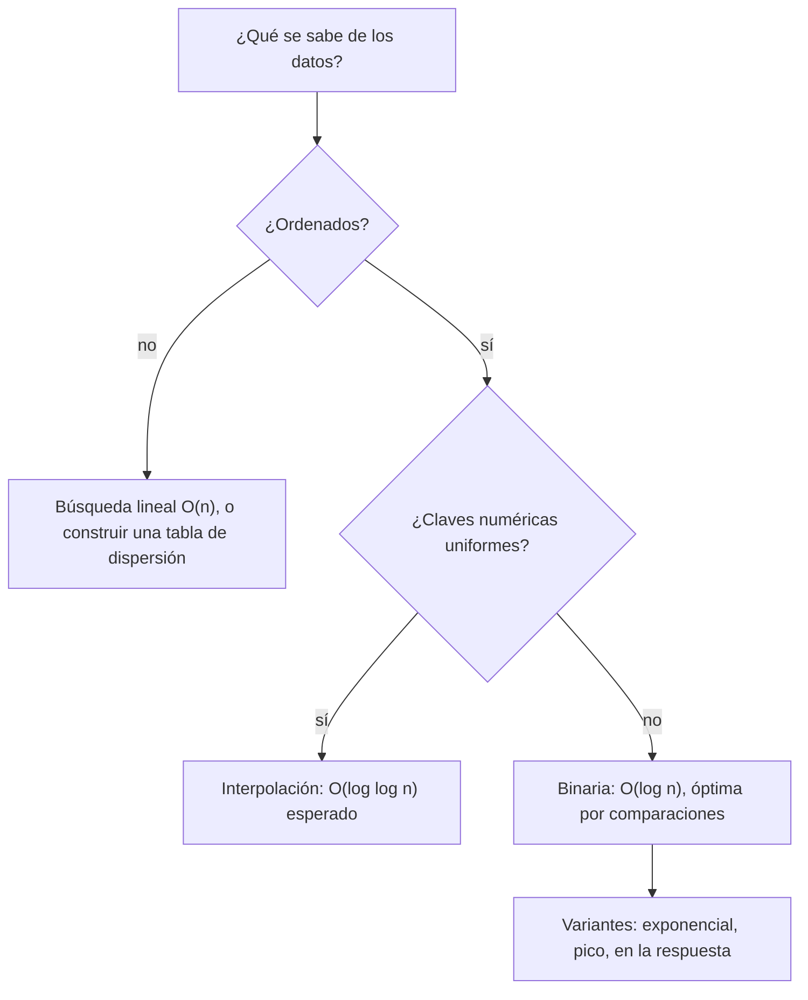

# Análisis de Algoritmos - Algoritmos que involucran secuencias y conjuntos

## 3.3 Búsquedas.

---

Buscar un elemento es la operación más frecuente sobre una colección de datos, y el mejor método depende de lo que se sepa de ella: si no hay ninguna estructura, hay que mirar todos los elementos; si está ordenada, cada comparación descarta la mitad; si además los valores están distribuidos uniformemente, se puede **adivinar** la posición; si se guardó en una tabla de dispersión, se va directamente a ella. Este tema analiza la búsqueda lineal, la binaria con su cota inferior, la búsqueda por interpolación, algunas variantes de la búsqueda binaria (búsqueda exponencial, en matrices, de un pico) y la búsqueda de patrones en cadenas con el algoritmo de Knuth, Morris y Pratt.

### Búsqueda lineal

Recorre la secuencia hasta encontrar el elemento: $n$ comparaciones en el peor caso y $(n + 1)/2$ en promedio si está y su posición es uniforme (tema 1.3). Es **óptima sin información**: si un algoritmo no examinara alguna posición, un adversario pondría allí el elemento buscado. Funciona en listas enlazadas y en datos no ordenados.

### Búsqueda binaria

En un arreglo ordenado se compara con el elemento central y se descarta la mitad que no puede contener la clave. El peor caso hace $\lfloor \log_2 n \rfloor + 1$ comparaciones de tres vías (tema 1.4).

**Cota inferior.** Todo algoritmo que busca en un arreglo ordenado usando solo comparaciones hace $\Omega(\log n)$ en el peor caso. **Demostración:** su comportamiento es un árbol de decisión binario cuyas hojas incluyen las $n$ respuestas que indican en qué posición está la clave, más la respuesta que indica que no está. Un árbol binario de altura $h$ tiene a lo sumo $2^h$ hojas, así que $2^h \geq n + 1$ y $h \geq \log_2 (n + 1).$ $\blacksquare$

**Errores comunes.** El cálculo `mid = (lo + hi) / 2` se desborda con enteros de 32 bits cuando $lo + hi > 2^{31} - 1$ (error que permaneció años en la biblioteca de Java); se evita con `lo + (hi - lo) / 2`. Y las condiciones de los extremos, `lo <= hi` y `mid ± 1`, deben elegirse junto con el invariante: la clave, si está, está en $A[lo..hi].$

**Variantes.**

- **Primera o última aparición** con claves repetidas: al encontrarla, seguir buscando en la mitad correspondiente.
- **Búsqueda exponencial** en un arreglo sin límite conocido: probar las posiciones $1, 2, 4, 8, \ldots$ hasta pasarse y luego hacer búsqueda binaria; $O(\log i)$ si la clave está en la posición $i.$
- **Búsqueda en la respuesta:** si un predicado es monótono (falso y después verdadero), la búsqueda binaria encuentra el primer valor que lo cumple. Así se calcula la raíz cuadrada entera o la mínima capacidad que basta para algo.
- **Pico:** un arreglo sin elementos consecutivos iguales siempre tiene un pico, y se encuentra en $O(\log n)$ aunque no esté ordenado (ejercicio 3).

### Búsqueda por interpolación

Si las claves son números distribuidos de manera **uniforme**, en lugar de probar el centro se prueba la posición donde se esperaría la clave:

$$pos = lo + \frac{(x - A[lo])(hi - lo)}{A[hi] - A[lo]}.$$

Con claves uniformes el número esperado de comparaciones es $O(\log \log n)$ (Yao y Yao, 1976), pero en el peor caso, con distribuciones muy sesgadas, degenera a $O(n).$

### Búsqueda de patrones: Knuth, Morris y Pratt

Buscar un patrón $P$ de longitud $m$ en un texto $T$ de longitud $n$ comparando en cada posición cuesta $O(nm)$ en el peor caso. El algoritmo **KMP** (1977) nunca retrocede en el texto: cuando falla una comparación tras haber coincidido $q$ caracteres, ya sabe cuáles fueron, y puede desplazar el patrón hasta el siguiente punto donde un prefijo del patrón coincide con lo leído. Esa información está en la **función de prefijo**:

$$\pi[q] = \max \{ k \lt q : P[1..k] \text{ es sufijo de } P[1..q] \},$$

la longitud del prefijo propio más largo de $P[1..q]$ que también es su sufijo. Se calcula en $O(m)$ aplicando la misma idea al patrón contra sí mismo.

**Análisis.** En el ciclo principal, cada carácter del texto incrementa $q$ a lo sumo en 1, y cada retroceso $q \leftarrow \pi[q]$ lo disminuye en al menos 1. Como $q \geq 0,$ el total de retrocesos no supera el total de incrementos, que es a lo sumo $n.$ Por tanto, KMP hace a lo sumo $2n$ comparaciones: $O(n + m)$ en total. El tema 5.2 presenta otros algoritmos de búsqueda de patrones.

| Método | Requisito | Tiempo |
| --- | --- | --- |
| lineal | ninguno | $\Theta(n)$ |
| binaria | arreglo ordenado | $\Theta(\log n)$ |
| interpolación | ordenado y uniforme | $O(\log \log n)$ esperado, $O(n)$ peor |
| BST balanceado | árbol | $O(\log n)$ |
| tabla de dispersión | tabla | $O(1)$ esperado |
| KMP, patrones | ninguno | $O(n + m)$ |



### Implementación en Python

El programa compara el número de comparaciones de las búsquedas lineal, binaria y por interpolación con claves uniformes y con claves exponenciales (ejercicio 1), prueba la búsqueda en matrices ordenadas, la del pico y KMP contra soluciones de fuerza bruta (ejercicios 2 a 4), mide la profundidad de búsqueda en BST degenerados, aleatorios y balanceados (ejercicio 5), simula las colisiones del ejercicio 6 y compara la búsqueda ternaria con la binaria (ejercicio 7).

```python
import math, random, time
from bisect import bisect_left

random.seed(33)

# --- Ejercicio 1: lineal, binaria e interpolación ---
def lineal(A, x):
    c = 0
    for i, a in enumerate(A):
        c += 1
        if a == x:
            return i, c
    return -1, c

def binaria(A, x):
    lo, hi, c = 0, len(A) - 1, 0
    while lo <= hi:
        mid = (lo + hi) // 2
        c += 1
        if A[mid] == x:
            return mid, c
        if A[mid] < x:
            lo = mid + 1
        else:
            hi = mid - 1
    return -1, c

def interpolacion(A, x):
    lo, hi, c = 0, len(A) - 1, 0
    while lo <= hi and A[lo] <= x <= A[hi]:
        c += 1
        if A[hi] == A[lo]:
            pos = lo
        else:
            pos = lo + (x - A[lo]) * (hi - lo) // (A[hi] - A[lo])
        if A[pos] == x:
            return pos, c
        if A[pos] < x:
            lo = pos + 1
        else:
            hi = pos - 1
    return -1, c

def experimento(A, nombre):
    claves = random.sample(A, 200)
    fila = []
    for f in (lineal, binaria, interpolacion):
        tot = 0
        for x in claves:
            i, c = f(A, x)
            assert A[i] == x
            tot += c
        fila.append(tot / len(claves))
    print(f"   {nombre:28} lineal {fila[0]:9.1f}  binaria {fila[1]:5.1f}  interpolación {fila[2]:7.1f}")

print("ejercicio 1: comparaciones promedio")
for n in (10**3, 10**5):
    experimento(sorted(random.sample(range(10 * n), n)), f"uniforme, n = {n}")
    experimento(sorted({int(1.0001 ** random.randint(0, 200000)) for _ in range(n)}),
                f"exponencial, n ~ {n}")

# --- Ejercicio 2: matriz con filas y columnas ordenadas ---
def busca_matriz(M, x):
    f, c, pasos = 0, len(M[0]) - 1, 0
    while f < len(M) and c >= 0:
        pasos += 1
        if M[f][c] == x:
            return (f, c), pasos
        if M[f][c] > x:
            c -= 1
        else:
            f += 1
    return None, pasos

m, n = 40, 60
M = [[3 * i + 2 * j for j in range(n)] for i in range(m)]
peor = 0
for x in range(-1, 3 * m + 2 * n + 1):
    pos, p = busca_matriz(M, x)
    esta = any(x in fila for fila in M)
    assert (pos is not None) == esta and (pos is None or M[pos[0]][pos[1]] == x)
    peor = max(peor, p)
print(f"ejercicio 2: matriz {m}x{n}, todas las búsquedas correctas, peor caso {peor} pasos (m + n = {m + n})")

# --- Ejercicio 3: pico por búsqueda binaria ---
def pico(A):
    lo, hi = 0, len(A) - 1
    while lo < hi:
        mid = (lo + hi) // 2
        if A[mid] < A[mid + 1]:
            lo = mid + 1          # hay un pico a la derecha
        else:
            hi = mid              # hay un pico en mid o a la izquierda
    return lo

def es_pico(A, i):
    return (i == 0 or A[i - 1] < A[i]) and (i == len(A) - 1 or A[i + 1] < A[i])

ok = all(es_pico(A, pico(A)) for A in (random.sample(range(1000), random.randint(1, 50)) for _ in range(2000)))
print("ejercicio 3: pico válido en 2000 arreglos:", ok, "| [1, 3, 20, 4, 1, 0] ->", pico([1, 3, 20, 4, 1, 0]))

# --- Ejercicio 4: KMP ---
def prefijo(P):
    pi, k = [0] * len(P), 0
    for q in range(1, len(P)):
        while k and P[k] != P[q]:
            k = pi[k - 1]
        if P[k] == P[q]:
            k += 1
        pi[q] = k
    return pi

def kmp(T, P):
    pi, q, r, comps = prefijo(P), 0, [], 0
    for i, c in enumerate(T):
        while q and P[q] != c:
            comps += 1
            q = pi[q - 1]
        comps += 1
        if P[q] == c:
            q += 1
        if q == len(P):
            r.append(i - len(P) + 1)
            q = pi[q - 1]
    return r, comps

print("ejercicio 4: prefijo de 'ababaca':", prefijo("ababaca"))
print("   'abababcabab' en 'ababababcabababcababab':", kmp("ababababcabababcababab", "abababcabab")[0])
for _ in range(500):
    T = "".join(random.choice("ab") for _ in range(random.randint(0, 60)))
    P = "".join(random.choice("ab") for _ in range(random.randint(1, 5)))
    r, comps = kmp(T, P)
    assert r == [i for i in range(len(T) - len(P) + 1) if T[i:i + len(P)] == P]
    assert comps <= 2 * len(T)
print("   coincide con la búsqueda ingenua en 500 casos, siempre con <= 2n comparaciones")

# --- Ejercicio 5: BST balanceado frente a degenerado ---
class N:
    __slots__ = ("k", "i", "d")
    def __init__(s, k): s.k, s.i, s.d = k, None, None

def inserta(t, k):
    if t is None:
        return N(k)
    x = t
    while True:
        if k < x.k:
            if x.i is None: x.i = N(k); return t
            x = x.i
        else:
            if x.d is None: x.d = N(k); return t
            x = x.d

def profundidad_media(t, claves):
    tot = 0
    for k in claves:
        x, d = t, 1
        while x.k != k:
            x = x.i if k < x.k else x.d; d += 1
        tot += d
    return tot / len(claves)

def balanceado(claves):
    if not claves:
        return None
    m = len(claves) // 2
    r = N(claves[m]); r.i = balanceado(claves[:m]); r.d = balanceado(claves[m + 1:])
    return r

n = 2000
claves = list(range(n))
deg = None
for k in claves:
    deg = inserta(deg, k)
ale = None
for k in random.sample(claves, n):
    ale = inserta(ale, k)
print("ejercicio 5: comparaciones promedio por búsqueda exitosa, n = 2000")
print(f"   degenerado (claves en orden) {profundidad_media(deg, claves):7.1f}")
print(f"   aleatorio                    {profundidad_media(ale, claves):7.1f}")
print(f"   perfectamente balanceado     {profundidad_media(balanceado(claves), claves):7.1f}")

# --- Ejercicio 6: colisiones esperadas, m = 11, n = 8 ---
m, n, rep = 11, 8, 200000
pares = ocupadas = 0
for _ in range(rep):
    cub = [0] * m
    for _ in range(n):
        cub[random.randrange(m)] += 1
    pares += sum(c * (c - 1) // 2 for c in cub)
    ocupadas += n - sum(1 for c in cub if c)
print(f"ejercicio 6: pares que colisionan: simulado {pares / rep:.3f}, C(8,2)/11 = {28 / 11:.3f}")
print(f"   inserciones en posición ocupada: simulado {ocupadas / rep:.3f},"
      f" fórmula {n - m * (1 - (1 - 1 / m) ** n):.3f}")

# --- Ejercicio 7: búsqueda ternaria ---
def ternaria(A, x):
    lo, hi, c = 0, len(A) - 1, 0
    while lo <= hi:
        t = (hi - lo) // 3
        m1, m2 = lo + t, hi - t
        c += 1                       # comparación de tres vías con A[m1]
        if A[m1] == x: return m1, c
        if x < A[m1]:
            hi = m1 - 1
            continue
        c += 1                       # comparación de tres vías con A[m2]
        if A[m2] == x: return m2, c
        if x > A[m2]:
            lo = m2 + 1
        else:
            lo, hi = m1 + 1, m2 - 1
    return -1, c

for n in (10**3, 10**6):
    A = list(range(0, 2 * n, 2))
    xs = random.sample(A, min(2000, n))
    assert all(ternaria(A, x)[0] == x // 2 for x in xs)
    cb = sum(binaria(A, x)[1] for x in xs) / len(xs)
    ct = sum(ternaria(A, x)[1] for x in xs) / len(xs)
    print(f"ejercicio 7: n = {n:7}: comparaciones de tres vías promedio: binaria {cb:.1f}, ternaria {ct:.1f}")
```

Salida:

```text
ejercicio 1: comparaciones promedio
   uniforme, n = 1000           lineal     504.8  binaria   9.0  interpolación     3.3
   exponencial, n ~ 1000        lineal     406.7  binaria   8.8  interpolación   217.8
   uniforme, n = 100000         lineal   52125.8  binaria  15.6  interpolación     3.9
   exponencial, n ~ 100000      lineal   24783.5  binaria  14.7  interpolación  1680.9
ejercicio 2: matriz 40x60, todas las búsquedas correctas, peor caso 61 pasos (m + n = 100)
ejercicio 3: pico válido en 2000 arreglos: True | [1, 3, 20, 4, 1, 0] -> 2
ejercicio 4: prefijo de 'ababaca': [0, 0, 1, 2, 3, 0, 1]
   'abababcabab' en 'ababababcabababcababab': [2, 9]
   coincide con la búsqueda ingenua en 500 casos, siempre con <= 2n comparaciones
ejercicio 5: comparaciones promedio por búsqueda exitosa, n = 2000
   degenerado (claves en orden)  1000.5
   aleatorio                       13.4
   perfectamente balanceado        10.0
ejercicio 6: pares que colisionan: simulado 2.548, C(8,2)/11 = 2.545
   inserciones en posición ocupada: simulado 2.132, fórmula 2.132
ejercicio 7: n =    1000: comparaciones de tres vías promedio: binaria 9.0, ternaria 9.6
ejercicio 7: n = 1000000: comparaciones de tres vías promedio: binaria 18.9, ternaria 19.9
```

Con claves uniformes, la interpolación necesita unas 4 comparaciones incluso con $10^5$ claves; con claves que crecen exponencialmente, sus estimaciones son pésimas y hace cientos o miles, mientras que la binaria no se inmuta.

### Ejercicios Propuestos

1. **Comparación.** Implementa y compara las búsquedas lineal, binaria y por interpolación con arreglos de distintos tamaños y distribuciones.

2. **Matriz ordenada.** En una matriz $m \times n$ con filas y columnas ordenadas de forma creciente, diseña un algoritmo eficiente para buscar un elemento.

3. **Pico.** Encuentra un pico, un elemento mayor que sus vecinos, en un arreglo con $a_i \neq a_{i+1}$ para todo $i.$

4. **KMP.** Implementa KMP para encontrar todas las apariciones de un patrón en un texto.

5. **BST.** Analiza la diferencia de rendimiento entre buscar en un BST balanceado y en uno no balanceado.

6. **Dispersión.** En una tabla de tamaño $m = 11$ con $h(k) = k \bmod m,$ calcula el número esperado de colisiones al insertar $n = 8$ claves.

7. **Búsqueda ternaria.** Implementa una búsqueda que use dos puntos de división en lugar de uno y compárala con la binaria.

### Soluciones

**Ejercicio 1.** Ver la salida del programa. La lineal crece como $n/2;$ la binaria como $\log_2 n;$ la interpolación es casi constante con claves uniformes, pero lenta con distribuciones sesgadas. En la práctica, para arreglos pequeños la lineal puede ganar por su acceso secuencial a la memoria.

**Ejercicio 2.** Se empieza en la esquina superior derecha. Si el elemento es la clave, se termina; si es mayor, toda su columna (hacia abajo) es mayor y se descarta moviéndose a la izquierda; si es menor, toda su fila (hacia la izquierda) es menor y se descarta bajando. Cada paso elimina una fila o una columna, así que hace a lo sumo $m + n - 1$ pasos: $O(m + n).$ Es óptimo para matrices cuadradas: la antidiagonal puede contener $n$ valores cuyo orden relativo no está determinado y que hay que examinar uno por uno.

**Ejercicio 3.** Búsqueda binaria: si $A[mid] \lt A[mid + 1],$ hay un pico en $A[mid + 1..hi],$ porque al subir desde $mid,$ o se encuentra un descenso, que da un pico, o se llega al final, que también es pico; si no, hay uno en $A[lo..mid].$ Invariante: $A[lo..hi]$ contiene un pico. $O(\log n).$ En $[1, 3, 20, 4, 1, 0]$ el pico es 20, en la posición 2.

**Ejercicio 4.** Es el programa. Para el patrón ababaca, $\pi = [0, 0, 1, 2, 3, 0, 1]:$ por ejemplo, $\pi[5] = 3$ porque aba es a la vez prefijo y sufijo de ababa. En todos los casos de prueba hace a lo sumo $2n$ comparaciones, como establece el análisis.

**Ejercicio 5.** La búsqueda cuesta la profundidad del nodo. Insertar claves ordenadas produce un BST degenerado: profundidad media $(n + 1)/2,$ unas 1000 comparaciones con $n = 2000.$ Con orden aleatorio, la media es $2 \ln n + O(1) \approx 13.4.$ Un árbol perfectamente balanceado da unas $\log_2 n - 1 \approx 10.$ Un AVL o rojinegro garantiza $O(\log n)$ sin depender del orden de llegada.

**Ejercicio 6.** Suponiendo dispersión uniforme, hay dos formas de contar:

- **Pares que colisionan:** cada uno de los $\binom{8}{2} = 28$ pares cae en la misma posición con probabilidad $1/11:$ $28/11 \approx 2.55.$
- **Inserciones en posición ocupada:** el número esperado de posiciones ocupadas es $11(1 - (10/11)^8) \approx 5.87,$ así que las colisiones son $8 - 5.87 \approx 2.13.$

Las dos coinciden con la simulación. Con claves concretas el resultado depende de ellas: las del tema 3.1 dan 5.

**Ejercicio 7.** Con $m_1 = lo + \lfloor (hi - lo)/3 \rfloor$ y $m_2 = hi - \lfloor (hi - lo)/3 \rfloor$ el intervalo se divide en tres partes. Hace $\log_3 n$ iteraciones, pero con 1 o 2 comparaciones cada una, en promedio $5/3:$ en total $\frac{5}{3} \log_3 n \approx 1.05 \log_2 n,$ más que la binaria, y con 2 comparaciones en el peor caso, $2 \log_3 n \approx 1.26 \log_2 n.$ En general, dividir en $k$ partes cuesta $(k - 1) \log_k n$ en el peor caso, mínimo con $k = 2.$ La búsqueda ternaria sí es útil para otra cosa: encontrar el máximo de una función **unimodal**.

### Referencias

1. Knuth, D. E., _The Art of Computer Programming, Vol. 3: Sorting and Searching_. Addison-Wesley, 1998. Secciones 6.1 y 6.2.1.
2. Cormen, T. H., Leiserson, C. E., Rivest, R. L., and Stein, C., _Introduction to Algorithms_. MIT Press, 2022. Capítulos 2 y 32.
3. Knuth, D. E., Morris, J. H., and Pratt, V. R., Fast pattern matching in strings. _SIAM Journal on Computing_ 6(2), 1977.
4. Perl, Y., Itai, A., and Avni, H., Interpolation search: a log log N search. _Communications of the ACM_ 21(7), 1978.
