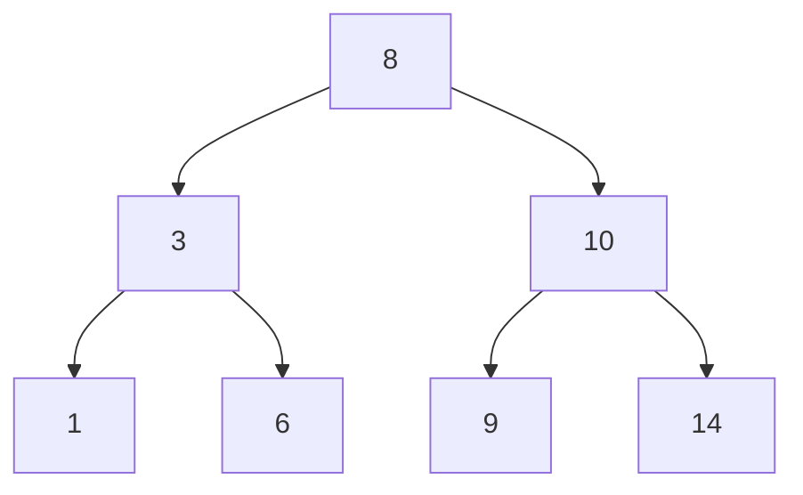
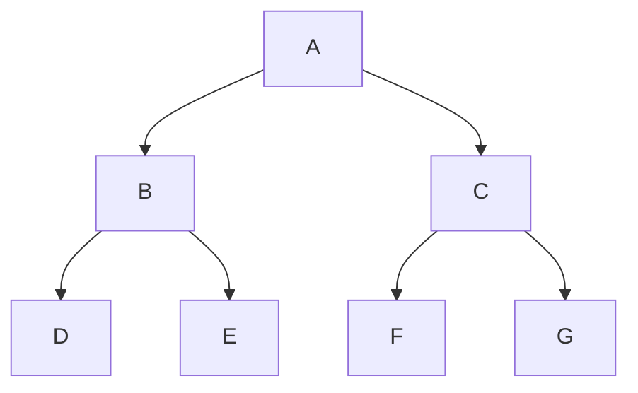

# Análisis de Algoritmos - Algoritmos que involucran secuencias y conjuntos

## 3.3 Búsquedas.

---

Los algoritmos de búsqueda son procedimientos fundamentales para localizar elementos específicos dentro de estructuras de datos. Según Cormen et al. (2009), "el problema de búsqueda consiste en encontrar un elemento con clave $k$ en una estructura de datos".

#### Clasificación de Búsquedas

**Búsquedas internas**: Datos en memoria principal
**Búsquedas externas**: Datos en almacenamiento secundario

### Búsqueda en Secuencias No Ordenadas

#### Búsqueda Lineal (Secuencial)

```python
def linear_search(sequence, target):
    """
    Búsqueda lineal en secuencia no ordenada
    Complejidad: O(n) en peor caso
    """
    for i in range(len(sequence)):
        if sequence[i] == target:
            return i
    return -1
```

**Análisis de complejidad**:

- Peor caso: $O(n)$
- Caso promedio: $\frac{n+1}{2} = O(n)$
- Mejor caso: $O(1)$

#### Búsqueda con Centinela

```python
def sentinel_search(sequence, target):
    """
    Búsqueda con centinela - elimina una comparación por iteración
    """
    n = len(sequence)
    last_element = sequence[-1]
    sequence[-1] = target  # Establecer centinela

    i = 0
    while sequence[i] != target:
        i += 1

    sequence[-1] = last_element  # Restaurar valor original

    if i < n-1 or sequence[-1] == target:
        return i
    return -1
```

### Búsqueda en Secuencias Ordenadas

#### Búsqueda Binaria

```python
def binary_search(sequence, target):
    """
    Búsqueda binaria - secuencia debe estar ordenada
    Complejidad: O(log n)
    """
    left, right = 0, len(sequence) - 1

    while left <= right:
        mid = left + (right - left) // 2

        if sequence[mid] == target:
            return mid
        elif sequence[mid] < target:
            left = mid + 1
        else:
            right = mid - 1

    return -1
```

**Análisis de complejidad**:

- Tiempo: $O(\log n)$
- Espacio: $O(1)$ (iterativo), $O(\log n)$ (recursivo)

##### Versión Recursiva

```python
def binary_search_recursive(sequence, target, left, right):
    if left > right:
        return -1

    mid = left + (right - left) // 2

    if sequence[mid] == target:
        return mid
    elif sequence[mid] < target:
        return binary_search_recursive(sequence, target, mid + 1, right)
    else:
        return binary_search_recursive(sequence, target, left, mid - 1)
```

#### Búsqueda por Interpolación

```python
def interpolation_search(sequence, target):
    """
    Búsqueda por interpolación - secuencia uniformemente distribuida
    Complejidad esperada: O(log log n)
    """
    left, right = 0, len(sequence) - 1

    while left <= right and sequence[left] <= target <= sequence[right]:
        # Fórmula de interpolación
        pos = left + ((target - sequence[left]) * (right - left)) // (sequence[right] - sequence[left])

        if sequence[pos] == target:
            return pos
        elif sequence[pos] < target:
            left = pos + 1
        else:
            right = pos - 1

    return -1
```

**Complejidad**:

- Mejor caso: $O(1)$
- Caso promedio: $O(\log \log n)$ para distribuciones uniformes
- Peor caso: $O(n)$ (distribución no uniforme)

### Búsqueda en Árboles

#### Búsqueda en BST (Binary Search Tree)

```python
def bst_search(node, target):
    """
    Búsqueda en árbol binario de búsqueda
    Complejidad: O(h) donde h es la altura del árbol
    """
    if node is None or node.key == target:
        return node

    if target < node.key:
        return bst_search(node.left, target)
    else:
        return bst_search(node.right, target)
```



### Búsqueda en Tablas Hash

#### Búsqueda con Hashing

```python
class HashTable:
    def __init__(self, size):
        self.size = size
        self.table = [[] for _ in range(size)]

    def hash_function(self, key):
        return hash(key) % self.size

    def search(self, key):
        index = self.hash_function(key)
        bucket = self.table[index]

        for i, (k, v) in enumerate(bucket):
            if k == key:
                return v
        return None
```

**Complejidad esperada**: $O(1)$ bajo suposiciones de hashing uniforme

### Algoritmos de Búsqueda en Strings

#### Búsqueda de Fuerza Bruta

```python
def brute_force_search(text, pattern):
    """
    Búsqueda de patrón en texto - fuerza bruta
    Complejidad: O(n*m)
    """
    n, m = len(text), len(pattern)

    for i in range(n - m + 1):
        j = 0
        while j < m and text[i + j] == pattern[j]:
            j += 1
        if j == m:
            return i

    return -1
```

#### Algoritmo KMP (Knuth-Morris-Pratt)

```python
def kmp_search(text, pattern):
    """
    Algoritmo KMP - búsqueda eficiente de patrones
    Complejidad: O(n + m)
    """
    def compute_lps(pattern):
        lps = [0] * len(pattern)
        length = 0
        i = 1

        while i < len(pattern):
            if pattern[i] == pattern[length]:
                length += 1
                lps[i] = length
                i += 1
            else:
                if length != 0:
                    length = lps[length - 1]
                else:
                    lps[i] = 0
                    i += 1
        return lps

    n, m = len(text), len(pattern)
    lps = compute_lps(pattern)
    i = j = 0

    while i < n:
        if text[i] == pattern[j]:
            i += 1
            j += 1

            if j == m:
                return i - j
        else:
            if j != 0:
                j = lps[j - 1]
            else:
                i += 1

    return -1
```

### Búsqueda en Grafos

#### Búsqueda en Profundidad (DFS)

```python
def dfs(graph, start, target):
    """
    Búsqueda en profundidad
    Complejidad: O(V + E)
    """
    stack = [start]
    visited = set()

    while stack:
        node = stack.pop()
        if node == target:
            return True

        if node not in visited:
            visited.add(node)
            for neighbor in graph[node]:
                if neighbor not in visited:
                    stack.append(neighbor)

    return False
```

#### Búsqueda en Anchura (BFS)

```python
from collections import deque

def bfs(graph, start, target):
    """
    Búsqueda en anchura - encuentra el camino más corto
    Complejidad: O(V + E)
    """
    queue = deque([start])
    visited = set([start])

    while queue:
        node = queue.popleft()
        if node == target:
            return True

        for neighbor in graph[node]:
            if neighbor not in visited:
                visited.add(neighbor)
                queue.append(neighbor)

    return False
```



### Búsqueda Heurística

#### Algoritmo A*

```python
def a_star_search(graph, start, goal, heuristic):
    """
    Algoritmo A* - búsqueda heurística informada
    """
    open_set = PriorityQueue()
    open_set.put((0, start))

    g_score = {node: float('inf') for node in graph}
    g_score[start] = 0

    f_score = {node: float('inf') for node in graph}
    f_score[start] = heuristic(start, goal)

    while not open_set.empty():
        current = open_set.get()[1]

        if current == goal:
            return reconstruct_path(came_from, current)

        for neighbor in graph[current]:
            tentative_g = g_score[current] + graph[current][neighbor]

            if tentative_g < g_score[neighbor]:
                came_from[neighbor] = current
                g_score[neighbor] = tentative_g
                f_score[neighbor] = g_score[neighbor] + heuristic(neighbor, goal)
                open_set.put((f_score[neighbor], neighbor))

    return None
```

### Análisis de Complejidad

#### Tabla Comparativa de Búsquedas

| Algoritmo                  | Mejor caso | Caso promedio    | Peor caso   | Espacio |
| -------------------------- | ---------- | ---------------- | ----------- | ------- |
| Búsqueda lineal            | $O(1)$     | $O(n)$           | $O(n)$      | $O(1)$  |
| Búsqueda binaria           | $O(1)$     | $O(\log n)$      | $O(\log n)$ | $O(1)$  |
| Búsqueda por interpolación | $O(1)$     | $O(\log \log n)$ | $O(n)$      | $O(1)$  |
| BST search                 | $O(1)$     | $O(\log n)$      | $O(n)$      | $O(1)$  |
| Hash search                | $O(1)$     | $O(1)$           | $O(n)$      | $O(n)$  |
| KMP                        | $O(m)$     | $O(n + m)$       | $O(n + m)$  | $O(m)$  |

#### Teorema del Límite Inferior para Búsqueda

Para cualquier algoritmo de búsqueda por comparación en un arreglo ordenado:

$$\Omega(\log n) \text{ comparaciones en el peor caso}$$

**Demostración**: El árbol de decisión debe tener al menos $n$ hojas, por lo tanto la altura es al menos $\log_2 n$.

### Ejercicios Propuestos

#### Ejercicio 1: Implementación Comparativa

Implemente y compare los tiempos de ejecución de búsqueda lineal, binaria y por interpolación para arreglos de diferentes tamaños y distribuciones.

#### Ejercicio 2: Búsqueda en Matriz Ordenada

Dada una matriz $m \times n$ donde cada fila y columna está ordenada, diseñe un algoritmo eficiente para buscar un elemento.

```python
def search_sorted_matrix(matrix, target):
    """
    Búsqueda en matriz ordenada - complejidad O(m + n)
    """
    if not matrix:
        return False

    row, col = 0, len(matrix[0]) - 1

    while row < len(matrix) and col >= 0:
        if matrix[row][col] == target:
            return True
        elif matrix[row][col] > target:
            col -= 1
        else:
            row += 1

    return False
```

#### Ejercicio 3: Búsqueda del Pico

Encuentre un pico en un arreglo donde $a[i] \neq a[i+1]$ para todo $i$.

#### Ejercicio 4: Implementación KMP

Implemente el algoritmo KMP completo que encuentre todas las ocurrencias de un patrón en un texto.

#### Ejercicio 5: Búsqueda en BST Balanceado

Analice la diferencia de performance entre búsquedas en BST balanceado vs no balanceado.

#### Ejercicio 6: Análisis de Hashing

Para una tabla hash de tamaño $m = 11$ con función $h(k) = k \mod m$, calcule el número esperado de colisiones para $n = 8$ claves.

#### Ejercicio 7: Búsqueda Terciaria

Implemente una versión de búsqueda binaria que use dos puntos medios en lugar de uno.

### Soluciones Sugeridas

#### Ejercicio 3: Búsqueda del Pico

```python
def find_peak(arr):
    left, right = 0, len(arr) - 1

    while left < right:
        mid = left + (right - left) // 2

        if arr[mid] > arr[mid + 1]:
            right = mid
        else:
            left = mid + 1

    return left
```

#### Ejercicio 7: Búsqueda Terciaria

```python
def ternary_search(arr, target):
    left, right = 0, len(arr) - 1

    while left <= right:
        mid1 = left + (right - left) // 3
        mid2 = right - (right - left) // 3

        if arr[mid1] == target:
            return mid1
        if arr[mid2] == target:
            return mid2

        if target < arr[mid1]:
            right = mid1 - 1
        elif target > arr[mid2]:
            left = mid2 + 1
        else:
            left = mid1 + 1
            right = mid2 - 1

    return -1
```

### Aplicaciones Prácticas

#### Sistemas de Bases de Datos

Índices B+ trees para búsquedas eficientes

#### Motores de Búsqueda

Algoritmos de indexación y recuperación de información

#### Compiladores

Búsqueda de símbolos en tablas hash

#### Inteligencia Artificial

Algoritmos de búsqueda heurística para pathfinding

### Referencias

1. Cormen, T. H., Leiserson, C. E., Rivest, R. L., & Stein, C. (2009). Introduction to Algorithms (3rd ed.). MIT Press. (Capítulos 2, 11, 12, 15)
2. Kleinberg, J., & Tardos, É. (2005). Algorithm Design. Addison Wesley. (Capítulos 2, 13)
3. Knuth, D. E. (1998). The Art of Computer Programming, Volume 3: Sorting and Searching. Addison-Wesley.

### Recursos Adicionales

- Visualizaciones interactivas: https://visualgo.net/en/searching
- Implementaciones de referencia en diferentes lenguajes
- Plataformas para práctica: LeetCode, HackerRank con problemas de búsqueda
