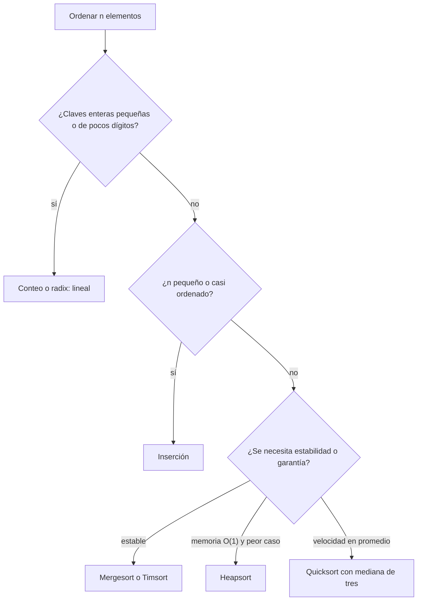

# Análisis de Algoritmos - Algoritmos que involucran secuencias y conjuntos

## 3.4 Ordenamientos.

---

Ordenar una secuencia es el problema más estudiado de la algorítmica: aparece como paso previo de la búsqueda binaria, de la eliminación de duplicados, de los algoritmos voraces y de la geometría computacional, y ofrece ejemplos de casi todos los paradigmas de diseño. Este tema presenta los algoritmos de ordenamiento por comparación cuadráticos (inserción, selección) y de $O(n \log n)$ (mergesort, heapsort, quicksort), con sus análisis y propiedades (estabilidad, memoria adicional, adaptabilidad), y los ordenamientos lineales que no comparan (conteo, radix, cubetas). El tema 3.5 demuestra que $n \log n$ es el límite para los que comparan.

### Propiedades

- **Estable:** los elementos con claves iguales conservan su orden relativo. Importa al ordenar registros por varias claves sucesivamente.
- **En el lugar:** usa $O(1)$ memoria adicional (a veces se admite $O(\log n)$ de pila).
- **Adaptable:** es más rápido con entradas casi ordenadas.

### Algoritmos cuadráticos

- **Inserción** (tema 2.2): inserta cada elemento en el prefijo ya ordenado. Hace tantos desplazamientos como inversiones: $\Theta(n)$ ordenado, $\Theta(n^2)$ en el peor caso y en promedio. Estable, en el lugar, adaptable; el mejor para arreglos pequeños.
- **Selección:** busca el mínimo del resto y lo intercambia a su lugar. Siempre $n(n - 1)/2$ comparaciones, pero solo $n - 1$ intercambios: útil si escribir es caro. No es estable.
- **Burbuja:** intercambia vecinos desordenados hasta que no queden. $\Theta(n^2);$ solo tiene valor didáctico.

### Mergesort

Divide y vencerás: ordenar recursivamente las dos mitades y **mezclarlas** recorriéndolas con dos índices. La mezcla de $n$ elementos hace a lo sumo $n - 1$ comparaciones, así que $T(n) = 2T(n/2) + \Theta(n) = \Theta(n \log n)$ en **todos** los casos. Es estable si en los empates se toma primero el de la izquierda. Necesita $\Theta(n)$ memoria adicional en la versión estándar. Es el algoritmo de elección para listas enlazadas y para ordenar en disco (mezcla de $k$ vías), y Timsort, el de Python y Java, es un mergesort adaptable.

### Heapsort

Un **montículo de máximos** es un árbol binario completo, guardado en un arreglo, en el que cada nodo es mayor o igual que sus hijos. **Construirlo** de abajo hacia arriba, hundiendo cada nodo interno, cuesta $O(n):$ hay a lo sumo $\lceil n/2^{h+1} \rceil$ nodos de altura $h$ y hundir uno cuesta $O(h),$ y $\sum_h h \, n/2^{h+1} = O(n).$ Luego se repite $n - 1$ veces: intercambiar la raíz (el máximo) con el último elemento, reducir el montículo y hundir la nueva raíz en $O(\log n).$ Total $\Theta(n \log n)$ en el peor caso, en el lugar, no estable. Hace más comparaciones que los otros y accede a la memoria de forma dispersa.

### Quicksort

Divide y vencerás con el trabajo antes de la recursión: **particionar** alrededor de un pivote $p,$ dejando a la izquierda los menores y a la derecha los mayores, y ordenar recursivamente las dos partes. No necesita combinar.

- **Peor caso:** si el pivote es siempre el mínimo o el máximo, $T(n) = T(n - 1) + \Theta(n) = \Theta(n^2).$ Con el último elemento como pivote, ocurre con entradas ordenadas.
- **Caso promedio:** con pivote aleatorio, los elementos de rango $i$ y $j$ se comparan si y solo si uno de ellos es el primer pivote elegido entre los $j - i + 1$ de rangos $i..j,$ lo que ocurre con probabilidad $2/(j - i + 1).$ Sumando sobre los pares:

$$E[C] = \sum_{i \lt j} \frac{2}{j - i + 1} \leq 2n H_n = 2n \ln n + O(n) \approx 1.39 \, n \log_2 n.$$

Es en el lugar, salvo $O(\log n)$ de pila si se hace la recursión sobre la parte menor, y no es estable. En la práctica es el más rápido por su ciclo interno sencillo y su buen uso de la caché. Mejoras habituales: pivote por **mediana de tres**, **inserción** para subarreglos pequeños y **partición en tres** (menores, iguales, mayores) cuando hay muchas claves repetidas. Introsort, el de C++, cambia a heapsort si la recursión se hace demasiado profunda.

### Ordenamientos lineales

Si las claves no son arbitrarias, se puede evitar comparar:

- **Conteo:** con claves enteras en $\{0, \ldots, k\},$ contar cuántas veces aparece cada una, calcular sumas de prefijos y colocar cada elemento en su posición, recorriendo la entrada de atrás hacia adelante para que sea estable. $\Theta(n + k).$
- **Radix:** ordenar por dígitos, del menos significativo al más significativo, con un ordenamiento estable en cada pasada. Con $d$ dígitos en base $b,$ $\Theta(d(n + b)).$ Enteros de 32 bits en base $2^8$ son 4 pasadas.
- **Cubetas:** con claves reales uniformes en $[0, 1),$ repartirlas en $n$ cubetas y ordenar cada una por inserción. $\Theta(n)$ esperado (ejercicio 4).

| Algoritmo | Mejor | Promedio | Peor | Memoria | Estable |
| --- | --- | --- | --- | --- | --- |
| inserción | $n$ | $n^2$ | $n^2$ | $O(1)$ | sí |
| selección | $n^2$ | $n^2$ | $n^2$ | $O(1)$ | no |
| mergesort | $n \log n$ | $n \log n$ | $n \log n$ | $O(n)$ | sí |
| heapsort | $n \log n$ | $n \log n$ | $n \log n$ | $O(1)$ | no |
| quicksort | $n \log n$ | $n \log n$ | $n^2$ | $O(\log n)$ | no |
| conteo | $n + k$ | $n + k$ | $n + k$ | $O(n + k)$ | sí |
| radix | $d(n + b)$ | $d(n + b)$ | $d(n + b)$ | $O(n + b)$ | sí |



### Implementación en Python

Todos los algoritmos comparan a través de una función que cuenta las comparaciones, y cada resultado se verifica contra `sorted`. El programa los ejecuta con 2000 claves aleatorias, ordenadas, en orden inverso y con solo 5 valores distintos (ejercicios 1 y 2); comprueba el conteo y radix; muestra la inestabilidad de la selección y una versión estable (ejercicio 3); implementa el ordenamiento por cubetas (ejercicio 4), un mergesort en el lugar (ejercicio 5) y quickselect (ejercicio 6), y evalúa las recurrencias del ejercicio 7.

```python
import random, math

random.seed(34)

class Cmp:
    """Cuenta comparaciones: todos los algoritmos comparan con menor()."""
    n = 0
def menor(a, b):
    Cmp.n += 1
    return a < b

def insercion(A, lo=0, hi=None):
    hi = len(A) - 1 if hi is None else hi
    for i in range(lo + 1, hi + 1):
        x, j = A[i], i - 1
        while j >= lo and menor(x, A[j]):
            A[j + 1] = A[j]; j -= 1
        A[j + 1] = x

def seleccion(A):
    for i in range(len(A) - 1):
        m = i
        for j in range(i + 1, len(A)):
            if menor(A[j], A[m]):
                m = j
        A[i], A[m] = A[m], A[i]

def mergesort(A):
    if len(A) <= 1:
        return A
    m = len(A) // 2
    I, D = mergesort(A[:m]), mergesort(A[m:])
    R, i, j = [], 0, 0
    while i < len(I) and j < len(D):
        if menor(D[j], I[i]):           # toma de la izquierda en empates: estable
            R.append(D[j]); j += 1
        else:
            R.append(I[i]); i += 1
    return R + I[i:] + D[j:]

def heapsort(A):
    n = len(A)
    def hunde(i, n):
        while 2 * i + 1 < n:
            h = 2 * i + 1
            if h + 1 < n and menor(A[h], A[h + 1]):
                h += 1
            if not menor(A[i], A[h]):
                return
            A[i], A[h] = A[h], A[i]; i = h
    for i in range(n // 2 - 1, -1, -1):
        hunde(i, n)
    for fin in range(n - 1, 0, -1):
        A[0], A[fin] = A[fin], A[0]
        hunde(0, fin)

def particion(A, lo, hi):            # Lomuto con el pivote en A[hi]
    p, i = A[hi], lo
    for j in range(lo, hi):
        if menor(A[j], p):
            A[i], A[j] = A[j], A[i]; i += 1
    A[i], A[hi] = A[hi], A[i]
    return i

def quicksort_simple(A, lo=0, hi=None):
    hi = len(A) - 1 if hi is None else hi
    while lo < hi:
        q = particion(A, lo, hi)
        if q - lo < hi - q:              # recursión en la parte menor: pila O(log n)
            quicksort_simple(A, lo, q - 1); lo = q + 1
        else:
            quicksort_simple(A, q + 1, hi); hi = q - 1

CORTE = 16
def quicksort_opt(A, lo=0, hi=None):
    hi = len(A) - 1 if hi is None else hi
    while hi - lo + 1 > CORTE:
        m = (lo + hi) // 2                # mediana de tres al final
        if menor(A[m], A[lo]): A[m], A[lo] = A[lo], A[m]
        if menor(A[hi], A[lo]): A[hi], A[lo] = A[lo], A[hi]
        if menor(A[m], A[hi]): A[m], A[hi] = A[hi], A[m]
        q = particion(A, lo, hi)
        if q - lo < hi - q:
            quicksort_opt(A, lo, q - 1); lo = q + 1
        else:
            quicksort_opt(A, q + 1, hi); hi = q - 1
    insercion(A, lo, hi)

def counting_sort(A, k):
    C = [0] * (k + 1)
    for x in A: C[x] += 1
    for i in range(1, k + 1): C[i] += C[i - 1]
    B = [None] * len(A)
    for x in reversed(A):                 # de atrás hacia adelante: estable
        C[x] -= 1; B[C[x]] = x
    return B

def radix_sort(A, base=256):
    pasos, m = 0, max(A)
    while base ** pasos <= m:
        d = base ** pasos
        cubetas = [[] for _ in range(base)]
        for x in A:
            cubetas[(x // d) % base].append(x)
        A = [x for c in cubetas for x in c]
        pasos += 1
    return A

def bucket_sort(A):
    n = len(A)
    B = [[] for _ in range(n)]
    for x in A:
        B[min(int(n * x), n - 1)].append(x)
    for b in B:
        insercion(b)
    return [x for b in B for x in b], max(map(len, B))

def ejecuta(nombre, A):
    B = A[:]
    Cmp.n = 0
    if nombre == "inserción": insercion(B)
    elif nombre == "selección": seleccion(B)
    elif nombre == "mergesort": B = mergesort(B)
    elif nombre == "heapsort": heapsort(B)
    elif nombre == "quicksort simple": quicksort_simple(B)
    elif nombre == "quicksort optimizado": quicksort_opt(B)
    assert B == sorted(A), nombre
    return Cmp.n

n = 2000
datos = {"aleatorio": [random.randint(0, 10**6) for _ in range(n)]}
datos["ordenado"] = sorted(datos["aleatorio"])
datos["inverso"] = datos["ordenado"][::-1]
datos["pocos valores"] = [random.randint(0, 4) for _ in range(n)]
print(f"ejercicios 1 y 2: comparaciones con n = {n} (n lg n = {n * math.log2(n):.0f})")
print(f"   {'':21}" + "".join(f"{d:>14}" for d in datos))
for alg in ["inserción", "selección", "mergesort", "heapsort", "quicksort simple", "quicksort optimizado"]:
    print(f"   {alg:21}" + "".join(f"{ejecuta(alg, A):14}" for A in datos.values()))

# --- lineales ---
A = [random.randint(0, 10**9) for _ in range(5000)]
assert radix_sort(A) == sorted(A)
assert counting_sort([x % 100 for x in A], 99) == sorted(x % 100 for x in A)
print("   counting sort y radix sort (base 256, 4 pasadas) correctos con 5000 claves")

# --- Ejercicio 3: estabilidad ---
registros = [(3, "a"), (1, "b"), (3, "c"), (2, "d"), (1, "e"), (3, "f")]
def seleccion_registros(R):
    R = R[:]
    for i in range(len(R) - 1):
        m = min(range(i, len(R)), key=lambda j: (R[j][0], j))
        R[i], R[m] = R[m], R[i]
    return R
def seleccion_estable(R):
    R = R[:]
    for i in range(len(R) - 1):
        m = min(range(i, len(R)), key=lambda j: (R[j][0], j))
        R.insert(i, R.pop(m))             # desplazar en lugar de intercambiar
    return R
print("ejercicio 3:", seleccion_registros([(2, "a"), (2, "b"), (1, "c")]), "<- (2,a) y (2,b) se invierten")
print("   estable:", seleccion_estable(registros))
print("   sorted :", sorted(registros, key=lambda r: r[0]))

# --- Ejercicio 4: bucket sort ---
for n in (10**3, 10**5):
    U = [random.random() for _ in range(n)]
    Cmp.n = 0
    R, mayor = bucket_sort(U)
    assert R == sorted(U)
    print(f"ejercicio 4: n = {n:6}: {Cmp.n / n:.2f} comparaciones por elemento, cubeta mayor {mayor}")

# --- Ejercicio 5: mezcla en el lugar ---
def mezcla_en_lugar(A, lo, m, hi):
    """Mezcla A[lo..m-1] y A[m..hi-1] con O(1) memoria extra (rotaciones)."""
    i, j = lo, m
    while i < j < hi:
        if A[j] < A[i]:
            v, k = A[j], j
            while k > i:                   # desplazar: rota A[i..j]
                A[k] = A[k - 1]; k -= 1
            A[i] = v
            j += 1
        i += 1

def mergesort_en_lugar(A, lo=0, hi=None):
    hi = len(A) if hi is None else hi
    if hi - lo > 1:
        m = (lo + hi) // 2
        mergesort_en_lugar(A, lo, m)
        mergesort_en_lugar(A, m, hi)
        mezcla_en_lugar(A, lo, m, hi)

for _ in range(300):
    A = [random.randint(0, 50) for _ in range(random.randint(0, 60))]
    B = A[:]
    mergesort_en_lugar(B)
    assert B == sorted(A)
print("ejercicio 5: mergesort en el lugar correcto en 300 arreglos")

# --- Ejercicio 6: quickselect ---
def quickselect(A, k):
    A = A[:]
    lo, hi = 0, len(A) - 1
    while True:
        r = random.randint(lo, hi)
        A[r], A[hi] = A[hi], A[r]
        q = particion(A, lo, hi)
        if q == k: return A[q]
        if k < q: hi = q - 1
        else: lo = q + 1

for n in (10**3, 10**5):
    A = [random.randint(0, 10**9) for _ in range(n)]
    S = sorted(A)
    Cmp.n = 0
    reps = 20
    for _ in range(reps):
        k = random.randrange(n)
        assert quickselect(A, k) == S[k]
    print(f"ejercicio 6: n = {n:6}: {Cmp.n / reps / n:.2f} n comparaciones en promedio")

# --- Ejercicio 7: recurrencias ---
def T1(n): return 0 if n <= 1 else T1(n // 2) + T1(n - n // 2) + n
def T2(n): return sum(range(1, n + 1))
for n in (2**10, 2**16):
    print(f"ejercicio 7: n = 2^{int(math.log2(n))}: 2T(n/2)+n = {T1(n)} = n lg n = {int(n * math.log2(n))};"
          f" T(n-1)+n = {T2(n)} = n(n+1)/2")
```

Salida:

```text
ejercicios 1 y 2: comparaciones con n = 2000 (n lg n = 21932)
                             aleatorio      ordenado       inverso pocos valores
   inserción                   1003333          1999       1999000        798893
   selección                   1999000       1999000       1999000       1999000
   mergesort                     19391         10864         11091         18102
   heapsort                      37678         39158         35973         31594
   quicksort simple              23702       1995178       1998795        405998
   quicksort optimizado          23369         15879         38104        410056
   counting sort y radix sort (base 256, 4 pasadas) correctos con 5000 claves
ejercicio 3: [(1, 'c'), (2, 'b'), (2, 'a')] <- (2,a) y (2,b) se invierten
   estable: [(1, 'b'), (1, 'e'), (2, 'd'), (3, 'a'), (3, 'c'), (3, 'f')]
   sorted : [(1, 'b'), (1, 'e'), (2, 'd'), (3, 'a'), (3, 'c'), (3, 'f')]
ejercicio 4: n =   1000: 0.42 comparaciones por elemento, cubeta mayor 6
ejercicio 4: n = 100000: 0.45 comparaciones por elemento, cubeta mayor 8
ejercicio 5: mergesort en el lugar correcto en 300 arreglos
ejercicio 6: n =   1000: 2.92 n comparaciones en promedio
ejercicio 6: n = 100000: 2.96 n comparaciones en promedio
ejercicio 7: n = 2^10: 2T(n/2)+n = 10240 = n lg n = 10240; T(n-1)+n = 524800 = n(n+1)/2
ejercicio 7: n = 2^16: 2T(n/2)+n = 1048576 = n lg n = 1048576; T(n-1)+n = 2147516416 = n(n+1)/2
```

La tabla muestra los casos extremos: la inserción es imbatible con datos ordenados y desastrosa en orden inverso; el quicksort con el último elemento como pivote se vuelve cuadrático con datos ordenados, y la mediana de tres lo corrige; ninguna de las dos versiones resiste muchas claves repetidas, porque la partición de Lomuto manda todos los iguales al mismo lado; mergesort es el que menos compara.

### Ejercicios Propuestos

1. **Comparación.** Implementa y compara los algoritmos con distintas distribuciones de datos.

2. **Quicksort optimizado.** Implementa quicksort con pivote por mediana de tres e inserción para subarreglos pequeños.

3. **Estabilidad.** Muestra por qué el ordenamiento por selección no es estable y modifícalo para que lo sea.

4. **Cubetas.** Implementa el ordenamiento por cubetas suponiendo claves uniformes en $[0, 1).$

5. **Mergesort en el lugar.** Implementa una versión de mergesort que no use un arreglo auxiliar.

6. **Selección.** Modifica quicksort para encontrar el k-ésimo menor en tiempo esperado $O(n).$

7. **Recurrencias.** Resuelve $T(n) = 2T(n/2) + \Theta(n)$ y $T(n) = T(n - 1) + \Theta(n).$

### Soluciones

**Ejercicio 1.** Ver la tabla del programa y su comentario. Contar comparaciones es más fiable que medir tiempos, que dependen de la máquina; en tiempo real, el quicksort optimizado suele ganar con datos aleatorios por su buen uso de la caché.

**Ejercicio 2.** Es `quicksort_opt` del programa. La **mediana de tres** ordena $A[lo],$ $A[mid]$ y $A[hi]$ y usa la mediana como pivote: evita el peor caso con entradas ordenadas o inversas y reduce las comparaciones esperadas de $1.39 \, n \log_2 n$ a unas $1.19 \, n \log_2 n.$ El **corte a inserción** para subarreglos de menos de 16 elementos evita muchas llamadas recursivas sobre arreglos diminutos, donde la inserción es más rápida. Para muchas claves repetidas hace falta además la partición en tres de Dijkstra.

**Ejercicio 3.** La selección intercambia el mínimo con el elemento de la posición $i,$ y ese intercambio puede saltar por encima de un elemento igual. Con $[(2, a), (2, b), (1, c)],$ el mínimo $(1, c)$ se intercambia con $(2, a),$ que queda detrás de $(2, b).$ **Versión estable:** en lugar de intercambiar, sacar el mínimo (el primero entre los iguales) e insertarlo en la posición $i,$ desplazando a la derecha los elementos intermedios. Sigue siendo $\Theta(n^2),$ pero con $\Theta(n^2)$ movimientos en lugar de $n - 1$ intercambios.

**Ejercicio 4.** Con $n$ claves uniformes en $[0, 1)$ y $n$ cubetas, la clave $x$ va a la cubeta $\lfloor nx \rfloor.$ Sea $N_i$ el tamaño de la cubeta $i,$ con distribución binomial de parámetros $n$ y $1/n.$ Ordenar cada una por inserción cuesta $O(N_i^2),$ y

$$E[N_i^2] = \text{Var}[N_i] + E[N_i]^2 = n \cdot \tfrac{1}{n}\left(1 - \tfrac{1}{n}\right) + 1 = 2 - \tfrac{1}{n},$$

así que el costo esperado total es $\Theta(n) + \sum_i O(E[N_i^2]) = \Theta(n).$ El programa mide menos de media comparación por elemento.

**Ejercicio 5.** La mezcla en el lugar recorre las dos mitades; cuando el primer elemento de la derecha es menor que el actual de la izquierda, lo inserta en su lugar desplazando un bloque, lo que es una **rotación**. Usa $O(1)$ memoria, pero cada mezcla puede costar $\Theta(n^2)$ en desplazamientos, y el total es $O(n^2).$ Existen mezclas en el lugar en tiempo lineal (Kronrod, 1969; Huang y Langston, 1988), pero son complejas y lentas en la práctica; por eso las bibliotecas aceptan $O(n)$ de memoria.

**Ejercicio 6.** **Quickselect:** particionar con un pivote aleatorio; si queda en la posición $k,$ es la respuesta; si no, continuar solo en el lado que contiene la posición $k.$ Como cada partición es lineal y el pivote aleatorio reduce el tamaño a una fracción constante en promedio, el tiempo esperado es $O(n):$ unas $2n$ comparaciones para la mediana y $3n$ en promedio sobre $k,$ como mide el programa. El peor caso es $\Theta(n^2);$ el algoritmo de la mediana de medianas (Blum, Floyd, Pratt, Rivest y Tarjan, 1973) da $O(n)$ en el peor caso.

**Ejercicio 7.** La primera es mergesort: árbol de recursión con $\log_2 n$ niveles de costo $n$ cada uno, $\Theta(n \log n);$ con $T(1) = 0$ y $n$ potencia de 2, exactamente $n \log_2 n.$ La segunda es el peor caso de quicksort o la inserción: desarrollando, $T(n) = \sum_{i=1}^{n} \Theta(i) = \Theta(n^2);$ exactamente $n(n + 1)/2$ con costo $i$ en cada nivel.

### Referencias

1. Cormen, T. H., Leiserson, C. E., Rivest, R. L., and Stein, C., _Introduction to Algorithms_. MIT Press, 2022. Capítulos 2, 6, 7, 8 y 9.
2. Knuth, D. E., _The Art of Computer Programming, Vol. 3: Sorting and Searching_. Addison-Wesley, 1998. Capítulo 5.
3. Sedgewick, R., and Wayne, K., _Algorithms_. Addison-Wesley, 2011. Capítulo 2.
4. Hoare, C. A. R., Quicksort. _The Computer Journal_ 5(1), 1962.
