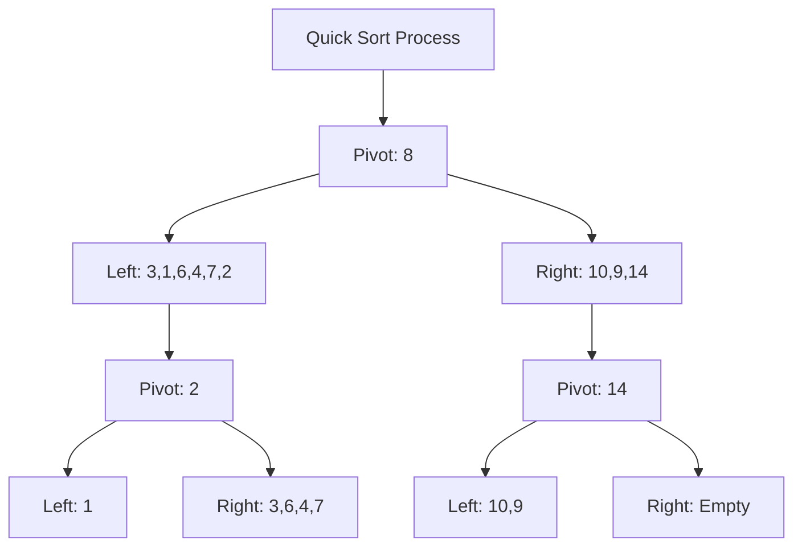

# Análisis de Algoritmos - Algoritmos que involucran secuencias y conjuntos

## 3.4 Ordenamientos.

---

El problema de ordenamiento consiste en reorganizar una secuencia de elementos según un orden específico. Formalmente, dada una secuencia $\langle a_1, a_2, \ldots, a_n \rangle$, encontrar una permutación $\pi$ tal que $a_{\pi(1)} \leq a_{\pi(2)} \leq \cdots \leq a_{\pi(n)}$.

#### Clasificación de Algoritmos de Ordenamiento

**Por complejidad**:

- $O(n^2)$: Bubble Sort, Selection Sort, Insertion Sort
- $O(n \log n)$: Merge Sort, Heap Sort, Quick Sort (promedio)
- $O(n)$: Counting Sort, Radix Sort, Bucket Sort (bajo condiciones)

**Por estabilidad**: Un algoritmo es estable si preserva el orden relativo de elementos iguales

### Algoritmos de Ordenamiento Cuadráticos

#### Insertion Sort

```python
def insertion_sort(arr):
    """
    Insertion Sort - O(n²) en peor caso, O(n) en mejor caso
    Estable y in-place
    """
    for i in range(1, len(arr)):
        key = arr[i]
        j = i - 1
        while j >= 0 and arr[j] > key:
            arr[j + 1] = arr[j]
            j -= 1
        arr[j + 1] = key
    return arr
```

**Análisis de complejidad**:

- Peor caso: $O(n^2)$ (secuencia inversamente ordenada)
- Mejor caso: $O(n)$ (secuencia ordenada)
- Caso promedio: $O(n^2)$

#### Selection Sort

```python
def selection_sort(arr):
    """
    Selection Sort - O(n²) en todos los casos
    No estable, in-place
    """
    for i in range(len(arr)):
        min_idx = i
        for j in range(i + 1, len(arr)):
            if arr[j] < arr[min_idx]:
                min_idx = j
        arr[i], arr[min_idx] = arr[min_idx], arr[i]
    return arr
```

#### Bubble Sort

```python
def bubble_sort(arr):
    """
    Bubble Sort - O(n²) en peor caso, O(n) en mejor caso
    Estable, in-place
    """
    n = len(arr)
    for i in range(n):
        swapped = False
        for j in range(0, n - i - 1):
            if arr[j] > arr[j + 1]:
                arr[j], arr[j + 1] = arr[j + 1], arr[j]
                swapped = True
        if not swapped:
            break
    return arr
```

### Algoritmos de Ordenamiento Eficientes

#### Merge Sort

```python
def merge_sort(arr):
    """
    Merge Sort - O(n log n) en todos los casos
    Estable, no in-place (requiere espacio adicional O(n))
    """
    if len(arr) <= 1:
        return arr

    mid = len(arr) // 2
    left = merge_sort(arr[:mid])
    right = merge_sort(arr[mid:])

    return merge(left, right)

def merge(left, right):
    result = []
    i = j = 0

    while i < len(left) and j < len(right):
        if left[i] <= right[j]:
            result.append(left[i])
            i += 1
        else:
            result.append(right[j])
            j += 1

    result.extend(left[i:])
    result.extend(right[j:])
    return result
```

**Ecuación de recurrencia**: $T(n) = 2T(n/2) + \Theta(n)$
**Solución**: $T(n) = \Theta(n \log n)$

#### Quick Sort

```python
def quick_sort(arr, low=0, high=None):
    """
    Quick Sort - O(n log n) promedio, O(n²) peor caso
    No estable, in-place
    """
    if high is None:
        high = len(arr) - 1

    if low < high:
        pi = partition(arr, low, high)
        quick_sort(arr, low, pi - 1)
        quick_sort(arr, pi + 1, high)

def partition(arr, low, high):
    pivot = arr[high]
    i = low - 1

    for j in range(low, high):
        if arr[j] <= pivot:
            i += 1
            arr[i], arr[j] = arr[j], arr[i]

    arr[i + 1], arr[high] = arr[high], arr[i + 1]
    return i + 1
```



**Análisis**:

- Mejor caso: $O(n \log n)$ (particiones balanceadas)
- Peor caso: $O(n^2)$ (particiones desbalanceadas)
- Caso promedio: $O(n \log n)$

#### Heap Sort

```python
def heap_sort(arr):
    """
    Heap Sort - O(n log n) en todos los casos
    No estable, in-place
    """
    n = len(arr)

    # Build max heap
    for i in range(n // 2 - 1, -1, -1):
        heapify(arr, n, i)

    # Extract elements
    for i in range(n - 1, 0, -1):
        arr[0], arr[i] = arr[i], arr[0]
        heapify(arr, i, 0)

def heapify(arr, n, i):
    largest = i
    left = 2 * i + 1
    right = 2 * i + 2

    if left < n and arr[left] > arr[largest]:
        largest = left

    if right < n and arr[right] > arr[largest]:
        largest = right

    if largest != i:
        arr[i], arr[largest] = arr[largest], arr[i]
        heapify(arr, n, largest)
```

### Algoritmos de Ordenamiento Lineales

#### Counting Sort

```python
def counting_sort(arr, max_val=None):
    """
    Counting Sort - O(n + k) donde k es el rango
    Estable, no in-place
    """
    if max_val is None:
        max_val = max(arr) if arr else 0

    count = [0] * (max_val + 1)
    output = [0] * len(arr)

    for num in arr:
        count[num] += 1

    for i in range(1, len(count)):
        count[i] += count[i - 1]

    for i in range(len(arr) - 1, -1, -1):
        output[count[arr[i]] - 1] = arr[i]
        count[arr[i]] -= 1

    return output
```

#### Radix Sort

```python
def radix_sort(arr):
    """
    Radix Sort - O(d(n + k)) donde d es el número de dígitos
    Estable, no in-place
    """
    max_val = max(arr) if arr else 0
    exp = 1

    while max_val // exp > 0:
        counting_sort_by_digit(arr, exp)
        exp *= 10

def counting_sort_by_digit(arr, exp):
    n = len(arr)
    output = [0] * n
    count = [0] * 10

    for i in range(n):
        index = (arr[i] // exp) % 10
        count[index] += 1

    for i in range(1, 10):
        count[i] += count[i - 1]

    for i in range(n - 1, -1, -1):
        index = (arr[i] // exp) % 10
        output[count[index] - 1] = arr[i]
        count[index] -= 1

    for i in range(n):
        arr[i] = output[i]
```

### Análisis de Complejidad

#### Teorema del Límite Inferior para Ordenamiento por Comparación

Cualquier algoritmo de ordenamiento por comparación requiere $\Omega(n \log n)$ comparaciones en el peor caso.

**Demostración**: El árbol de decisión debe tener al menos $n!$ hojas, por lo tanto la altura es al menos $\log_2(n!) = \Omega(n \log n)$.

#### Tabla Comparativa de Complejidades

| Algoritmo      | Mejor caso    | Caso promedio | Peor caso     | Espacio     | Estable |
| -------------- | ------------- | ------------- | ------------- | ----------- | ------- |
| Bubble Sort    | $O(n)$        | $O(n^2)$      | $O(n^2)$      | $O(1)$      | Sí      |
| Selection Sort | $O(n^2)$      | $O(n^2)$      | $O(n^2)$      | $O(1)$      | No      |
| Insertion Sort | $O(n)$        | $O(n^2)$      | $O(n^2)$      | $O(1)$      | Sí      |
| Merge Sort     | $O(n \log n)$ | $O(n \log n)$ | $O(n \log n)$ | $O(n)$      | Sí      |
| Quick Sort     | $O(n \log n)$ | $O(n \log n)$ | $O(n^2)$      | $O(\log n)$ | No      |
| Heap Sort      | $O(n \log n)$ | $O(n \log n)$ | $O(n \log n)$ | $O(1)$      | No      |
| Counting Sort  | $O(n + k)$    | $O(n + k)$    | $O(n + k)$    | $O(n + k)$  | Sí      |
| Radix Sort     | $O(d(n + k))$ | $O(d(n + k))$ | $O(d(n + k))$ | $O(n + k)$  | Sí      |

### Algoritmos Híbridos y Optimizaciones

#### Tim Sort (Usado en Python)

Combinación de Merge Sort e Insertion Sort

```python
def tim_sort(arr):
    """
    Tim Sort - algoritmo híbrido usado en Python
    O(n log n) en peor caso, O(n) en mejor caso
    """
    min_run = 32
    n = len(arr)

    # Insertion Sort para runs pequeños
    for i in range(0, n, min_run):
        insertion_sort(arr, i, min(i + min_run - 1, n - 1))

    # Merge de runs
    size = min_run
    while size < n:
        for start in range(0, n, size * 2):
            mid = start + size - 1
            end = min(start + size * 2 - 1, n - 1)
            if mid < end:
                merge(arr, start, mid, end)
        size *= 2
```

### Ejercicios Propuestos

#### Ejercicio 1: Implementación Comparativa

Implemente y compare los tiempos de ejecución de todos los algoritmos para diferentes distribuciones de datos.

#### Ejercicio 2: Quick Sort Optimizado

Implemente Quick Sort con:

- Selección de pivote por mediana de tres
- Insertion Sort para subarreglos pequeños

#### Ejercicio 3: Análisis de Estabilidad

Demuestre por qué Selection Sort no es estable y modifíquelo para que sea estable.

#### Ejercicio 4: Ordenamiento por Cubetas

Implemente Bucket Sort asumiendo distribución uniforme de los datos.

#### Ejercicio 5: Merge Sort In-place

Implemente una versión in-place de Merge Sort.

#### Ejercicio 6: k-ésimo Elemento

Use una modificación de Quick Sort para encontrar el k-ésimo elemento más pequeño en tiempo esperado $O(n)$.

#### Ejercicio 7: Análisis de Recurrencias

Resuelva las recurrencias de:

- $T(n) = 2T(n/2) + \Theta(n)$
- $T(n) = T(n-1) + \Theta(n)$

### Soluciones Sugeridas

#### Ejercicio 2: Quick Sort Optimizado

```python
def optimized_quick_sort(arr, low=0, high=None, threshold=10):
    if high is None:
        high = len(arr) - 1

    if high - low < threshold:
        insertion_sort(arr, low, high)
        return

    if low < high:
        # Median of three pivot selection
        mid = (low + high) // 2
        if arr[low] > arr[mid]:
            arr[low], arr[mid] = arr[mid], arr[low]
        if arr[low] > arr[high]:
            arr[low], arr[high] = arr[high], arr[low]
        if arr[mid] > arr[high]:
            arr[mid], arr[high] = arr[high], arr[mid]

        pivot = arr[mid]
        pi = partition(arr, low, high, pivot)
        optimized_quick_sort(arr, low, pi - 1, threshold)
        optimized_quick_sort(arr, pi + 1, high, threshold)
```

#### Ejercicio 6: k-ésimo Elemento

```python
def quick_select(arr, k, low=0, high=None):
    if high is None:
        high = len(arr) - 1

    if low == high:
        return arr[low]

    pi = partition(arr, low, high)

    if k == pi:
        return arr[k]
    elif k < pi:
        return quick_select(arr, k, low, pi - 1)
    else:
        return quick_select(arr, k, pi + 1, high)
```

### Aplicaciones Prácticas

#### Bases de Datos

Índices y operaciones de JOIN optimizadas

#### Sistemas Operativos

Planificación de procesos y gestión de memoria

#### Gráficos por Computadora

Ordenamiento de polígonos para renderizado

#### Ciencia de Datos

Preprocesamiento de datos para machine learning

### Referencias

1. Cormen, T. H., Leiserson, C. E., Rivest, R. L., & Stein, C. (2009). Introduction to Algorithms (3rd ed.). MIT Press. (Capítulos 2, 7, 8, 9)
2. Kleinberg, J., & Tardos, É. (2005). Algorithm Design. Addison Wesley. (Capítulos 2, 5, 13)
3. Knuth, D. E. (1998). The Art of Computer Programming, Volume 3: Sorting and Searching. Addison-Wesley.

### Recursos Adicionales

- Visualizaciones interactivas: https://visualgo.net/en/sorting
- Implementaciones de referencia en diferentes lenguajes
- Platformas para práctica: LeetCode, HackerRank con problemas de ordenamiento
