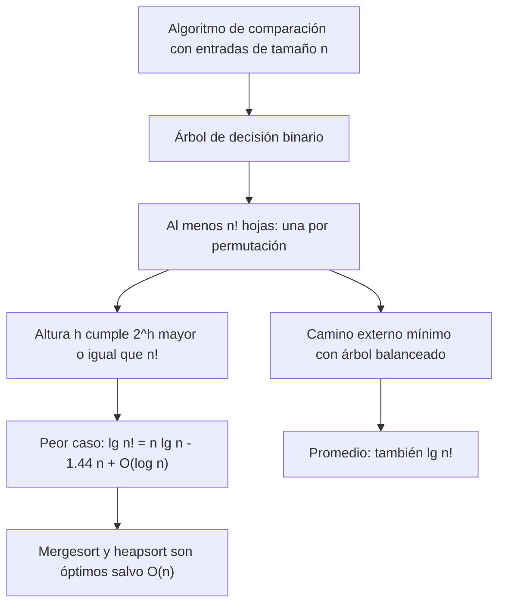

# Análisis de Algoritmos - Algoritmos que involucran secuencias y conjuntos

## 3.5 Cota mínima de ordenamiento.

---

Mergesort y heapsort ordenan con $O(n \log n)$ comparaciones. ¿Se puede hacer mejor? Para responder hay que demostrar algo sobre **todos** los algoritmos posibles, incluidos los que nadie ha inventado. La herramienta es el **árbol de decisión**, que modela cualquier algoritmo de ordenamiento por comparación, y el resultado es que $\Omega(n \log n)$ comparaciones son inevitables, tanto en el peor caso como en promedio. Este tema demuestra ambas cotas, calcula la constante exacta con la fórmula de Stirling, la compara con los algoritmos conocidos y explica por qué los ordenamientos lineales del tema 3.4 no la contradicen.

### El modelo de comparación

Un algoritmo de **ordenamiento por comparación** obtiene información de la entrada únicamente comparando pares de elementos: $a_i \lt a_j,$ $a_i \leq a_j,$ etc. Puede mover y copiar elementos, pero no examinar su valor (por ejemplo, usarlo como índice). Inserción, selección, mergesort, heapsort y quicksort son de este tipo; conteo y radix no.

Se supone que los elementos son distintos, lo que solo puede facilitar el problema, así que cada entrada corresponde a una de las $n!$ permutaciones y una comparación tiene dos resultados posibles.

### Árboles de decisión

Fijado $n,$ el comportamiento de un algoritmo de comparación es un **árbol binario**:

- cada nodo interno es una comparación $a_i : a_j;$
- sus dos hijos son lo que el algoritmo hace según el resultado;
- cada hoja es una permutación de salida, el orden que el algoritmo declara.

La ejecución con una entrada concreta es un camino de la raíz a una hoja, y el número de comparaciones es la longitud de ese camino. El **peor caso** del algoritmo es la **altura** del árbol, y el promedio sobre las $n!$ entradas es la **longitud media** de los caminos a las hojas.

### Cota inferior en el peor caso

**Teorema.** Todo algoritmo de ordenamiento por comparación hace al menos $\lceil \log_2 n! \rceil = \Omega(n \log n)$ comparaciones en el peor caso.

**Demostración.** Si el algoritmo es correcto, cada una de las $n!$ permutaciones de entrada debe llegar a una hoja distinta: dos entradas que llegan a la misma hoja reciben la misma reordenación, que no puede ordenar a ambas. Así, el árbol tiene al menos $n!$ hojas. Un árbol binario de altura $h$ tiene a lo sumo $2^h$ hojas, de modo que $2^h \geq n!$ y $h \geq \log_2 n!.$ Finalmente,

$$\log_2 n! = \sum_{i=1}^{n} \log_2 i \geq \sum_{i=\lceil n/2 \rceil}^{n} \log_2 \frac{n}{2} \geq \frac{n}{2} \log_2 \frac{n}{2} = \Omega(n \log n). \qquad \blacksquare$$

**Constante exacta.** Por la fórmula de Stirling, $n! = \sqrt{2\pi n} \, (n/e)^n (1 + O(1/n)),$ así que

$$\log_2 n! = n \log_2 n - n \log_2 e + \tfrac{1}{2} \log_2 (2 \pi n) + O(1/n) \approx n \log_2 n - 1.443 \, n.$$

Mergesort hace a lo sumo $n \lceil \log_2 n \rceil - 2^{\lceil \log_2 n \rceil} + 1$ comparaciones, y esa cantidad nunca supera $n \log_2 n - 0.91 n + 1:$ está a $O(n)$ de la cota, así que es **asintóticamente óptimo**, igual que heapsort. Quicksort lo es en promedio.

### Cota inferior en el caso promedio

**Teorema.** Todo algoritmo de ordenamiento por comparación hace en promedio al menos $\log_2 n!$ comparaciones, si las $n!$ entradas son igualmente probables.

**Demostración.** Hay que mostrar que un árbol binario con $L$ hojas tiene **longitud de camino externo**, la suma de las profundidades de las hojas, $E \geq L \log_2 L.$ Basta considerar árboles en los que todo nodo interno tiene dos hijos, porque un nodo con un solo hijo se puede eliminar y acorta los caminos. Por inducción sobre $L:$ con $L = 1,$ $E = 0.$ Si la raíz tiene subárboles con $k$ y $L - k$ hojas, $E = E_1 + E_2 + L \geq k \log_2 k + (L - k) \log_2 (L - k) + L.$ La función $x \log_2 x$ es convexa, así que la suma se minimiza con $k = L/2:$ $E \geq 2 \cdot \frac{L}{2} \log_2 \frac{L}{2} + L = L \log_2 L.$ Con $L \geq n!$ hojas, la profundidad media es $E/L \geq \log_2 L \geq \log_2 n!.$ $\blacksquare$

El mismo argumento vale para algoritmos aleatorios: un algoritmo aleatorio es una distribución sobre árboles de decisión, y cada uno de ellos cumple la cota.

### Cómo superar la cota

La cota solo afecta al modelo de comparación. Si las claves tienen estructura que se puede explotar con otras operaciones, por ejemplo usarlas como índices, se ordena más rápido:

- **Conteo:** claves enteras en $[0, k];$ $\Theta(n + k),$ lineal si $k = O(n).$
- **Radix:** claves de $d$ dígitos en base $b;$ $\Theta(d(n + b)),$ lineal si $d$ es constante y $b = O(n).$ Enteros de $w$ bits con $b = n$ dan $\Theta(n \cdot w/\log n).$
- **Cubetas:** claves reales con distribución conocida; $\Theta(n)$ **esperado**.

En la word-RAM se conocen algoritmos para enteros en $O(n \log \log n)$ (Han, 2002) que no contradicen nada: no son de comparación.



### Implementación en Python

El programa construye el árbol de decisión de la inserción con 3 elementos registrando las comparaciones que hace con cada permutación (ejercicio 2), calcula $\log_2 10!$ y sus aproximaciones (ejercicio 3), compara la cota $\lceil \log_2 n! \rceil$ con el mínimo de comparaciones conocido y con el peor caso de la inserción binaria y de mergesort, calcula la mínima profundidad media de un árbol con $n!$ hojas (ejercicio 6) y cuenta las comparaciones para encontrar el mínimo, y el mínimo y el máximo juntos (ejercicio 7).

```python
import math, random
from itertools import permutations

# --- Ejercicio 2: árbol de decisión de la inserción con 3 elementos ---
def insercion_traza(perm):
    """Ordena índices simbólicos; registra las comparaciones a:b y su resultado."""
    A, traza = ["a", "b", "c"], []
    val = dict(zip("abc", perm))
    for i in range(1, 3):
        x, j = A[i], i - 1
        while j >= 0:
            menor = val[x] < val[A[j]]
            traza.append(f"{x}<{A[j]}" if menor else f"{x}>{A[j]}")
            if not menor:
                break
            A[j + 1] = A[j]; j -= 1
        A[j + 1] = x
    return tuple(traza), "".join(A)

hojas = {}
for p in permutations((1, 2, 3)):
    t, orden = insercion_traza(p)
    hojas[t] = orden
print("ejercicio 2: hojas del árbol de decisión de la inserción (n = 3)")
for t, orden in sorted(hojas.items(), key=lambda x: len(x[0])):
    print(f"   {' -> '.join(t):18} => {orden}")
print(f"   {len(hojas)} hojas, altura {max(map(len, hojas))}, cota lg 3! = {math.log2(6):.3f},"
      f" longitud media de camino {sum(map(len, hojas)) / len(hojas):.3f}")

# --- Ejercicio 3: lg(10!) ---
n = 10
exacto = math.log2(math.factorial(n))
aprox1 = n * math.log2(n) - n * math.log2(math.e)
stirling = aprox1 + 0.5 * math.log2(2 * math.pi * n)
print(f"ejercicio 3: 10! = {math.factorial(n)}, lg 10! = {exacto:.4f}, techo {math.ceil(exacto)}")
print(f"   n lg n - n lg e = {aprox1:.4f} (error {exacto - aprox1:.4f});"
      f" con el término 1/2 lg(2 pi n): {stirling:.4f}")

# --- comparaciones mínimas conocidas frente a la cota y a algoritmos ---
def merge_comps(A):
    if len(A) <= 1: return A, 0
    m = len(A) // 2
    (I, c1), (D, c2) = merge_comps(A[:m]), merge_comps(A[m:])
    R, i, j, c = [], 0, 0, c1 + c2
    while i < len(I) and j < len(D):
        c += 1
        if D[j] < I[i]: R.append(D[j]); j += 1
        else: R.append(I[i]); i += 1
    return R + I[i:] + D[j:], c

def binaria_insercion_peor(n):
    return sum(math.ceil(math.log2(i + 1)) for i in range(1, n))

def peor_mergesort(n):
    if n <= 6:
        return max(merge_comps(list(p))[1] for p in permutations(range(n)))
    return None

optimo = {1: 0, 2: 1, 3: 3, 4: 5, 5: 7, 6: 10, 7: 13, 8: 16, 9: 19, 10: 22, 11: 26, 12: 30}
print("   n  ceil(lg n!)  óptimo conocido  inserción binaria  mergesort")
for k in range(1, 13):
    pm = peor_mergesort(k)
    if pm is None:
        pm = k * math.ceil(math.log2(k)) - 2 ** math.ceil(math.log2(k)) + 1   # fórmula exacta
    print(f"  {k:2}  {math.ceil(math.log2(math.factorial(k))):11}  {optimo[k]:15}"
          f"  {binaria_insercion_peor(k):17}  {pm:9}")

# --- Ejercicio 6: caso promedio, longitud de camino externo mínima ---
def lce_minima(hojas):
    """Árbol binario con L hojas lo más balanceado posible."""
    d = math.floor(math.log2(hojas))
    extra = hojas - 2 ** d               # hojas que bajan un nivel más
    return (hojas - 2 * extra) * d + 2 * extra * (d + 1)

for k in (3, 5, 10, 15):
    L = math.factorial(k)
    print(f"ejercicio 6: n = {k:2}: promedio mínimo {lce_minima(L) / L:7.3f} >= lg n! = {math.log2(L):7.3f}")

# --- Ejercicio 7: mínimo y k-ésimo ---
def minimo_comps(A):
    m, c = A[0], 0
    for x in A[1:]:
        c += 1
        if x < m: m = x
    return m, c

def min_y_max(A):
    """3 floor(n/2) comparaciones: por parejas."""
    c = 0
    if len(A) % 2:
        mn = mx = A[0]; i = 1
    else:
        c += 1
        mn, mx = (A[0], A[1]) if A[0] < A[1] else (A[1], A[0]); i = 2
    while i < len(A):
        a, b = A[i], A[i + 1]
        c += 1
        if b < a: a, b = b, a
        c += 2
        if a < mn: mn = a
        if b > mx: mx = b
        i += 2
    return mn, mx, c

random.seed(35)
for n in (10, 1000):
    A = random.sample(range(10 * n), n)
    print(f"ejercicio 7: n = {n:4}: mínimo con {minimo_comps(A)[1]} comparaciones (n - 1);"
          f" mínimo y máximo con {min_y_max(A)[2]} = ceil(3n/2) - 2 = {math.ceil(3 * n / 2) - 2}")
```

Salida:

```text
ejercicio 2: hojas del árbol de decisión de la inserción (n = 3)
   b>a -> c>b         => abc
   b<a -> c>a         => bac
   b>a -> c<b -> c>a  => acb
   b>a -> c<b -> c<a  => cab
   b<a -> c<a -> c>b  => bca
   b<a -> c<a -> c<b  => cba
   6 hojas, altura 3, cota lg 3! = 2.585, longitud media de camino 2.667
ejercicio 3: 10! = 3628800, lg 10! = 21.7911, techo 22
   n lg n - n lg e = 18.7923 (error 2.9987); con el término 1/2 lg(2 pi n): 21.7790
   n  ceil(lg n!)  óptimo conocido  inserción binaria  mergesort
   1            0                0                  0          0
   2            1                1                  1          1
   3            3                3                  3          3
   4            5                5                  5          5
   5            7                7                  8          8
   6           10               10                 11         11
   7           13               13                 14         14
   8           16               16                 17         17
   9           19               19                 21         21
  10           22               22                 25         25
  11           26               26                 29         29
  12           29               30                 33         33
ejercicio 6: n =  3: promedio mínimo   2.667 >= lg n! =   2.585
ejercicio 6: n =  5: promedio mínimo   6.933 >= lg n! =   6.907
ejercicio 6: n = 10: promedio mínimo  21.844 >= lg n! =  21.791
ejercicio 6: n = 15: promedio mínimo  40.318 >= lg n! =  40.250
ejercicio 7: n =   10: mínimo con 9 comparaciones (n - 1); mínimo y máximo con 13 = ceil(3n/2) - 2 = 13
ejercicio 7: n = 1000: mínimo con 999 comparaciones (n - 1); mínimo y máximo con 1498 = ceil(3n/2) - 2 = 1498
```

La cota $\lceil \log_2 n! \rceil$ no siempre se alcanza: para $n = 12$ es 29, pero se demostró por búsqueda exhaustiva que hacen falta 30 (Wells, 1965). El algoritmo de **inserción por fusión** de Ford y Johnson (1959) alcanza el óptimo para todo $n \leq 11.$

### Ejercicios Propuestos

1. **Demostración.** Demuestra que todo algoritmo de ordenamiento por comparación requiere $\Omega(n \log n)$ comparaciones en el peor caso.

2. **Árbol de decisión.** Construye el árbol de decisión de un algoritmo que ordene 3 elementos y verifica que tiene al menos 6 hojas.

3. **Cálculo.** Calcula $\log_2 10!$ y compáralo con la aproximación $n \log_2 n - n \log_2 e.$

4. **Algoritmos no óptimos.** ¿Por qué la inserción y la burbuja no alcanzan la cota en el peor caso?

5. **Algoritmos lineales.** ¿Bajo qué condiciones el ordenamiento por conteo y el radix superan la cota $n \log n?$

6. **Caso promedio.** Demuestra que el número esperado de comparaciones también es $\Omega(n \log n).$

7. **Selección.** ¿Cuál es la cota inferior para encontrar solo el k-ésimo menor elemento?

### Soluciones

**Ejercicio 1.** Es el teorema de la cota en el peor caso.

**Ejercicio 2.** El árbol de la inserción con 3 elementos, según lo traza el programa: la raíz compara b con a; en cada rama se compara c con el mayor de los dos y, si hace falta, con el menor. Tiene exactamente $3! = 6$ hojas, una por permutación, altura 3, que es $\lceil \log_2 6 \rceil,$ y profundidad media $16/6 \approx 2.67.$ Es óptimo: un árbol de altura 2 tendría a lo sumo 4 hojas, y la profundidad media mínima con 6 hojas es también $16/6.$

**Ejercicio 3.** $10! = 3\,628\,800$ y $\log_2 10! \approx 21.79,$ así que hacen falta al menos 22 comparaciones. La aproximación $n \log_2 n - n \log_2 e \approx 18.79$ se queda corta por casi 3, porque omite el término $\frac{1}{2} \log_2 (2 \pi n) \approx 2.99;$ con él, $21.78,$ un error de $0.01.$

**Ejercicio 4.** Ambas comparan y mueven solo elementos **adyacentes**, y un intercambio de adyacentes elimina exactamente una inversión. La entrada en orden inverso tiene $n(n - 1)/2$ inversiones, así que hacen $\Theta(n^2)$ intercambios y comparaciones. El defecto no es el número de comparaciones de una inserción, que la inserción binaria reduce a $\lceil \log_2 (i + 1) \rceil,$ sino el desaprovechamiento de la información: comparar elementos vecinos casi nunca divide a la mitad el conjunto de permutaciones compatibles. La inserción binaria sí hace $O(n \log n)$ comparaciones, como muestra la tabla, pero sigue haciendo $\Theta(n^2)$ desplazamientos.

**Ejercicio 5.** Cuando las claves son enteros, o cadenas de longitud acotada, que se pueden usar como índices. Conteo: si el rango es $k = O(n),$ cuesta $O(n).$ Radix: si las claves tienen $d = O(1)$ dígitos en base $b = O(n),$ es decir, son enteros polinomiales en $n,$ cuesta $O(n).$ Si las claves son de $n^{\log n}$ o más, el número de dígitos crece y la ventaja se pierde.

**Ejercicio 6.** Es el teorema del caso promedio. El programa calcula la profundidad media mínima de un árbol con $n!$ hojas y confirma que siempre es al menos $\log_2 n!.$

**Ejercicio 7.** Para el **mínimo**, $n - 1$ comparaciones son necesarias y suficientes: cada elemento que no es el mínimo debe perder al menos una comparación, y una comparación tiene un solo perdedor. Para el **mínimo y el máximo** a la vez, $\lceil 3n/2 \rceil - 2,$ procesando por parejas: comparar los dos elementos de la pareja, el menor con el mínimo y el mayor con el máximo. Para el **k-ésimo** en general, el árbol de decisión solo da $\log_2 n$ porque hay $n$ respuestas posibles, una cota débil; con un argumento de adversario, todo algoritmo necesita al menos $n - 1$ comparaciones, porque para certificar el k-ésimo cada uno de los demás elementos debe compararse directa o indirectamente con él, y para la mediana se sabe que hacen falta al menos $(2 + \epsilon) n$ y bastan $2.95 n$ (Dor y Zwick). El algoritmo de la mediana de medianas logra $O(n),$ así que la selección es $\Theta(n),$ estrictamente más fácil que ordenar.

### Referencias

1. Cormen, T. H., Leiserson, C. E., Rivest, R. L., and Stein, C., _Introduction to Algorithms_. MIT Press, 2022. Secciones 8.1 y 9.1.
2. Knuth, D. E., _The Art of Computer Programming, Vol. 3: Sorting and Searching_. Addison-Wesley, 1998. Sección 5.3.1.
3. Ford, L. R., and Johnson, S. M., A tournament problem. _The American Mathematical Monthly_ 66(5), 1959.
4. Dor, D., and Zwick, U., Selecting the median. _SIAM Journal on Computing_ 28(5), 1999.
