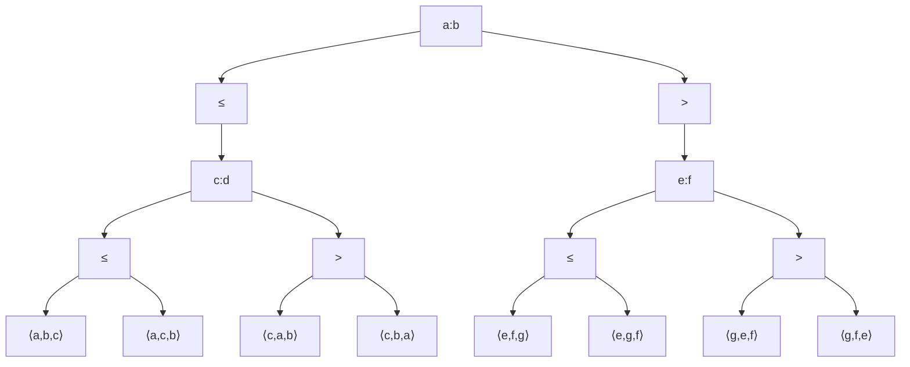

# Análisis de Algoritmos - Algoritmos que involucran secuencias y conjuntos

## 3.5 Cota mínima de ordenamiento.

---

El estudio de la cota mínima de ordenamiento establece el límite teórico inferior para la complejidad de cualquier algoritmo de ordenamiento por comparación. Según Cormen et al. (2009), "cualquier algoritmo de ordenamiento por comparación requiere $\Omega(n \log n)$ comparaciones en el peor caso para ordenar $n$ elementos".

### Teorema Fundamental del Ordenamiento por Comparación

#### Enunciado Formal

Para cualquier algoritmo de ordenamiento por comparación que ordene una secuencia de $n$ elementos distintos, el número de comparaciones en el peor caso es al menos:

$$\Omega(n \log n)$$

#### Demostración mediante Árboles de Decisión



**Argumento de la demostración**:

1. Cada algoritmo de ordenamiento por comparación corresponde a un árbol de decisión
2. El árbol debe tener al menos $n!$ hojas (una por cada permutación posible)
3. La altura $h$ del árbol satisface: $2^h \geq n!$
4. Aplicando logaritmos: $h \geq \log_2(n!)$
5. Por la aproximación de Stirling: $n! \sim \sqrt{2\pi n}\left(\frac{n}{e}\right)^n$
6. Por tanto: $h \geq \log_2(n!) = \Omega(n \log n)$

#### Aproximación de Stirling

$$n! = \sqrt{2\pi n}\left(\frac{n}{e}\right)^n \left(1 + \Theta\left(\frac{1}{n}\right)\right)$$

$$\log_2(n!) = n\log_2 n - n\log_2 e + \frac{1}{2}\log_2(2\pi n) + O\left(\frac{1}{n}\right)$$

$$\log_2(n!) = \Theta(n \log n)$$

### Consecuencias del Teorema

#### Límite Inferior para Algoritmos de Ordenamiento

| Tipo de Algoritmo  | Cota Inferior      | Algoritmos que la alcanzan |
| ------------------ | ------------------ | -------------------------- |
| Por comparación    | $\Omega(n \log n)$ | Merge Sort, Heap Sort      |
| No por comparación | $\Omega(n)$        | Counting Sort, Radix Sort  |

#### Implicaciones Prácticas

1. **Merge Sort y Heap Sort son óptimos** en el sentido de la cota inferior
2. **Quick Sort no es óptimo** en el peor caso $(O(n^2))$
3. Los algoritmos lineales **requieren suposiciones adicionales** sobre los datos

### Algoritmos que Alcanzan la Cota Óptima

#### Merge Sort

```python
def merge_sort(arr):
    """
    Merge Sort - Θ(n log n) en todos los casos
    Alcanza la cota inferior para ordenamiento por comparación
    """
    if len(arr) <= 1:
        return arr

    mid = len(arr) // 2
    left = merge_sort(arr[:mid])
    right = merge_sort(arr[mid:])

    return merge(left, right)

def merge(left, right):
    result = []
    i = j = 0

    while i < len(left) and j < len(right):
        if left[i] <= right[j]:
            result.append(left[i])
            i += 1
        else:
            result.append(right[j])
            j += 1

    result.extend(left[i:])
    result.extend(right[j:])
    return result
```

**Ecuación de recurrencia**:

$$T(n) = 2T\left(\frac{n}{2}\right) + \Theta(n)$$

**Solución**: $T(n) = \Theta(n \log n)$

#### Heap Sort

```python
def heap_sort(arr):
    """
    Heap Sort - Θ(n log n) en todos los casos
    Alcanza la cota inferior para ordenamiento por comparación
    """
    n = len(arr)

    # Build max heap - O(n)
    for i in range(n // 2 - 1, -1, -1):
        heapify(arr, n, i)

    # Extract elements - O(n log n)
    for i in range(n - 1, 0, -1):
        arr[0], arr[i] = arr[i], arr[0]
        heapify(arr, i, 0)

def heapify(arr, n, i):
    largest = i
    left = 2 * i + 1
    right = 2 * i + 2

    if left < n and arr[left] > arr[largest]:
        largest = left

    if right < n and arr[right] > arr[largest]:
        largest = right

    if largest != i:
        arr[i], arr[largest] = arr[largest], arr[i]
        heapify(arr, n, largest)
```

### Algoritmos que Superan la Cota bajo Supuestos Especiales

#### Counting Sort

```python
def counting_sort(arr, k):
    """
    Counting Sort - O(n + k)
    Supera la cota n log n cuando k = O(n)
    """
    count = [0] * (k + 1)
    output = [0] * len(arr)

    # Count occurrences - O(n)
    for num in arr:
        count[num] += 1

    # Cumulative sum - O(k)
    for i in range(1, k + 1):
        count[i] += count[i - 1]

    # Build output - O(n)
    for i in range(len(arr) - 1, -1, -1):
        output[count[arr[i]] - 1] = arr[i]
        count[arr[i]] -= 1

    return output
```

#### Radix Sort

```python
def radix_sort(arr, d):
    """
    Radix Sort - O(d(n + k))
    Supera la cota cuando d es constante y k = O(n)
    """
    for exp in range(1, d + 1):
        counting_sort_by_digit(arr, exp)

def counting_sort_by_digit(arr, exp):
    n = len(arr)
    output = [0] * n
    count = [0] * 10

    # Count occurrences of each digit - O(n)
    for i in range(n):
        digit = (arr[i] // exp) % 10
        count[digit] += 1

    # Cumulative sum - O(10) = O(1)
    for i in range(1, 10):
        count[i] += count[i - 1]

    # Build output - O(n)
    for i in range(n - 1, -1, -1):
        digit = (arr[i] // exp) % 10
        output[count[digit] - 1] = arr[i]
        count[digit] -= 1

    # Copy back - O(n)
    for i in range(n):
        arr[i] = output[i]
```

### Análisis de la Cota Inferior

#### Demostración Rigurosa usando Árboles de Decisión

Sea $A$ un algoritmo de ordenamiento por comparación. Definimos:

1. **Árbol de decisión**: Representa todas las comparaciones posibles
2. **Camino**: Secuencia de comparaciones para una entrada específica
3. **Hoja**: Permutación ordenada resultante

**Lema**: La altura $h$ del árbol satisface $2^h \geq n!$

**Prueba**:

- Hay $n!$ permutaciones posibles
- Cada hoja corresponde al menos a una permutación
- Un árbol binario de altura $h$ tiene como máximo $2^h$ hojas
- Por tanto: $2^h \geq n!$

#### Cálculo de la Cota Inferior

$$h \geq \log_2(n!) = \sum_{i=1}^n \log_2 i = \Theta(n \log n)$$

**Límite inferior más ajustado**:

$$\log_2(n!) \geq n\log_2 n - n\log_2 e$$

$$\log_2(n!) \geq n\log_2 n - 1.443n$$

### Ejercicios Propuestos

#### Ejercicio 1: Demostración Formal

Demuestre formalmente que cualquier algoritmo de ordenamiento por comparación requiere $\Omega(n \log n)$ comparaciones en el peor caso.

#### Ejercicio 2: Árbol de Decisión

Construya el árbol de decisión completo para ordenar 3 elementos y verifique que tiene al menos 6 hojas.

#### Ejercicio 3: Cálculo de log(n!)

Calcule $\log_2(10!)$ exactamente y compare con la aproximación $n\log_2 n - n\log_2 e$.

#### Ejercicio 4: Algoritmos No Óptimos

¿Por qué Insertion Sort y Bubble Sort no alcanzan la cota óptima en el peor caso?

#### Ejercicio 5: Condiciones para Algoritmos Lineales

¿Bajo qué condiciones Counting Sort y Radix Sort superan la cota $n \log n$?

#### Ejercicio 6: Límite Inferior para Caso Promedio

Demuestre que el número esperado de comparaciones también es $\Omega(n \log n)$.

#### Ejercicio 7: Ordenamiento Parcial

¿Cuál es la cota inferior para encontrar solo el k-ésimo elemento más pequeño?

### Soluciones Sugeridas

#### Ejercicio 2: Árbol para 3 Elementos

Para ordenar 3 elementos distintos $(a, b, c)$:

- Número de hojas: $3! = 6$
- Altura mínima: $\lceil \log_2 6 \rceil = 3$

#### Ejercicio 3: Cálculo de log(10!)

$$10! = 3,628,800$$
$$\log_2(10!) = \log_2(3628800) \approx 21.79$$
$$n\log_2 n - n\log_2 e = 10\log_2 10 - 10\log_2 e \approx 33.22 - 14.43 = 18.79$$

#### Ejercicio 7: Selección del k-ésimo Elemento

Para encontrar el k-ésimo elemento:

- Cota inferior: $\Omega(n)$
- Algoritmo óptimo: QuickSelect con tiempo esperado $O(n)$

### Aplicaciones e Implicaciones

#### Diseño de Algoritmos Óptimos

- Merge Sort y Heap Sort son óptimos para ordenamiento general
- Para casos especiales, usar algoritmos lineales

#### Análisis de Algoritmos Existentes

```python
# Quick Sort no es óptimo en el peor caso
def quick_sort_worst_case(n):
    """
    Genera entrada del peor caso para Quick Sort
    """
    return sorted(list(range(n)))  # Ya ordenado
```

#### Selección de Algoritmos en la Práctica

| Escenario                | Algoritmo Recomendado | Razón                    |
| ------------------------ | --------------------- | ------------------------ |
| Datos generales          | TimSort (híbrido)     | Buen desempeño promedio  |
| Memoria limitada         | Heap Sort             | $O(1)$ espacio adicional |
| Datos casi ordenados     | Insertion Sort        | $O(n)$ en mejor caso     |
| Enteros en rango pequeño | Counting Sort         | $O(n + k)$               |
| Números con dígitos      | Radix Sort            | $O(d(n + k))$            |

### Extensiones del Teorema

#### Ordenamiento con Información Parcial

Si se conoce que los datos están casi ordenados, algunos algoritmos pueden superar la cota:

- Insertion Sort: $O(nk)$ si cada elemento está a lo sumo $k$ posiciones de su lugar correcto

#### Ordenamiento Paralelo

En modelos de computación paralela:

- **Ordenamiento por comparación**: $\Omega\left(\frac{n \log n}{p}\right)$ donde $p$ es el número de procesadores
- **Ordenamiento no por comparación**: Puede ser más eficiente

### Referencias

1. Cormen, T. H., Leiserson, C. E., Rivest, R. L., & Stein, C. (2009). Introduction to Algorithms (3rd ed.). MIT Press. (Capítulo 8)
2. Kleinberg, J., & Tardos, É. (2005). Algorithm Design. Addison Wesley. (Capítulo 13)
3. Knuth, D. E. (1998). The Art of Computer Programming, Volume 3: Sorting and Searching. Addison-Wesley.

### Recursos Adicionales

- Visualizaciones de árboles de decisión: https://www.cs.usfca.edu/~galles/visualization/ComparisonSort.html
- Demostraciones interactivas de la cota inferior
- Implementaciones de algoritmos óptimos en diferentes lenguajes
