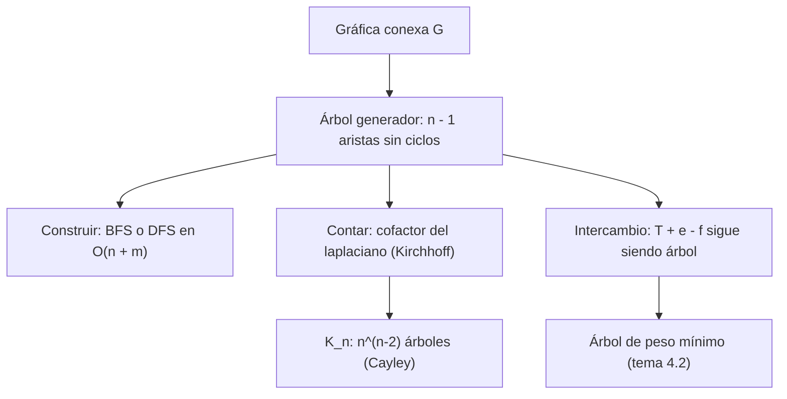

# Análisis de Algoritmos - Algoritmos para teoría de gráficas

## 4.1 Árboles generadores.

---

Un **árbol generador** de una gráfica conexa es un subconjunto de sus aristas que conecta todos los vértices sin formar ciclos: el esqueleto mínimo que mantiene la gráfica conectada. Aparecen al diseñar redes (cableado, tuberías, rutas), al recorrer gráficas (los recorridos en amplitud y en profundidad construyen uno) y como subrutina de algoritmos de aproximación (tema 5.4). Este tema demuestra sus propiedades básicas, muestra cómo construirlos con BFS y DFS, cuenta cuántos tiene una gráfica con el teorema de la matriz y el árbol de Kirchhoff y la fórmula de Cayley, y prepara el problema del árbol generador de peso mínimo (tema 4.2).

### Definiciones y propiedades

Sea $G = (V, E)$ una gráfica no dirigida conexa con $n$ vértices y $m$ aristas. Un **árbol** es una gráfica conexa y acíclica; un **árbol generador** de $G$ es un subgrafo $T = (V, E_T)$ con $E_T \subseteq E$ que es un árbol.

**Teorema.** Para una gráfica $T$ con $n$ vértices, son equivalentes:

1. $T$ es conexa y acíclica;
2. $T$ es conexa y tiene $n - 1$ aristas;
3. $T$ es acíclica y tiene $n - 1$ aristas;
4. entre cada par de vértices hay exactamente un camino;
5. $T$ es acíclica, y agregar cualquier arista crea exactamente un ciclo;
6. $T$ es conexa, y quitar cualquier arista la desconecta.

**Idea de la demostración.** La clave es contar componentes: empezando con $n$ vértices aislados, que son $n$ componentes, agregar una arista entre dos componentes distintas reduce su número en 1 sin crear ciclos, y agregarla dentro de una componente crea un ciclo sin reducirlo. Una gráfica acíclica con $k$ aristas tiene entonces $n - k$ componentes: es conexa si y solo si $k = n - 1.$ El resto de las equivalencias se sigue de que dos caminos distintos entre los mismos vértices forman un ciclo.

**Consecuencias para los algoritmos.**

- Toda gráfica conexa tiene un árbol generador: quitar aristas de ciclos mientras haya ciclos.
- **Intercambio:** si $T$ es un árbol generador y $e \notin T,$ entonces $T + e$ tiene un único ciclo $C,$ y para toda $f \in C,$ $T + e - f$ es otro árbol generador. Es la base de los argumentos de optimalidad del tema 4.2.
- **Corte:** quitar una arista $f$ de $T$ divide a $V$ en dos lados; cualquier arista $e$ de $G$ que cruce ese corte reconecta: $T - f + e$ es un árbol generador.

### Construcción por recorridos

Un recorrido desde un vértice $s$ que registra, para cada vértice descubierto, la arista por la que se le descubrió produce un árbol generador, porque cada vértice salvo $s$ recibe exactamente una arista que lo une a uno ya descubierto. Ambos cuestan $O(n + m).$

- **Árbol BFS:** el camino en el árbol de $s$ a cada $v$ es un camino más corto en número de aristas. Las aristas que no están en el árbol unen vértices de niveles iguales o consecutivos.
- **Árbol DFS:** toda arista que no está en el árbol une un vértice con un **ancestro** suyo (no hay aristas cruzadas en gráficas no dirigidas). Sirve para encontrar puentes, puntos de articulación y componentes biconexas.

### Contar árboles generadores

Sea $\tau(G)$ el número de árboles generadores de $G.$ El **laplaciano** es la matriz $L = D - A,$ donde $D$ es la diagonal de los grados y $A$ la matriz de adyacencia.

**Teorema de la matriz y el árbol** (Kirchhoff, 1847). $\tau(G)$ es igual a cualquier cofactor de $L:$ el determinante de la matriz que resulta de quitar una fila $i$ y la columna $i.$

Se calcula en $O(n^3)$ con eliminación gaussiana, aunque $\tau(G)$ puede ser exponencial. Para la gráfica completa $K_n,$ el cofactor da la **fórmula de Cayley** (1889): $\tau(K_n) = n^{n-2}.$ Una demostración combinatoria de Cayley es la **codificación de Prüfer**, una biyección entre los árboles con vértices $1, \ldots, n$ y las secuencias de longitud $n - 2$ con valores en $\{1, \ldots, n\}.$



### Implementación en Python

El programa enumera los árboles generadores del triángulo (ejercicio 1), construye árboles BFS y DFS, cuenta los árboles generadores por fuerza bruta y con el teorema de Kirchhoff (con aritmética racional exacta), comprueba la fórmula de Cayley y pone a prueba la cota del ejercicio 3. Después compara Prim con un arreglo y con un montículo en gráficas dispersas y densas (ejercicio 2) y encuentra el segundo mejor árbol generador quitando cada arista del mínimo, verificado contra la enumeración de todos los árboles (ejercicio 4).

```python
import heapq, math, random
from collections import deque
from fractions import Fraction
from itertools import combinations

random.seed(41)

def es_arbol_generador(n, aristas):
    """n - 1 aristas sin ciclos (conjuntos disjuntos)."""
    if len(aristas) != n - 1:
        return False
    padre = list(range(n))
    def raiz(x):
        while padre[x] != x:
            padre[x] = padre[padre[x]]; x = padre[x]
        return x
    for u, v, *_ in aristas:
        ru, rv = raiz(u), raiz(v)
        if ru == rv:
            return False
        padre[ru] = rv
    return True

def arboles_fuerza_bruta(n, E):
    return [T for T in combinations(E, n - 1) if es_arbol_generador(n, T)]

def kirchhoff(n, E):
    """Teorema de la matriz y el árbol: un cofactor del laplaciano."""
    L = [[Fraction(0)] * n for _ in range(n)]
    for u, v, *_ in E:
        L[u][u] += 1; L[v][v] += 1; L[u][v] -= 1; L[v][u] -= 1
    M = [fila[1:] for fila in L[1:]]          # quitar fila y columna 0
    det, k = Fraction(1), n - 1
    for c in range(k):                        # eliminación gaussiana exacta
        p = next((f for f in range(c, k) if M[f][c] != 0), None)
        if p is None:
            return 0
        if p != c:
            M[c], M[p] = M[p], M[c]; det = -det
        det *= M[c][c]
        for f in range(c + 1, k):
            r = M[f][c] / M[c][c]
            for j in range(c, k):
                M[f][j] -= r * M[c][j]
    return int(det)

# --- Ejercicio 1: el triángulo ---
nombres = "ABC"
T3 = [(0, 1), (0, 2), (1, 2)]
print("ejercicio 1:", [[nombres[u] + nombres[v] for u, v in T] for T in arboles_fuerza_bruta(3, T3)])

# --- árboles BFS y DFS ---
def arbol_bfs(n, ady, s=0):
    padre, cola = {s: None}, deque([s])
    while cola:
        u = cola.popleft()
        for v in ady[u]:
            if v not in padre:
                padre[v] = u; cola.append(v)
    return [(padre[v], v) for v in padre if padre[v] is not None]

def arbol_dfs(n, ady, s=0):
    padre, pila, vistos = {}, [(s, None)], set()
    while pila:
        u, p = pila.pop()
        if u in vistos:
            continue
        vistos.add(u)
        if p is not None:
            padre[u] = p
        for v in reversed(ady[u]):
            if v not in vistos:
                pila.append((v, u))
    return [(padre[v], v) for v in padre]

n = 6
E = [(0, 1), (0, 2), (1, 2), (1, 3), (2, 4), (3, 4), (3, 5), (4, 5)]
ady = [[] for _ in range(n)]
for u, v in E:
    ady[u].append(v); ady[v].append(u)
print("árbol BFS:", arbol_bfs(n, ady), "| árbol DFS:", arbol_dfs(n, ady))
print("   son árboles generadores:", es_arbol_generador(n, arbol_bfs(n, ady)), es_arbol_generador(n, arbol_dfs(n, ady)))
print("   número de árboles generadores: fuerza bruta", len(arboles_fuerza_bruta(n, E)), "| Kirchhoff", kirchhoff(n, E))
print("   Cayley, K_n tiene n^(n-2):", [(k, kirchhoff(k, list(combinations(range(k), 2))), k ** (k - 2)) for k in range(2, 8)])

# --- Ejercicio 3: cotas para el número de árboles generadores ---
print("ejercicio 3: n, m, tau, C(m,n-1)/n, C(m,n-1), (1/n)(2m/(n-1))^(n-1)")
casos = [("K3", 3, T3), ("gráfica de arriba", n, E), ("K5", 5, list(combinations(range(5), 2)))]
for _ in range(3):
    k = random.randint(5, 8)
    G = [e for e in combinations(range(k), 2) if random.random() < 0.6]
    if kirchhoff(k, G):
        casos.append((f"aleatoria", k, G))
viola = 0
for nombre, k, G in casos:
    m, tau = len(G), kirchhoff(k, G)
    c = math.comb(m, k - 1)
    grim = (2 * m / (k - 1)) ** (k - 1) / k
    viola += tau > c / k
    print(f"   {nombre:18} n={k} m={m:2} tau={tau:5} {c / k:9.1f} {c:7} {grim:10.1f}")
print("   casos que violan tau <= C(m,n-1)/n:", viola)

# --- Ejercicio 2: Prim con arreglo y con montículo binario ---
def prim_arreglo(n, W):
    dentro, clave, ops = [False] * n, [math.inf] * n, 0
    clave[0], total = 0, 0
    for _ in range(n):
        u = min((v for v in range(n) if not dentro[v]), key=lambda v: clave[v])
        ops += n
        dentro[u] = True; total += clave[u]
        for v, w in W[u]:
            ops += 1
            if not dentro[v] and w < clave[v]:
                clave[v] = w
    return total, ops

def prim_monticulo(n, W):
    dentro, total, ops = [False] * n, 0, 0
    H = [(0, 0)]
    while H:
        w, u = heapq.heappop(H)
        ops += max(1, int(math.log2(len(H) + 1)))
        if dentro[u]:
            continue
        dentro[u] = True; total += w
        for v, wv in W[u]:
            if not dentro[v]:
                heapq.heappush(H, (wv, v))
                ops += max(1, int(math.log2(len(H))))
    return total, ops

print("ejercicio 2: operaciones aproximadas de Prim")
for n, p in [(200, 0.02), (200, 0.9), (2000, 0.003), (2000, 0.5)]:
    W = [[] for _ in range(n)]
    for u in range(1, n):                          # garantizar conexidad
        v, w = random.randrange(u), random.randint(1, 1000)
        W[u].append((v, w)); W[v].append((u, w))
    m = n - 1
    for u, v in combinations(range(n), 2):
        if random.random() < p:
            w = random.randint(1, 1000); W[u].append((v, w)); W[v].append((u, w)); m += 1
    a, oa = prim_arreglo(n, W)
    b, ob = prim_monticulo(n, W)
    assert a == b
    print(f"   n = {n:4}, m = {m:7}: arreglo {oa:9}  montículo {ob:9}  (n^2 = {n * n}, m lg n = {int(m * math.log2(n))})")

# --- Ejercicio 4: segundo mejor árbol, quitando cada arista del mínimo ---
def kruskal(n, E, prohibida=None):
    padre = list(range(n))
    def raiz(x):
        while padre[x] != x:
            padre[x] = padre[padre[x]]; x = padre[x]
        return x
    T = []
    for e in sorted(E, key=lambda e: e[2]):
        if e == prohibida:
            continue
        ru, rv = raiz(e[0]), raiz(e[1])
        if ru != rv:
            padre[ru] = rv; T.append(e)
    return T if len(T) == n - 1 else None

def segundo_mejor(n, E):
    T = kruskal(n, E)
    mejor = None
    for e in T:
        S = kruskal(n, E, prohibida=e)
        if S and (mejor is None or sum(x[2] for x in S) < sum(x[2] for x in mejor)):
            mejor = S
    return T, mejor

Ew = [(0, 1, 4), (0, 2, 3), (1, 2, 1), (1, 3, 2), (2, 3, 4), (3, 4, 2), (2, 4, 5)]
T, S = segundo_mejor(5, Ew)
print("ejercicio 4: mínimo", T, "peso", sum(e[2] for e in T), "| segundo", S, "peso", sum(e[2] for e in S))
ok = True
for _ in range(200):
    k = random.randint(3, 6)
    G = [(u, v, random.randint(1, 9)) for u, v in combinations(range(k), 2) if random.random() < 0.7]
    todos = sorted(sum(e[2] for e in A) for A in arboles_fuerza_bruta(k, G))
    if len(todos) >= 2:
        T, S = segundo_mejor(k, G)
        ok &= sum(e[2] for e in T) == todos[0] and sum(e[2] for e in S) == todos[1]
print("   coincide con la enumeración de todos los árboles en 200 gráficas:", ok)
```

Salida:

```text
ejercicio 1: [['AB', 'AC'], ['AB', 'BC'], ['AC', 'BC']]
árbol BFS: [(0, 1), (0, 2), (1, 3), (2, 4), (3, 5)] | árbol DFS: [(0, 1), (1, 2), (2, 4), (4, 3), (3, 5)]
   son árboles generadores: True True
   número de árboles generadores: fuerza bruta 30 | Kirchhoff 30
   Cayley, K_n tiene n^(n-2): [(2, 1, 1), (3, 3, 3), (4, 16, 16), (5, 125, 125), (6, 1296, 1296), (7, 16807, 16807)]
ejercicio 3: n, m, tau, C(m,n-1)/n, C(m,n-1), (1/n)(2m/(n-1))^(n-1)
   K3                 n=3 m= 3 tau=    3       1.0       3        3.0
   gráfica de arriba  n=6 m= 8 tau=   30       9.3      56       55.9
   K5                 n=5 m=10 tau=  125      42.0     210      125.0
   aleatoria          n=8 m=17 tau= 3944    2431.0   19448     7972.2
   aleatoria          n=5 m= 4 tau=    1       0.2       1        3.2
   aleatoria          n=5 m= 8 tau=   45      14.0      70       51.2
   casos que violan tau <= C(m,n-1)/n: 6
ejercicio 2: operaciones aproximadas de Prim
   n =  200, m =     601: arreglo     41202  montículo      8395  (n^2 = 40000, m lg n = 4593)
   n =  200, m =   18100: arreglo     76200  montículo    440805  (n^2 = 40000, m lg n = 138353)
   n = 2000, m =    8151: arreglo   4016302  montículo    176571  (n^2 = 4000000, m lg n = 89382)
   n = 2000, m = 1001513: arreglo   6003026  montículo  35958027  (n^2 = 4000000, m lg n = 10982375)
ejercicio 4: mínimo [(1, 2, 1), (1, 3, 2), (3, 4, 2), (0, 2, 3)] peso 8 | segundo [(1, 2, 1), (1, 3, 2), (3, 4, 2), (0, 1, 4)] peso 9
   coincide con la enumeración de todos los árboles en 200 gráficas: True
```

### Ejercicios Propuestos

1. **Enumeración.** Encuentra todos los árboles generadores de la gráfica con $V = \{A, B, C\}$ y $E = \{AB, AC, BC\}.$

2. **Prim.** Implementa el algoritmo de Prim con distintas estructuras para la cola de prioridad y compara su eficiencia.

3. **Cota.** El enunciado original pedía demostrar que en una gráfica conexa con $n$ vértices y $m$ aristas, $\tau(G) \leq \frac{1}{n} \binom{m}{n-1}.$ Decide si es cierto; si no, corrígelo y demuestra una cota válida.

4. **Segundo mejor.** Diseña un algoritmo que encuentre el segundo mejor árbol generador de peso mínimo.

5. **Kruskal.** Analiza la complejidad del algoritmo de Kruskal cuando las aristas ya vienen ordenadas y cuando no.

### Soluciones

**Ejercicio 1.** Con 3 vértices un árbol generador tiene 2 aristas, y cualquier par de aristas del triángulo es acíclico. Hay $\binom{3}{2} = 3:$ $\{AB, AC\},$ $\{AB, BC\}$ y $\{AC, BC\}.$ Coincide con Cayley, $3^{3-2} = 3.$

**Ejercicio 2.** Prim hace crecer un árbol desde un vértice, agregando en cada paso la arista más ligera que sale de él (tema 4.2). Lo que cambia es cómo se encuentra esa arista:

| Cola de prioridad | Extraer mínimo | Disminuir clave | Total |
| --- | --- | --- | --- |
| arreglo de claves | $O(n)$ | $O(1)$ | $O(n^2)$ |
| montículo binario | $O(\log n)$ | $O(\log n)$ | $O(m \log n)$ |
| montículo de Fibonacci | $O(\log n)$ amortizado | $O(1)$ amortizado | $O(m + n \log n)$ |

El arreglo es mejor en gráficas densas, con $m = \Theta(n^2),$ y el montículo en dispersas, como muestran los conteos del programa: con 2000 vértices y 8000 aristas, el montículo hace unas 20 veces menos trabajo; con un millón de aristas, el arreglo hace 6 veces menos.

**Ejercicio 3.** **Es falso.** En el triángulo $K_3,$ $n = m = 3$ y $\frac{1}{3}\binom{3}{2} = 1,$ pero $\tau(K_3) = 3.$ El programa encuentra que todas las gráficas probadas violan la desigualdad. Dos cotas correctas:

- $\tau(G) \leq \binom{m}{n-1},$ porque cada árbol generador es un subconjunto de $n - 1$ aristas, y distintos árboles son subconjuntos distintos.
- $\tau(G) \leq \frac{1}{n} \left(\frac{2m}{n - 1}\right)^{n-1}$ (Grimmett, 1976), que es exacta para las gráficas completas. **Demostración:** por el teorema de la matriz y el árbol, $\tau(G) = \frac{1}{n} \prod_{i=2}^{n} \lambda_i,$ donde $\lambda_2, \ldots, \lambda_n$ son los valores propios no nulos del laplaciano. Su suma es la traza, $\sum_v \deg v = 2m,$ y por la desigualdad entre las medias aritmética y geométrica, $\prod_{i=2}^{n} \lambda_i \leq \left(\frac{2m}{n - 1}\right)^{n-1}.$ $\blacksquare$

**Ejercicio 4.** El segundo mejor árbol difiere del mínimo $T$ en exactamente un intercambio: existe uno de la forma $T - f + e.$ Por tanto basta, para cada arista $f$ de $T,$ calcular el árbol mínimo de $G - f$ y quedarse con el más ligero: $n - 1$ ejecuciones de Kruskal, $O(nm \log m)$ en total, o $O(nm)$ reutilizando el orden de las aristas. El tema 4.2 da un algoritmo de $O(n^2)$ con la arista más pesada de cada camino en $T.$ El programa lo verifica contra la enumeración de todos los árboles.

**Ejercicio 5.** Kruskal ordena las aristas, $O(m \log m) = O(m \log n),$ y luego procesa cada una con dos búsquedas y quizá una unión en una estructura de conjuntos disjuntos: con unión por rango y compresión de caminos, $O(m \, \alpha(n)),$ donde $\alpha$ es la inversa de la función de Ackermann, que no pasa de 4 en la práctica. Sin ordenar, domina el ordenamiento: $O(m \log n).$ Con las aristas ya ordenadas, o con pesos enteros pequeños que se ordenan en tiempo lineal (tema 3.4), el total es $O(m \, \alpha(n)),$ casi lineal.

### Referencias

1. Cormen, T. H., Leiserson, C. E., Rivest, R. L., and Stein, C., _Introduction to Algorithms_. MIT Press, 2022. Capítulos 20 y 21 y apéndice B.5.
2. West, D. B., _Introduction to Graph Theory_. Prentice Hall, 2001. Capítulo 2.
3. Aigner, M., and Ziegler, G. M., _Proofs from THE BOOK_. Springer, 2018. Capítulo 33, cuatro demostraciones de la fórmula de Cayley.
4. Grimmett, G. R., An upper bound for the number of spanning trees of a graph. _Discrete Mathematics_ 16(4), 1976.
