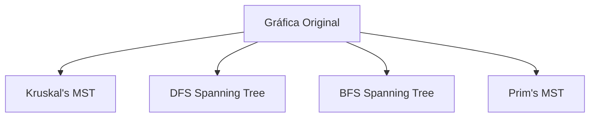
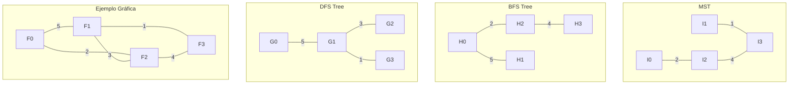

# Análisis de Algoritmos - Algoritmos para teoría de gráficas

## 4.1 Árboles generadores.

---

Los árboles generadores son estructuras fundamentales en teoría de gráficas con aplicaciones en redes, optimización y diseño de algoritmos. Un árbol generador de una gráfica conexa no dirigida $G = (V, E)$ es un subgrafo $T = (V, E')$ que es un árbol y contiene todos los vértices de $G$.

### Definiciones Básicas

#### Árbol

Un árbol es una gráfica conexa y acíclica. Para una gráfica con $n$ vértices, las siguientes propiedades son equivalentes:

- $G$ es un árbol
- $G$ es conexa y tiene $n-1$ aristas
- $G$ es acíclica y tiene $n-1$ aristas
- Entre cualquier par de vértices existe exactamente un camino simple

#### Árbol Generador

Dada una gráfica conexa no dirigida $G = (V, E)$ con $|V| = n$ vértices, un árbol generador $T = (V, E')$ es un subgrafo que:

- Contiene todos los vértices de $G$ $(V(T) = V(G))$
- Es un árbol (conexo y acíclico)
- Tiene exactamente $n-1$ aristas

### Algoritmos para Encontrar Árboles Generadores

#### Algoritmo de Búsqueda en Profundidad (DFS)

```python
def dfs_spanning_tree(graph, start):
    n = len(graph)
    visited = [False] * n
    parent = [-1] * n
    tree_edges = []

    def dfs(u):
        visited[u] = True
        for v in graph[u]:
            if not visited[v]:
                parent[v] = u
                tree_edges.append((u, v))
                dfs(v)

    dfs(start)
    return tree_edges, parent
```

#### Algoritmo de Búsqueda en Amplitud (BFS)

```python
from collections import deque

def bfs_spanning_tree(graph, start):
    n = len(graph)
    visited = [False] * n
    parent = [-1] * n
    tree_edges = []
    queue = deque([start])
    visited[start] = True

    while queue:
        u = queue.popleft()
        for v in graph[u]:
            if not visited[v]:
                visited[v] = True
                parent[v] = u
                tree_edges.append((u, v))
                queue.append(v)

    return tree_edges, parent
```

### Árbol Generador Mínimo (MST)

Para gráficas ponderadas, buscamos el árbol generador con peso mínimo total.

#### Algoritmo de Prim

```python
import heapq

def prim_mst(graph, weights):
    n = len(graph)
    visited = [False] * n
    min_heap = []
    mst_edges = []
    total_weight = 0

    # Comenzar desde el vértice 0
    heapq.heappush(min_heap, (0, 0, -1))  # (peso, vértice, padre)

    while min_heap:
        weight, u, parent = heapq.heappop(min_heap)
        if visited[u]:
            continue

        visited[u] = True
        if parent != -1:
            mst_edges.append((parent, u))
            total_weight += weight

        for v in graph[u]:
            if not visited[v]:
                heapq.heappush(min_heap, (weights[(u, v)], v, u))

    return mst_edges, total_weight
```

#### Algoritmo de Kruskal

```python
class UnionFind:
    def __init__(self, n):
        self.parent = list(range(n))
        self.rank = [0] * n

    def find(self, x):
        if self.parent[x] != x:
            self.parent[x] = self.find(self.parent[x])
        return self.parent[x]

    def union(self, x, y):
        rx, ry = self.find(x), self.find(y)
        if rx == ry:
            return False
        if self.rank[rx] < self.rank[ry]:
            self.parent[rx] = ry
        elif self.rank[rx] > self.rank[ry]:
            self.parent[ry] = rx
        else:
            self.parent[ry] = rx
            self.rank[rx] += 1
        return True

def kruskal_mst(edges, n):
    edges.sort(key=lambda x: x[2])  # Ordenar por peso
    uf = UnionFind(n)
    mst_edges = []
    total_weight = 0

    for u, v, weight in edges:
        if uf.union(u, v):
            mst_edges.append((u, v))
            total_weight += weight

    return mst_edges, total_weight
```

### Propiedades y Teoremas

#### Teorema del Árbol Generador Mínimo

Dada una gráfica conexa ponderada $G = (V, E)$ con función de peso $w: E \rightarrow \mathbb{R}$, existe un árbol generador mínimo $T$ tal que:

$$w(T) = \sum_{(u,v) \in T} w(u,v)$$

es mínimo entre todos los árboles generadores posibles.

#### Lema de Corte

Sea $S$ un subconjunto no vacío de vértices y sea $e$ la arista de mínimo peso que conecta $S$ con $V-S$. Entonces $e$ pertenece a algún árbol generador mínimo.

### Diagramas





### Ejemplos

#### Ejemplo 1: Gráfica Simple

Dada la gráfica con vértices {0, 1, 2, 3} y aristas:

- (0,1) peso 5
- (0,2) peso 2
- (1,2) peso 3
- (1,3) peso 1
- (2,3) peso 4

El árbol generador mínimo tiene peso: $2 + 1 + 4 = 7$

#### Ejemplo 2: Aplicación en Redes

En una red de computadoras, encontrar el árbol generador mínimo permite minimizar el costo total de conexión mientras se mantiene la conectividad entre todos los nodos.

### Ejercicios Propuestos

1. **Ejercicio Básico**: Dada la siguiente gráfica, encuentra todos los árboles generadores posibles:

   ```
   V = {A, B, C}
   E = {(A,B), (A,C), (B,C)}
   ```

2. **Ejercicio de Implementación**: Implementa el algoritmo de Prim usando diferentes estructuras de datos para la cola de prioridad y compara su eficiencia.

3. **Ejercicio Teórico**: Demuestra que en cualquier gráfica conexa con $n$ vértices y $m$ aristas, el número de árboles generadores está acotado por:

   $$\tau(G) \leq \frac{1}{n} \binom{m}{n-1}$$

4. **Ejercicio de Aplicación**: Diseña un algoritmo que encuentre el segundo mejor árbol generador mínimo de una gráfica.

5. **Ejercicio Avanzado**: Analiza la complejidad del algoritmo de Kruskal cuando las aristas ya están ordenadas y cuando no lo están.

### Referencias

#### Bibliografía Básica

1. Cormen, T. H., Leiserson, C. E., Rivest, R. L., & Stein, C. (2009). _Introduction to Algorithms_ (3rd ed.). MIT Press. (Capítulos 23-24)
2. Kleinberg, J., & Tardos, É. (2005). _Algorithm Design_. Addison Wesley. (Capítulo 4)

#### Bibliografía Complementaria

1. Skiena, S. S. (2008). _The Algorithm Design Manual_ (2nd ed.). Springer. (Capítulo 6)
2. Dasgupta, S., Papadimitriou, C., & Vazirani, U. (2006). _Algorithms_. McGraw-Hill. (Capítulo 5)
3. Graham, R. L., Knuth, D. E., & Patashnik, O. (1994). _Concrete Mathematics: A Foundation for Computer Science_ (2nd ed.). Addison-Wesley Professional.

### Consejos de Estudio

1. **Visualización**: Dibuja las gráficas y sus árboles generadores para comprender mejor los algoritmos.
2. **Implementación**: Codifica los algoritmos desde cero para internalizar su funcionamiento.
3. **Complejidad**: Analiza la complejidad temporal de cada algoritmo:
   - DFS/BFS: $O(V + E)$
   - Prim con heap binario: $O(E \log V)$
   - Kruskal: $O(E \log E)$
4. **Aplicaciones**: Relaciona los conceptos con problemas del mundo real como diseño de redes y clustering.

Esta guía proporciona una base sólida para comprender los árboles generadores y sus algoritmos asociados. Practica con los ejercicios y consulta las referencias para profundizar en el tema.
