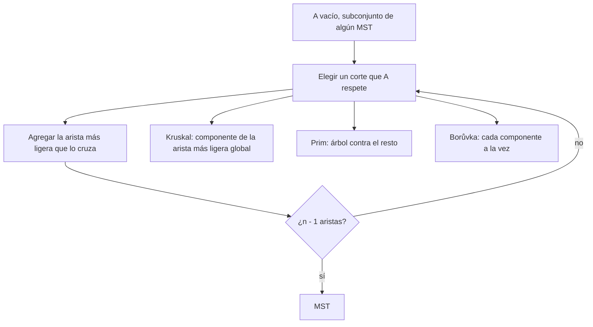

# Análisis de Algoritmos - Algoritmos para teoría de gráficas

## 4.2 Árboles generadores de peso mínimo.

---

Si las aristas de una gráfica tienen **pesos** (costos de cable, distancias, latencias), entre todos sus árboles generadores (tema 4.1) interesa el de peso total mínimo: el **árbol generador de peso mínimo** (MST, por _minimum spanning tree_). Aunque una gráfica puede tener un número exponencial de árboles generadores, el MST se encuentra con algoritmos voraces en tiempo casi lineal, porque el problema tiene una estructura muy favorable: la **propiedad del corte**. Este tema la demuestra y la usa para justificar los algoritmos de Kruskal, Prim y Borůvka, analiza sus costos con distintas estructuras de datos y resuelve el problema del segundo mejor árbol.

### Planteamiento

Sea $G = (V, E)$ conexa, no dirigida, con pesos $w : E \to \mathbb{R}.$ Se busca un árbol generador $T$ que minimice $w(T) = \sum_{e \in T} w(e).$ Los pesos pueden ser negativos: sumar una constante a todos no cambia cuál árbol es mínimo, porque todos tienen $n - 1$ aristas.

### La propiedad del corte

Un **corte** $(S, V \setminus S)$ es una partición de los vértices; una arista lo **cruza** si tiene un extremo de cada lado. Un conjunto de aristas $A$ **respeta** el corte si ninguna de sus aristas lo cruza.

**Teorema (propiedad del corte).** Sea $A$ un subconjunto de algún MST, y $(S, V \setminus S)$ un corte que $A$ respeta. Si $e$ es una arista de peso mínimo entre las que cruzan el corte, entonces $A \cup \{e\}$ también es subconjunto de algún MST. Se dice que $e$ es **segura** para $A.$

**Demostración.** Sea $T$ un MST que contiene a $A.$ Si $e \in T,$ no hay nada que probar. Si no, $T + e$ tiene un ciclo, y como $e$ cruza el corte, el ciclo debe cruzarlo otra vez por alguna arista $f \neq e.$ Como $A$ respeta el corte, $f \notin A.$ Entonces $T' = T + e - f$ es un árbol generador (intercambio, tema 4.1), y $w(T') = w(T) + w(e) - w(f) \leq w(T)$ porque $w(e) \leq w(f).$ Así $T'$ es un MST que contiene a $A \cup \{e\}.$ $\blacksquare$

**Propiedad del ciclo.** Dualmente, la arista más pesada de un ciclo, si es única, no está en ningún MST. **Unicidad:** si todos los pesos son distintos, el MST es único.

Todo algoritmo que empiece con $A = \emptyset$ y agregue aristas seguras hasta tener $n - 1$ construye un MST. Los algoritmos difieren en qué corte usan.

### Kruskal

Ordenar las aristas por peso y recorrerlas, agregando cada una que no forme ciclo con las ya elegidas. Los componentes del bosque parcial se mantienen en una estructura de **conjuntos disjuntos**: una arista $uv$ forma ciclo si y solo si $u$ y $v$ ya están en el mismo conjunto.

**Corrección:** cuando se agrega $uv,$ el corte entre el componente de $u$ y el resto es respetado por $A,$ y $uv$ es la arista más ligera que lo cruza, porque las más ligeras ya se procesaron y no lo cruzan. **Costo:** $O(m \log m)$ por el ordenamiento más $O(m \, \alpha(n))$ de conjuntos disjuntos con unión por rango y compresión de caminos.

### Prim

Hacer crecer un solo árbol desde un vértice $r:$ en cada paso agregar la arista más ligera que une el árbol con un vértice de fuera. Una cola de prioridad guarda, para cada vértice de fuera, el peso de la arista más ligera que lo une al árbol.

**Corrección:** el corte es (árbol, resto), respetado por $A,$ y la arista elegida es la más ligera que lo cruza. **Costo:** $n$ extracciones del mínimo y hasta $m$ disminuciones de clave: $O(n^2)$ con un arreglo, $O(m \log n)$ con un montículo binario y $O(m + n \log n)$ con un **montículo de Fibonacci**, que disminuye claves en $O(1)$ amortizado gracias a los cortes en cascada.

### Borůvka

En cada ronda, cada componente elige su arista de salida más ligera (segura por la propiedad del corte) y todas se agregan a la vez. Cada ronda al menos reduce a la mitad el número de componentes, así que hay $O(\log n)$ rondas de costo $O(m):$ $O(m \log n).$ Se paraleliza de forma natural y es la base del algoritmo aleatorio de Karger, Klein y Tarjan, de tiempo esperado $O(m).$

| Algoritmo | Estructura | Tiempo | Mejor para |
| --- | --- | --- | --- |
| Kruskal | conjuntos disjuntos | $O(m \log n)$ | dispersas, aristas ordenadas |
| Prim | arreglo | $O(n^2)$ | densas |
| Prim | montículo binario | $O(m \log n)$ | dispersas |
| Prim | montículo de Fibonacci | $O(m + n \log n)$ | teoría, densas grandes |
| Borůvka | ninguna especial | $O(m \log n)$ | paralelo |



### Implementación en Python

El programa implementa Kruskal con conjuntos disjuntos, Prim con montículo binario y Prim con un **montículo de Fibonacci** completo (inserción, extracción del mínimo con consolidación, disminución de clave con cortes en cascada). Traza ambos algoritmos en la gráfica del ejercicio 1, verifica que los tres coinciden en 100 gráficas aleatorias (ejercicio 2), calcula el segundo mejor árbol en $O(n^2)$ comparándolo con la enumeración de todos los árboles (ejercicio 4) y estima el trabajo en gráficas dispersas y densas (ejercicio 5).

```python
import heapq, math, random
from itertools import combinations

random.seed(42)

class ConjuntosDisjuntos:
    def __init__(self, n):
        self.p, self.r = list(range(n)), [0] * n
    def raiz(self, x):
        while self.p[x] != x:
            self.p[x] = self.p[self.p[x]]; x = self.p[x]
        return x
    def une(self, a, b):
        a, b = self.raiz(a), self.raiz(b)
        if a == b:
            return False
        if self.r[a] < self.r[b]: a, b = b, a
        self.p[b] = a
        self.r[a] += self.r[a] == self.r[b]
        return True

def kruskal(n, E, traza=None):
    D, T = ConjuntosDisjuntos(n), []
    for u, v, w in sorted(E, key=lambda e: e[2]):
        if D.une(u, v):
            T.append((u, v, w))
            if traza is not None: traza.append(f"toma {u}{v}({w})")
        elif traza is not None:
            traza.append(f"rechaza {u}{v}({w})")
    return T

def adyacencia(n, E):
    A = [[] for _ in range(n)]
    for u, v, w in E:
        A[u].append((v, w)); A[v].append((u, w))
    return A

def prim_binario(n, E, traza=None):
    A, dentro, T = adyacencia(n, E), [False] * n, []
    H = [(0, 0, -1)]
    while H:
        w, u, p = heapq.heappop(H)
        if dentro[u]:
            continue
        dentro[u] = True
        if p >= 0:
            T.append((p, u, w))
            if traza is not None: traza.append(f"agrega {p}{u}({w})")
        for v, wv in A[u]:
            if not dentro[v]:
                heapq.heappush(H, (wv, v, u))
    return T

# --- Montículo de Fibonacci (mínimos) ---
class NodoF:
    __slots__ = ("clave", "valor", "padre", "hijo", "izq", "der", "grado", "marca")
    def __init__(self, clave, valor):
        self.clave, self.valor = clave, valor
        self.padre = self.hijo = None
        self.izq = self.der = self
        self.grado, self.marca = 0, False

class Fibonacci:
    def __init__(self):
        self.minimo, self.n, self.trabajo = None, 0, 0
    def _une_lista(self, a, b):           # concatena dos listas circulares
        a.der.izq, b.der.izq = b, a
        a.der, b.der = b.der, a.der
    def inserta(self, clave, valor):
        x = NodoF(clave, valor)
        if self.minimo is None:
            self.minimo = x
        else:
            self._une_lista(self.minimo, x)
            if clave < self.minimo.clave: self.minimo = x
        self.n += 1; self.trabajo += 1
        return x
    def _quita(self, x):
        x.izq.der, x.der.izq = x.der, x.izq
        x.izq = x.der = x
    def extrae_min(self):
        z = self.minimo
        if z.hijo:
            hijos, c = [], z.hijo
            while True:
                hijos.append(c); c = c.der
                if c is z.hijo: break
            for c in hijos:
                self._quita(c); c.padre = None
                self._une_lista(z, c)
        if z.der is z:
            self.minimo = None
        else:
            self.minimo = z.der
            self._quita(z)
            self._consolida()
        self.n -= 1
        return z
    def _consolida(self):
        raices, c = [], self.minimo
        while True:
            raices.append(c); c = c.der
            if c is self.minimo: break
        A = {}
        for x in raices:
            self.trabajo += 1
            d = x.grado
            while d in A:
                y = A.pop(d)
                if y.clave < x.clave: x, y = y, x
                self._quita(y)               # y pasa a ser hijo de x
                y.padre, y.marca = x, False
                if x.hijo is None: x.hijo = y
                else: self._une_lista(x.hijo, y)
                x.grado += 1; d += 1; self.trabajo += 1
            A[d] = x
        self.minimo = None
        for x in A.values():
            x.izq = x.der = x
            if self.minimo is None: self.minimo = x
            else:
                self._une_lista(self.minimo, x)
                if x.clave < self.minimo.clave: self.minimo = x
    def disminuye(self, x, k):
        x.clave = k; self.trabajo += 1
        p = x.padre
        if p and x.clave < p.clave:
            self._corta(x, p)
            while p.padre:                    # corte en cascada
                if not p.marca:
                    p.marca = True; break
                q = p.padre; self._corta(p, q); p = q
        if x.clave < self.minimo.clave:
            self.minimo = x
    def _corta(self, x, p):
        if x.der is x: p.hijo = None
        else:
            if p.hijo is x: p.hijo = x.der
            self._quita(x)
        p.grado -= 1
        x.padre, x.marca = None, False
        self._une_lista(self.minimo, x); self.trabajo += 1

def prim_fibonacci(n, E):
    A, F = adyacencia(n, E), Fibonacci()
    nodo = [F.inserta(0 if v == 0 else math.inf, v) for v in range(n)]
    padre, dentro, T = [-1] * n, [False] * n, []
    disminuciones = 0
    while F.minimo:
        u = F.extrae_min().valor
        dentro[u] = True
        if padre[u] >= 0:
            T.append((padre[u], u, nodo[u].clave))
        for v, w in A[u]:
            if not dentro[v] and w < nodo[v].clave:
                F.disminuye(nodo[v], w); padre[v] = u; disminuciones += 1
    return T, F.trabajo, disminuciones

peso = lambda T: sum(e[2] for e in T)

# --- Ejercicio 1 ---
E1 = [(0, 1, 1), (0, 2, 4), (0, 3, 3), (1, 2, 2), (1, 3, 5), (2, 3, 6)]
tk, tp = [], []
print("ejercicio 1 (A=0, B=1, C=2, D=3):")
print("   Kruskal:", ", ".join(tk) if kruskal(4, E1, tk) else "", "-> peso", peso(kruskal(4, E1)))
print("   Prim:   ", ", ".join(tp) if prim_binario(4, E1, tp) else "", "-> peso", peso(prim_binario(4, E1)))

# --- Ejercicio 2: Prim con Fibonacci frente a binario ---
def gráfica(n, p):
    E = [(u, random.randrange(u), random.randint(1, 10**6)) for u in range(1, n)]
    E += [(u, v, random.randint(1, 10**6)) for u, v in combinations(range(n), 2) if random.random() < p]
    return E

ok = True
for _ in range(100):
    k = random.randint(2, 30)
    G = gráfica(k, random.random())
    w = peso(kruskal(k, G))
    ok &= w == peso(prim_binario(k, G)) == peso(prim_fibonacci(k, G)[0])
print("ejercicio 2: Kruskal, Prim binario y Prim Fibonacci dan el mismo peso en 100 gráficas:", ok)
for n, p in [(1000, 0.005), (1000, 0.5)]:
    G = gráfica(n, p)
    T, trabajo, dis = prim_fibonacci(n, G)
    print(f"   n = {n}, m = {len(G):6}: disminuciones de clave {dis:5},"
          f" trabajo del montículo {trabajo:6} (n lg n = {int(n * math.log2(n))})")

# --- Ejercicio 4: segundo mejor en O(n^2) ---
def segundo_mejor(n, E):
    T = kruskal(n, E)
    enT = {(min(u, v), max(u, v)) for u, v, _ in T}
    A = adyacencia(n, T)
    maxw = [[0] * n for _ in range(n)]       # arista más pesada en el camino de T
    for s in range(n):
        pila, visto = [s], {s}
        while pila:
            u = pila.pop()
            for v, w in A[u]:
                if v not in visto:
                    visto.add(v); maxw[s][v] = max(maxw[s][u], w); pila.append(v)
    mejor = math.inf
    for u, v, w in E:
        if (min(u, v), max(u, v)) not in enT:
            mejor = min(mejor, peso(T) - maxw[u][v] + w)
    return peso(T), mejor

def todos_los_pesos(n, E):
    pesos = []
    for S in combinations(E, n - 1):
        D = ConjuntosDisjuntos(n)
        if all(D.une(u, v) for u, v, _ in S):
            pesos.append(peso(S))
    return sorted(pesos)

ok = True
for _ in range(200):
    k = random.randint(3, 6)
    G = [(u, v, random.randint(1, 9)) for u, v in combinations(range(k), 2) if random.random() < 0.8]
    P = todos_los_pesos(k, G)
    if len(P) >= 2:
        ok &= segundo_mejor(k, G) == (P[0], P[1])
print("ejercicio 4: segundo mejor con la arista más pesada del camino, correcto en 200 gráficas:", ok,
      "| ejercicio 1:", segundo_mejor(4, E1))

# --- Ejercicio 5: densas y dispersas, con conteo de operaciones ---
print("ejercicio 5: trabajo estimado")
for n, p in [(1500, 0.002), (1500, 0.9)]:
    G = gráfica(n, p)
    m = len(G)
    print(f"   n = {n}, m = {m:7}: Kruskal m lg m = {int(m * math.log2(m)):8}, Prim binario m lg n = {int(m * math.log2(n)):8},"
          f" Prim arreglo n^2 = {n * n:8}, Prim Fibonacci m + n lg n = {m + int(n * math.log2(n)):8}")
```

Salida:

```text
ejercicio 1 (A=0, B=1, C=2, D=3):
   Kruskal: toma 01(1), toma 12(2), toma 03(3), rechaza 02(4), rechaza 13(5), rechaza 23(6) -> peso 6
   Prim:    agrega 01(1), agrega 12(2), agrega 03(3) -> peso 6
ejercicio 2: Kruskal, Prim binario y Prim Fibonacci dan el mismo peso en 100 gráficas: True
   n = 1000, m =   3563: disminuciones de clave  2214, trabajo del montículo  21617 (n lg n = 9965)
   n = 1000, m = 250979: disminuciones de clave  6482, trabajo del montículo  31597 (n lg n = 9965)
ejercicio 4: segundo mejor con la arista más pesada del camino, correcto en 200 gráficas: True | ejercicio 1: (6, 8)
ejercicio 5: trabajo estimado
   n = 1500, m =    3835: Kruskal m lg m =    45655, Prim binario m lg n =    40462, Prim arreglo n^2 =  2250000, Prim Fibonacci m + n lg n =    19661
   n = 1500, m = 1013216: Kruskal m lg m = 20214176, Prim binario m lg n = 10690185, Prim arreglo n^2 =  2250000, Prim Fibonacci m + n lg n =  1029042
```

### Ejercicios Propuestos

1. **Ambos algoritmos.** Encuentra el MST de la gráfica con $V = \{A, B, C, D\}$ y aristas $AB$ de peso 1, $AC$ 4, $AD$ 3, $BC$ 2, $BD$ 5, $CD$ 6, con Kruskal y con Prim.

2. **Montículo de Fibonacci.** Implementa Prim con un montículo de Fibonacci y compáralo con la versión de montículo binario.

3. **Corrección de Kruskal.** Demuestra la corrección de Kruskal con la propiedad del corte.

4. **Segundo mejor.** Diseña un algoritmo que encuentre el segundo mejor árbol generador.

5. **Densas y dispersas.** ¿Qué algoritmo es más eficiente para gráficas densas, con $m \approx n^2,$ y para dispersas, con $m \approx n?$

### Soluciones

**Ejercicio 1.** **Kruskal:** en orden de peso, toma $AB$ (1), $BC$ (2) y $AD$ (3); rechaza $AC$ (4), que cerraría el ciclo $ABC,$ $BD$ (5) y $CD$ (6). **Prim** desde $A:$ la arista más ligera que sale de $\{A\}$ es $AB$ (1); de $\{A, B\},$ $BC$ (2); de $\{A, B, C\},$ $AD$ (3). Ambos dan el MST $\{AB, BC, AD\}$ de peso 6, que es único porque los pesos son distintos.

**Ejercicio 2.** Es `prim_fibonacci` del programa, que da los mismos pesos que las otras versiones. El montículo de Fibonacci gana en teoría cuando hay muchas disminuciones de clave, pero en la práctica su constante es grande y su manejo de memoria lento: el montículo binario, incluso con inserciones repetidas en lugar de disminuciones, suele ser más rápido salvo en gráficas enormes y muy densas. En el programa, el número de disminuciones crece mucho menos que $m,$ porque la mayoría de las aristas no mejoran la clave.

**Ejercicio 3.** Sea $e = uv$ la arista que Kruskal agrega, y $C$ el componente de $u$ en el bosque $A$ construido hasta ese momento. El corte $(C, V \setminus C)$ es respetado por $A,$ porque $C$ es un componente. Toda arista más ligera que $e$ ya se procesó y, o está en $A,$ o se rechazó porque unía vértices del mismo componente; en ambos casos no cruza el corte. Así, $e$ es una arista mínima que cruza el corte, segura por el teorema. Por inducción, $A$ siempre está contenido en un MST, y al final tiene $n - 1$ aristas porque $G$ es conexa: es un MST. $\blacksquare$

**Ejercicio 4.** Por el argumento de intercambio, existe un segundo mejor árbol de la forma $T - f + e$ con $e \notin T$ y $f$ en el ciclo que $e$ cierra en $T.$ Para minimizar $w(e) - w(f),$ dada $e = uv$ conviene quitar la arista más pesada del camino de $u$ a $v$ en $T.$ Se calcula $\text{máx}[u][v]$ para todos los pares con un recorrido desde cada vértice de $T,$ en $O(n^2),$ y el segundo mejor peso es $\min_{uv \notin T} \left( w(T) - \text{máx}[u][v] + w(uv) \right).$ Total $O(n^2)$ más el MST. En la gráfica del ejercicio 1, el segundo mejor pesa 8: cambiar $AD$ por $BD,$ o $BC$ por $AC.$

**Ejercicio 5.** Con $m \approx n^2,$ Prim con arreglo cuesta $O(n^2),$ lineal en el tamaño de la entrada y óptimo; Kruskal y Prim con montículo binario cuestan $O(n^2 \log n).$ Prim con Fibonacci también es $O(m + n \log n) = O(n^2).$ Con $m \approx n,$ Kruskal y Prim con montículo cuestan $O(n \log n)$ y el arreglo $O(n^2):$ hay que evitarlo. Los conteos del programa ilustran ambos extremos.

### Referencias

1. Cormen, T. H., Leiserson, C. E., Rivest, R. L., and Stein, C., _Introduction to Algorithms_. MIT Press, 2022. Capítulos 19 y 21.
2. Kleinberg, J., and Tardos, É., _Algorithm Design_. Pearson, 2006. Sección 4.5.
3. Fredman, M. L., and Tarjan, R. E., Fibonacci heaps and their uses in improved network optimization algorithms. _Journal of the ACM_ 34(3), 1987.
4. Graham, R. L., and Hell, P., On the history of the minimum spanning tree problem. _Annals of the History of Computing_ 7(1), 1985.
