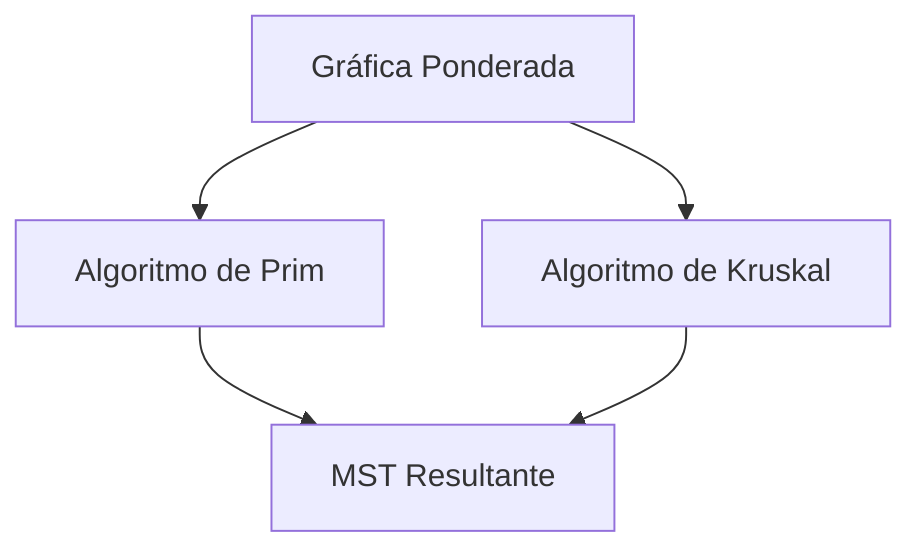
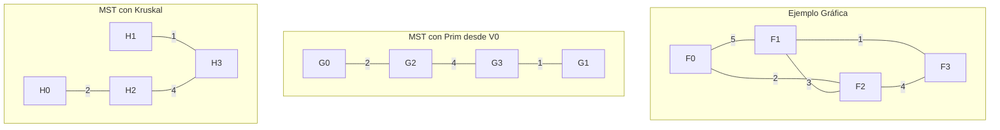

# Análisis de Algoritmos - Algoritmos para teoría de gráficas

## 4.2 Árboles generadores de peso mínimo.

---

Los árboles generadores de peso mínimo (Minimum Spanning Trees, MST) son estructuras fundamentales en teoría de gráficas con aplicaciones en redes, optimización y diseño de algoritmos. Un MST de una gráfica conexa no dirigida ponderada $G = (V, E)$ con función de peso $w: E \rightarrow \mathbb{R}$ es un árbol generador $T = (V, E')$ que minimiza la suma de los pesos de sus aristas:

$$w(T) = \sum_{e \in E'} w(e)$$

### Definiciones Básicas

#### Árbol Generador de Peso Mínimo (MST)

Dada una gráfica conexa no dirigida ponderada $G = (V, E, w)$, un árbol generador de peso mínimo $T = (V, E')$ es un subgrafo que:

- Contiene todos los vértices de $G$ $(V(T) = V(G))$
- Es un árbol (conexo y acíclico)
- Minimiza el peso total: $w(T) = \min\{w(T') : T' \text{ es árbol generador de } G\}$

#### Propiedades Fundamentales

- **Propiedad de ciclo**: Para cualquier ciclo $C$ en $G$, si $e$ es una arista de máximo peso en $C$, entonces existe un MST que no contiene $e$.
- **Propiedad de corte**: Para cualquier corte $(S, V-S)$ de $G$, si $e$ es una arista de mínimo peso que cruza el corte, entonces $e$ pertenece a algún MST.

### Algoritmos para MST

#### Algoritmo de Prim

##### Descripción

El algoritmo de Prim construye el MST incrementalmente, comenzando desde un vértice arbitrario y expandiendo el árbol agregando en cada paso la arista de menor peso que conecta el árbol actual con un vértice externo.

##### Pseudocódigo

```
PRIM(G, w, r)
1. for cada u ∈ V[G]
2.     key[u] = ∞
3.     π[u] = NIL
4. key[r] = 0
5. Q = V[G]
6. while Q ≠ ∅
7.     u = EXTRACT-MIN(Q)
8.     for cada v ∈ Adj[u]
9.         if v ∈ Q y w(u, v) < key[v]
10.            π[v] = u
11.            key[v] = w(u, v)
```

##### Implementación en Python

```python
import heapq

def prim_mst(graph, weights, start=0):
    n = len(graph)
    key = [float('inf')] * n
    parent = [-1] * n
    in_mst = [False] * n
    min_heap = []

    key[start] = 0
    heapq.heappush(min_heap, (0, start))

    while min_heap:
        _, u = heapq.heappop(min_heap)
        if in_mst[u]:
            continue

        in_mst[u] = True

        for v in graph[u]:
            weight = weights[(u, v)]
            if not in_mst[v] and weight < key[v]:
                key[v] = weight
                parent[v] = u
                heapq.heappush(min_heap, (key[v], v))

    mst_edges = []
    total_weight = 0
    for i in range(n):
        if parent[i] != -1:
            mst_edges.append((parent[i], i))
            total_weight += weights[(parent[i], i)]

    return mst_edges, total_weight
```

##### Complejidad

- Con heap binario: $O(E \log V)$
- Con heap de Fibonacci: $O(E + V \log V)$

#### Algoritmo de Kruskal

##### Descripción

El algoritmo de Kruskal ordena todas las aristas por peso y las procesa en orden creciente, agregando cada arista al MST si no forma un ciclo con las aristas ya seleccionadas.

##### Pseudocódigo

```
KRUSKAL(G, w)
1. A = ∅
2. for cada vértice v ∈ V[G]
3.     MAKE-SET(v)
4. ordenar las aristas de E por peso w no decreciente
5. for cada arista (u, v) ∈ E, en orden de peso no decreciente
6.     if FIND-SET(u) ≠ FIND-SET(v)
7.         A = A ∪ {(u, v)}
8.         UNION(u, v)
9. return A
```

##### Implementación en Python

```python
class UnionFind:
    def __init__(self, n):
        self.parent = list(range(n))
        self.rank = [0] * n

    def find(self, x):
        if self.parent[x] != x:
            self.parent[x] = self.find(self.parent[x])
        return self.parent[x]

    def union(self, x, y):
        rx, ry = self.find(x), self.find(y)
        if rx == ry:
            return False

        if self.rank[rx] < self.rank[ry]:
            self.parent[rx] = ry
        elif self.rank[rx] > self.rank[ry]:
            self.parent[ry] = rx
        else:
            self.parent[ry] = rx
            self.rank[rx] += 1
        return True

def kruskal_mst(edges, n):
    edges.sort(key=lambda x: x[2])
    uf = UnionFind(n)
    mst_edges = []
    total_weight = 0

    for u, v, weight in edges:
        if uf.find(u) != uf.find(v):
            uf.union(u, v)
            mst_edges.append((u, v))
            total_weight += weight

    return mst_edges, total_weight
```

##### Complejidad

- $O(E \log E) = O(E \log V)$ (debido al ordenamiento)

### Teoremas Fundamentales

#### Teorema del MST único

Si todos los pesos de las aristas son distintos, entonces el MST es único.

#### Teorema del corte seguro

Sea $G = (V, E)$ una gráfica conexa no dirigida con función de peso real $w: E \rightarrow \mathbb{R}$. Sea $A$ un subconjunto de aristas de algún MST de $G$, sea $(S, V-S)$ un corte que respeta $A$, y sea $e$ una arista de peso mínimo que cruza el corte $(S, V-S)$. Entonces $e$ es segura para $A$.

### Diagramas





### Ejemplos

#### Ejemplo 1: Gráfica Simple

Dada la gráfica con vértices {0, 1, 2, 3} y aristas:

- (0,1) peso 5
- (0,2) peso 2
- (1,2) peso 3
- (1,3) peso 1
- (2,3) peso 4

El árbol generador mínimo tiene peso: $2 + 1 + 4 = 7$

#### Ejemplo 2: Aplicación en Redes

En una red de computadoras, encontrar el MST permite minimizar el costo total de conexión mientras se mantiene la conectividad entre todos los nodos.

### Ejercicios Propuestos

1. **Ejercicio Básico**: Dada la siguiente gráfica ponderada, encuentra el MST usando ambos algoritmos:

   ```
   V = {A, B, C, D}
   E = {(A,B,1), (A,C,4), (A,D,3), (B,C,2), (B,D,5), (C,D,6)}
   ```

2. **Ejercicio de Implementación**: Implementa el algoritmo de Prim usando un heap de Fibonacci y compara su rendimiento con la versión que usa heap binario.

3. **Ejercicio Teórico**: Demuestra la corrección del algoritmo de Kruskal usando la propiedad de corte seguro.

4. **Ejercicio de Aplicación**: Diseña un algoritmo que encuentre el segundo mejor árbol generador mínimo de una gráfica.

5. **Ejercicio Avanzado**: Analiza qué algoritmo es más eficiente para gráficas densas (E ≈ V²) y para gráficas dispersas (E ≈ V).

### Referencias

#### Bibliografía Básica

1. Cormen, T. H., Leiserson, C. E., Rivest, R. L., & Stein, C. (2009). _Introduction to Algorithms_ (3rd ed.). MIT Press. (Capítulo 23)
2. Kleinberg, J., & Tardos, É. (2005). _Algorithm Design_. Addison Wesley. (Capítulo 4)

#### Bibliografía Complementaria

1. Skiena, S. S. (2008). _The Algorithm Design Manual_ (2nd ed.). Springer. (Capítulo 6)
2. Dasgupta, S., Papadimitriou, C., & Vazirani, U. (2006). _Algorithms_. McGraw-Hill. (Capítulo 5)

### Consejos de Estudio

1. **Visualización**: Dibuja las gráficas y sus MST para comprender mejor los algoritmos.
2. **Implementación**: Codifica los algoritmos desde cero para internalizar su funcionamiento.
3. **Complejidad**: Analiza la complejidad temporal de cada algoritmo y sus variantes.
4. **Aplicaciones**: Relaciona los conceptos con problemas del mundo real como diseño de redes y clustering.
