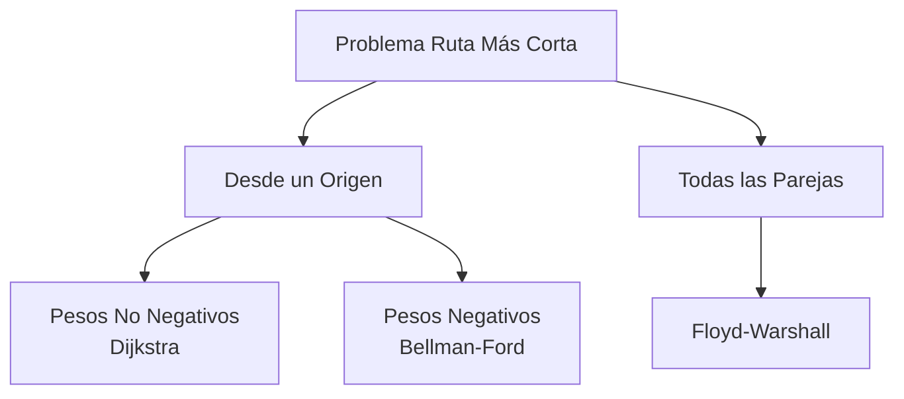
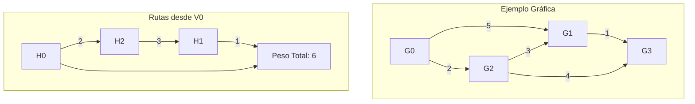

# Análisis de Algoritmos - Algoritmos para teoría de gráficas

## 4.3 La ruta más corta.

---

El problema de la ruta más corta es fundamental en teoría de gráficas y tiene aplicaciones en redes, navegación, logística y planificación. Dada una gráfica ponderada $G = (V, E)$ con función de peso $w: E \rightarrow \mathbb{R}$ y un vértice origen $s$, buscamos encontrar el camino de menor peso desde $s$ a todos los demás vértices.

### Definiciones Básicas

#### Función de Peso y Peso de Camino

Para una arista $(u, v) \in E$, $w(u, v)$ es el peso de la arista. El peso de un camino $p = \langle v_0, v_1, \ldots, v_k \rangle$ es la suma de los pesos de sus aristas:

$$w(p) = \sum_{i=1}^{k} w(v_{i-1}, v_i)$$

#### Distancia Más Corta

La distancia más corta desde $s$ a $v$ se define como:

$$ \delta(s, v) = \begin{cases} \min\{w(p) : s \leadsto v\} & \text{si existe un camino de } s \text{ a } v \\\ \infty & \text{en caso contrario} \end{cases}$$

#### Propiedad de Subestructura Óptima
Cualquier subcamino de una ruta más corta es también una ruta más corta.

### Algoritmos para Rutas Más Cortas

#### Algoritmo de Dijkstra

##### Descripción
El algoritmo de Dijkstra resuelve el problema de la ruta más corta desde un único origen en gráficas con pesos no negativos. Utiliza una estrategia voraz, expandiendo el vértice con la distancia estimada más pequeña.

##### Pseudocódigo
```
DIJKSTRA(G, w, s)
1. INICIALIZAR-SIMPLE(G, s)
2. S = ∅
3. Q = V[G]
4. while Q ≠ ∅
5.     u = EXTRACT-MIN(Q)
6.     S = S ∪ {u}
7.     for cada vértice v ∈ Adj[u]
8.         RELAJAR(u, v, w)
```

##### Implementación en Python

```python
import heapq

def dijkstra(graph, weights, start):
    n = len(graph)
    dist = [float('inf')] * n
    prev = [-1] * n
    dist[start] = 0

    # Min-heap: (distancia, vértice)
    heap = [(0, start)]

    while heap:
        d, u = heapq.heappop(heap)
        if d != dist[u]:
            continue

        for v in graph[u]:
            new_dist = dist[u] + weights[(u, v)]
            if new_dist < dist[v]:
                dist[v] = new_dist
                prev[v] = u
                heapq.heappush(heap, (new_dist, v))

    return dist, prev
```

##### Complejidad
- Con heap binario: $O((V + E) \log V)$
- Con heap de Fibonacci: $O(E + V \log V)$

#### Algoritmo de Bellman-Ford

##### Descripción
El algoritmo de Bellman-Ford maneja pesos negativos y detecta ciclos de peso negativo alcanzables desde el origen.

##### Pseudocódigo
```
BELLMAN-FORD(G, w, s)
1. INICIALIZAR-SIMPLE(G, s)
2. for i = 1 to |V[G]| - 1
3.     for cada arista (u, v) ∈ E[G]
4.         RELAJAR(u, v, w)
5. for cada arista (u, v) ∈ E[G]
6.     if d[v] > d[u] + w(u, v)
7.         return FALSE
8. return TRUE
```

##### Implementación en Python

```python
def bellman_ford(edges, n, start):
    dist = [float('inf')] * n
    prev = [-1] * n
    dist[start] = 0

    # Relajar todas las aristas n-1 veces
    for _ in range(n - 1):
        updated = False
        for u, v, w in edges:
            if dist[u] + w < dist[v]:
                dist[v] = dist[u] + w
                prev[v] = u
                updated = True
        if not updated:
            break

    # Verificar ciclos de peso negativo
    for u, v, w in edges:
        if dist[u] + w < dist[v]:
            return None, None  # Ciclo de peso negativo detectado

    return dist, prev
```

##### Complejidad
- $O(VE)$

#### Algoritmo de Floyd-Warshall

##### Descripción
El algoritmo de Floyd-Warshall resuelve el problema de todas las parejas de rutas más cortas en una gráfica con pesos positivos o negativos (sin ciclos de peso negativo).

##### Formulación Recursiva
Sea $d_{ij}^{(k)}$ la distancia más corta de $i$ a $j$ usando sólo los vértices $\{1, 2, \ldots, k\}$ como intermedios:

$$d_{ij}^{(k)} = \begin{cases} w(i, j) & \text{si } k = 0 \\\ \min(d_{ij}^{(k-1)}, d_{ik}^{(k-1)} + d_{kj}^{(k-1)}) & \text{si } k \geq 1 \end{cases}$$

##### Implementación en Python

```python
def floyd_warshall(graph, n):
    # Inicializar matriz de distancias
    dist = [[float('inf')] * n for _ in range(n)]

    for i in range(n):
        dist[i][i] = 0
        for j, w in graph[i]:
            dist[i][j] = w

    # Algoritmo principal
    for k in range(n):
        for i in range(n):
            if dist[i][k] == float('inf'):
                continue
            for j in range(n):
                if dist[i][j] > dist[i][k] + dist[k][j]:
                    dist[i][j] = dist[i][k] + dist[k][j]

    return dist
```

##### Complejidad
- $O(V^3)$

### Diagramas





### Aplicaciones

#### Sistemas de Navegación
Los algoritmos de ruta más corta son fundamentales en sistemas de GPS y aplicaciones de mapas.

#### Redes de Computadoras
Enrutamiento de paquetes en redes usando protocolos como OSPF (Open Shortest Path First).

#### Planificación de Proyectos
Uso en el método de la ruta crítica (CPM) para gestión de proyectos.

### Ejemplos

#### Ejemplo 1: Dijkstra
Dada la gráfica con vértices {0, 1, 2, 3} y aristas:
- (0,1) peso 5
- (0,2) peso 2
- (2,1) peso 1
- (1,3) peso 3
- (2,3) peso 6

Las distancias desde el vértice 0:
- δ(0,0) = 0
- δ(0,2) = 2
- δ(0,1) = 2 + 1 = 3
- δ(0,3) = min(3 + 3, 2 + 6) = 6

#### Ejemplo 2: Bellman-Ford
Grágica con aristas de peso negativo pero sin ciclos negativos:
- (0,1) peso 6
- (0,2) peso 7
- (1,3) peso 5
- (2,3) peso -3

### Ejercicios Propuestos

1. **Ejercicio Básico**: Aplica el algoritmo de Dijkstra manualmente a la siguiente gráfica:
   ```
   V = {A, B, C, D}
   E = {(A,B,4), (A,C,2), (B,C,1), (B,D,5), (C,D,8)}
   ```
   Encuentra las rutas más cortas desde A.

2. **Ejercicio de Implementación**: Implementa el algoritmo de Bellman-Ford que reconstruya las rutas además de calcular las distancias.

3. **Ejercicio Teórico**: Demuestra por qué el algoritmo de Dijkstra no funciona con pesos negativos.

4. **Ejercicio de Aplicación**: Diseña un algoritmo que encuentre el vértice que minimice la máxima distancia a todos los demás vértices (centro de la gráfica).

5. **Ejercicio Avanzado**: Analiza cómo modificar el algoritmo de Floyd-Warshall para detectar la presencia de ciclos de peso negativo.

### Referencias

#### Bibliografía Básica
1. Cormen, T. H., Leiserson, C. E., Rivest, R. L., & Stein, C. (2009). *Introduction to Algorithms* (3rd ed.). MIT Press. (Capítulos 24-25)
2. Kleinberg, J., & Tardos, É. (2005). *Algorithm Design*. Addison Wesley. (Capítulo 4)

#### Bibliografía Complementaria
1. Skiena, S. S. (2008). *The Algorithm Design Manual* (2nd ed.). Springer. (Capítulo 6)
2. Dasgupta, S., Papadimitriou, C., & Vazirani, U. (2006). *Algorithms*. McGraw-Hill. (Capítulo 4)

### Consejos de Estudio

1. **Visualización**: Dibuja las gráficas y traza la ejecución de los algoritmos paso a paso.
2. **Implementación**: Codifica todos los algoritmos y verifica con ejemplos conocidos.
3. **Complejidad**: Entiende el análisis de complejidad de cada algoritmo y cuándo aplicar cada uno.
4. **Aplicaciones**: Identifica problemas del mundo real que se pueden modelar como problemas de rutas más cortas.
