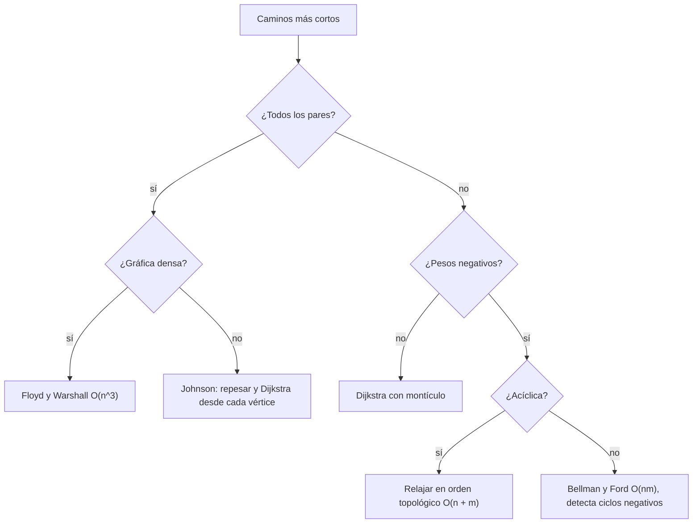

# Análisis de Algoritmos - Algoritmos para teoría de gráficas

## 4.3 La ruta más corta.

---

Encontrar el camino de menor costo entre dos puntos de una red es uno de los problemas algorítmicos con más aplicaciones: navegación, enrutamiento de paquetes en internet, planificación de proyectos, alineación de secuencias. Este tema define el problema en gráficas dirigidas con pesos, demuestra las propiedades que comparten todos los algoritmos (subestructura óptima y relajación) y presenta los tres algoritmos clásicos: **Dijkstra** para pesos no negativos, **Bellman y Ford** para pesos arbitrarios con detección de ciclos negativos, y **Floyd y Warshall** para todos los pares, con su análisis y sus límites.

### El problema

Sea $G = (V, E)$ dirigida con pesos $w : E \to \mathbb{R}.$ El peso de un camino es la suma de los pesos de sus aristas, y la **distancia** $\delta(s, v)$ es el mínimo de los pesos de los caminos de $s$ a $v,$ o $+\infty$ si no hay ninguno. Si un camino de $s$ a $v$ puede pasar por un **ciclo de peso negativo**, recorrerlo una y otra vez hace el peso arbitrariamente pequeño, y $\delta(s, v) = -\infty.$ Una gráfica no dirigida se trata como dirigida con las dos orientaciones de cada arista, lo que con un peso negativo produce un ciclo negativo de dos aristas.

Variantes: **origen único** (de $s$ a todos), **destino único** (invirtiendo las aristas), **un par** (ningún algoritmo conocido es asintóticamente mejor que el de origen único en el peor caso) y **todos los pares**.

### Propiedades

- **Subestructura óptima:** todo subcamino de un camino más corto es un camino más corto. Si no lo fuera, se reemplazaría por uno más corto y el camino completo mejoraría.
- **Sin ciclos:** si no hay ciclos negativos, existe un camino más corto simple, con a lo sumo $n - 1$ aristas.
- **Desigualdad del triángulo:** $\delta(s, v) \leq \delta(s, u) + w(u, v)$ para toda arista $uv.$

Los algoritmos mantienen una estimación $d[v] \geq \delta(s, v)$ y un predecesor $\pi[v],$ y las mejoran con la **relajación**:

```
RELAJA(u, v)
1  si d[u] + w(u, v) < d[v]
2      d[v] ← d[u] + w(u, v);  π[v] ← u
```

La relajación nunca hace $d[v] \lt \delta(s, v),$ y si $s, \ldots, u, v$ es un camino más corto y $d[u] = \delta(s, u)$ antes de relajar $uv,$ después $d[v] = \delta(s, v).$ Los predecesores forman un **árbol de caminos más cortos**.

### Dijkstra

Con pesos **no negativos**: mantener un conjunto $S$ de vértices terminados; en cada paso extraer de una cola de prioridad el vértice $u \notin S$ con menor $d[u],$ agregarlo a $S$ y relajar sus aristas de salida.

**Teorema.** Con pesos no negativos, cuando $u$ se agrega a $S,$ $d[u] = \delta(s, u).$

**Demostración.** Supón que $u$ es el primer vértice agregado con $d[u] > \delta(s, u).$ Sea $P$ un camino más corto de $s$ a $u,$ y $yx$ su primera arista con $y \in S$ y $x \notin S.$ Como $y$ se agregó correctamente y se relajó $yx,$ $d[x] = \delta(s, x).$ Como los pesos son no negativos y $x$ precede a $u$ en $P,$ $\delta(s, x) \leq \delta(s, u).$ Entonces $d[x] = \delta(s, x) \leq \delta(s, u) \lt d[u],$ y el algoritmo habría extraído $x$ antes que $u:$ contradicción. $\blacksquare$

**Costo:** como Prim (tema 4.2), $O(n^2)$ con un arreglo, $O((n + m) \log n)$ con un montículo binario y $O(m + n \log n)$ con uno de Fibonacci. Con pesos enteros pequeños hay variantes casi lineales, y en mapas de carreteras se usan precálculos (jerarquías de contracción) y la búsqueda $A^*,$ que guía la exploración con una estimación de la distancia restante.

### Bellman y Ford

Relajar **todas** las aristas $n - 1$ veces. Tras la ronda $i,$ $d[v]$ es a lo sumo el peso del mejor camino de $s$ a $v$ con $i$ aristas o menos (inducción), y como un camino más corto simple tiene a lo sumo $n - 1$ aristas, al final $d[v] = \delta(s, v).$ Una ronda adicional detecta los ciclos negativos: si alguna arista todavía se puede relajar, hay un ciclo negativo alcanzable desde $s.$ **Costo:** $O(nm).$ Funciona con pesos negativos y se distribuye bien: es la base de los protocolos de enrutamiento por vector de distancias como RIP.

En gráficas **acíclicas** basta relajar las aristas en orden topológico: $O(n + m),$ con pesos arbitrarios. Así se calcula la ruta crítica de un proyecto, usando pesos negados para obtener el camino más largo.

### Floyd y Warshall

Para todos los pares, por programación dinámica sobre los vértices intermedios permitidos. Sea $d_{ij}^{(k)}$ el peso del camino más corto de $i$ a $j$ cuyos vértices intermedios están en $\{1, \ldots, k\}.$ Ese camino usa $k$ o no lo usa:

$$d_{ij}^{(k)} = \min\left(d_{ij}^{(k-1)}, \; d_{ik}^{(k-1)} + d_{kj}^{(k-1)}\right), \qquad d_{ij}^{(0)} = w(i, j).$$

Tres ciclos anidados, con $k$ el exterior: $\Theta(n^3)$ tiempo y $\Theta(n^2)$ espacio, porque la tabla se puede actualizar en el lugar. Funciona con pesos negativos; hay un ciclo negativo si y solo si algún $d_{ii}$ queda negativo. Para gráficas dispersas conviene el algoritmo de **Johnson**: repesar con Bellman y Ford para eliminar los pesos negativos y ejecutar Dijkstra desde cada vértice, $O(nm \log n).$

| Algoritmo | Pesos | Pares | Tiempo |
| --- | --- | --- | --- |
| BFS | todos 1 | origen único | $O(n + m)$ |
| orden topológico | arbitrarios, acíclica | origen único | $O(n + m)$ |
| Dijkstra | no negativos | origen único | $O((n + m) \log n)$ |
| Bellman y Ford | arbitrarios | origen único | $O(nm)$ |
| Floyd y Warshall | arbitrarios | todos | $O(n^3)$ |
| Johnson | arbitrarios | todos | $O(nm \log n)$ |



### Implementación en Python

El programa implementa los tres algoritmos con reconstrucción de caminos. Resuelve el ejercicio 1, ejecuta Bellman y Ford en una gráfica con pesos negativos y lo compara, junto con Floyd y Warshall, con una búsqueda exhaustiva de caminos en 150 gráficas aleatorias (ejercicio 2), muestra el fallo de Dijkstra con un peso negativo (ejercicio 3), calcula el centro de una gráfica (ejercicio 4) y detecta ciclos negativos con la diagonal de Floyd y Warshall (ejercicio 5).

```python
import heapq, math, random
from itertools import permutations

random.seed(43)
INF = math.inf

def dijkstra(n, ady, s, traza=None):
    d, padre = [INF] * n, [None] * n
    d[s] = 0
    H, hecho = [(0, s)], [False] * n
    while H:
        du, u = heapq.heappop(H)
        if hecho[u]:
            continue
        hecho[u] = True
        if traza is not None:
            traza.append(u)
        for v, w in ady[u]:
            if du + w < d[v]:
                d[v], padre[v] = du + w, u
                heapq.heappush(H, (d[v], v))
    return d, padre

def bellman_ford(n, aristas, s):
    d, padre = [INF] * n, [None] * n
    d[s] = 0
    for _ in range(n - 1):
        cambio = False
        for u, v, w in aristas:
            if d[u] + w < d[v]:
                d[v], padre[v] = d[u] + w, u; cambio = True
        if not cambio:
            break
    for u, v, w in aristas:
        if d[u] + w < d[v]:
            return None, None            # ciclo negativo alcanzable
    return d, padre

def camino(padre, t):
    if padre[t] is None:
        return [t]
    return camino(padre, padre[t]) + [t]

def floyd_warshall(n, aristas):
    D = [[0 if i == j else INF for j in range(n)] for i in range(n)]
    for u, v, w in aristas:
        D[u][v] = min(D[u][v], w)
    for k in range(n):
        for i in range(n):
            for j in range(n):
                if D[i][k] + D[k][j] < D[i][j]:
                    D[i][j] = D[i][k] + D[k][j]
    return D

# --- Ejercicio 1 ---
nom = "ABCD"
E1 = [(0, 1, 4), (0, 2, 2), (1, 2, 1), (1, 3, 5), (2, 3, 8)]
ady = [[] for _ in range(4)]
for u, v, w in E1:
    ady[u].append((v, w)); ady[v].append((u, w))       # no dirigida
orden = []
d, p = dijkstra(4, ady, 0, orden)
print("ejercicio 1 (no dirigida): orden de extracción", [nom[u] for u in orden])
for v in range(4):
    print(f"   {nom[v]}: distancia {d[v]}, camino {'-'.join(nom[x] for x in camino(p, v))}")
ady_d = [[] for _ in range(4)]
for u, v, w in E1:
    ady_d[u].append((v, w))
print("   si fuera dirigida:", {nom[v]: x for v, x in enumerate(dijkstra(4, ady_d, 0)[0])})

# --- Ejercicio 2: Bellman-Ford con reconstrucción ---
E2 = [(0, 1, 6), (0, 3, 7), (1, 2, 5), (1, 3, 8), (1, 4, -4), (2, 1, -2),
      (3, 2, -3), (3, 4, 9), (4, 0, 2), (4, 2, 7)]
d, p = bellman_ford(5, E2, 0)
print("ejercicio 2: Bellman-Ford desde s = 0 (pesos negativos, sin ciclos negativos)")
for v in range(5):
    print(f"   {v}: distancia {d[v]:3}, camino {camino(p, v)}")
print("   con la arista 4 -> 3 de peso -10 hay ciclo negativo:", bellman_ford(5, E2 + [(4, 3, -10)], 0)[0] is None)

def caminos_fuerza_bruta(n, aristas, s):
    W = {}
    for u, v, w in aristas:
        W[(u, v)] = min(W.get((u, v), INF), w)
    d = [INF] * n; d[s] = 0
    for k in range(1, n):
        for perm in permutations([x for x in range(n) if x != s], k):
            c = [s] + list(perm)
            tot = sum(W.get((a, b), INF) for a, b in zip(c, c[1:]))
            d[perm[-1]] = min(d[perm[-1]], tot)
    return d

ok = True
for _ in range(150):
    n = random.randint(2, 6)
    A = [(u, v, random.randint(-3, 9)) for u in range(n) for v in range(n) if u != v and random.random() < 0.5]
    d, _ = bellman_ford(n, A, 0)
    D = floyd_warshall(n, A)
    neg = any(D[i][i] < 0 for i in range(n))
    if d is not None:
        ok &= d == caminos_fuerza_bruta(n, A, 0) and not neg and d == D[0]
    else:
        ok &= neg
print("   Bellman-Ford y Floyd-Warshall contra fuerza bruta en 150 gráficas:", ok)

# --- Ejercicio 3: Dijkstra con un peso negativo ---
E3 = [(0, 1, 2), (0, 2, 3), (2, 1, -2)]
ady3 = [[] for _ in range(3)]
for u, v, w in E3:
    ady3[u].append((v, w))
def dijkstra_sin_reinsertar(n, ady, s):
    """Versión de libro: un vértice extraído es definitivo."""
    d, hecho = [INF] * n, [False] * n
    d[s] = 0
    for _ in range(n):
        u = min((x for x in range(n) if not hecho[x]), key=lambda x: d[x])
        hecho[u] = True
        for v, w in ady[u]:
            if not hecho[v] and d[u] + w < d[v]:
                d[v] = d[u] + w
    return d
print("ejercicio 3: Dijkstra", dijkstra_sin_reinsertar(3, ady3, 0), "| Bellman-Ford", bellman_ford(3, E3, 0)[0])

# --- Ejercicio 4: centro de la gráfica ---
n = 6
E4 = [(0, 1, 7), (0, 2, 9), (0, 5, 14), (1, 2, 10), (1, 3, 15), (2, 3, 11), (2, 5, 2), (3, 4, 6), (4, 5, 9)]
D = floyd_warshall(n, E4 + [(v, u, w) for u, v, w in E4])
exc = [max(fila) for fila in D]
print("ejercicio 4: excentricidades", exc, "| centro", exc.index(min(exc)), "con radio", min(exc),
      "| diámetro", max(exc))

# --- Ejercicio 5: ciclo negativo en Floyd-Warshall ---
E5 = [(0, 1, 1), (1, 2, -1), (2, 3, -1), (3, 1, 1), (3, 4, 2)]
D = floyd_warshall(5, E5)
print("ejercicio 5: diagonal", [D[i][i] for i in range(5)], "-> vértices en ciclos negativos:",
      [i for i in range(5) if D[i][i] < 0])
E5b = [(0, 1, 1), (1, 2, -1), (2, 3, -1), (3, 1, 3), (3, 4, 2)]
print("   con 3 -> 1 de peso 3 (ciclo de peso 1):", [floyd_warshall(5, E5b)[i][i] for i in range(5)])

# --- comparación de operaciones ---
for n, p in [(300, 0.02), (300, 0.5)]:
    A = [(u, v, random.randint(1, 100)) for u in range(n) for v in range(n) if u != v and random.random() < p]
    ad = [[] for _ in range(n)]
    for u, v, w in A:
        ad[u].append((v, w))
    assert dijkstra(n, ad, 0)[0] == bellman_ford(n, A, 0)[0]
    m = len(A)
    print(f"n = {n}, m = {m:5}: Dijkstra (m + n) lg n ~ {int((m + n) * math.log2(n)):7},"
          f" Bellman-Ford nm ~ {n * m:9}, Floyd-Warshall n^3 = {n ** 3}")
```

Salida:

```text
ejercicio 1 (no dirigida): orden de extracción ['A', 'C', 'B', 'D']
   A: distancia 0, camino A
   B: distancia 3, camino A-C-B
   C: distancia 2, camino A-C
   D: distancia 8, camino A-C-B-D
   si fuera dirigida: {'A': 0, 'B': 4, 'C': 2, 'D': 9}
ejercicio 2: Bellman-Ford desde s = 0 (pesos negativos, sin ciclos negativos)
   0: distancia   0, camino [0]
   1: distancia   2, camino [0, 3, 2, 1]
   2: distancia   4, camino [0, 3, 2]
   3: distancia   7, camino [0, 3]
   4: distancia  -2, camino [0, 3, 2, 1, 4]
   con la arista 4 -> 3 de peso -10 hay ciclo negativo: True
   Bellman-Ford y Floyd-Warshall contra fuerza bruta en 150 gráficas: True
ejercicio 3: Dijkstra [0, 2, 3] | Bellman-Ford [0, 1, 3]
ejercicio 4: excentricidades [20, 21, 11, 20, 21, 13] | centro 2 con radio 11 | diámetro 21
ejercicio 5: diagonal [0, -1, -1, -2, 0] -> vértices en ciclos negativos: [1, 2, 3]
   con 3 -> 1 de peso 3 (ciclo de peso 1): [0, 0, 0, 0, 0]
n = 300, m =  1800: Dijkstra (m + n) lg n ~   17280, Bellman-Ford nm ~    540000, Floyd-Warshall n^3 = 27000000
n = 300, m = 44903: Dijkstra (m + n) lg n ~  371967, Bellman-Ford nm ~  13470900, Floyd-Warshall n^3 = 27000000
```

### Ejercicios Propuestos

1. **Dijkstra a mano.** Aplica Dijkstra desde $A$ a la gráfica con $V = \{A, B, C, D\}$ y aristas $AB$ de peso 4, $AC$ 2, $BC$ 1, $BD$ 5 y $CD$ 8.

2. **Bellman y Ford.** Implementa Bellman y Ford de modo que reconstruya los caminos además de calcular las distancias.

3. **Pesos negativos.** Muestra por qué Dijkstra no funciona con pesos negativos.

4. **Centro.** Diseña un algoritmo que encuentre el vértice que minimiza la máxima distancia a los demás, el centro de la gráfica.

5. **Ciclos negativos.** ¿Cómo se modifica Floyd y Warshall para detectar ciclos de peso negativo?

### Soluciones

**Ejercicio 1.** Tomando las aristas como no dirigidas: al inicio $d = (0, \infty, \infty, \infty).$ Se extrae $A$ y se relajan $AB$ y $AC:$ $d[B] = 4,$ $d[C] = 2.$ Se extrae $C$ (2) y se relajan $CB,$ que mejora $d[B]$ a 3, y $CD,$ que da $d[D] = 10.$ Se extrae $B$ (3) y se relaja $BD,$ que mejora $d[D]$ a 8. Se extrae $D.$ Resultado: $A$ 0, $C$ 2 por $A\text{-}C,$ $B$ 3 por $A\text{-}C\text{-}B$ y $D$ 8 por $A\text{-}C\text{-}B\text{-}D.$ Si las aristas fueran dirigidas en el orden dado, $C$ no llegaría a $B,$ y las distancias serían $B$ 4 y $D$ 9.

**Ejercicio 2.** Es `bellman_ford` del programa: el arreglo de predecesores se actualiza en cada relajación exitosa y el camino se reconstruye de $t$ hacia atrás. En la gráfica de ejemplo, el camino más corto a 4 es $0 \to 3 \to 2 \to 1 \to 4$ con peso $7 - 3 - 2 - 4 = -2,$ usando tres aristas negativas. Si se agrega la arista $4 \to 3$ con peso $-10,$ el ciclo $3 \to 2 \to 1 \to 4 \to 3$ pesa $-19$ y la ronda adicional lo detecta. El ciclo se puede recuperar siguiendo $n$ veces los predecesores desde el vértice que aún se relajó.

**Ejercicio 3.** Con aristas $s \to a$ de peso 2, $s \to b$ de peso 3 y $b \to a$ de peso $-2:$ Dijkstra extrae primero $a$ con $d[a] = 2$ y lo declara terminado; después extrae $b$ y la arista $b \to a$ daría $3 - 2 = 1 \lt 2,$ pero $a$ ya no se actualiza. La demostración del teorema falla en el paso $\delta(s, x) \leq \delta(s, u):$ con pesos negativos, un camino puede volverse más corto después de alejarse. Sumar una constante a todos los pesos para hacerlos no negativos tampoco sirve, porque penaliza más a los caminos con más aristas.

**Ejercicio 4.** La **excentricidad** de $v$ es $e(v) = \max_u \delta(v, u);$ el **centro** es el vértice con $e(v)$ mínima, el **radio** esa excentricidad y el **diámetro** la máxima. Se calculan todas las distancias con Floyd y Warshall, $O(n^3),$ o con Dijkstra desde cada vértice, $O(n(n + m) \log n),$ o con BFS desde cada vértice si no hay pesos, $O(n(n + m));$ luego se toma el máximo de cada fila y el mínimo de esos máximos. En la gráfica del programa, el centro es el vértice 2, con radio 11.

**Ejercicio 5.** No hay que modificar el algoritmo, solo inspeccionar el resultado: $d_{ii}$ empieza en 0 y solo baja si se encuentra un camino de $i$ a $i$ con peso negativo, es decir, un ciclo negativo que pasa por $i.$ Basta comprobar al final si algún $d_{ii} \lt 0.$ En el ejemplo del programa, el ciclo $1 \to 2 \to 3 \to 1$ pesa $-1$ y los vértices 1, 2 y 3 quedan con diagonal negativa. Con ciclos negativos, los demás valores de la tabla no son distancias: $\delta(i, j) = -\infty$ para todo par conectado a través de un vértice con $d_{kk} \lt 0.$ Además, los números pueden decrecer exponencialmente, por lo que conviene detenerse en cuanto aparece un $d_{ii}$ negativo.

### Referencias

1. Cormen, T. H., Leiserson, C. E., Rivest, R. L., and Stein, C., _Introduction to Algorithms_. MIT Press, 2022. Capítulos 22 y 23.
2. Dijkstra, E. W., A note on two problems in connexion with graphs. _Numerische Mathematik_ 1, 1959.
3. Floyd, R. W., Algorithm 97: shortest path. _Communications of the ACM_ 5(6), 1962.
4. Kleinberg, J., and Tardos, É., _Algorithm Design_. Pearson, 2006. Secciones 4.4 y 6.8 a 6.10.
