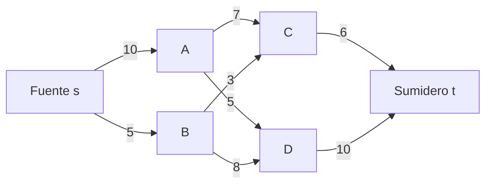
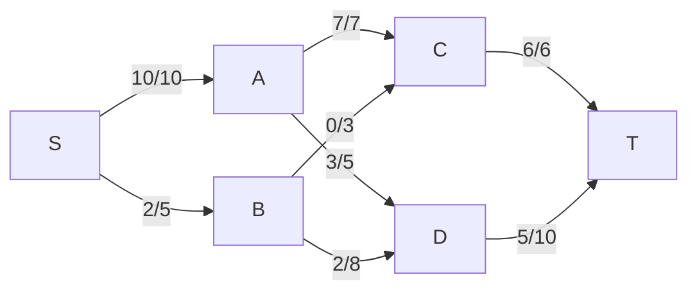

# Análisis de Algoritmos - Algoritmos para teoría de gráficas

## 4.4 Teoría de redes.

---

La teoría de redes (o teoría de flujos en redes) es una rama fundamental de la teoría de gráficas que estudia el flujo de recursos a través de redes. Tiene aplicaciones en transporte, redes de comunicación, logística y sistemas de distribución.

### Definiciones Básicas

#### Red de Flujo

Una red de flujo es una gráfica dirigida $G = (V, E)$ con:

- Una fuente $s \in V$ (nodo de origen)
- Un sumidero $t \in V$ (nodo de destino)
- Una función de capacidad $c: E \rightarrow \mathbb{R}^+$

#### Flujo

Un flujo en una red es una función $f: E \rightarrow \mathbb{R}^+$ que satisface:

1. **Restricción de capacidad**: $0 \leq f(u, v) \leq c(u, v)$ para todo $(u, v) \in E$
2. **Conservación de flujo**: $\sum_{v \in V} f(u, v) = \sum_{v \in V} f(v, u)$ para todo $u \in V - \{s, t\}$

#### Valor del Flujo

El valor de un flujo $f$ se define como:

$$|f| = \sum_{v \in V} f(s, v) - \sum_{v \in V} f(v, s)$$

### Problemas Fundamentales

#### Flujo Máximo

Encontrar el flujo de máximo valor desde $s$ a $t$ que satisface las restricciones de capacidad.

#### Corte Mínimo

Un corte $(S, T)$ es una partición de $V$ con $s \in S$ y $t \in T$. La capacidad del corte es:

$$c(S, T) = \sum_{u \in S, v \in T} c(u, v)$$

### Teoremas Fundamentales

#### Teorema de Flujo Máximo - Corte Mínimo

El valor del flujo máximo es igual a la capacidad del corte mínimo:

$$\max |f| = \min c(S, T)$$

#### Lemma de la Optimalidad

Un flujo $f$ es máximo si y sólo si no existe camino de aumento en la red residual.

### Algoritmos Principales

#### Algoritmo de Ford-Fulkerson

##### Descripción

El algoritmo encuentra el flujo máximo mediante la búsqueda iterativa de caminos de aumento en la red residual.

##### Pseudocódigo

```
FORD-FULKERSON(G, s, t)
1. for cada arista (u, v) ∈ E[G]
2.     f[u, v] = 0
3.     f[v, u] = 0
4. while exista un camino p de s a t en la red residual G_f
5.     c_f(p) = min{c_f(u, v) : (u, v) ∈ p}
6.     for cada arista (u, v) ∈ p
7.         f[u, v] = f[u, v] + c_f(p)
8.         f[v, u] = -f[u, v]
```

##### Implementación en Python (usando BFS)

```python
from collections import deque

def ford_fulkerson(graph, capacities, s, t):
    n = len(graph)
    # Matriz de flujo
    flow = [[0] * n for _ in range(n)]
    max_flow = 0

    def bfs(residual_graph, parent):
        visited = [False] * n
        queue = deque([s])
        visited[s] = True

        while queue:
            u = queue.popleft()
            for v in residual_graph[u]:
                if not visited[v] and capacities[u][v] - flow[u][v] > 0:
                    visited[v] = True
                    parent[v] = u
                    queue.append(v)
                    if v == t:
                        return True
        return False

    parent = [-1] * n
    while bfs(graph, parent):
        path_flow = float('inf')
        v = t

        # Encontrar la capacidad residual mínima
        while v != s:
            u = parent[v]
            path_flow = min(path_flow, capacities[u][v] - flow[u][v])
            v = u

        # Actualizar flujos
        v = t
        while v != s:
            u = parent[v]
            flow[u][v] += path_flow
            flow[v][u] -= path_flow
            v = u

        max_flow += path_flow

    return max_flow, flow
```

#### Algoritmo de Edmonds-Karp

##### Descripción

Variante de Ford-Fulkerson que usa BFS para encontrar caminos de aumento, garantizando complejidad polinomial.

##### Complejidad

- $O(VE^2)$

#### Algoritmo de Dinic

##### Descripción

Algoritmo más eficiente que usa el concepto de gráfica de niveles y bloqueo de flujo.

##### Implementación en Python

```python
def dinic(graph, capacities, s, t):
    n = len(graph)
    flow = [[0] * n for _ in range(n)]
    level = [-1] * n

    def bfs():
        nonlocal level
        level = [-1] * n
        queue = deque([s])
        level[s] = 0

        while queue:
            u = queue.popleft()
            for v in graph[u]:
                if level[v] == -1 and capacities[u][v] - flow[u][v] > 0:
                    level[v] = level[u] + 1
                    queue.append(v)
        return level[t] != -1

    def dfs(u, flow_in):
        if u == t:
            return flow_in

        for v in graph[u]:
            if level[v] == level[u] + 1 and capacities[u][v] - flow[u][v] > 0:
                pushed = dfs(v, min(flow_in, capacities[u][v] - flow[u][v]))
                if pushed > 0:
                    flow[u][v] += pushed
                    flow[v][u] -= pushed
                    return pushed
        return 0

    max_flow = 0
    while bfs():
        while True:
            pushed = dfs(s, float('inf'))
            if pushed == 0:
                break
            max_flow += pushed

    return max_flow, flow
```

##### Complejidad

- $O(V^2E)$

### Aplicaciones Especiales

#### Acoplamiento Bipartito Máximo

Problema reducible a flujo máximo.

#### Múltiples Fuentes y Sumideros

Se resuelve agregando una superfuente y un supersumidero.

### Diagramas



**Red residual correspondiente** (después de enviar flujo inicial):



### Ejemplos

#### Ejemplo 1: Flujo Máximo

Para la red:

- s → A: capacidad 10
- s → B: capacidad 5
- A → C: capacidad 7
- A → D: capacidad 5
- B → C: capacidad 3
- B → D: capacidad 8
- C → t: capacidad 6
- D → t: capacidad 10

El flujo máximo es 11.

#### Ejemplo 2: Acoplamiento Bipartito

Convertir problema de acoplamiento en red de flujo:

- Conectar fuente a todos los vértices del conjunto izquierdo
- Conectar todos los vértices del conjunto derecho al sumidero
- Capacidades unitarias

### Ejercicios Propuestos

1. **Ejercicio Básico**: Calcula manualmente el flujo máximo para la red:

   ```
   s → A: 10, s → B: 5
   A → C: 8, A → D: 3
   B → C: 4, B → D: 7
   C → t: 6, D → t: 9
   ```

2. **Ejercicio de Implementación**: Implementa el algoritmo de Edmonds-Karp y compáralo con Ford-Fulkerson.

3. **Ejercicio Teórico**: Demuestra el teorema de flujo máximo - corte mínimo.

4. **Ejercicio de Aplicación**: Modela el problema de asignación de tareas como problema de flujo.

5. **Ejercicio Avanzado**: Extiende el algoritmo de Dinic para manejar capacidades variables en el tiempo.

### Referencias

#### Bibliografía Básica

1. Cormen, T. H., Leiserson, C. E., Rivest, R. L., & Stein, C. (2009). _Introduction to Algorithms_ (3rd ed.). MIT Press. (Capítulo 26)
2. Kleinberg, J., & Tardos, É. (2005). _Algorithm Design_. Addison Wesley. (Capítulo 7)

#### Bibliografía Complementaria

1. Skiena, S. S. (2008). _The Algorithm Design Manual_ (2nd ed.). Springer. (Capítulo 8)
2. Ahuja, R. K., Magnanti, T. L., & Orlin, J. B. (1993). _Network Flows: Theory, Algorithms, and Applications_. Prentice Hall.

### Consejos de Estudio

1. **Visualización**: Dibuja las redes y sus redes residuales para entender los algoritmos.
2. **Implementación**: Codifica todos los algoritmos y prueba con redes de diferentes tamaños.
3. **Análisis**: Comprende las diferencias de complejidad entre los algoritmos.
4. **Aplicaciones**: Identifica problemas prácticos que pueden modelarse como redes de flujo.
