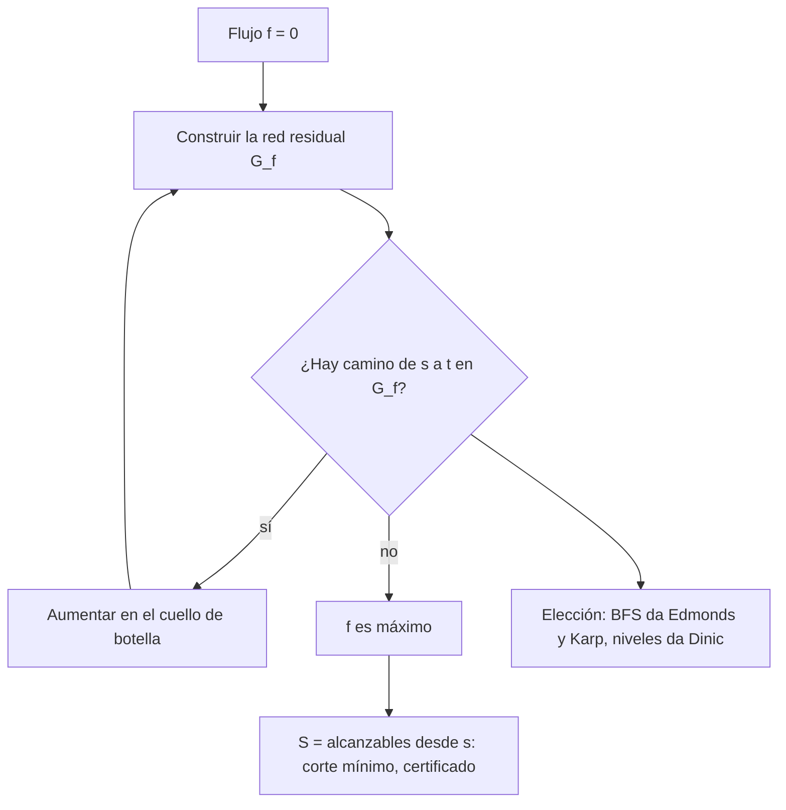

# Análisis de Algoritmos - Algoritmos para teoría de gráficas

## 4.4 Teoría de redes.

---

Una **red de flujo** modela el transporte de una mercancía (agua, datos, vehículos, mercancías) desde una fuente hasta un sumidero a través de conductos de capacidad limitada. El problema del **flujo máximo** pregunta cuánto se puede enviar, y su dual, el **corte mínimo**, cuál es el cuello de botella. Ambos se resuelven en tiempo polinomial y sirven para muchos problemas que a primera vista no tratan de flujos: apareamientos en gráficas bipartitas, asignación de tareas, conectividad, segmentación de imágenes. Este tema define las redes y los flujos, demuestra el teorema de flujo máximo y corte mínimo, y analiza los algoritmos de Ford y Fulkerson, Edmonds y Karp, y Dinic.

### Redes y flujos

Una **red de flujo** es una gráfica dirigida $G = (V, E)$ con una **capacidad** $c(u, v) \geq 0$ en cada arista, una **fuente** $s$ y un **sumidero** $t.$ Un **flujo** es una función $f : E \to \mathbb{R}$ que cumple:

- **Capacidad:** $0 \leq f(u, v) \leq c(u, v).$
- **Conservación:** para todo $v \neq s, t,$ lo que entra es igual a lo que sale, $\sum_u f(u, v) = \sum_w f(v, w).$

El **valor** $|f|$ es el flujo neto que sale de $s.$ Un **corte** $(S, T)$ es una partición de $V$ con $s \in S$ y $t \in T;$ su **capacidad** es la suma de las capacidades de las aristas de $S$ a $T.$

**Lema.** Para todo flujo $f$ y todo corte $(S, T),$ el flujo neto que cruza el corte es $|f|,$ y por tanto $|f| \leq c(S, T).$

**Demostración.** Sumando la conservación sobre los vértices de $S$ distintos de $s,$ el flujo neto que sale de $S$ es el que sale de $s,$ $|f|.$ Ese flujo neto es lo que va de $S$ a $T$ menos lo que vuelve de $T$ a $S;$ lo primero es a lo sumo $c(S, T)$ y lo segundo es no negativo. $\blacksquare$

### Red residual y caminos aumentantes

Dado un flujo $f,$ la **red residual** $G_f$ tiene, para cada arista $uv,$ una arista $uv$ con capacidad residual $c(u, v) - f(u, v)$ (lo que aún cabe) y una arista $vu$ con capacidad $f(u, v)$ (lo que se puede deshacer). Un **camino aumentante** es un camino de $s$ a $t$ en $G_f$ con capacidades residuales positivas; aumentar el flujo a lo largo de él en su capacidad mínima, el **cuello de botella**, da un flujo válido de mayor valor.

**Teorema de flujo máximo y corte mínimo** (Ford y Fulkerson, 1956). Son equivalentes:

1. $f$ es un flujo máximo;
2. no hay caminos aumentantes en $G_f;$
3. $|f| = c(S, T)$ para algún corte $(S, T).$

**Demostración.** $1 \Rightarrow 2:$ si hubiera un camino aumentante, el flujo aumentaría. $2 \Rightarrow 3:$ sea $S$ el conjunto de vértices alcanzables desde $s$ en $G_f;$ $t \notin S$ porque no hay camino aumentante. Toda arista $uv$ de $S$ a $T$ está saturada, $f(u, v) = c(u, v),$ porque si no $v$ sería alcanzable; toda arista $vu$ de $T$ a $S$ tiene flujo cero, porque si no la arista residual $uv$ haría alcanzable a $v.$ Así, el flujo neto por el corte es $c(S, T),$ y por el lema es $|f|.$ $3 \Rightarrow 1:$ por el lema, ningún flujo supera $c(S, T) = |f|.$ $\blacksquare$

El teorema da a la vez un algoritmo y un **certificado**: el corte mínimo demuestra que el flujo no se puede mejorar. Además, si las capacidades son enteras, el flujo máximo puede tomarse **entero** (teorema de integralidad), porque cada aumento suma un entero.

### Algoritmos

- **Ford y Fulkerson:** mientras exista un camino aumentante, aumentar. Con capacidades enteras termina en a lo sumo $|f^*|$ aumentos, $O(m \, |f^*|):$ **pseudopolinomial**, porque una mala elección de caminos puede hacer un aumento de 1 por iteración (ejercicio 2). Con capacidades irracionales puede no terminar.
- **Edmonds y Karp** (1972): elegir siempre el camino aumentante más corto en número de aristas, con BFS. La distancia de $s$ a cada vértice en la red residual nunca disminuye, y cada arista puede ser cuello de botella $O(n)$ veces, así que hay $O(nm)$ aumentos: $O(nm^2)$ en total, polinomial e independiente de las capacidades.
- **Dinic** (1970): en cada **fase** se construye la **gráfica de niveles** con BFS y se encuentra en ella un **flujo bloqueante** con DFS, saturando todos los caminos más cortos a la vez. La distancia de $s$ a $t$ aumenta en cada fase, así que hay a lo sumo $n - 1$ fases de $O(nm):$ $O(n^2 m).$ En redes de capacidad unitaria es $O(m \sqrt{n})$ para apareamientos bipartitos (Hopcroft y Karp).
- Los algoritmos de **empuje y reetiquetado** (Goldberg y Tarjan) logran $O(n^3)$ o mejor, y en 2022 Chen y otros dieron un algoritmo de tiempo casi lineal $m^{1 + o(1)}.$



### Aplicaciones

- **Apareamiento bipartito máximo:** conectar $s$ con un lado y el otro lado con $t,$ todas las capacidades 1. Un flujo entero máximo es un apareamiento máximo (ejercicio 4). Su dual es el teorema de König: en gráficas bipartitas, el apareamiento máximo y la cubierta de vértices mínima tienen el mismo tamaño.
- **Caminos disjuntos:** el máximo número de caminos de $s$ a $t$ sin aristas en común es igual al mínimo número de aristas cuya eliminación los separa (teorema de Menger).
- **Varias fuentes o sumideros:** agregar una superfuente y un supersumidero.
- **Capacidades en vértices:** dividir cada vértice en una entrada y una salida unidas por una arista con esa capacidad.
- **Flujo de costo mínimo:** enviar una cantidad dada al menor costo; generaliza a la ruta más corta y al problema de asignación.

### Implementación en Python

El programa implementa Ford y Fulkerson (con DFS y con un adversario que siempre elige el camino de menor cuello de botella), Edmonds y Karp, y Dinic, junto con el corte mínimo. Resuelve la red del ejercicio 1, muestra el comportamiento pseudopolinomial de Ford y Fulkerson y compara los tres algoritmos con un corte mínimo por fuerza bruta en 200 redes aleatorias (ejercicio 2), resuelve una asignación de tareas (ejercicio 4) y calcula un flujo con capacidades que varían en el tiempo con una red expandida y Dinic (ejercicio 5).

```python
import random
from collections import deque
from itertools import combinations

random.seed(44)

class Red:
    def __init__(self, n):
        self.n, self.ady, self.cap, self.ini = n, [[] for _ in range(n)], {}, {}
    def arista(self, u, v, c):
        if (u, v) not in self.cap:
            self.ady[u].append(v); self.ady[v].append(u)
            self.cap.setdefault((v, u), 0)
            self.cap[(u, v)] = 0
        self.cap[(u, v)] += c
        self.ini[(u, v)] = self.ini.get((u, v), 0) + c
    def copia(self):
        r = Red(self.n)
        r.ady = [l[:] for l in self.ady]; r.cap = dict(self.cap); r.ini = dict(self.ini)
        return r

def aumenta(R, padre, s, t):
    b, v = float("inf"), t
    while v != s:
        u = padre[v]; b = min(b, R.cap[(u, v)]); v = u
    v = t
    while v != s:
        u = padre[v]; R.cap[(u, v)] -= b; R.cap[(v, u)] += b; v = u
    return b

def ford_fulkerson_dfs(R, s, t):
    flujo, aumentos = 0, 0
    while True:
        padre, pila = {s: None}, [s]
        while pila and t not in padre:
            u = pila.pop()
            for v in R.ady[u]:
                if v not in padre and R.cap[(u, v)] > 0:
                    padre[v] = u; pila.append(v)
        if t not in padre:
            return flujo, aumentos
        flujo += aumenta(R, padre, s, t); aumentos += 1

def edmonds_karp(R, s, t):
    flujo, aumentos = 0, 0
    while True:
        padre, cola = {s: None}, deque([s])
        while cola and t not in padre:
            u = cola.popleft()
            for v in R.ady[u]:
                if v not in padre and R.cap[(u, v)] > 0:
                    padre[v] = u; cola.append(v)
        if t not in padre:
            return flujo, aumentos
        flujo += aumenta(R, padre, s, t); aumentos += 1

def dinic(R, s, t):
    flujo, fases = 0, 0
    while True:
        nivel = {s: 0}; cola = deque([s])
        while cola:
            u = cola.popleft()
            for v in R.ady[u]:
                if v not in nivel and R.cap[(u, v)] > 0:
                    nivel[v] = nivel[u] + 1; cola.append(v)
        if t not in nivel:
            return flujo, fases
        fases += 1
        it = {u: 0 for u in range(R.n)}
        def dfs(u, f):
            if u == t:
                return f
            while it[u] < len(R.ady[u]):
                v = R.ady[u][it[u]]
                if R.cap[(u, v)] > 0 and nivel.get(v) == nivel[u] + 1:
                    d = dfs(v, min(f, R.cap[(u, v)]))
                    if d:
                        R.cap[(u, v)] -= d; R.cap[(v, u)] += d
                        return d
                it[u] += 1
            return 0
        while True:
            f = dfs(s, float("inf"))
            if not f:
                break
            flujo += f

def corte_minimo(R, s):
    """Tras el flujo máximo: vértices alcanzables en la red residual."""
    S, cola = {s}, deque([s])
    while cola:
        u = cola.popleft()
        for v in R.ady[u]:
            if v not in S and R.cap[(u, v)] > 0:
                S.add(v); cola.append(v)
    return S

# --- Ejercicio 1 ---
nom = ["s", "A", "B", "C", "D", "t"]
idx = {x: i for i, x in enumerate(nom)}
R = Red(6)
for u, v, c in [("s", "A", 10), ("s", "B", 5), ("A", "C", 8), ("A", "D", 3),
                ("B", "C", 4), ("B", "D", 7), ("C", "t", 6), ("D", "t", 9)]:
    R.arista(idx[u], idx[v], c)
f, k = edmonds_karp(R, 0, 5)
S = corte_minimo(R, 0)
print("ejercicio 1: flujo máximo", f, "con", k, "caminos aumentantes")
print("   flujo por arista:", {f"{nom[u]}{nom[v]}": R.ini[(u, v)] - R.cap[(u, v)] for (u, v) in R.ini})
corte = [(u, v) for (u, v) in R.ini if u in S and v not in S]
print("   corte mínimo S =", sorted(nom[x] for x in S), "aristas", [nom[u] + nom[v] for u, v in corte],
      "capacidad", sum(R.ini[e] for e in corte))

# --- Ejercicio 2: Ford-Fulkerson con DFS frente a Edmonds-Karp ---
def red_mala(C):
    R = Red(4)
    R.arista(0, 1, C); R.arista(0, 2, C); R.arista(1, 2, 1); R.arista(1, 3, C); R.arista(2, 3, C)
    return R

def ford_fulkerson_adversario(R, s, t):
    """Elige siempre el camino aumentante de MENOR cuello de botella."""
    flujo, aumentos = 0, 0
    while True:
        peor = None
        def caminos(u, visto, camino):
            nonlocal peor
            if u == t:
                b = min(R.cap[e] for e in zip(camino, camino[1:]))
                if peor is None or b < peor[0]:
                    peor = (b, camino[:])
                return
            for v in R.ady[u]:
                if v not in visto and R.cap[(u, v)] > 0:
                    visto.add(v); camino.append(v)
                    caminos(v, visto, camino)
                    camino.pop(); visto.discard(v)
        caminos(s, {s}, [s])
        if peor is None:
            return flujo, aumentos
        padre = {b: a for a, b in zip(peor[1], peor[1][1:])}
        flujo += aumenta(R, padre, s, t); aumentos += 1

print("ejercicio 2:")
for C in (10, 100, 1000):
    print(f"   capacidad {C:4}: Ford-Fulkerson adversario {ford_fulkerson_adversario(red_mala(C), 0, 3)},"
          f" Edmonds-Karp {edmonds_karp(red_mala(C), 0, 3)}, Dinic {dinic(red_mala(C), 0, 3)}"
          "  (flujo, aumentos o fases)")

def red_aleatoria(n, p, cmax):
    R = Red(n)
    for u in range(n):
        for v in range(n):
            if u != v and random.random() < p:
                R.arista(u, v, random.randint(1, cmax))
    return R

ok = True
for _ in range(200):
    n = random.randint(2, 8)
    R = red_aleatoria(n, 0.4, 20)
    a, b, c = ford_fulkerson_dfs(R.copia(), 0, n - 1)[0], edmonds_karp(R.copia(), 0, n - 1)[0], dinic(R.copia(), 0, n - 1)[0]
    # corte mínimo por fuerza bruta sobre todos los S con s dentro y t fuera
    mejor = min(sum(c for (u, v), c in R.ini.items() if u in S and v not in S)
                for k in range(n - 1) for S in ({0} | set(T) for T in combinations(range(1, n - 1), k)))
    ok &= a == b == c == mejor
print("   los tres algoritmos y el corte mínimo por fuerza bruta coinciden en 200 redes:", ok)

# --- Ejercicio 4: asignación de tareas ---
trabajadores = ["Ana", "Beto", "Caro", "Dani"]
tareas = ["redes", "datos", "web", "pruebas"]
puede = {"Ana": ["redes", "datos"], "Beto": ["datos"], "Caro": ["datos", "web", "pruebas"], "Dani": ["web"]}
n = 2 + len(trabajadores) + len(tareas)
s, t = 0, n - 1
R = Red(n)
for i, a in enumerate(trabajadores, 1):
    R.arista(s, i, 1)
    for x in puede[a]:
        R.arista(i, 1 + len(trabajadores) + tareas.index(x), 1)
for j in range(len(tareas)):
    R.arista(1 + len(trabajadores) + j, t, 1)
f, _ = edmonds_karp(R, s, t)
asign = [(trabajadores[i - 1], tareas[j - 1 - len(trabajadores)])
         for (i, j), c in R.ini.items() if 1 <= i <= 4 and j > 4 and j < t and R.cap[(i, j)] == 0]
print("ejercicio 4: tareas asignadas", f, asign)

# --- Ejercicio 5: capacidades que varían en el tiempo (red expandida) ---
# arista (u, v): capacidad en cada paso de tiempo; el viaje tarda 1 paso; se puede esperar en un vértice
T = 4
cap_t = {("s", "a"): [3, 3, 0, 0], ("s", "b"): [2, 2, 2, 2], ("a", "t"): [0, 1, 4, 4],
         ("b", "a"): [1, 1, 1, 1], ("b", "t"): [1, 0, 1, 0]}
vert = ["s", "a", "b", "t"]
id_ = {(x, k): i for i, (x, k) in enumerate((x, k) for k in range(T + 1) for x in vert)}
R = Red(len(id_) + 2)
S0, T0 = len(id_), len(id_) + 1
for k in range(T):
    for (u, v), caps in cap_t.items():
        if caps[k]:
            R.arista(id_[(u, k)], id_[(v, k + 1)], caps[k])
    for x in vert[:-1]:                             # esperar (almacenamiento ilimitado)
        R.arista(id_[(x, k)], id_[(x, k + 1)], 10**9)
for k in range(T + 1):
    R.arista(S0, id_[("s", k)], 10**9 if k == 0 else 0)
    R.arista(id_[("t", k)], T0, 10**9)
f, fases = dinic(R, S0, T0)
llegadas = [R.ini[(id_[("t", k)], T0)] - R.cap[(id_[("t", k)], T0)] for k in range(T + 1)]
print(f"ejercicio 5: red expandida con {len(id_)} copias de vértices; flujo máximo en {T} pasos = {f}"
      f" ({fases} fases de Dinic); unidades que llegan a t en cada paso: {llegadas}")
```

Salida:

```text
ejercicio 1: flujo máximo 14 con 3 caminos aumentantes
   flujo por arista: {'sA': 9, 'sB': 5, 'AC': 6, 'AD': 3, 'BC': 0, 'BD': 5, 'Ct': 6, 'Dt': 8}
   corte mínimo S = ['A', 'C', 's'] aristas ['sB', 'AD', 'Ct'] capacidad 14
ejercicio 2:
   capacidad   10: Ford-Fulkerson adversario (20, 20), Edmonds-Karp (20, 2), Dinic (20, 1)  (flujo, aumentos o fases)
   capacidad  100: Ford-Fulkerson adversario (200, 200), Edmonds-Karp (200, 2), Dinic (200, 1)  (flujo, aumentos o fases)
   capacidad 1000: Ford-Fulkerson adversario (2000, 2000), Edmonds-Karp (2000, 2), Dinic (2000, 1)  (flujo, aumentos o fases)
   los tres algoritmos y el corte mínimo por fuerza bruta coinciden en 200 redes: True
ejercicio 4: tareas asignadas 4 [('Ana', 'redes'), ('Beto', 'datos'), ('Caro', 'pruebas'), ('Dani', 'web')]
ejercicio 5: red expandida con 20 copias de vértices; flujo máximo en 4 pasos = 9 (3 fases de Dinic); unidades que llegan a t en cada paso: [0, 0, 1, 5, 3]
```

### Ejercicios Propuestos

1. **Flujo máximo a mano.** Calcula el flujo máximo de la red con aristas $s \to A$ de capacidad 10, $s \to B$ 5, $A \to C$ 8, $A \to D$ 3, $B \to C$ 4, $B \to D$ 7, $C \to t$ 6 y $D \to t$ 9.

2. **Edmonds y Karp.** Implementa Edmonds y Karp y compáralo con Ford y Fulkerson.

3. **Teorema.** Demuestra el teorema de flujo máximo y corte mínimo.

4. **Asignación.** Modela la asignación de tareas a trabajadores como un problema de flujo.

5. **Capacidades variables.** Extiende el algoritmo de Dinic para manejar capacidades que varían en el tiempo.

### Soluciones

**Ejercicio 1.** El flujo máximo es **14**. Una descomposición en caminos: $s \to A \to C \to t$ con 6, $s \to A \to D \to t$ con 3 y $s \to B \to D \to t$ con 5. El corte $S = \{s, A, C\}$ tiene aristas de salida $s \to B$ (5), $A \to D$ (3) y $C \to t$ (6), con capacidad $5 + 3 + 6 = 14,$ lo que certifica que no se puede enviar más. Aunque $s$ puede emitir 15 y $t$ recibir 15, $A$ solo puede pasar 9: lo que entra a $C$ está limitado por $C \to t,$ y $A \to D$ es pequeña.

**Ejercicio 2.** Ver el programa. En la red de cuatro vértices con aristas de capacidad $C$ y una arista central de capacidad 1, un Ford y Fulkerson que siempre elige el camino de menor cuello de botella alterna entre $s \to 1 \to 2 \to t$ y $s \to 2 \to 1 \to t,$ usando la arista central en un sentido y luego deshaciéndola: $2C$ aumentos de 1 cada uno. Edmonds y Karp usa los caminos más cortos, $s \to 1 \to t$ y $s \to 2 \to t,$ y termina en 2 aumentos, sin importar $C;$ Dinic los encuentra en una sola fase. En redes aleatorias, los tres coinciden con el corte mínimo calculado por fuerza bruta.

**Ejercicio 3.** Es el teorema de flujo máximo y corte mínimo, con su demostración.

**Ejercicio 4.** Se construye la red: $s \to$ cada trabajador con capacidad 1 (cada uno hace una tarea), trabajador $\to$ tarea con capacidad 1 si puede hacerla, y tarea $\to t$ con capacidad 1 (cada tarea se asigna una vez). Por integralidad, un flujo máximo entero asigna cada trabajador a lo sumo a una tarea, y su valor es el número máximo de asignaciones. En el ejemplo se asignan las 4 tareas. Si cada trabajador puede hacer hasta $k$ tareas, basta poner capacidad $k$ en su arista desde $s;$ si las asignaciones tienen costos, es un flujo de costo mínimo o el método húngaro.

**Ejercicio 5.** Si la capacidad de cada arista depende del instante y cruzarla toma un paso, se construye la **red expandida en el tiempo**: una copia $v_k$ de cada vértice para cada instante $k = 0, \ldots, T;$ una arista $u_k \to v_{k+1}$ con la capacidad de $uv$ en el instante $k;$ aristas de espera $v_k \to v_{k+1}$ con la capacidad de almacenamiento del vértice, y la fuente $s_0$ y un supersumidero unido a todas las copias de $t.$ El flujo máximo en la red expandida es la máxima cantidad que llega a $t$ en el horizonte $T,$ y Dinic se aplica sin cambios. El costo es el de Dinic sobre una red con $n(T + 1)$ vértices y $O((n + m) T)$ aristas: polinomial en $T,$ es decir, pseudopolinomial en la representación del horizonte. En el ejemplo llegan 9 unidades en 4 pasos.

### Referencias

1. Cormen, T. H., Leiserson, C. E., Rivest, R. L., and Stein, C., _Introduction to Algorithms_. MIT Press, 2022. Capítulo 24.
2. Ford, L. R., and Fulkerson, D. R., Maximal flow through a network. _Canadian Journal of Mathematics_ 8, 1956.
3. Edmonds, J., and Karp, R. M., Theoretical improvements in algorithmic efficiency for network flow problems. _Journal of the ACM_ 19(2), 1972.
4. Ahuja, R. K., Magnanti, T. L., and Orlin, J. B., _Network Flows: Theory, Algorithms, and Applications_. Prentice Hall, 1993.
