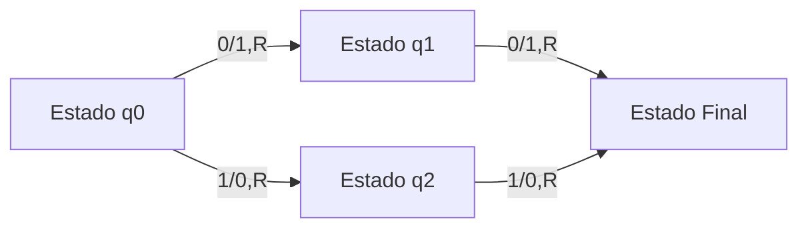

# Análisis de Algoritmos - Temas selectos

## 5.1 Algoritmos deterministas y no-deterministas.

---

En el estudio de la teoría de la computación y el análisis de algoritmos, la distinción entre algoritmos deterministas y no-deterministas es fundamental. Esta diferencia no solo afecta cómo diseñamos algoritmos, sino también cómo entendemos los límites de lo que es computable y la eficiencia con que podemos resolver problemas.

### Definiciones Fundamentales

#### Algoritmo Determinista

Un algoritmo determinista es aquel que, dado una entrada particular, siempre producirá la misma salida y la máquina que lo ejecuta pasa por la misma secuencia de estados. En cada paso del algoritmo, la siguiente acción está completamente determinada por el estado actual.

**Definición formal**: Un algoritmo es determinista si para cada estado y cada símbolo de entrada, existe exactamente una transición posible a un siguiente estado.

#### Algoritmo No-Determinista

Un algoritmo no-determinista es aquel que, para un estado dado y un símbolo de entrada, puede tener múltiples transiciones posibles a diferentes estados. Estos algoritmos "adivinan" el camino correcto hacia la solución.

**Definición formal**: Un algoritmo es no-determinista si para algún estado y algún símbolo de entrada, existe más de una transición posible a un siguiente estado.

### Modelos Formales

#### Máquina de Turing Determinista (MTD)

Una MTD se define por la tupla:

$$M = (Q, \Sigma, \Gamma, \delta, q_0, B, F)$$

Donde:

- $Q$: Conjunto finito de estados
- $\Sigma$: Alfabeto de entrada
- $\Gamma$: Alfabeto de la cinta $(\Sigma \subseteq \Gamma)$
- $\delta$: Función de transición $\delta: Q \times \Gamma \rightarrow Q \times \Gamma \times \{L, R\}$
- $q_0$: Estado inicial
- $B$: Símbolo blanco $(B \in \Gamma - \Sigma)$
- $F$: Conjunto de estados finales

#### Máquina de Turing No-Determinista (MTN)

Una MTN se define de manera similar pero con una función de transición diferente:

$$\delta: Q \times \Gamma \rightarrow \mathcal{P}(Q \times \Gamma \times \{L, R\})$$

Donde $\mathcal{P}$ denota el conjunto potencia, permitiendo múltiples transiciones posibles.

### Complejidad Computacional

#### Clases de Complejidad

- **P**: Clase de problemas decidibles en tiempo polinomial por una MTD
- **NP**: Clase de problemas decidibles en tiempo polinomial por una MTN
- **NP-completo**: Problemas en NP a los que cualquier problema en NP puede reducirse en tiempo polinomial

#### Relación entre P y NP

El problema más famoso en ciencias de la computación es si P = NP. Se conjetura que:

$$P \subseteq NP$$

pero no se sabe si:

$$NP \subseteq P$$

### Ejemplos y Aplicaciones

#### Algoritmo Determinista: Búsqueda Binaria

```python
def busqueda_binaria(arr, objetivo):
    izquierda, derecha = 0, len(arr) - 1

    while izquierda <= derecha:
        medio = (izquierda + derecha) // 2
        if arr[medio] == objetivo:
            return medio
        elif arr[medio] < objetivo:
            izquierda = medio + 1
        else:
            derecha = medio - 1

    return -1
```

#### Algoritmo No-Determinista: SAT (Satisfacibilidad Booleana)

El problema SAT pregunta: dada una fórmula booleana, ¿existe una asignación de valores que la haga verdadera?

Una MTN para SAT "adivinaría" la asignación correcta y luego verificaría en tiempo polinomial.

### Diagrama de Estados



Este diagrama muestra un autómata no-determinista donde desde el estado q0 hay dos transiciones posibles con la misma entrada.

### Ejercicios Propuestos

1. **Ejercicio 1**: Demuestre que toda MTN tiene una MTD equivalente que reconoce el mismo lenguaje.

2. **Ejercicio 2**: Para el siguiente autómata no-determinista, encuentre el autómata determinista equivalente:
   - Estados: {q0, q1, q2}
   - Estado inicial: q0
   - Estados finales: {q2}
   - Transiciones:
     - δ(q0, 0) = {q0, q1}
     - δ(q0, 1) = {q0}
     - δ(q1, 0) = {q2}
     - δ(q1, 1) = {q2}

3. **Ejercicio 3**: Explique por qué los algoritmos no-deterministas son útiles en la teoría de la complejidad aunque no puedan ser implementados directamente en hardware convencional.

4. **Ejercicio 4**: Demuestre que si un problema está en NP, entonces existe un algoritmo determinista que lo resuelve en tiempo $O(2^{p(n)})$ para algún polinomio p.

### Implementación de Simulación No-Determinista

Aunque no podemos implementar verdadero no-determinismo, podemos simularlo mediante búsqueda:

```python
def simular_mtn(transiciones, estado_actual, cadena, indice):
    if indice == len(cadena):
        return estado_actual in estados_finales

    simbolo = cadena[indice]
    next_states = transiciones.get((estado_actual, simbolo), [])

    for next_state in next_states:
        if simular_mtn(transiciones, next_state, cadena, indice + 1):
            return True

    return False
```

### Aplicaciones Prácticas

Los algoritmos no-deterministas son principalmente un constructo teórico, pero tienen aplicaciones importantes en:

1. **Diseño de algoritmos de aproximación**
2. **Algoritmos de backtracking optimizados**
3. **Planificación y scheduling**
4. **Procesamiento de lenguajes naturales**
5. **Sistemas expertos y inteligencia artificial**

### Referencias

#### Bibliografía Básica

1. Cormen, T. H., Leiserson, C. E., Rivest, R. L., & Stein, C. (2009). Introduction to Algorithms (3rd ed.). MIT Press. (Capítulos 34 y 35)
2. Kleinberg, J., & Tardos, É. (2005). Algorithm Design. Addison Wesley. (Capítulo 8)

#### Bibliografía Complementaria

1. Skiena, S. S. (2008). The Algorithm Design Manual (2nd ed.). Springer. (Capítulo 10)
2. Dasgupta, S., Papadimitriou, C., & Vazirani, U. (2006). Algorithms. McGraw-Hill. (Capítulo 8)
3. Warren, H. S. (2002). Hacker's Delight. Addison-Wesley Professional.
4. Graham, R. L., Knuth, D. E., & Patashnik, O. (1994). Concrete Mathematics: A Foundation for Computer Science (2nd ed.). Addison-Wesley Professional.

#### Recursos Adicionales

- Sipser, M. (2012). Introduction to the Theory of Computation (3rd ed.). Cengage Learning.
- Arora, S., & Barak, B. (2009). Computational Complexity: A Modern Approach. Cambridge University Press.
