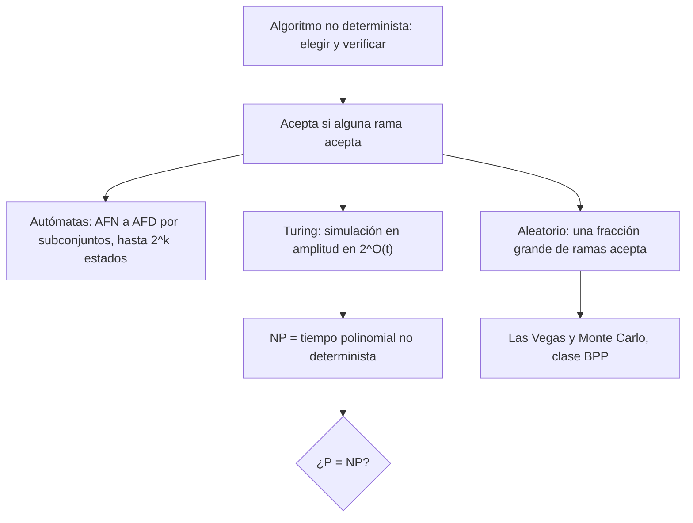

# Análisis de Algoritmos - Temas selectos

## 5.1 Algoritmos deterministas y no-deterministas.

---

Un algoritmo **determinista** tiene, en cada paso, exactamente una acción posible: con la misma entrada recorre siempre el mismo cómputo. Un algoritmo **no determinista** puede tener varias acciones posibles en un paso y se considera que **acepta** si alguna de sus elecciones lleva a una respuesta afirmativa. El no determinismo no es un modelo de hardware real, sino una herramienta conceptual: describe con precisión la idea de "adivinar una solución y verificarla", que es exactamente la clase NP (tema 1.2). Este tema define el no determinismo en autómatas finitos y máquinas de Turing, demuestra que no aumenta lo que se puede calcular pero sí, aparentemente, la eficiencia, y lo distingue de los algoritmos **aleatorios**, que sí se ejecutan.

### No determinismo

Formalmente, un modelo no determinista reemplaza la función de transición por una **relación**: desde una configuración puede haber cero, una o varias siguientes. Las ejecuciones forman un **árbol de cómputo** cuya raíz es la configuración inicial. Para problemas de decisión:

- la máquina **acepta** $x$ si **alguna** rama termina aceptando;
- el **tiempo** con $x$ es la longitud de la rama más larga (o de la aceptante más corta, según la convención; para clases polinomiales da igual).

Dos formas equivalentes de pensarlo: la máquina **adivina** en cada bifurcación la elección correcta, o la máquina se **clona** y explora todas las ramas en paralelo. En pseudocódigo se escribe con una instrucción `elegir x ∈ S`, seguida de una verificación determinista.

```
SAT-NO-DETERMINISTA(φ con variables x1..xn)
1  para i ← 1 hasta n
2      elegir xi ∈ {falso, verdadero}       ▷ n pasos de adivinación
3  si φ(x1, ..., xn) es verdadera           ▷ verificación polinomial
4      aceptar
5  rechazar
```

### Autómatas finitos

Un **autómata finito no determinista** (AFN) puede tener varias transiciones con el mismo símbolo y acepta si algún camino termina en un estado final.

**Teorema** (Rabin y Scott, 1959). Todo AFN con $k$ estados tiene un AFD equivalente con a lo sumo $2^k$ estados.

**Demostración: construcción de subconjuntos.** Los estados del AFD son conjuntos de estados del AFN. El inicial es $\{q_0\};$ desde un conjunto $S,$ con el símbolo $a,$ se va al conjunto $\bigcup_{q \in S} \delta(q, a);$ un conjunto es final si contiene algún estado final. Por inducción sobre la longitud de $w,$ el AFD llega tras leer $w$ al conjunto exacto de estados en que podría estar el AFN, así que ambos aceptan las mismas cadenas. $\blacksquare$

La cota es justa: el lenguaje "el k-ésimo símbolo desde el final es 0" tiene un AFN de $k + 1$ estados, pero todo AFD que lo reconoce necesita $2^k,$ porque debe recordar los últimos $k$ símbolos. En autómatas finitos, el no determinismo no da más poder, pero sí una **concisión exponencial**.

### Máquinas de Turing

Una **máquina de Turing no determinista** (MTN) tiene una relación de transición $\delta \subseteq (Q \times \Gamma) \times (Q \times \Gamma \times \{L, R\}).$

**Teorema.** Toda MTN $N$ tiene una máquina determinista $D$ que acepta el mismo lenguaje. Si $N$ tarda $t(n),$ $D$ tarda $2^{O(t(n))}.$

**Demostración.** Sea $b$ el máximo número de elecciones en una transición de $N.$ $D$ recorre el árbol de cómputo de $N$ **en amplitud**: para cada longitud $\ell = 1, 2, \ldots$ y cada secuencia de elecciones $c \in \{1, \ldots, b\}^\ell,$ simula $N$ siguiendo $c$ y acepta si alguna simulación acepta. El recorrido en amplitud, y no en profundidad, es necesario: una rama infinita no debe impedir encontrar una aceptante. Si $N$ acepta en $t$ pasos, $D$ examina a lo sumo $\sum_{\ell \leq t} b^\ell = O(b^t)$ secuencias, cada una en $O(t)$ pasos: $O(t \, b^t) = 2^{O(t)}.$ $\blacksquare$

Así, el no determinismo **no cambia lo computable** (la tesis de Church y Turing se mantiene), pero la simulación conocida es exponencial. Si se puede hacer en tiempo polinomial es exactamente la pregunta $\text{P} = \text{NP}.$

**Clases.** $\text{NP} = \bigcup_k \text{NTIME}(n^k).$ Una MTN polinomial equivale a un verificador polinomial (tema 1.2): las elecciones de una rama aceptante son el **certificado**, y recíprocamente la MTN adivina el certificado y ejecuta el verificador. Para espacio, el **teorema de Savitch** muestra que el no determinismo cuesta a lo sumo un cuadrado: $\text{NSPACE}(s) \subseteq \text{SPACE}(s^2),$ y por tanto $\text{PSPACE} = \text{NPSPACE}.$

### No determinismo y aleatoriedad

Un algoritmo **aleatorio** sí se ejecuta: elige al azar en cada bifurcación y tiene una probabilidad de éxito. Se distinguen los de tipo **Las Vegas**, que siempre dan la respuesta correcta y cuyo tiempo es aleatorio (quicksort con pivote aleatorio), y los de tipo **Monte Carlo**, de tiempo fijo y respuesta correcta con alta probabilidad (prueba de primalidad de Miller y Rabin). El no determinismo pide solo que **una** rama acepte; la aleatoriedad, que una **fracción** grande lo haga. Por eso la clase BPP de los problemas con algoritmos aleatorios polinomiales de error acotado se cree igual a P, mientras que se cree que NP es mayor.



### Implementación en Python

El programa aplica la construcción de subconjuntos al AFN del ejercicio 2 y comprueba, en todas las cadenas de longitud hasta 12, que el AFN y el AFD aceptan el lenguaje "el penúltimo símbolo es 0". Mide la explosión exponencial con la familia "el k-ésimo símbolo desde el final es 0" y simula de forma determinista un algoritmo no determinista para SAT y para la suma de subconjuntos recorriendo todas las ramas de elección (ejercicio 4).

```python
from itertools import product

# --- Ejercicio 2: construcción de subconjuntos ---
delta = {("q0", "0"): {"q0", "q1"}, ("q0", "1"): {"q0"},
         ("q1", "0"): {"q2"}, ("q1", "1"): {"q2"}}
inicial, finales, alfabeto = "q0", {"q2"}, "01"

def acepta_afn(w):
    actuales = {inicial}
    for c in w:
        actuales = set().union(*(delta.get((q, c), set()) for q in actuales))
    return bool(actuales & finales)

def subconjuntos():
    ini = frozenset([inicial])
    estados, pendientes, trans = {ini}, [ini], {}
    while pendientes:
        S = pendientes.pop()
        for c in alfabeto:
            T = frozenset().union(*(delta.get((q, c), set()) for q in S))
            trans[(S, c)] = T
            if T not in estados:
                estados.add(T); pendientes.append(T)
    return ini, estados, trans

ini, estados, trans = subconjuntos()
nombre = lambda S: "{" + ",".join(sorted(S)) + "}" if S else "{}"
print("ejercicio 2: AFD por construcción de subconjuntos")
orden = sorted(estados, key=lambda S: (len(S), sorted(S)))
for S in orden:
    marca = "*" if S & finales else " "
    print(f"   {marca} {nombre(S):12} 0 -> {nombre(trans[(S, '0')]):12} 1 -> {nombre(trans[(S, '1')])}")

def acepta_afd(w):
    S = ini
    for c in w:
        S = trans[(S, c)]
    return bool(S & finales)

ok = all(acepta_afn(w) == acepta_afd(w) == (len(w) >= 2 and w[-2] == "0")
         for k in range(13) for w in map("".join, product("01", repeat=k)))
print("   AFN = AFD = 'el penúltimo símbolo es 0' en las 8191 cadenas de longitud <= 12:", ok)

# --- explosión exponencial: el k-ésimo símbolo desde el final es 0 ---
def afd_desde_final(k):
    """AFN con k + 1 estados; se cuentan los estados alcanzables del AFD."""
    d = {(0, "0"): {0, 1}, (0, "1"): {0}}
    for i in range(1, k):
        d[(i, "0")] = {i + 1}; d[(i, "1")] = {i + 1}
    ini = frozenset([0]); vistos, pend = {ini}, [ini]
    while pend:
        S = pend.pop()
        for c in "01":
            T = frozenset().union(*(d.get((q, c), set()) for q in S))
            if T not in vistos:
                vistos.add(T); pend.append(T)
    return len(vistos)

print("   estados del AFD para 'el k-ésimo desde el final es 0':",
      [(k, k + 1, afd_desde_final(k)) for k in range(1, 11)], "(k, AFN, AFD)")

# --- Ejercicio 4: simulación determinista de una elección no determinista ---
def formula(x):
    """(x1 o no x2) y (x2 o x3) y (no x1 o no x3) y (x3 o x4) y (no x2 o no x4)"""
    x1, x2, x3, x4 = x
    return (x1 or not x2) and (x2 or x3) and (not x1 or not x3) and (x3 or x4) and (not x2 or not x4)

def sat_no_determinista(n, verifica):
    """Una MTN 'adivina' x en n pasos y verifica en tiempo polinomial.
    La simulación determinista recorre las 2^n ramas del árbol de cómputo."""
    ramas = 0
    for x in product([False, True], repeat=n):
        ramas += 1
        if verifica(x):
            return x, ramas
    return None, ramas

x, ramas = sat_no_determinista(4, formula)
print("ejercicio 4: asignación encontrada", [int(v) for v in x], "tras", ramas, "de", 2 ** 4, "ramas")
x, ramas = sat_no_determinista(4, lambda x: formula(x) and x[0])
print("   exigiendo x1 = 1:", x, "tras", ramas, "ramas: insatisfacible, se exploran todas")

# --- suma de subconjuntos: árbol de elecciones ---
def ramas_aceptantes(A, t):
    acept = sum(1 for e in product([0, 1], repeat=len(A)) if sum(a for a, b in zip(A, e) if b) == t)
    return acept, 2 ** len(A)

print("   suma de subconjuntos {3, 34, 4, 12, 5, 2} con t = 9: ramas aceptantes / total =",
      ramas_aceptantes([3, 34, 4, 12, 5, 2], 9))
```

Salida:

```text
ejercicio 2: AFD por construcción de subconjuntos
     {q0}         0 -> {q0,q1}      1 -> {q0}
     {q0,q1}      0 -> {q0,q1,q2}   1 -> {q0,q2}
   * {q0,q2}      0 -> {q0,q1}      1 -> {q0}
   * {q0,q1,q2}   0 -> {q0,q1,q2}   1 -> {q0,q2}
   AFN = AFD = 'el penúltimo símbolo es 0' en las 8191 cadenas de longitud <= 12: True
   estados del AFD para 'el k-ésimo desde el final es 0': [(1, 2, 2), (2, 3, 4), (3, 4, 8), (4, 5, 16), (5, 6, 32), (6, 7, 64), (7, 8, 128), (8, 9, 256), (9, 10, 512), (10, 11, 1024)] (k, AFN, AFD)
ejercicio 4: asignación encontrada [0, 0, 1, 0] tras 3 de 16 ramas
   exigiendo x1 = 1: None tras 16 ramas: insatisfacible, se exploran todas
   suma de subconjuntos {3, 34, 4, 12, 5, 2} con t = 9: ramas aceptantes / total = (2, 64)
```

### Ejercicios Propuestos

1. **Equivalencia.** Demuestra que toda máquina de Turing no determinista tiene una determinista que reconoce el mismo lenguaje.

2. **AFN a AFD.** Encuentra el autómata determinista equivalente al AFN con estados $q_0,$ $q_1$ y $q_2,$ estado inicial $q_0,$ final $q_2$ y transiciones $\delta(q_0, 0) = \{q_0, q_1\},$ $\delta(q_0, 1) = \{q_0\},$ $\delta(q_1, 0) = \{q_2\}$ y $\delta(q_1, 1) = \{q_2\}.$

3. **Utilidad.** Explica por qué los algoritmos no deterministas son útiles en la teoría de la complejidad aunque no se puedan ejecutar en una computadora convencional.

4. **NP en tiempo exponencial.** Demuestra que si un problema está en NP, existe un algoritmo determinista que lo resuelve en tiempo $O(2^{p(n)})$ para algún polinomio $p.$

### Soluciones

**Ejercicio 1.** Es el teorema de la sección de máquinas de Turing, con la simulación en amplitud del árbol de cómputo.

**Ejercicio 2.** La construcción de subconjuntos produce 4 estados alcanzables, de los 8 posibles: $\{q_0\}$ (inicial), $\{q_0, q_1\},$ $\{q_0, q_2\}$ y $\{q_0, q_1, q_2\},$ los dos últimos finales, con las transiciones de la tabla del programa. El AFN acepta las cadenas cuyo **penúltimo símbolo es 0:** $q_0$ lee cualquier prefijo, adivina con un 0 que faltan dos símbolos pasando a $q_1,$ y $q_1$ consume uno más para llegar a $q_2.$ El AFD recuerda los dos últimos símbolos: $\{q_0\}$ significa "los dos últimos son 11" (o la cadena es más corta), $\{q_0, q_1\}$ "10", $\{q_0, q_2\}$ "01" y $\{q_0, q_1, q_2\}$ "00". Es mínimo, porque los cuatro estados distinguen sufijos distintos.

**Ejercicio 3.** Porque capturan la estructura de los problemas de búsqueda: NP es exactamente la clase de problemas cuya solución, una vez adivinada, se verifica en tiempo polinomial. Eso permite (a) **clasificar** problemas, pues la NP-completitud se define con este modelo; (b) **demostrar** cotas y relaciones, como Savitch o la jerarquía no determinista; (c) **diseñar**, porque un algoritmo no determinista es una especificación precisa del espacio de búsqueda que luego se explora con retroceso, ramificación y acotamiento o heurísticas; y (d) describir lenguajes de forma concisa, como los AFN y las expresiones regulares, que se compilan a AFD.

**Ejercicio 4.** Si $A \in \text{NP},$ existe un verificador $V(x, c)$ que corre en tiempo $q(|x|)$ y certificados de longitud a lo sumo $r(|x|),$ con $q$ y $r$ polinomios. El algoritmo determinista prueba todos los certificados $c$ de longitud a lo sumo $r(n),$ que son menos de $2^{r(n)+1},$ y acepta si alguno hace que $V$ acepte. Tiempo: $2^{r(n)+1} \cdot q(n) \leq 2^{p(n)}$ con $p(n) = r(n) + 1 + \lceil \log_2 q(n) \rceil,$ que está acotado por un polinomio. $\blacksquare$ Por tanto $\text{NP} \subseteq \text{EXP}.$ El programa lo ilustra con SAT: con una fórmula satisfacible puede encontrar pronto una rama aceptante, pero con una insatisfacible debe recorrer las $2^n.$

### Referencias

1. Sipser, M., _Introduction to the Theory of Computation_. Cengage, 2012. Secciones 1.2, 3.2 y 7.3.
2. Rabin, M. O., and Scott, D., Finite automata and their decision problems. _IBM Journal of Research and Development_ 3(2), 1959.
3. Arora, S., and Barak, B., _Computational Complexity: A Modern Approach_. Cambridge University Press, 2009. Capítulos 2, 4 y 7.
4. Motwani, R., and Raghavan, P., _Randomized Algorithms_. Cambridge University Press, 1995. Capítulo 1.
