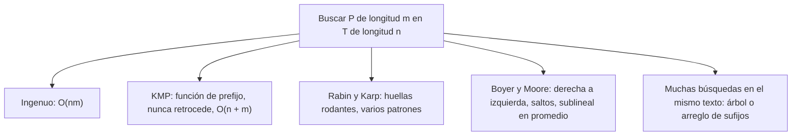

# Análisis de Algoritmos - Temas selectos

## 5.2 Algoritmos para apareamiento de cadenas.

---

El **apareamiento de cadenas** (_string matching_) consiste en encontrar todas las apariciones de un **patrón** $P$ de longitud $m$ en un **texto** $T$ de longitud $n.$ Es lo que hace la búsqueda de un editor de texto, `grep`, un detector de virus o un alineador de secuencias de ADN. El algoritmo ingenuo cuesta $O(nm),$ y las tres ideas clásicas para mejorarlo son aprovechar lo que ya se leyó para no retroceder en el texto (**Knuth, Morris y Pratt**), comparar huellas numéricas en lugar de cadenas (**Rabin y Karp**) y comparar de derecha a izquierda para saltar grandes partes del texto (**Boyer y Moore**). Este tema las presenta con sus análisis y sus peores casos.

### Definiciones

Sean $T[0..n-1]$ y $P[0..m-1]$ cadenas sobre un alfabeto $\Sigma.$ El patrón **aparece con desplazamiento** $s$ si $T[s..s+m-1] = P,$ con $0 \leq s \leq n - m.$ Un **prefijo** de $P$ es $P[0..k-1]$ y un **sufijo** $P[m-k..m-1];$ un **borde** es una cadena que es a la vez prefijo propio y sufijo.

### Algoritmo ingenuo

Probar cada desplazamiento $s$ y comparar carácter por carácter hasta una diferencia. Peor caso $\Theta((n - m + 1) m),$ por ejemplo con $T = a^n$ y $P = a^m.$ Con texto aleatorio sobre un alfabeto grande, la primera diferencia llega pronto y el promedio es casi $n$ comparaciones.

### Knuth, Morris y Pratt

Cuando, tras coincidir $q$ caracteres, aparece una diferencia, el texto leído es $P[0..q-1]$ y el siguiente desplazamiento posible alinea el **borde más largo** de $P[0..q-1]$ con lo leído. La **función de prefijo** $\pi[q]$ es la longitud del borde más largo de $P[0..q],$ y KMP la usa para continuar sin retroceder en el texto (tema 3.3).

**Teorema.** KMP hace a lo sumo $2n$ comparaciones en la búsqueda y $2m$ en el cálculo de $\pi:$ tiempo $O(n + m).$

**Demostración.** Sea $q$ el número de caracteres coincidentes. Cada iteración del ciclo externo aumenta $q$ a lo sumo en 1 y hace una comparación exitosa o fallida que la acompaña; cada iteración del ciclo interno hace una comparación fallida y **disminuye** $q$ al menos en 1, porque $\pi[q - 1] \lt q.$ Como $q \geq 0,$ el número total de disminuciones no excede el de aumentos, que es a lo sumo $n.$ Así, hay a lo sumo $n$ comparaciones en el ciclo externo y $n$ en el interno. El mismo argumento con el patrón contra sí mismo acota el cálculo de $\pi.$ $\blacksquare$

**Cálculo de la función de prefijo.** Se procesa el patrón de izquierda a derecha manteniendo $k = \pi[q - 1].$ Si $P[k] = P[q],$ el borde se extiende y $\pi[q] = k + 1;$ si no, se prueba el siguiente borde más corto, $k \leftarrow \pi[k - 1],$ porque los bordes de un borde son bordes.

### Rabin y Karp

Interpretar cada ventana de $m$ caracteres como un número en base $b$ módulo un primo $p$ y compararla con la huella del patrón:

$$h(T[s..s+m-1]) = \left(\sum_{i=0}^{m-1} T[s+i] \, b^{m-1-i}\right) \bmod p.$$

La huella de la ventana siguiente se calcula en $O(1)$ con la **huella rodante**: quitar el primer carácter multiplicado por $b^{m-1},$ multiplicar por $b$ y sumar el nuevo. Cuando las huellas coinciden se verifica carácter por carácter, porque puede ser una **coincidencia falsa**. Con $p$ aleatorio grande, la probabilidad de cada falsa coincidencia es $O(m/p),$ y el tiempo esperado es $O(n + m);$ el peor caso es $O(nm).$ Su fuerza es la búsqueda de **muchos patrones** a la vez (ejercicio 4) y la detección de plagio por comparación de huellas de fragmentos.

### Boyer y Moore

Alinea el patrón y lo compara **de derecha a izquierda**. Ante una diferencia, desplaza según el máximo de dos reglas:

- **Mal carácter:** alinear el carácter del texto que causó la diferencia con su última aparición en el patrón, o pasar el patrón por completo si no aparece.
- **Buen sufijo:** si ya coincidió un sufijo $u$ del patrón, alinearlo con su siguiente aparición en el patrón precedida por un carácter distinto, o con el borde más largo del patrón que sea sufijo de $u$ (ejercicio 6).

Con alfabetos grandes y patrones largos, el mal carácter produce saltos de casi $m$ y el algoritmo es **sublineal** en promedio, $O(n/m)$ comparaciones: es la base de `grep` y de las búsquedas en editores. Su peor caso es $\Theta(nm)$ si se reportan todas las apariciones (ejercicio 5).

| Algoritmo | Preprocesamiento | Búsqueda en el peor caso | Promedio |
| --- | --- | --- | --- |
| ingenuo | ninguno | $O(nm)$ | casi $n$ |
| KMP | $O(m)$ | $O(n)$ | $n$ |
| Rabin y Karp | $O(m)$ | $O(nm)$ | $O(n + m)$ esperado |
| Boyer y Moore | $O(m + \lvert \Sigma \rvert)$ | $O(nm),$ $O(n)$ con Galil | $O(n/m)$ |

Para muchos patrones a la vez se usa el autómata de **Aho y Corasick**, que generaliza KMP a un trie; para muchas búsquedas sobre el mismo texto, índices como el **árbol de sufijos** o el **arreglo de sufijos**, que responden en $O(m)$ tras un preprocesamiento lineal del texto.



### Implementación en Python

El programa implementa los cuatro algoritmos, cuenta sus comparaciones de caracteres y los compara entre sí y con el ingenuo en 2000 casos aleatorios. Resuelve los ejercicios 1 y 3, busca varios patrones con Rabin y Karp (ejercicio 4), mide los peores casos con y sin la regla de Galil (ejercicio 5) y calcula la tabla del buen sufijo para tres patrones (ejercicio 6).

```python
import random

random.seed(52)

def ingenuo(T, P):
    r, comps = [], 0
    for s in range(len(T) - len(P) + 1):
        j = 0
        while j < len(P):
            comps += 1
            if T[s + j] != P[j]:
                break
            j += 1
        if j == len(P):
            r.append(s)
    return r, comps

def prefijo(P):
    pi, k = [0] * len(P), 0
    for q in range(1, len(P)):
        while k and P[k] != P[q]:
            k = pi[k - 1]
        if P[k] == P[q]:
            k += 1
        pi[q] = k
    return pi

def kmp(T, P):
    pi, q, r, comps = prefijo(P), 0, [], 0
    for i, c in enumerate(T):
        while q and P[q] != c:
            comps += 1; q = pi[q - 1]
        comps += 1
        if P[q] == c:
            q += 1
        if q == len(P):
            r.append(i - len(P) + 1); q = pi[q - 1]
    return r, comps

# --- Rabin-Karp con varios patrones de la misma longitud ---
def rabin_karp_multi(T, patrones, base=256, mod=1_000_000_007):
    m = len(next(iter(patrones)))
    assert all(len(p) == m for p in patrones)
    def h(s):
        v = 0
        for c in s:
            v = (v * base + ord(c)) % mod
        return v
    tabla = {}
    for p in patrones:
        tabla.setdefault(h(p), []).append(p)
    alta = pow(base, m - 1, mod)
    res, falsos = [], 0
    if len(T) < m:
        return res, falsos
    v = h(T[:m])
    for s in range(len(T) - m + 1):
        if v in tabla:
            hallado = [p for p in tabla[v] if T[s:s + m] == p]
            falsos += not hallado
            res += [(s, p) for p in hallado]
        if s + m < len(T):                      # ventana deslizante
            v = ((v - ord(T[s]) * alta) * base + ord(T[s + m])) % mod
    return res, falsos

# --- Boyer-Moore: mal carácter y buen sufijo ---
def buen_sufijo(P):
    m = len(P)
    desp, borde = [0] * (m + 1), [0] * (m + 1)
    i, j = m, m + 1
    borde[i] = j
    while i > 0:                                # caso 1: el sufijo reaparece
        while j <= m and P[i - 1] != P[j - 1]:
            if desp[j] == 0:
                desp[j] = j - i
            j = borde[j]
        i -= 1; j -= 1; borde[i] = j
    j = borde[0]
    for i in range(m + 1):                      # caso 2: un prefijo es sufijo
        if desp[i] == 0:
            desp[i] = j
        if i == j:
            j = borde[j]
    return desp

def boyer_moore(T, P, galil=False):
    m, n = len(P), len(T)
    ultimo = {c: i for i, c in enumerate(P)}
    gs = buen_sufijo(P)
    periodo = gs[0]
    r, comps, s, limite = [], 0, 0, 0
    while s <= n - m:
        j = m - 1
        while j >= limite and P[j] == T[s + j]:
            comps += 1; j -= 1
        if j < limite:
            r.append(s)
            s += periodo
            limite = m - periodo if galil else 0
        else:
            comps += 1
            s += max(gs[j + 1], j - ultimo.get(T[s + j], -1))
            limite = 0
    return r, comps

# --- Ejercicio 1 ---
T, P = "ABABDABACDABABCABAB", "ABABCABAB"
print("ejercicio 1:", "ingenuo", ingenuo(T, P), "| KMP", kmp(T, P), "| Boyer-Moore", boyer_moore(T, P),
      "(posiciones, comparaciones)")
print("   prefijo de ABABCABAB:", prefijo(P))

# --- Ejercicio 3 ---
print("ejercicio 3: prefijo de ACACAGT:", prefijo("ACACAGT"))

# --- verificación cruzada ---
ok = True
for _ in range(2000):
    T = "".join(random.choice("ab") for _ in range(random.randint(0, 40)))
    P = "".join(random.choice("ab") for _ in range(random.randint(1, 6)))
    esperado = ingenuo(T, P)[0]
    ok &= kmp(T, P)[0] == esperado == boyer_moore(T, P)[0] == boyer_moore(T, P, True)[0]
    ok &= sorted(s for s, _ in rabin_karp_multi(T, {P})[0]) == esperado
print("   ingenuo, KMP, Boyer-Moore (con y sin Galil) y Rabin-Karp coinciden en 2000 casos:", ok)

# --- Ejercicio 4 ---
texto = "el gato y el pato vieron al rato un plato"
res, falsos = rabin_karp_multi(texto, {"gato", "pato", "rato", "lato"})
print("ejercicio 4:", res, "| coincidencias de hash falsas:", falsos)

# --- Ejercicio 5: peores casos ---
print("ejercicio 5: comparaciones con n = 10000")
for nombre, T, P in [("T = a^n, P = a^m", "a" * 10000, "a" * 100),
                     ("T = a^n, P = b a^(m-1)", "a" * 10000, "b" + "a" * 99),
                     ("texto aleatorio en 26 letras", "".join(random.choice("abcdefghijklmnopqrstuvwxyz") for _ in range(10000)),
                      "algoritmos")]:
    print(f"   {nombre:30} ingenuo {ingenuo(T, P)[1]:7}  KMP {kmp(T, P)[1]:6}"
          f"  BM {boyer_moore(T, P)[1]:7}  BM + Galil {boyer_moore(T, P, True)[1]:6}")

# --- Ejercicio 6: tabla del buen sufijo ---
for P in ("ANPANMAN", "ABBABAB", "GCAGAGAG"):
    print(f"ejercicio 6: buen sufijo de {P}: {buen_sufijo(P)}")
```

Salida:

```text
ejercicio 1: ingenuo ([10], 29) | KMP ([10], 23) | Boyer-Moore ([10], 16) (posiciones, comparaciones)
   prefijo de ABABCABAB: [0, 0, 1, 2, 0, 1, 2, 3, 4]
ejercicio 3: prefijo de ACACAGT: [0, 0, 1, 2, 3, 0, 0]
   ingenuo, KMP, Boyer-Moore (con y sin Galil) y Rabin-Karp coinciden en 2000 casos: True
ejercicio 4: [(3, 'gato'), (13, 'pato'), (28, 'rato'), (37, 'lato')] | coincidencias de hash falsas: 0
ejercicio 5: comparaciones con n = 10000
   T = a^n, P = a^m               ingenuo  990100  KMP  10000  BM  990100  BM + Galil  10000
   T = a^n, P = b a^(m-1)         ingenuo    9901  KMP  10000  BM   10000  BM + Galil  10000
   texto aleatorio en 26 letras   ingenuo   10414  KMP  10407  BM    1234  BM + Galil   1234
ejercicio 6: buen sufijo de ANPANMAN: [6, 6, 6, 6, 6, 6, 3, 8, 1]
ejercicio 6: buen sufijo de ABBABAB: [5, 5, 5, 5, 2, 5, 4, 1]
ejercicio 6: buen sufijo de GCAGAGAG: [7, 7, 7, 7, 2, 7, 4, 7, 1]
```

### Ejercicios Propuestos

1. **Ingenuo y KMP.** Implementa el algoritmo de fuerza bruta y compáralo con KMP para el texto ABABDABACDABABCABAB y el patrón ABABCABAB.

2. **Linealidad de KMP.** Demuestra que la función de prefijo garantiza que KMP corre en tiempo lineal.

3. **Función de prefijo.** Calcula a mano la función de prefijo del patrón ACACAGT.

4. **Varios patrones.** Modifica Rabin y Karp para buscar varios patrones en un texto.

5. **Peor caso de Boyer y Moore.** Analiza el peor caso de Boyer y Moore y propón una mejora.

6. **Buen sufijo.** Implementa la regla del buen sufijo de Boyer y Moore.

### Soluciones

**Ejercicio 1.** El patrón aparece en la posición 10. El ingenuo hace 29 comparaciones, KMP 23 y Boyer y Moore 16. La función de prefijo de ABABCABAB es $[0, 0, 1, 2, 0, 1, 2, 3, 4]:$ por ejemplo, tras leer ABABCABAB completo, el borde más largo es ABAB, de longitud 4. En textos así de cortos las diferencias son pequeñas; en el ejercicio 5 se ven las grandes.

**Ejercicio 2.** Es el teorema de la sección de KMP: la función de potencial $q$ sube a lo sumo $n$ veces en 1 y cada uso de $\pi$ la baja al menos en 1, así que hay a lo sumo $2n$ comparaciones.

**Ejercicio 3.** Para $P = \text{ACACAGT}:$

| $q$ | 0 | 1 | 2 | 3 | 4 | 5 | 6 |
| --- | --- | --- | --- | --- | --- | --- | --- |
| $P[q]$ | A | C | A | C | A | G | T |
| $\pi[q]$ | 0 | 0 | 1 | 2 | 3 | 0 | 0 |

$\pi[2] = 1$ por el borde A de ACA; $\pi[3] = 2$ por AC en ACAC; $\pi[4] = 3$ por ACA en ACACA. En $q = 5,$ G no extiende ACA (esperaba C), ni el borde A (esperaba C), ni el vacío (esperaba A): $\pi[5] = 0.$ Igual para T.

**Ejercicio 4.** Si los patrones tienen la misma longitud $m,$ se guardan sus huellas en una tabla de dispersión y cada ventana del texto se busca en ella en $O(1)$ esperado: $O(n + km)$ esperado para $k$ patrones, en lugar de $k$ búsquedas. Con longitudes distintas, se agrupan por longitud y se hace una pasada por grupo, o se usa Aho y Corasick. En el ejemplo se encuentran gato, pato, rato y lato (dentro de plato), sin coincidencias falsas.

**Ejercicio 5.** Con $T = a^n$ y $P = a^m,$ el patrón aparece en todas las posiciones; tras cada aparición, el desplazamiento es el periodo del patrón, 1, y se vuelven a comparar los $m$ caracteres: $\Theta(nm),$ 990 100 comparaciones en el programa, igual que el ingenuo. **Mejora de Galil** (1979): tras una aparición completa, el patrón se desplaza su periodo $p,$ y los primeros $m - p$ caracteres de la nueva ventana ya se sabe que coinciden, así que la comparación se detiene ahí. Con ella, Boyer y Moore es $O(n + m)$ en el peor caso (Cole demostró $3n$ comparaciones), como muestran las 10 000 del programa. En texto aleatorio en español o inglés, Boyer y Moore examina solo una fracción del texto: 1234 comparaciones para 10 000 caracteres.

**Ejercicio 6.** Es `buen_sufijo` del programa, que calcula en $O(m)$ con la técnica de bordes, para cada posición $j$ de la diferencia, el desplazamiento correspondiente al sufijo $P[j+1..m-1]$ ya coincidente. Para ANPANMAN, si coinciden las dos últimas letras AN y falla la anterior, se desplaza 3 para alinear con el AN de ANPANMAN precedido de P y no de M. El desplazamiento tras una aparición completa es el periodo del patrón, la primera entrada de la tabla: 6 para ANPANMAN.

### Referencias

1. Cormen, T. H., Leiserson, C. E., Rivest, R. L., and Stein, C., _Introduction to Algorithms_. MIT Press, 2022. Capítulo 32.
2. Boyer, R. S., and Moore, J S., A fast string searching algorithm. _Communications of the ACM_ 20(10), 1977.
3. Karp, R. M., and Rabin, M. O., Efficient randomized pattern-matching algorithms. _IBM Journal of Research and Development_ 31(2), 1987.
4. Gusfield, D., _Algorithms on Strings, Trees, and Sequences_. Cambridge University Press, 1997. Capítulos 1 a 3.
