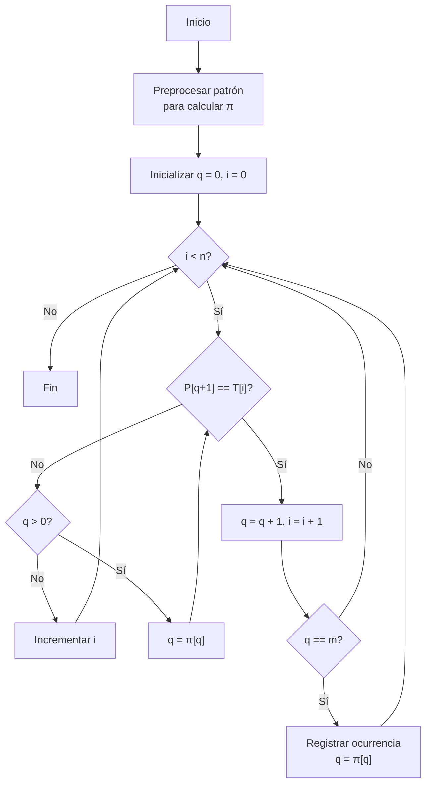

# Análisis de Algoritmos - Temas selectos

## 5.2 Algoritmos para apareamiento de cadenas.

---

El apareamiento de cadenas (string matching) es un problema fundamental en ciencia de la computación que consiste en encontrar todas las ocurrencias de un patrón $P$ de longitud $m$ en un texto $T$ de longitud $n$, donde $n \geq m$. Este problema tiene aplicaciones en procesamiento de texto, bioinformática, motores de búsqueda y sistemas de recuperación de información.

### Definición Formal

Dado un texto $T[1..n]$ y un patrón $P[1..m]$, donde los caracteres pertenecen a un alfabeto finito $\Sigma$, queremos encontrar todos los desplazamientos $s$ en el rango $0 \leq s \leq n-m$ tales que:

$$T[s+1..s+m] = P[1..m]$$

### Algoritmo Ingenuo (Fuerza Bruta)

#### Descripción

El algoritmo ingenuo prueba todos los posibles desplazamientos $s$ en el texto y verifica si el patrón coincide en esa posición.

#### Pseudocódigo

```
NAIVE-STRING-MATCHER(T, P)
  n = T.length
  m = P.length
  for s = 0 to n - m
    if P[1..m] == T[s+1..s+m]
      print "Pattern occurs with shift" s
```

#### Complejidad

- Peor caso: $O((n-m+1)m)$
- Mejor caso: $O(n)$

#### Implementación en Python

```python
def naive_string_matcher(text, pattern):
    n = len(text)
    m = len(pattern)
    occurrences = []

    for s in range(n - m + 1):
        if pattern == text[s:s+m]:
            occurrences.append(s)

    return occurrences
```

### Algoritmo de Knuth-Morris-Pratt (KMP)

#### Descripción

KMP utiliza un preprocesamiento del patrón para crear una función de prefijo que permite evitar comparaciones innecesarias.

#### Función de Prefijo

La función de prefijo $\pi$ para un patrón $P$ se define como:

$$\pi[q] = \max\{k : k < q \land P[1..k] \text{ es sufijo de } P[1..q]\}$$

#### Pseudocódigo

```
COMPUTE-PREFIX-FUNCTION(P)
  m = P.length
  let π[1..m] be a new array
  π[1] = 0
  k = 0
  for q = 2 to m
    while k > 0 and P[k+1] ≠ P[q]
      k = π[k]
    if P[k+1] == P[q]
      k = k + 1
    π[q] = k
  return π

KMP-MATCHER(T, P)
  n = T.length
  m = P.length
  π = COMPUTE-PREFIX-FUNCTION(P)
  q = 0
  for i = 1 to n
    while q > 0 and P[q+1] ≠ T[i]
      q = π[q]
    if P[q+1] == T[i]
      q = q + 1
    if q == m
      print "Pattern occurs with shift" i-m
      q = π[q]
```

#### Complejidad

- Preprocesamiento: $O(m)$
- Búsqueda: $O(n)$
- Total: $O(n + m)$

#### Implementación en Python

```python
def compute_prefix_function(pattern):
    m = len(pattern)
    pi = [0] * m
    k = 0

    for q in range(1, m):
        while k > 0 and pattern[k] != pattern[q]:
            k = pi[k-1]
        if pattern[k] == pattern[q]:
            k += 1
        pi[q] = k

    return pi

def kmp_matcher(text, pattern):
    n = len(text)
    m = len(pattern)
    pi = compute_prefix_function(pattern)
    q = 0
    occurrences = []

    for i in range(n):
        while q > 0 and pattern[q] != text[i]:
            q = pi[q-1]
        if pattern[q] == text[i]:
            q += 1
        if q == m:
            occurrences.append(i - m + 1)
            q = pi[q-1]

    return occurrences
```

### Algoritmo de Boyer-Moore

#### Descripción

Boyer-Moore compara el patrón con el texto de derecha a izquierda y utiliza dos heurísticas para desplazamientos mayores: la regla del mal carácter y la regla del buen sufijo.

#### Regla del Mal Carácter

$$ \Delta_1(c) = \begin{cases} m - \max\{i : 1 \leq i \leq m, P[i] = c\} & \text{si } c \text{ aparece en } P \\\ m & \text{en otro caso} \end{cases}$$

#### Pseudocódigo (Simplificado)
```
BOYER-MOORE-MATCHER(T, P)
  n = T.length
  m = P.length
  λ = LAST-OCCURRENCE-FUNCTION(P, m)
  γ = GOOD-SUFFIX-FUNCTION(P, m)
  s = 0
  while s ≤ n - m
    j = m
    while j > 0 and P[j] == T[s+j]
      j = j - 1
    if j == 0
      print "Pattern occurs with shift" s
      s = s + γ[0]
    else
      s = s + max(γ[j], j - λ[T[s+j]])
```

#### Complejidad
- Peor caso: $O(nm)$
- Mejor caso: $O(n/m)$

### Algoritmo de Rabin-Karp

#### Descripción
Utiliza hashing para comparar el patrón con subcadenas del texto. Si el hash coincide, entonces verifica la coincidencia carácter por carácter.

#### Función de Hash
Un hash efectivo para Rabin-Karp es:

$$h(P) = \left(\sum_{i=1}^{m} P[i] \cdot d^{m-i}\right) \mod q$$

Donde $d$ es el tamaño del alfabeto y $q$ es un número primo.

#### Pseudocódigo
```
RABIN-KARP-MATCHER(T, P, d, q)
  n = T.length
  m = P.length
  h = d^(m-1) mod q
  p = 0
  t₀ = 0
  for i = 1 to m
    p = (d*p + P[i]) mod q
    t₀ = (d*t₀ + T[i]) mod q
  for s = 0 to n - m
    if p == tₛ
      if P[1..m] == T[s+1..s+m]
        print "Pattern occurs with shift" s
    if s < n - m
      tₛ₊₁ = (d*(tₛ - T[s+1]*h) + T[s+m+1]) mod q
```

#### Complejidad
- Caso promedio: $O(n + m)$
- Peor caso: $O(nm)$

#### Implementación en Python
```python
def rabin_karp_matcher(text, pattern, d=256, q=101):
    n = len(text)
    m = len(pattern)
    h = pow(d, m-1, q)
    p = 0
    t = 0
    occurrences = []

    # Preprocessing
    for i in range(m):
        p = (d * p + ord(pattern[i])) % q
        t = (d * t + ord(text[i])) % q

    # Matching
    for s in range(n - m + 1):
        if p == t:
            if pattern == text[s:s+m]:
                occurrences.append(s)

        if s < n - m:
            t = (d * (t - ord(text[s]) * h) + ord(text[s+m])) % q
            if t < 0:
                t += q

    return occurrences
```

### Diagrama de Flujo del Algoritmo KMP



### Ejercicios Propuestos

1. Implemente el algoritmo de fuerza bruta y compárelo con KMP para el texto "ABABDABACDABABCABAB" y el patrón "ABABCABAB".

2. Demuestre por qué la función de prefijo en KMP garantiza un tiempo de ejecución lineal.

3. Para el patrón "ACACAGT", calcule manualmente la función de prefijo π.

4. Modifique el algoritmo de Rabin-Karp para encontrar múltiples patrones en un texto.

5. Analice el peor caso para el algoritmo de Boyer-Moore y proponga una mejora.

6. Implemente la regla del buen sufijo para el algoritmo de Boyer-Moore.

### Aplicaciones

1. **Editores de texto**: Búsqueda y reemplazo de texto
2. **Bioinformática**: Búsqueda de secuencias en ADN
3. **Motores de búsqueda**: Indexación y recuperación de información
4. **Detección de plagio**: Comparación de documentos
5. **Sistemas de control de versiones**: Detección de cambios

### Referencias

#### Bibliografía Básica
1. Cormen, T. H., Leiserson, C. E., Rivest, R. L., & Stein, C. (2009). Introduction to Algorithms (3rd ed.). MIT Press. (Capítulo 32)
2. Kleinberg, J., & Tardos, É. (2005). Algorithm Design. Addison Wesley. (Capítulo 6)

#### Bibliografía Complementaria
1. Knuth, D. E., Morris, J. H., & Pratt, V. R. (1977). Fast pattern matching in strings. SIAM Journal on Computing, 6(2), 323-350.
2. Boyer, R. S., & Moore, J. S. (1977). A fast string searching algorithm. Communications of the ACM, 20(10), 762-772.
3. Karp, R. M., & Rabin, M. O. (1987). Efficient randomized pattern-matching algorithms. IBM Journal of Research and Development, 31(2), 249-260.

#### Recursos Adicionales
- Gusfield, D. (1997). Algorithms on Strings, Trees and Sequences. Cambridge University Press.
- Crochemore, M., & Rytter, W. (2003). Jewels of Stringology. World Scientific.
