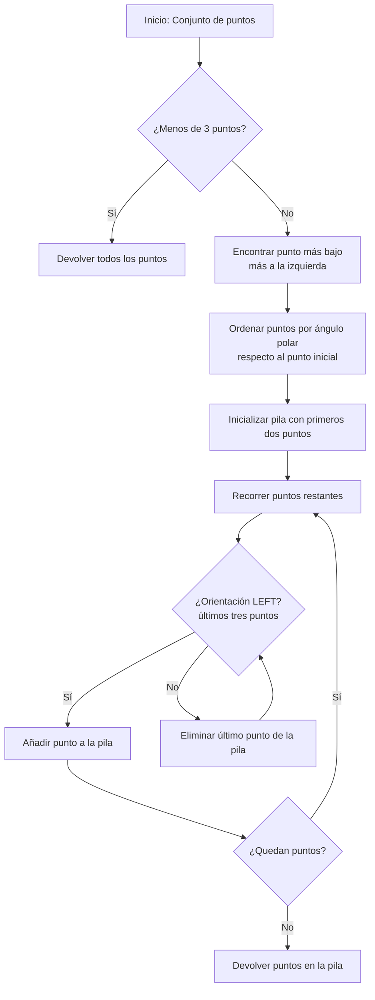

# Análisis de Algoritmos - Temas selectos

## 5.3 Geometría computacional.

---

La geometría computacional es una rama de la ciencia de la computación que estudia algoritmos para resolver problemas geométricos. Estos problemas involucran objetos como puntos, líneas, polígonos y otros elementos geométricos en espacios de dos o más dimensiones.

### Conceptos Fundamentales

#### Representación de Puntos y Vectores

Un punto en el plano 2D se representa como $P = (x, y)$.
Un vector $\vec{v}$ desde el punto $A$ al punto $B$ se define como:

$$\vec{v} = B - A = (x_B - x_A, y_B - y_A)$$

#### Producto Cruz (Cross Product)

El producto cruz de dos vectores $\vec{u} = (u_x, u_y)$ y $\vec{v} = (v_x, v_y)$ es:

$$\vec{u} \times \vec{v} = u_x v_y - u_y v_x$$

El signo del producto cruz indica la orientación relativa de los vectores:

- Positivo: $\vec{v}$ gira a la izquierda de $\vec{u}$
- Cero: vectores colineales
- Negativo: $\vec{v}$ gira a la derecha de $\vec{u}$

```python
def cross_product(o, a, b):
    """Calcula el producto cruz de los vectores OA y OB"""
    return (a[0] - o[0]) * (b[1] - o[1]) - (a[1] - o[1]) * (b[0] - o[0])
```

### Problemas Básicos

#### Orientación de Tres Puntos

Dados tres puntos $A$, $B$ y $C$, determinar si forman:

- Giro a la izquierda (counterclockwise)
- Giro a la derecha (clockwise)
- Son colineales

```python
def orientation(a, b, c):
    """Determina la orientación de tres puntos"""
    cross = (b[0] - a[0]) * (c[1] - a[1]) - (b[1] - a[1]) * (c[0] - a[0])
    if cross > 0:
        return "LEFT"  # Counterclockwise
    elif cross < 0:
        return "RIGHT" # Clockwise
    else:
        return "COLINEAR"
```

#### Distancia entre Dos Puntos

La distancia euclidiana entre dos puntos $P_1 = (x_1, y_1)$ y $P_2 = (x_2, y_2)$ es:

$$d = \sqrt{(x_2 - x_1)^2 + (y_2 - y_1)^2}$$

```python
def distance(p1, p2):
    """Calcula la distancia euclidiana entre dos puntos"""
    return math.sqrt((p2[0] - p1[0])**2 + (p2[1] - p1[1])**2)
```

### Algoritmos Importantes

#### Cerco Convexo (Convex Hull)

El problema del cerco convexo consiste en encontrar el polígono convexo más pequeño que contiene todos los puntos de un conjunto dado.

##### Algoritmo de Graham Scan

```python
def graham_scan(points):
    """Implementa el algoritmo de Graham Scan para encontrar el cerco convexo"""
    if len(points) <= 3:
        return points

    # Encuentra el punto más bajo (y más a la izquierda en caso de empate)
    start = min(points, key=lambda p: (p[1], p[0]))

    # Ordena puntos por ángulo polar respecto al punto inicial
    sorted_points = sorted(points, key=lambda p: (math.atan2(p[1]-start[1], p[0]-start[0]), distance(start, p)))

    # Construye el cerco convexo
    hull = [sorted_points[0], sorted_points[1]]

    for i in range(2, len(sorted_points)):
        while len(hull) >= 2 and orientation(hull[-2], hull[-1], sorted_points[i]) != "LEFT":
            hull.pop()
        hull.append(sorted_points[i])

    return hull
```

##### Algoritmo de Jarvis March (Gift Wrapping)

```python
def jarvis_march(points):
    """Implementa el algoritmo de Jarvis March para encontrar el cerco convexo"""
    n = len(points)
    if n <= 3:
        return points

    # Encuentra el punto más a la izquierda
    leftmost = 0
    for i in range(1, n):
        if points[i][0] < points[leftmost][0]:
            leftmost = i

    hull = []
    p = leftmost
    q = 0

    while True:
        hull.append(points[p])
        q = (p + 1) % n

        for i in range(n):
            if orientation(points[p], points[i], points[q]) == "LEFT":
                q = i

        p = q
        if p == leftmost:
            break

    return hull
```

#### Diagrama de Voronoi

El diagrama de Voronoi divide el plano en regiones donde cada región contiene todos los puntos más cercanos a un punto dado (sitio) que a cualquier otro sitio.

#### Triangulación de Delaunay

Una triangulación de Delaunay maximiza el ángulo mínimo de todos los triángulos, evitando triángulos excesivamente delgados.

### Algoritmo para Intersección de Segmentos

```python
def segments_intersect(p1, p2, p3, p4):
    """Determina si los segmentos p1p2 y p3p4 se intersectan"""
    def ccw(a, b, c):
        return (b[0]-a[0])*(c[1]-a[1]) - (b[1]-a[1])*(c[0]-a[0])

    o1 = ccw(p1, p2, p3)
    o2 = ccw(p1, p2, p4)
    o3 = ccw(p3, p4, p1)
    o4 = ccw(p3, p4, p2)

    # Caso general: los segmentos se cruzan
    if o1 * o2 < 0 and o3 * o4 < 0:
        return True

    # Casos especiales: puntos colineales
    if o1 == 0 and on_segment(p1, p3, p2):
        return True
    if o2 == 0 and on_segment(p1, p4, p2):
        return True
    if o3 == 0 and on_segment(p3, p1, p4):
        return True
    if o4 == 0 and on_segment(p3, p2, p4):
        return True

    return False

def on_segment(p, q, r):
    """Verifica si el punto q está en el segmento pr"""
    if (min(p[0], r[0]) <= q[0] <= max(p[0], r[0]) and
        min(p[1], r[1]) <= q[1] <= max(p[1], r[1])):
        return True
    return False
```

### Diagrama de Flujo: Algoritmo de Graham Scan



### Ejercicios Propuestos

1. Implemente una función que determine si un punto dado está dentro de un polígono simple usando el método de ray casting.

2. Desarrolle un algoritmo para encontrar el par de puntos más cercano en un conjunto de puntos en el plano.

3. Implemente el algoritmo de barrido lineal para encontrar todas las intersecciones entre un conjunto de segmentos.

4. Cree una visualización del algoritmo de Graham Scan que muestre cada paso del proceso.

5. Demuestre que el producto cruz de dos vectores es igual al área del paralelogramo formado por ellos.

6. Implemente el algoritmo de Quickhull para encontrar el cerco convexo de un conjunto de puntos.

### Aplicaciones

1. **Gráficos por computadora**: Rasterización, detección de colisiones
2. **Sistemas de información geográfica**: Análisis espacial, mapas
3. **Robótica**: Planificación de caminos, navegación
4. **Visión por computadora**: Reconocimiento de patrones, procesamiento de imágenes
5. **Diseño asistido por computadora**: Modelado 3D, fabricación

### Referencias

#### Bibliografía Básica

1. Cormen, T. H., Leiserson, C. E., Rivest, R. L., & Stein, C. (2009). Introduction to Algorithms (3rd ed.). MIT Press. (Capítulo 33)
2. Kleinberg, J., & Tardos, É. (2005). Algorithm Design. Addison Wesley. (Capítulo 6)

#### Bibliografía Complementaria

1. de Berg, M., Cheong, O., van Kreveld, M., & Overmars, M. (2008). Computational Geometry: Algorithms and Applications. Springer.
2. O'Rourke, J. (1998). Computational Geometry in C. Cambridge University Press.
3. Preparata, F. P., & Shamos, M. I. (1985). Computational Geometry: An Introduction. Springer.

#### Recursos Adicionales

- Graham, R. L. (1972). An efficient algorithm for determining the convex hull of a finite planar set. Information Processing Letters, 1(4), 132-133.
- Jarvis, R. A. (1973). On the identification of the convex hull of a finite set of points in the plane. Information Processing Letters, 2(1), 18-21.
