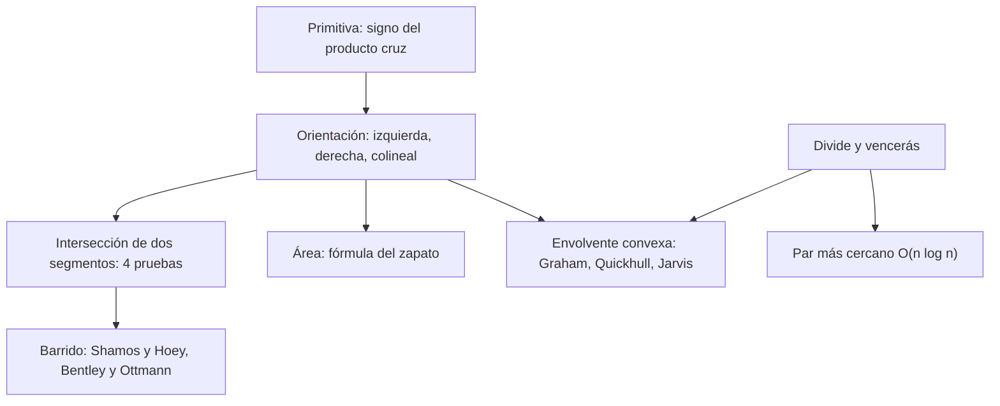

# Análisis de Algoritmos - Temas selectos

## 5.3 Geometría computacional.

---

La **geometría computacional** estudia algoritmos para problemas sobre puntos, segmentos y polígonos: ¿está este punto dentro de esta región?, ¿se cruzan estos segmentos?, ¿cuál es el menor polígono convexo que encierra estos puntos? Aparece en gráficos por computadora, sistemas de información geográfica, robótica, diseño de circuitos y videojuegos. Casi todos sus algoritmos se apoyan en una sola primitiva, el **producto cruz**, que decide la orientación de tres puntos con aritmética exacta, y en dos técnicas: el **barrido** del plano con una recta y **divide y vencerás**. Este tema presenta la primitiva, la prueba de punto en polígono, la intersección de segmentos, el par de puntos más cercano y la envolvente convexa.

### La primitiva de orientación

Para vectores $a = (a_x, a_y)$ y $b = (b_x, b_y),$ el **producto cruz** es el escalar $a \times b = a_x b_y - a_y b_x.$ Para tres puntos $o, p, q,$ el signo de $(p - o) \times (q - o)$ indica la orientación:

- positivo: $o \to p \to q$ gira a la **izquierda** (sentido antihorario);
- negativo: gira a la **derecha**;
- cero: los tres puntos son **colineales**.

Con coordenadas enteras se evalúa sin error de redondeo, y por eso los algoritmos geométricos robustos se escriben en términos de esta prueba en lugar de ángulos o pendientes.

**Área.** $|a \times b|$ es el área del paralelogramo generado por $a$ y $b$ (ejercicio 5), y la mitad, la del triángulo. Sumando triángulos con signo desde el origen se obtiene la **fórmula del zapato** para el área de un polígono simple con vértices $p_0, \ldots, p_{n-1}$ en orden:

$$A = \frac{1}{2} \left| \sum_{i=0}^{n-1} (x_i y_{i+1} - x_{i+1} y_i) \right|, \qquad p_n = p_0.$$

### Punto en polígono

**Teorema de la curva de Jordan:** un polígono simple divide al plano en un interior y un exterior. Un rayo desde $p$ cruza la frontera un número **impar** de veces si y solo si $p$ está dentro. El algoritmo del **rayo** (ejercicio 1) lanza un rayo horizontal hacia la derecha y cuenta las aristas que lo cruzan, en $O(n).$ Los casos degenerados, como un rayo que pasa por un vértice, se resuelven con la regla semiabierta: una arista cuenta si un extremo está estrictamente arriba del rayo y el otro no. En un polígono **convexo** basta $O(\log n)$ con búsqueda binaria sobre los triángulos en abanico desde un vértice.

### Intersección de segmentos

Dos segmentos $p_1 p_2$ y $p_3 p_4$ se cortan si cada uno **separa** a los extremos del otro: $p_1$ y $p_2$ están en lados distintos de la recta $p_3 p_4,$ y $p_3$ y $p_4$ en lados distintos de $p_1 p_2.$ Son cuatro pruebas de orientación, más los casos colineales en los que un extremo cae sobre el otro segmento.

**Barrido.** Para $n$ segmentos, comparar todos los pares cuesta $\Theta(n^2).$ Un **barrido** desplaza una recta vertical de izquierda a derecha y mantiene los segmentos que la cruzan en orden vertical; los **eventos** son los extremos y las intersecciones. Dos segmentos que se cortan son vecinos en ese orden justo antes de cortarse, así que basta comparar cada segmento con sus vecinos cuando estos cambian. El algoritmo de **Shamos y Hoey** decide si hay alguna intersección en $O(n \log n),$ y el de **Bentley y Ottmann** las reporta todas en $O((n + k) \log n),$ con $k$ el número de intersecciones.

### Par de puntos más cercano

Con divide y vencerás, en $O(n \log n)$ (tema 2.4): se parte por la mediana en $x,$ se resuelven las mitades y se revisa la franja central comparando cada punto con a lo sumo 7 vecinos en orden de $y.$ La cota inferior en el modelo de árboles de decisión algebraicos es $\Omega(n \log n),$ porque el problema contiene a decidir si $n$ números son distintos.

### Envolvente convexa

La **envolvente convexa** de un conjunto $P$ es el menor polígono convexo que lo contiene; sus vértices son puntos de $P.$

- **Graham** (1972): tomar el punto más bajo $p_0,$ ordenar los demás por ángulo alrededor de él y recorrerlos con una pila, sacando el tope mientras los dos últimos puntos y el nuevo no formen un giro a la izquierda. Cada punto entra y sale de la pila a lo sumo una vez: $O(n)$ después del ordenamiento, $O(n \log n)$ en total. La variante de la **cadena monótona** de Andrew ordena por $x$ y construye las mitades inferior y superior, evitando los ángulos.
- **Quickhull:** tomar los puntos extremos en $x,$ $a$ y $b;$ el punto más lejano de la recta $ab$ es de la envolvente, y los puntos dentro del triángulo se descartan; repetir en cada lado. $O(n \log n)$ en promedio, $O(n^2)$ en el peor caso.
- **Jarvis** (envoltura de regalo): desde un punto de la envolvente, buscar el siguiente con el menor giro. $O(nh)$ con $h$ vértices en la envolvente. **Chan** (1996) combina ideas para obtener $O(n \log h),$ óptimo.

**Cota inferior.** La envolvente convexa requiere $\Omega(n \log n)$ en el peor caso: con los puntos $(x_i, x_i^2),$ todos en la envolvente, recorrerla en orden da los $x_i$ ordenados, así que un algoritmo más rápido ordenaría más rápido que la cota del tema 3.5.



### Implementación en Python

El programa comprueba la relación entre el producto cruz y el área (ejercicio 5); decide punto en polígono con el rayo en un polígono no convexo y compara su área exacta con una estimación de Monte Carlo (ejercicio 1); compara el par más cercano por divide y vencerás con la fuerza bruta (ejercicio 2); encuentra las intersecciones de 400 segmentos con un barrido que compara cada segmento que entra solo con los activos (ejercicio 3); traza Graham paso a paso (ejercicio 4) y compara Quickhull con Graham y la cadena monótona (ejercicio 6).

```python
import math, random
from itertools import combinations

random.seed(53)

def cruz(o, a, b):
    """(a - o) x (b - o): > 0 giro a la izquierda, < 0 a la derecha, 0 colineales."""
    return (a[0] - o[0]) * (b[1] - o[1]) - (a[1] - o[1]) * (b[0] - o[0])

# --- Ejercicio 5: producto cruz y área ---
for a, b in [((3, 0), (0, 2)), ((2, 1), (1, 3)), ((4, 2), (2, 1))]:
    area = abs(cruz((0, 0), a, b))
    base = math.hypot(*a)
    ang = math.atan2(b[1], b[0]) - math.atan2(a[1], a[0])
    print(f"ejercicio 5: a = {a}, b = {b}: |a x b| = {area}, |a||b| sen = {abs(base * math.hypot(*b) * math.sin(ang)):.4f}")

# --- Ejercicio 1: punto en polígono por rayo ---
def en_poligono(p, P):
    x, y = p
    dentro = False
    for i in range(len(P)):
        (x1, y1), (x2, y2) = P[i], P[(i + 1) % len(P)]
        if (y1 > y) != (y2 > y):                  # la arista cruza la horizontal de p
            xc = x1 + (y - y1) * (x2 - x1) / (y2 - y1)
            if xc > x:
                dentro = not dentro
    return dentro

def area_signada(P):
    return sum(P[i][0] * P[(i + 1) % len(P)][1] - P[(i + 1) % len(P)][0] * P[i][1] for i in range(len(P))) / 2

poligono = [(0, 0), (6, 0), (6, 4), (3, 2), (0, 4)]       # no convexo, con una muesca
for p in [(1, 1), (3, 3), (5, 3), (3, 1.9), (7, 1)]:
    print(f"ejercicio 1: {p} dentro: {en_poligono(p, poligono)}")
print("   área por la fórmula del zapato:", area_signada(poligono))
dentro = sum(en_poligono((random.uniform(0, 6), random.uniform(0, 4)), poligono) for _ in range(200000))
print(f"   Monte Carlo: {dentro / 200000 * 24:.3f} (área del rectángulo 24 por la fracción de puntos dentro)")

# --- Ejercicio 2: par más cercano (divide y vencerás, tema 2.4) ---
def cercano(P):
    Px = sorted(P)
    def rec(Q):
        if len(Q) <= 3:
            return min(math.dist(a, b) for a, b in combinations(Q, 2)) if len(Q) > 1 else math.inf
        m = len(Q) // 2
        xm = Q[m][0]
        d = min(rec(Q[:m]), rec(Q[m:]))
        franja = sorted((p for p in Q if abs(p[0] - xm) < d), key=lambda p: p[1])
        for i in range(len(franja)):
            for j in range(i + 1, min(i + 8, len(franja))):
                d = min(d, math.dist(franja[i], franja[j]))
        return d
    return rec(Px)

P = [(random.random(), random.random()) for _ in range(3000)]
print(f"ejercicio 2: 3000 puntos, divide y vencerás {cercano(P):.6e},"
      f" fuerza bruta {min(math.dist(a, b) for a, b in combinations(P, 2)):.6e}")

# --- Ejercicio 3: intersecciones de segmentos ---
def signo(v):
    return (v > 0) - (v < 0)

def en_segmento(p, q, r):
    return min(p[0], r[0]) <= q[0] <= max(p[0], r[0]) and min(p[1], r[1]) <= q[1] <= max(p[1], r[1])

def se_cortan(s, t):
    p1, p2 = s; p3, p4 = t
    d1, d2 = signo(cruz(p3, p4, p1)), signo(cruz(p3, p4, p2))
    d3, d4 = signo(cruz(p1, p2, p3)), signo(cruz(p1, p2, p4))
    if d1 * d2 < 0 and d3 * d4 < 0:
        return True
    return ((d1 == 0 and en_segmento(p3, p1, p4)) or (d2 == 0 and en_segmento(p3, p2, p4)) or
            (d3 == 0 and en_segmento(p1, p3, p2)) or (d4 == 0 and en_segmento(p1, p4, p2)))

def barrido(S):
    """Barrido vertical: los eventos son los extremos; al entrar un segmento
    se compara solo con los segmentos activos (los que cruzan la recta)."""
    eventos = []
    for i, (a, b) in enumerate(S):
        a, b = sorted((a, b))
        eventos += [(a[0], 0, i), (b[0], 1, i)]
    eventos.sort()
    activos, pares, pruebas = set(), set(), 0
    for x, tipo, i in eventos:
        if tipo == 0:
            for j in activos:
                pruebas += 1
                if se_cortan(S[i], S[j]):
                    pares.add((min(i, j), max(i, j)))
            activos.add(i)
        else:
            activos.discard(i)
    return pares, pruebas

S = []
for _ in range(400):
    x, y = random.uniform(0, 100), random.uniform(0, 100)
    ang, L = random.uniform(0, math.pi), random.uniform(0.5, 4)
    S.append(((x, y), (x + L * math.cos(ang), y + L * math.sin(ang))))
pares, pruebas = barrido(S)
fb = {(i, j) for i, j in combinations(range(len(S)), 2) if se_cortan(S[i], S[j])}
print(f"ejercicio 3: 400 segmentos cortos: {len(pares)} intersecciones, igual a fuerza bruta: {pares == fb};"
      f" pruebas del barrido {pruebas}, de fuerza bruta {len(S) * (len(S) - 1) // 2}")
print("   casos especiales: colineales traslapados", se_cortan(((0, 0), (2, 0)), ((1, 0), (3, 0))),
      "| colineales separados", se_cortan(((0, 0), (1, 0)), ((2, 0), (3, 0))),
      "| se tocan en un extremo", se_cortan(((0, 0), (1, 1)), ((1, 1), (2, 0))))

# --- Ejercicio 4: Graham paso a paso ---
def graham(P, traza=None):
    p0 = min(P, key=lambda p: (p[1], p[0]))
    resto = sorted((p for p in P if p != p0),
                   key=lambda p: (math.atan2(p[1] - p0[1], p[0] - p0[0]), math.dist(p0, p)))
    pila = [p0]
    for p in resto:
        while len(pila) >= 2 and cruz(pila[-2], pila[-1], p) <= 0:
            q = pila.pop()
            if traza is not None: traza.append(f"   saca {q} (giro a la derecha hacia {p})")
        pila.append(p)
        if traza is not None: traza.append(f"   mete {p}: pila {pila}")
    return pila

pts = [(0, 0), (4, 0), (2, 1), (5, 3), (3, 2), (2, 4), (0, 3), (1, 2)]
traza = []
H = graham(pts, traza)
print("ejercicio 4: Graham con", pts)
print("\n".join(traza))
print("   envolvente:", H)

# --- Ejercicio 6: Quickhull ---
def quickhull(P):
    a, b = min(P), max(P)
    def lado(a, b, S):
        S = [p for p in S if cruz(a, b, p) > 0]
        if not S:
            return []
        c = max(S, key=lambda p: cruz(a, b, p))     # el más lejano de la recta ab
        return lado(a, c, S) + [c] + lado(c, b, S)
    return [a] + lado(a, b, P) + [b] + lado(b, a, P)

def monotona(P):
    P = sorted(set(P))
    def mitad(Q):
        h = []
        for p in Q:
            while len(h) >= 2 and cruz(h[-2], h[-1], p) <= 0:
                h.pop()
            h.append(p)
        return h
    inf, sup = mitad(P), mitad(P[::-1])
    return inf[:-1] + sup[:-1]

ok = True
for _ in range(300):
    Q = list({(random.randint(0, 30), random.randint(0, 30)) for _ in range(random.randint(3, 40))})
    if len(Q) >= 3 and any(cruz(Q[0], Q[1], q) for q in Q):
        ok &= set(quickhull(Q)) == set(monotona(Q)) == set(graham(Q))
print("ejercicio 6: Quickhull, Graham y cadena monótona dan la misma envolvente en 300 conjuntos:", ok)
print("   Quickhull de los puntos del ejercicio 4:", quickhull(pts))
```

Salida:

```text
ejercicio 5: a = (3, 0), b = (0, 2): |a x b| = 6, |a||b| sen = 6.0000
ejercicio 5: a = (2, 1), b = (1, 3): |a x b| = 5, |a||b| sen = 5.0000
ejercicio 5: a = (4, 2), b = (2, 1): |a x b| = 0, |a||b| sen = 0.0000
ejercicio 1: (1, 1) dentro: True
ejercicio 1: (3, 3) dentro: False
ejercicio 1: (5, 3) dentro: True
ejercicio 1: (3, 1.9) dentro: True
ejercicio 1: (7, 1) dentro: False
   área por la fórmula del zapato: 18.0
   Monte Carlo: 18.008 (área del rectángulo 24 por la fracción de puntos dentro)
ejercicio 2: 3000 puntos, divide y vencerás 6.486175e-05, fuerza bruta 6.486175e-05
ejercicio 3: 400 segmentos cortos: 16 intersecciones, igual a fuerza bruta: True; pruebas del barrido 2244, de fuerza bruta 79800
   casos especiales: colineales traslapados True | colineales separados False | se tocan en un extremo True
ejercicio 4: Graham con [(0, 0), (4, 0), (2, 1), (5, 3), (3, 2), (2, 4), (0, 3), (1, 2)]
   mete (4, 0): pila [(0, 0), (4, 0)]
   mete (2, 1): pila [(0, 0), (4, 0), (2, 1)]
   saca (2, 1) (giro a la derecha hacia (5, 3))
   mete (5, 3): pila [(0, 0), (4, 0), (5, 3)]
   mete (3, 2): pila [(0, 0), (4, 0), (5, 3), (3, 2)]
   saca (3, 2) (giro a la derecha hacia (1, 2))
   mete (1, 2): pila [(0, 0), (4, 0), (5, 3), (1, 2)]
   saca (1, 2) (giro a la derecha hacia (2, 4))
   mete (2, 4): pila [(0, 0), (4, 0), (5, 3), (2, 4)]
   mete (0, 3): pila [(0, 0), (4, 0), (5, 3), (2, 4), (0, 3)]
   envolvente: [(0, 0), (4, 0), (5, 3), (2, 4), (0, 3)]
ejercicio 6: Quickhull, Graham y cadena monótona dan la misma envolvente en 300 conjuntos: True
   Quickhull de los puntos del ejercicio 4: [(0, 0), (0, 3), (2, 4), (5, 3), (4, 0)]
```

El barrido del ejercicio 3 es una simplificación: compara cada segmento nuevo con **todos** los activos, no solo con sus vecinos, y en el peor caso, con todos los segmentos cruzando la recta, sigue siendo cuadrático. Con segmentos cortos dispersos, los activos son pocos y hace 35 veces menos pruebas que la fuerza bruta. Bentley y Ottmann mantiene los activos ordenados en un árbol balanceado para comparar solo vecinos.

### Ejercicios Propuestos

1. **Punto en polígono.** Implementa una función que decida si un punto está dentro de un polígono simple con el método del rayo.

2. **Par más cercano.** Desarrolla un algoritmo que encuentre el par de puntos más cercano de un conjunto en el plano.

3. **Intersecciones.** Implementa un algoritmo de barrido que encuentre todas las intersecciones de un conjunto de segmentos.

4. **Graham paso a paso.** Muestra cada paso del algoritmo de Graham.

5. **Producto cruz.** Demuestra que el valor absoluto del producto cruz de dos vectores es el área del paralelogramo que forman.

6. **Quickhull.** Implementa Quickhull para calcular la envolvente convexa.

### Soluciones

**Ejercicio 1.** Es `en_poligono` del programa. En el polígono con muesca $(0, 0),$ $(6, 0),$ $(6, 4),$ $(3, 2),$ $(0, 4),$ el punto $(3, 3)$ está en la muesca, fuera, aunque esté dentro del rectángulo que lo rodea: su rayo cruza dos aristas, la que baja de $(6, 4)$ a $(3, 2)$ y el lado derecho. El punto $(3, 1.9),$ justo debajo de la muesca, está dentro: su rayo cruza solo el lado derecho. El área exacta es 18, y la estimación con 200 000 puntos aleatorios da $18.008.$

**Ejercicio 2.** Es el algoritmo del tema 2.4, de $O(n \log n);$ el programa obtiene la misma distancia que la fuerza bruta con 3000 puntos.

**Ejercicio 3.** Ver la sección de intersección y el comentario tras la salida. La prueba `se_cortan` maneja los casos colineales: dos segmentos sobre la misma recta se cortan si se traslapan, y dos que comparten un extremo también.

**Ejercicio 4.** La traza del programa: tras ordenar por ángulo desde $(0, 0),$ el punto $(2, 1)$ entra a la pila pero sale al llegar $(5, 3),$ porque $(4, 0) \to (2, 1) \to (5, 3)$ gira a la derecha; lo mismo ocurre con $(3, 2)$ al llegar $(1, 2),$ y con $(1, 2)$ al llegar $(2, 4).$ La envolvente final es $(0, 0),$ $(4, 0),$ $(5, 3),$ $(2, 4),$ $(0, 3).$

**Ejercicio 5.** Sean $a = |a|(\cos \alpha, \sin \alpha)$ y $b = |b|(\cos \beta, \sin \beta).$ Entonces

$$a \times b = |a||b|(\cos \alpha \sin \beta - \sin \alpha \cos \beta) = |a||b| \sin(\beta - \alpha).$$

El paralelogramo tiene base $|a|$ y altura $|b| \, |\sin(\beta - \alpha)|,$ la distancia del extremo de $b$ a la recta de $a,$ así que su área es $|a||b||\sin(\beta - \alpha)| = |a \times b|.$ $\blacksquare$ El signo indica si $b$ está a la izquierda o a la derecha de $a,$ y el valor es 0 si son paralelos, como $(4, 2)$ y $(2, 1).$

**Ejercicio 6.** Es `quickhull` del programa. Su recurrencia es como la de quicksort: si el punto más lejano divide los puntos en partes equilibradas, $T(n) = 2T(n/2) + O(n) = O(n \log n);$ si todos los puntos están en la envolvente y la división es muy desigual, $O(n^2).$ En la práctica es muy rápido, porque descarta de golpe los puntos interiores de cada triángulo.

### Referencias

1. de Berg, M., Cheong, O., van Kreveld, M., and Overmars, M., _Computational Geometry: Algorithms and Applications_. Springer, 2008. Capítulos 1 y 2.
2. Cormen, T. H., Leiserson, C. E., Rivest, R. L., and Stein, C., _Introduction to Algorithms_. MIT Press, 2022. Capítulo 33.
3. Preparata, F. P., and Shamos, M. I., _Computational Geometry: An Introduction_. Springer, 1985.
4. O'Rourke, J., _Computational Geometry in C_. Cambridge University Press, 1998.
