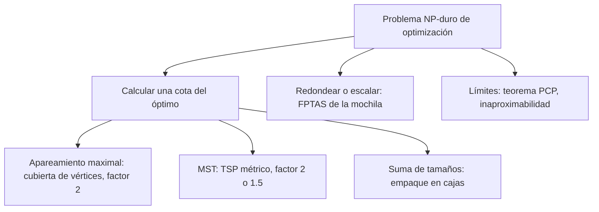

# Análisis de Algoritmos - Temas selectos

## 5.4 Algoritmos de aproximación.

---

Muchos problemas de optimización importantes son NP-duros (tema 1.2): si $\text{P} \neq \text{NP},$ ningún algoritmo polinomial los resuelve exactamente. Pero en la práctica hay que resolverlos. Un **algoritmo de aproximación** corre en tiempo polinomial y garantiza una solución cuyo valor está a un factor acotado del óptimo, **demostrado** para toda instancia, a diferencia de una heurística. Este tema define la razón de aproximación, presenta las técnicas para demostrarla (acotar el óptimo con una cantidad fácil de calcular) y las aplica a la cubierta de vértices, el agente viajero métrico, la cubierta de conjuntos, la mochila, el corte máximo y el empaque en cajas, junto con los límites de lo que se puede aproximar.

### Razón de aproximación

Un algoritmo $A$ es una **aproximación con razón** $\rho$ para un problema de minimización si para toda instancia $I,$ $A(I) \leq \rho \cdot \text{OPT}(I),$ con $\rho \geq 1;$ para maximización, si $A(I) \geq \text{OPT}(I)/\rho.$ En otra convención, para maximización se escribe $A(I) \geq \rho \cdot \text{OPT}(I)$ con $\rho \leq 1.$ Se habla de una 2-aproximación, una 1.5-aproximación, etc.

- Un **esquema de aproximación en tiempo polinomial** (PTAS) da, para cada $\epsilon > 0,$ una aproximación con razón $1 + \epsilon$ en tiempo polinomial en $n$ para $\epsilon$ fijo, por ejemplo $O(n^{1/\epsilon}).$
- Un **FPTAS** es un PTAS cuyo tiempo es polinomial en $n$ y en $1/\epsilon.$

**La técnica central.** Como $\text{OPT}$ es desconocido, se compara la solución con una **cota** del óptimo que sí se puede calcular: un apareamiento, un árbol generador mínimo, una relajación lineal, la suma de los tamaños. Toda demostración de aproximación tiene la forma $A(I) \leq \rho \cdot \text{cota} \leq \rho \cdot \text{OPT}.$

### Cubierta de vértices

Encontrar el menor conjunto $C$ de vértices que toque todas las aristas. **Algoritmo:** mientras quede una arista $uv$ sin cubrir, agregar **ambos** extremos a $C.$ Las aristas elegidas forman un **apareamiento maximal** $M,$ y $|C| = 2|M|.$ Como las aristas de $M$ no comparten extremos, toda cubierta, incluida la óptima, debe tener un vértice distinto por cada una: $\text{OPT} \geq |M|.$ Así, $|C| \leq 2 \, \text{OPT}$ (ejercicio 1). No se conoce una aproximación con razón $2 - \epsilon,$ y bajo la conjetura de los juegos únicos no existe.

### Agente viajero métrico

Encontrar el ciclo más corto que visite todas las ciudades, con distancias que cumplen la desigualdad del triángulo.

- **Doble árbol:** calcular un MST $T$ (tema 4.2), recorrerlo en preorden y visitar las ciudades en ese orden. El recorrido completo del árbol pasa dos veces por cada arista, $2w(T),$ y los atajos no lo alargan por la desigualdad del triángulo. Como quitar una arista del ciclo óptimo da un árbol generador, $w(T) \leq \text{OPT}.$ Resultado: una 2-aproximación.
- **Christofides** (1976): al MST se le agrega un **apareamiento perfecto de peso mínimo** $M$ entre los vértices de grado impar (que son un número par); la multigráfica resultante tiene todos los grados pares y un **circuito euleriano**, que con atajos da el recorrido. Una 1.5-aproximación (ejercicio 2). En 2021 Karlin, Klein y Oveis Gharan la mejoraron a $1.5 - 10^{-36}.$

Sin la desigualdad del triángulo, no existe ninguna aproximación polinomial con razón constante $\rho$ si $\text{P} \neq \text{NP}:$ con ella se decidiría si una gráfica tiene un ciclo hamiltoniano, poniendo distancia 1 a las aristas y $\rho n + 1$ a las no aristas.

### Otros problemas

| Problema | Algoritmo | Garantía |
| --- | --- | --- |
| cubierta de vértices | apareamiento maximal | 2 |
| TSP métrico | doble árbol, Christofides | 2, 1.5 |
| cubierta de conjuntos | voraz | $H_n \approx \ln n$ |
| mochila | escalamiento y programación dinámica | FPTAS, $1 - \epsilon$ |
| corte máximo | al azar o búsqueda local | 1/2 (Goemans y Williamson: 0.878) |
| empaque en cajas | primer ajuste decreciente | $\frac{11}{9} \text{OPT} + \frac{6}{9}$ |
| calendarización $P \Vert C_{\max}$ | LPT | $\frac{4}{3} - \frac{1}{3m}$ (tema 5.5) |

**Límites.** El **teorema PCP** (1992) implica que problemas como MAX-3SAT no tienen PTAS si $\text{P} \neq \text{NP};$ la cubierta de conjuntos no se aproxima mejor que $(1 - \epsilon) \ln n$ (Feige, Dinur y Steurer), así que el voraz es esencialmente óptimo; el clique máximo no se aproxima a $n^{1 - \epsilon}.$



### Implementación en Python

El programa compara cada algoritmo con el óptimo calculado por fuerza bruta o programación dinámica. Mide la razón de la cubierta por apareamiento y construye gráficas en las que el voraz por grado máximo falla (ejercicio 1); implementa el doble árbol y Christofides, con un apareamiento perfecto mínimo por programación dinámica sobre subconjuntos, contra el óptimo de Held y Karp (ejercicio 2); construye instancias malas para la cubierta de conjuntos voraz (ejercicio 3); implementa el FPTAS de la mochila (ejercicio 4), el corte máximo por búsqueda local (ejercicio 5) y el primer ajuste decreciente con su instancia mala (ejercicio 6).

```python
import math, random
from itertools import combinations
from functools import lru_cache

random.seed(54)

# --- Ejercicio 1: cubierta de vértices por apareamiento maximal ---
def cubierta_apareamiento(E):
    C = set()
    for u, v in E:
        if u not in C and v not in C:
            C |= {u, v}
    return C

def cubierta_grado(n, E):
    """Voraz por grado máximo: NO es una 2-aproximación."""
    E, C = set(E), set()
    while E:
        g = {}
        for u, v in E:
            g[u] = g.get(u, 0) + 1; g[v] = g.get(v, 0) + 1
        x = max(g, key=lambda v: (g[v], -v))
        C.add(x)
        E = {e for e in E if x not in e}
    return C

def cubierta_optima(n, E):
    for k in range(n + 1):
        for C in combinations(range(n), k):
            S = set(C)
            if all(u in S or v in S for u, v in E):
                return k

peor = 0
for _ in range(300):
    n = random.randint(2, 10)
    E = [e for e in combinations(range(n), 2) if random.random() < 0.35]
    if E:
        peor = max(peor, len(cubierta_apareamiento(E)) / cubierta_optima(n, E))
print(f"ejercicio 1: peor razón del apareamiento maximal en 300 gráficas: {peor:.2f} (cota 2)")

def gráfica_mala(k):
    """Bipartita: arriba k vértices; abajo, para cada i, floor(k/i) vértices de grado i."""
    arriba = list(range(k)); n = k; E = []
    for i in range(2, k + 1):
        for b in range(k // i):
            w = n; n += 1
            for a in range(b * i, b * i + i):
                E.append((a, w))
    return n, E
for k in (6, 12, 24):
    n, E = gráfica_mala(k)
    print(f"   gráfica mala k = {k:2}: voraz por grado {len(cubierta_grado(n, E)):3}, óptimo <= {k}"
          f" (razón {len(cubierta_grado(n, E)) / k:.2f}, crece como ln k)")

# --- Ejercicio 2: TSP métrico, doble árbol y Christofides ---
def dist_matriz(P):
    return [[math.dist(a, b) for b in P] for a in P]

def mst(D):
    n = len(D); dentro = [False] * n; clave = [math.inf] * n; padre = [-1] * n; clave[0] = 0
    for _ in range(n):
        u = min((v for v in range(n) if not dentro[v]), key=lambda v: clave[v])
        dentro[u] = True
        for v in range(n):
            if not dentro[v] and D[u][v] < clave[v]:
                clave[v], padre[v] = D[u][v], u
    return [(padre[v], v) for v in range(1, n)]

def recorrido_peso(D, t):
    return sum(D[t[i]][t[(i + 1) % len(t)]] for i in range(len(t)))

def doble_arbol(D):
    T = mst(D); ady = {v: [] for v in range(len(D))}
    for u, v in T: ady[u].append(v); ady[v].append(u)
    orden, pila, visto = [], [0], set()
    while pila:                                       # preorden = atajos del recorrido de Euler
        u = pila.pop()
        if u in visto: continue
        visto.add(u); orden.append(u)
        pila += sorted(ady[u], reverse=True)
    return orden

def apareamiento_perfecto_minimo(D, V):
    V = tuple(V)
    @lru_cache(maxsize=None)
    def f(mask):
        if mask == 0: return 0, ()
        i = (mask & -mask).bit_length() - 1
        mejor = (math.inf, ())
        for j in range(i + 1, len(V)):
            if mask >> j & 1:
                c, M = f(mask & ~(1 << i) & ~(1 << j))
                if c + D[V[i]][V[j]] < mejor[0]:
                    mejor = (c + D[V[i]][V[j]], M + ((V[i], V[j]),))
        return mejor
    return f((1 << len(V)) - 1)[1]

def christofides(D):
    n = len(D); T = mst(D)
    grado = [0] * n
    for u, v in T: grado[u] += 1; grado[v] += 1
    impares = [v for v in range(n) if grado[v] % 2]
    M = apareamiento_perfecto_minimo(D, impares)
    multi = {v: [] for v in range(n)}
    for u, v in list(T) + list(M):
        multi[u].append(v); multi[v].append(u)
    pila, euler = [0], []                              # Hierholzer
    while pila:
        u = pila[-1]
        if multi[u]:
            v = multi[u].pop(); multi[v].remove(u); pila.append(v)
        else:
            euler.append(pila.pop())
    visto, t = set(), []
    for v in euler:
        if v not in visto: visto.add(v); t.append(v)
    return t

def tsp_optimo(D):
    n = len(D)
    @lru_cache(maxsize=None)
    def g(mask, j):
        if mask == (1 << j) | 1:
            return D[0][j]
        return min(g(mask & ~(1 << j), k) + D[k][j] for k in range(1, n) if mask >> k & 1 and k != j)
    full = (1 << n) - 1
    return min(g(full, j) + D[j][0] for j in range(1, n))

r1 = r2 = 0; s1 = s2 = 0; casos = 40
for _ in range(casos):
    P = [(random.random(), random.random()) for _ in range(10)]
    D = dist_matriz(P); opt = tsp_optimo(D)
    a, b = recorrido_peso(D, doble_arbol(D)) / opt, recorrido_peso(D, christofides(D)) / opt
    r1, r2, s1, s2 = max(r1, a), max(r2, b), s1 + a, s2 + b
print(f"ejercicio 2: 40 instancias de 10 puntos; razón media / peor: doble árbol {s1 / casos:.3f} / {r1:.3f}"
      f" (cota 2), Christofides {s2 / casos:.3f} / {r2:.3f} (cota 1.5)")

# --- Ejercicio 3: cubierta de conjuntos voraz ---
def cubierta_conjuntos_voraz(U, S):
    U, elegidos = set(U), []
    while U:
        i = max(range(len(S)), key=lambda i: len(S[i] & U))
        elegidos.append(i); U -= S[i]
    return elegidos

def cubierta_conjuntos_optima(U, S):
    for k in range(1, len(S) + 1):
        for C in combinations(range(len(S)), k):
            if set().union(*(S[i] for i in C)) >= U:
                return k

def instancia_mala(k):
    """Óptimo 2 (dos filas); el voraz toma k columnas de tamaños 2, 4, 8, ..."""
    U, cols, x = set(), [], 0
    for i in range(1, k + 1):
        c = set(range(x, x + 2 ** i)); cols.append(c); U |= c; x += 2 ** i
    filas = [set(), set()]
    for c in cols:
        L = sorted(c); filas[0] |= set(L[:len(L) // 2]); filas[1] |= set(L[len(L) // 2:])
    return U, filas + cols

for k in (3, 5, 8):
    U, S = instancia_mala(k)
    print(f"ejercicio 3: instancia mala k = {k}: |U| = {len(U):3}, voraz {len(cubierta_conjuntos_voraz(U, S))},"
          f" óptimo {cubierta_conjuntos_optima(U, S) if k <= 5 else 2}, H(|U|) = {sum(1 / i for i in range(1, len(U) + 1)):.2f}")

# --- Ejercicio 4: esquema de aproximación para la mochila ---
def mochila_exacta(p, v, W):
    T = [0] * (W + 1)
    for pi, vi in zip(p, v):
        for c in range(W, pi - 1, -1):
            T[c] = max(T[c], T[c - pi] + vi)
    return T[W]

def mochila_fptas(p, v, W, eps):
    n, vmax = len(v), max(v)
    K = eps * vmax / n
    vv = [int(x // K) for x in v]
    V = sum(vv)
    peso = [0] + [math.inf] * V                   # peso mínimo para cada valor escalado
    elige = [set()] + [None] * V
    for i in range(n):
        for val in range(V, vv[i] - 1, -1):
            if peso[val - vv[i]] + p[i] < peso[val]:
                peso[val] = peso[val - vv[i]] + p[i]
                elige[val] = elige[val - vv[i]] | {i}
    mejor = max(val for val in range(V + 1) if peso[val] <= W)
    return sum(v[i] for i in elige[mejor]), V

n = 60
p = [random.randint(1, 1000) for _ in range(n)]
v = [random.randint(1, 10**6) for _ in range(n)]
W = sum(p) // 3
opt = mochila_exacta(p, v, W)
for eps in (0.5, 0.1, 0.01):
    val, tabla = mochila_fptas(p, v, W, eps)
    print(f"ejercicio 4: eps = {eps:4}: valor {val} = {val / opt:.5f} del óptimo (>= {1 - eps}), tabla de {tabla} valores")

# --- Ejercicio 5: corte máximo ---
def corte(E, lado):
    return sum(1 for u, v in E if lado[u] != lado[v])

def corte_busqueda_local(n, E):
    lado = [0] * n; mejora = True
    while mejora:
        mejora = False
        for v in range(n):
            mismo = sum(1 for a, b in E if v in (a, b) and lado[a] == lado[b])
            otro = sum(1 for a, b in E if v in (a, b) and lado[a] != lado[b])
            if mismo > otro:
                lado[v] ^= 1; mejora = True
    return lado

peor_local = peor_azar = 1.0
for _ in range(200):
    n = random.randint(2, 12)
    E = [e for e in combinations(range(n), 2) if random.random() < 0.5]
    if not E: continue
    opt = max(corte(E, [m >> i & 1 for i in range(n)]) for m in range(2 ** (n - 1)))
    peor_local = min(peor_local, corte(E, corte_busqueda_local(n, E)) / opt)
    peor_azar = min(peor_azar, (len(E) / 2) / opt)       # esperanza exacta del corte al azar
print(f"ejercicio 5: peor razón en 200 gráficas: búsqueda local {peor_local:.3f}, corte al azar en esperanza {peor_azar:.3f} (cota 1/2)")

# --- Ejercicio 6: empaque en cajas ---
def first_fit_decreasing(x):
    cajas = []
    for a in sorted(x, reverse=True):
        for c in cajas:
            if sum(c) + a <= 1 + 1e-12:
                c.append(a); break
        else:
            cajas.append([a])
    return cajas

for nombre, x in [("aleatorio", [round(random.uniform(0.05, 0.7), 3) for _ in range(200)]),
                  ("instancia mala", [0.51] * 6 + [0.27] * 6 + [0.26] * 6 + [0.23] * 12)]:
    cajas = len(first_fit_decreasing(x))
    print(f"ejercicio 6: {nombre:15} FFD usa {cajas} cajas; cota inferior ceil(suma) = {math.ceil(sum(x) - 1e-9)}")
```

Salida:

```text
ejercicio 1: peor razón del apareamiento maximal en 300 gráficas: 2.00 (cota 2)
   gráfica mala k =  6: voraz por grado   8, óptimo <= 6 (razón 1.33, crece como ln k)
   gráfica mala k = 12: voraz por grado  23, óptimo <= 12 (razón 1.92, crece como ln k)
   gráfica mala k = 24: voraz por grado  60, óptimo <= 24 (razón 2.50, crece como ln k)
ejercicio 2: 40 instancias de 10 puntos; razón media / peor: doble árbol 1.187 / 1.334 (cota 2), Christofides 1.047 / 1.148 (cota 1.5)
ejercicio 3: instancia mala k = 3: |U| =  14, voraz 3, óptimo 2, H(|U|) = 3.25
ejercicio 3: instancia mala k = 5: |U| =  62, voraz 5, óptimo 2, H(|U|) = 4.71
ejercicio 3: instancia mala k = 8: |U| = 510, voraz 8, óptimo 2, H(|U|) = 6.81
ejercicio 4: eps =  0.5: valor 19113107 = 1.00000 del óptimo (>= 0.5), tabla de 3570 valores
ejercicio 4: eps =  0.1: valor 19113107 = 1.00000 del óptimo (>= 0.9), tabla de 17963 valores
ejercicio 4: eps = 0.01: valor 19113107 = 1.00000 del óptimo (>= 0.99), tabla de 179913 valores
ejercicio 5: peor razón en 200 gráficas: búsqueda local 0.667, corte al azar en esperanza 0.500 (cota 1/2)
ejercicio 6: aleatorio       FFD usa 79 cajas; cota inferior ceil(suma) = 79
ejercicio 6: instancia mala  FFD usa 11 cajas; cota inferior ceil(suma) = 9
```

### Ejercicios Propuestos

1. **Cubierta de vértices.** Demuestra que el algoritmo voraz para cubierta de vértices es una 2-aproximación.

2. **Christofides.** Implementa el algoritmo de Christofides para el TSP métrico y compara su rendimiento con el basado en el MST.

3. **Cubierta de conjuntos.** Analiza la razón de aproximación del voraz para cubierta de conjuntos y demuestra que es $H_n.$

4. **Mochila.** Diseña un esquema de aproximación para la mochila y analiza su tiempo.

5. **Corte máximo.** Implementa un algoritmo de aproximación para el corte máximo y analiza su razón.

6. **Empaque en cajas.** Implementa el primer ajuste decreciente y analiza su razón.

### Soluciones

**Ejercicio 1.** "Voraz" debe entenderse como el algoritmo de la sección: tomar una arista no cubierta y agregar **sus dos extremos**. Su demostración está ahí: $|C| = 2|M| \leq 2 \, \text{OPT}.$ La cota es justa: en una gráfica formada por $k$ aristas disjuntas, el algoritmo toma $2k$ vértices y el óptimo $k.$ En cambio, el voraz que toma el vértice de **grado máximo** no es una 2-aproximación: en las gráficas bipartitas construidas en el programa, con $k$ vértices arriba que forman una cubierta y $\lfloor k/i \rfloor$ vértices de grado $i$ abajo, elige los de abajo y su razón crece como $\ln k.$

**Ejercicio 2.** Es `christofides` del programa.

1. **MST:** $w(T) \leq \text{OPT}.$
2. **Apareamiento:** sea $O$ el conjunto de vértices de grado impar de $T,$ de tamaño par. El ciclo óptimo, con atajos, da un ciclo sobre $O$ de peso a lo sumo $\text{OPT};$ sus aristas alternas forman dos apareamientos perfectos de $O,$ y el más ligero pesa a lo sumo $\text{OPT}/2.$ Así, $w(M) \leq \text{OPT}/2.$
3. **Euler y atajos:** $T + M$ tiene grados pares, su circuito euleriano pesa $w(T) + w(M) \leq 1.5 \, \text{OPT},$ y los atajos no lo alargan.

En las 40 instancias del programa, Christofides queda en promedio a 5% del óptimo y el doble árbol a 19%, ambos muy por debajo de sus garantías.

**Ejercicio 3.** **Voraz:** elegir siempre el conjunto que cubre más elementos aún no cubiertos. **Teorema:** su costo es a lo sumo $H(n) \cdot \text{OPT},$ con $n = |U|$ y $H(n) = 1 + \frac{1}{2} + \cdots + \frac{1}{n} \leq \ln n + 1.$

**Demostración.** Cuando el voraz elige un conjunto que cubre $k$ elementos nuevos, se reparte un costo $1/k$ a cada uno; el costo total es la suma de los costos repartidos. Ordena los elementos según el momento en que se cubren, $e_1, \ldots, e_n.$ Justo antes de cubrir $e_j$ quedan al menos $n - j + 1$ elementos sin cubrir, y los $\text{OPT}$ conjuntos óptimos los cubren todos, así que alguno cubre al menos $(n - j + 1)/\text{OPT}$ de ellos; el voraz elige uno al menos tan bueno, y el costo de $e_j$ es a lo sumo $\text{OPT}/(n - j + 1).$ Sumando, el costo total es a lo sumo $\text{OPT} \sum_{j=1}^{n} \frac{1}{n - j + 1} = H(n) \cdot \text{OPT}.$ $\blacksquare$ El análisis es casi justo: en las instancias del programa, el óptimo son dos conjuntos grandes, pero el voraz elige $k$ conjuntos de tamaños $2, 4, \ldots, 2^k,$ con razón $k/2 \approx \frac{1}{2} \log_2 n.$

**Ejercicio 4.** **FPTAS por escalamiento** (Ibarra y Kim, 1975). La programación dinámica por **valor** calcula, para cada valor total $V',$ el peso mínimo con el que se alcanza; cuesta $O(n \sum v_i)$ y es pseudopolinomial. Se escala: con $K = \epsilon v_{\max}/n,$ se redondea $v'_i = \lfloor v_i / K \rfloor$ y se resuelve exactamente con los valores redondeados, en $O(n \sum v'_i) = O(n^2 \cdot n/\epsilon) = O(n^3/\epsilon).$ **Garantía:** al redondear, cada objeto pierde a lo sumo $K$ de valor, y una solución pierde a lo sumo $nK = \epsilon v_{\max} \leq \epsilon \, \text{OPT}.$ Como la solución $S$ obtenida es óptima para los valores redondeados, $v(S) \geq K v'(S) \geq K v'(S^*) \geq v(S^*) - nK \geq (1 - \epsilon) \, \text{OPT}.$ $\blacksquare$ En el programa, incluso con $\epsilon = 0.5$ se obtiene el óptimo; lo que crece al reducir $\epsilon$ es el tamaño de la tabla.

**Ejercicio 5.** **Al azar:** poner cada vértice de un lado con probabilidad $1/2;$ cada arista cruza el corte con probabilidad $1/2,$ así que el corte esperado es $|E|/2 \geq \text{OPT}/2.$ **Búsqueda local:** mover un vértice de lado mientras eso aumente el corte; termina en a lo sumo $|E|$ mejoras, y en un óptimo local cada vértice tiene al menos la mitad de sus aristas cruzando, porque si no, moverlo mejoraría. Sumando sobre los vértices, al menos la mitad de las aristas cruzan: $\geq |E|/2 \geq \text{OPT}/2.$ En el programa, la búsqueda local nunca baja de $2/3$ del óptimo. Goemans y Williamson (1995) obtienen 0.878 con programación semidefinida, y bajo la conjetura de los juegos únicos es lo mejor posible.

**Ejercicio 6.** **Primer ajuste decreciente** (FFD): ordenar los objetos de mayor a menor y poner cada uno en la primera caja donde quepa. Johnson demostró que usa a lo sumo $\frac{11}{9} \text{OPT} + 4$ cajas, y Dósa (2007) ajustó la constante a $\frac{11}{9} \text{OPT} + \frac{6}{9},$ que es justa. Una cota sencilla: FFD usa a lo sumo $\frac{3}{2} \text{OPT} + 1.$ La instancia mala del programa tiene 6 objetos de 0.51, 6 de 0.27, 6 de 0.26 y 12 de 0.23: el óptimo usa 9 cajas, 6 con $0.51 + 0.26 + 0.23$ y 3 con $0.27 + 0.27 + 0.23 + 0.23,$ pero FFD usa 11, la razón $11/9.$ Como decidir si bastan 2 cajas es NP-completo (partición), ninguna aproximación polinomial logra una razón menor que $3/2$ si $\text{P} \neq \text{NP}.$

### Referencias

1. Williamson, D. P., and Shmoys, D. B., _The Design of Approximation Algorithms_. Cambridge University Press, 2011. Capítulos 1 a 3.
2. Vazirani, V. V., _Approximation Algorithms_. Springer, 2003.
3. Cormen, T. H., Leiserson, C. E., Rivest, R. L., and Stein, C., _Introduction to Algorithms_. MIT Press, 2022. Capítulo 35.
4. Christofides, N., Worst-case analysis of a new heuristic for the travelling salesman problem. _Report 388, Carnegie Mellon University_, 1976.
