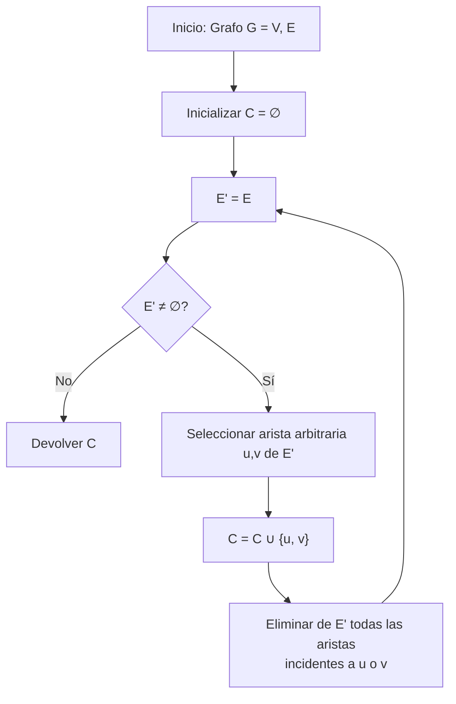

# Análisis de Algoritmos - Temas selectos

## 5.4 Algoritmos de aproximación.

---

Los algoritmos de aproximación son técnicas diseñadas para encontrar soluciones cercanas a la óptima para problemas NP-difíciles en tiempo polinomial. Estos algoritmos garantizan que la solución encontrada esté dentro de un factor conocido de la solución óptima.

### Conceptos Fundamentales

#### Problemas de Optimización

Un problema de optimización consiste en:

- Un conjunto de instancias
- Para cada instancia, un conjunto de soluciones factibles
- Una función objetivo que asigna un valor a cada solución

#### Algoritmo de Aproximación

Un algoritmo $A$ es un algoritmo de $\rho\text{-aproximación}$ para un problema de minimización si:

- $A$ corre en tiempo polinomial
- Para toda instancia $I$, $A(I) \leq \rho \cdot OPT(I)$

Para problemas de maximización:

- $A(I) \geq \rho \cdot OPT(I)$ donde $0 < \rho < 1$

#### Ratio de Aproximación

El ratio de aproximación $\rho$ se define como:

$$\rho = \sup_{I} \frac{A(I)}{OPT(I)} \quad \text{(minimización)}$$

$$\rho = \inf_{I} \frac{A(I)}{OPT(I)} \quad \text{(maximización)}$$

### Técnicas de Diseño

#### Algoritmos Voraces

```python
def greedy_set_cover(universe, subsets):
    """Algoritmo voraz para Set Cover"""
    covered = set()
    selected_subsets = []

    while covered != universe:
        # Encuentra el subset que cubre más elementos no cubiertos
        best_subset = None
        best_coverage = 0

        for subset in subsets:
            new_coverage = len(subset - covered)
            if new_coverage > best_coverage:
                best_subset = subset
                best_coverage = new_coverage

        if best_subset is None:
            break

        covered |= best_subset
        selected_subsets.append(best_subset)
        subsets.remove(best_subset)

    return selected_subsets
```

#### Algoritmos de Redondeo

```python
def rounding_lp_vertex_cover(graph):
    """Algoritmo de redondeo para Vertex Cover usando programación lineal"""
    # Resolver la relajación LP (omitiendo la implementación del solver)
    x = solve_lp_relaxation(graph)

    # Redondear las variables
    vertex_cover = set()
    for v in graph.vertices:
        if x[v] >= 0.5:
            vertex_cover.add(v)

    return vertex_cover
```

### Problemas Clásicos y sus Algoritmos

#### Vertex Cover

**Problema**: Encontrar el conjunto mínimo de vértices que cubra todas las aristas.

**Algoritmo 2-aproximación**:

```python
def vertex_cover_approx(graph):
    """Algoritmo 2-aproximación para Vertex Cover"""
    cover = set()
    edges = graph.edges.copy()

    while edges:
        # Selecciona una arista arbitraria (u, v)
        u, v = edges.pop()
        cover.add(u)
        cover.add(v)

        # Elimina todas las aristas incidentes a u o v
        edges = {(a, b) for a, b in edges if a != u and a != v and b != u and b != v}

    return cover
```

#### Traveling Salesman Problem (TSP)

**Problema métrico TSP**: Dado un grafo completo con pesos que satisfacen la desigualdad triangular.

**Algoritmo 2-aproximación**:

```python
def metric_tsp_approx(graph):
    """Algoritmo 2-aproximación para TSP métrico"""
    # Encontrar un MST
    mst = prim_mst(graph)

    # Realizar un recorrido preorder del MST
    tour = preorder_traversal(mst)

    # Añadir el vértice inicial al final para completar el ciclo
    tour.append(tour[0])

    return tour

def christofides_algorithm(graph):
    """Algoritmo 1.5-aproximación de Christofides para TSP métrico"""
    # 1. Encontrar MST
    mst = prim_mst(graph)

    # 2. Encontrar vértices de grado impar en el MST
    odd_vertices = find_odd_degree_vertices(mst)

    # 3. Encontrar matching perfecto mínimo en el subgrafo inducido
    matching = minimum_weight_perfect_matching(graph, odd_vertices)

    # 4. Combinar MST y matching
    multigraph = combine_mst_and_matching(mst, matching)

    # 5. Encontrar tour euleriano y convertirlo en hamiltoniano
    eulerian_tour = find_eulerian_tour(multigraph)
    hamiltonian_tour = shortcut_eulerian_tour(eulerian_tour)

    return hamiltonian_tour
```

#### Set Cover

**Problema**: Encontrar la colección mínima de subconjuntos que cubra el universo.

**Algoritmo $H_n\text{-aproximación}$** (donde $H_n$ es el n-ésimo número armónico):

```python
def set_cover_approx(universe, subsets):
    """Algoritmo ln(n)-aproximación para Set Cover"""
    covered = set()
    selected_subsets = []
    costs = {subset: 1 for subset in subsets}  # Costo uniforme

    while covered != universe:
        # Encuentra el subset con mejor relación costo/cobertura
        best_subset = None
        best_ratio = float('inf')

        for subset in subsets:
            if subset in selected_subsets:
                continue

            new_elements = subset - covered
            if not new_elements:
                continue

            ratio = costs[subset] / len(new_elements)
            if ratio < best_ratio:
                best_subset = subset
                best_ratio = ratio

        if best_subset is None:
            break

        covered |= best_subset
        selected_subsets.append(best_subset)

    return selected_subsets
```

### Esquemas de Aproximación

#### PTAS (Polynomial-Time Approximation Scheme)

Un PTAS es un algoritmo que para cualquier $\epsilon > 0$ fijo, produce una solución $(1 + \epsilon)\text{-aproximada}$ en tiempo polinomial en el tamaño de entrada.

#### FPTAS (Fully Polynomial-Time Approximation Scheme)

Un FPTAS es un PTAS donde el tiempo de ejecución es polinomial tanto en el tamaño de entrada como en $1/\epsilon$.

```python
def knapsack_fptas(values, weights, capacity, epsilon):
    """FPTAS para el problema de la mochila"""
    n = len(values)
    if n == 0 or capacity == 0:
        return 0

    # Escalar valores
    max_value = max(values)
    scale = epsilon * max_value / n
    scaled_values = [int(v / scale) for v in values]

    # Resolver el problema escalado con programación dinámica
    max_scaled_value = sum(scaled_values)
    dp = [0] * (max_scaled_value + 1)

    for i in range(1, max_scaled_value + 1):
        dp[i] = float('inf')

    for i in range(n):
        for j in range(max_scaled_value, scaled_values[i] - 1, -1):
            if dp[j - scaled_values[i]] + weights[i] < dp[j]:
                dp[j] = dp[j - scaled_values[i]] + weights[i]

    # Encontrar el máximo valor factible
    result = 0
    for j in range(max_scaled_value, -1, -1):
        if dp[j] <= capacity:
            result = j * scale
            break

    return result
```

### Diagrama de Flujo: Algoritmo de Aproximación para Vertex Cover



### Análisis de Competitividad

#### Algoritmos Online

Para algoritmos que toman decisiones sin conocimiento completo de la entrada futura.

**Competitividad**: Un algoritmo online es $c\text{-competitivo}$ si para toda secuencia de entrada:

$$ALG(\sigma) \leq c \cdot OPT(\sigma) + \alpha$$

donde $\alpha$ es una constante.

### Ejercicios Propuestos

1. Demuestre que el algoritmo voraz para Vertex Cover es una 2-aproximación.

2. Implemente el algoritmo de Christofides para TSP métrico y compare su rendimiento con el algoritmo basado en MST.

3. Analice el ratio de aproximación del algoritmo voraz para Set Cover y demuestre que es $H_n$.

4. Diseñe un PTAS para el problema de la mochila y analice su complejidad temporal.

5. Implemente un algoritmo de aproximación para el problema de Maximum Cut y analice su ratio.

6. Estudie el problema de Bin Packing y implemente el algoritmo First-Fit Decreasing, analizando su ratio de aproximación.

### Aplicaciones

1. **Redes de computadoras**: Enrutamiento, diseño de topologías
2. **Bioinformática**: Alineamiento de secuencias, diseño de experimentos
3. **Logística**: Optimización de rutas, planificación de entregas
4. **Scheduling**: Asignación de recursos, planificación de tareas
5. **Aprendizaje automático**: Selección de características, clustering

### Referencias

#### Bibliografía Básica

1. Cormen, T. H., Leiserson, C. E., Rivest, R. L., & Stein, C. (2009). Introduction to Algorithms (3rd ed.). MIT Press. (Capítulo 35)
2. Kleinberg, J., & Tardos, É. (2005). Algorithm Design. Addison Wesley. (Capítulo 11)

#### Bibliografía Complementaria

1. Vazirani, V. V. (2003). Approximation Algorithms. Springer.
2. Williamson, D. P., & Shmoys, D. B. (2011). The Design of Approximation Algorithms. Cambridge University Press.
3. Ausiello, G., Crescenzi, P., Gambosi, G., Kann, V., Marchetti-Spaccamela, A., & Protasi, M. (1999). Complexity and Approximation: Combinatorial Optimization Problems and Their Approximability Properties. Springer.

#### Recursos Adicionales

- Håstad, J. (2001). Some optimal inapproximability results. Journal of the ACM, 48(4), 798-859.
- Arora, S., & Lund, C. (1996). Hardness of approximations. In Approximation Algorithms for NP-Hard Problems (pp. 399-446). PWS Publishing.
