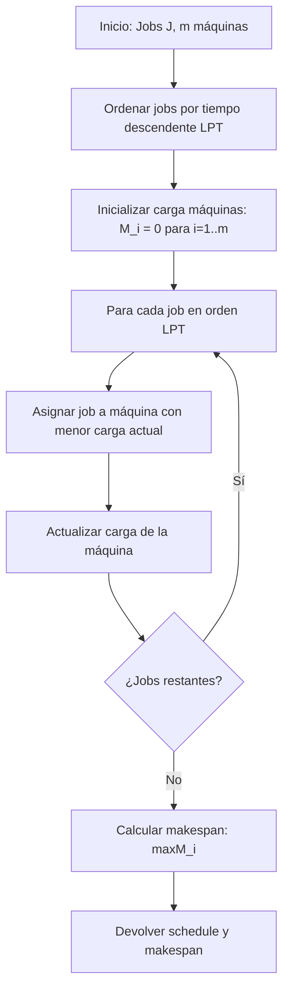

# Análisis de Algoritmos - Temas selectos

## 5.5 Calendarización.

---

La calendarización (scheduling) es un área fundamental en análisis de algoritmos que se ocupa de asignar recursos limitados a tareas a lo largo del tiempo. Los problemas de scheduling surgen en diversos contextos: sistemas operativos, producción industrial, planificación de proyectos y servicios computacionales.

### Conceptos Fundamentales

#### Elementos Básicos

- **Trabajos (Jobs)**: $J = \{J_1, J_2, ..., J_n\}$
- **Máquinas**: $M = \{M_1, M_2, ..., M_m\}$
- **Tiempo de procesamiento**: $p_j$ para cada trabajo $J_j$
- **Tiempo de liberación**: $r_j$ cuando $J_j$ está disponible
- **Fecha de entrega**: $d_j$ plazo para completar $J_j$
- **Peso**: $w_j$ importancia relativa de $J_j$

#### Funciones Objetivo

- **Makespan**: $C_{max} = \max\{C_j\}$ donde $C_j$ es tiempo de completitud
- **Suma de tiempos de completitud**: $\sum C_j$
- **Suma ponderada**: $\sum w_j C_j$
- **Tardanza máxima**: $T_{max} = \max\{0, \max\{C_j - d_j\}\}$
- **Número de trabajos tardíos**: $\sum U_j$ donde $U_j = 1$ si $C_j > d_j$

### Modelos de Scheduling

#### Clasificación por Notación α|β|γ

La notación estándar de tres campos:

- **α**: Entorno de máquinas (1, P, R, Q, O, F, J)
- **β**: Restricciones de jobs (r_j, prec, pmpnt, ...)
- **γ**: Función objetivo (C_max, ∑C_j, ∑w_jC_j, L_max, ...)

### Algoritmos para Scheduling en una Máquina

#### 1| |∑C_j: Algoritmo SPT

Shortest Processing Time First minimiza la suma de tiempos de completitud.

**Algoritmo**:

```python
def spt_scheduling(jobs):
    """Algoritmo SPT para minimizar ∑C_j"""
    # Ordenar jobs por tiempo de procesamiento ascendente
    sorted_jobs = sorted(jobs, key=lambda x: x['processing_time'])

    completion_time = 0
    total_completion = 0

    for job in sorted_jobs:
        completion_time += job['processing_time']
        total_completion += completion_time
        job['completion_time'] = completion_time

    return sorted_jobs, total_completion
```

**Teorema**: SPT es óptimo para 1| |∑C_j

#### 1| |∑w_jC_j: Algoritmo de Smith

Minimiza la suma ponderada de tiempos de completitud.

**Algoritmo**:

```python
def smith_ratio_scheduling(jobs):
    """Algoritmo de Smith para minimizar ∑w_jC_j"""
    # Ordenar por ratio w_j/p_j descendente
    sorted_jobs = sorted(jobs, key=lambda x: x['weight']/x['processing_time'], reverse=True)

    completion_time = 0
    total_weighted_completion = 0

    for job in sorted_jobs:
        completion_time += job['processing_time']
        total_weighted_completion += job['weight'] * completion_time
        job['completion_time'] = completion_time

    return sorted_jobs, total_weighted_completion
```

**Teorema**: El algoritmo de Smith es óptimo para 1| |∑w_jC_j

#### 1|r_j|C_max: Algoritmo de Jackson

```python
def jackson_scheduling(jobs):
    """Algoritmo de Jackson para 1|r_j|C_max"""
    available_jobs = jobs.copy()
    current_time = 0
    schedule = []

    while available_jobs:
        # Encontrar jobs disponibles
        ready_jobs = [j for j in available_jobs if j['release_time'] <= current_time]

        if ready_jobs:
            # Seleccionar job con menor tiempo de procesamiento
            next_job = min(ready_jobs, key=lambda x: x['processing_time'])
            schedule.append(next_job)
            current_time += next_job['processing_time']
            available_jobs.remove(next_job)
        else:
            # Avanzar al próximo tiempo de liberación
            next_release = min(j['release_time'] for j in available_jobs)
            current_time = next_release

    return schedule, current_time
```

### Scheduling en Múltiples Máquunas

#### P| |C_max: Algoritmo de List Scheduling

```python
def list_scheduling(jobs, num_machines):
    """Algoritmo de List Scheduling para P| |C_max"""
    machines = [0] * num_machines  # Tiempo de completitud de cada máquina
    schedule = [[] for _ in range(num_machines)]

    # Ordenar jobs por tiempo de procesamiento (LPT)
    sorted_jobs = sorted(jobs, key=lambda x: x['processing_time'], reverse=True)

    for job in sorted_jobs:
        # Asignar a la máquina con menor carga actual
        min_machine = machines.index(min(machines))
        schedule[min_machine].append(job)
        machines[min_machine] += job['processing_time']

    makespan = max(machines)
    return schedule, makespan
```

**Teorema**: List Scheduling tiene ratio de aproximación $2 - \frac{1}{m}$

#### Algoritmo LPT (Longest Processing Time First)

```python
def lpt_scheduling(jobs, num_machines):
    """Algoritmo LPT para P| |C_max"""
    return list_scheduling(sorted(jobs, key=lambda x: x['processing_time'], reverse=True),
                          num_machines)
```

**Teorema**: LPT tiene ratio de aproximación $\frac{4}{3} - \frac{1}{3m}$

### Scheduling con Precedencias

#### Algoritmo de Coffman-Graham

```python
def coffman_graham(jobs, num_machines, precedence):
    """Algoritmo de Coffman-Graham para P|prec|C_max"""
    # Asignar etiquetas (implementación simplificada)
    labels = assign_labels(jobs, precedence)

    # Ordenar jobs por etiqueta descendente
    sorted_jobs = sorted(jobs, key=lambda x: labels[x['id']], reverse=True)

    return list_scheduling(sorted_jobs, num_machines)
```

### Scheduling con Fechas de Entrega

#### Algoritmo de Hodgson para 1| |∑U_j

```python
def hodgson_algorithm(jobs):
    """Algoritmo de Hodgson para minimizar número de jobs tardíos"""
    # Ordenar por fecha de entrega (EDD)
    sorted_jobs = sorted(jobs, key=lambda x: x['due_date'])

    schedule = []
    rejected = []
    current_time = 0

    for job in sorted_jobs:
        # Intentar programar el job
        potential_completion = current_time + job['processing_time']

        if potential_completion <= job['due_date']:
            schedule.append(job)
            current_time = potential_completion
        else:
            # Verificar si rechazar este job o el más largo programado
            longest_index = -1
            longest_time = -1

            for i, scheduled_job in enumerate(schedule):
                if scheduled_job['processing_time'] > longest_time:
                    longest_time = scheduled_job['processing_time']
                    longest_index = i

            if longest_time > job['processing_time']:
                # Reemplazar el job más largo
                rejected.append(schedule[longest_index])
                schedule[longest_index] = job
                current_time -= longest_time - job['processing_time']
            else:
                rejected.append(job)

    return schedule, rejected
```

### Diagrama de Flujo: Algoritmo de List Scheduling



### Ejemplos Numéricos

#### Ejemplo 1: SPT vs LPT

**Jobs**: [p₁=3, p₂=1, p₃=4, p₄=2]

**SPT**: Orden [J₂, J₄, J₁, J₃]

- C₂=1, C₄=3, C₁=6, C₃=10
- ∑C_j = 1+3+6+10 = 20

**LPT**: Orden [J₃, J₁, J₄, J₂]

- C₃=4, C₁=7, C₄=9, C₂=10
- ∑C_j = 4+7+9+10 = 30

#### Ejemplo 2: List Scheduling

**Jobs**: [p₁=5, p₂=3, p₃=2, p₄=4, p₅=1], **m=2**

**Secuencia**: J₁(M1), J₂(M2), J₃(M2), J₄(M1), J₅(M2)

- M1: 5+4=9, M2: 3+2+1=6
- Makespan = max(9,6)=9

### Ejercicios Propuestos

1. Demuestre que el algoritmo SPT es óptimo para 1| |∑C_j.

2. Implemente el algoritmo de Lawler para 1|prec|f_max y analice su complejidad.

3. Para el problema P| |C_max, demuestre que el ratio de LPT es $\frac{4}{3} - \frac{1}{3m}$.

4. Diseñe un algoritmo para 1|r_j|∑C_j y analice su optimalidad.

5. Estudie el problema de flow shop (F| |C_max) y implemente el algoritmo de Johnson.

6. Analice la complejidad del problema R| |C_max (máquinas no relacionadas).

### Aplicaciones

1. **Sistemas operativos**: Planificación de procesos
2. **Manufactura**: Secuenciación de producción
3. **Proyectos**: Gestión de recursos y cronogramas
4. **Servicios**: Atención a clientes, transporte
5. **Computación distribuida**: Asignación de tareas

### Referencias

#### Bibliografía Básica

1. Cormen, T. H., Leiserson, C. E., Rivest, R. L., & Stein, C. (2009). Introduction to Algorithms (3rd ed.). MIT Press. (Capítulo 16, 35)
2. Kleinberg, J., & Tardos, É. (2005). Algorithm Design. Addison Wesley. (Capítulo 11)

#### Bibliografía Complementaria

1. Pinedo, M. L. (2016). Scheduling: Theory, Algorithms, and Systems. Springer.
2. Brucker, P. (2007). Scheduling Algorithms. Springer.
3. Graham, R. L., Lawler, E. L., Lenstra, J. K., & Rinnooy Kan, A. H. G. (1979). Optimization and approximation in deterministic sequencing and scheduling: a survey. Annals of Discrete Mathematics, 5, 287-326.

#### Recursos Adicionales

- Lawler, E. L. (1973). Optimal sequencing of a single machine subject to precedence constraints. Management Science, 19(5), 544-546.
- Johnson, S. M. (1954). Optimal two- and three-stage production schedules with setup times included. Naval Research Logistics Quarterly, 1(1), 61-68.
- Hodgson, T. J. (1977). A note on single machine sequencing with random processing times. Management Science, 23(10), 1144-1146.
